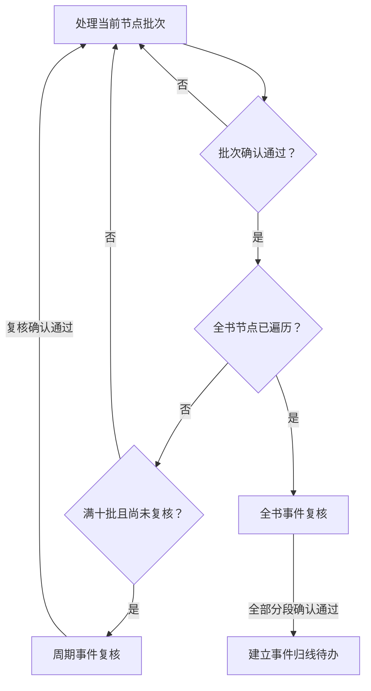
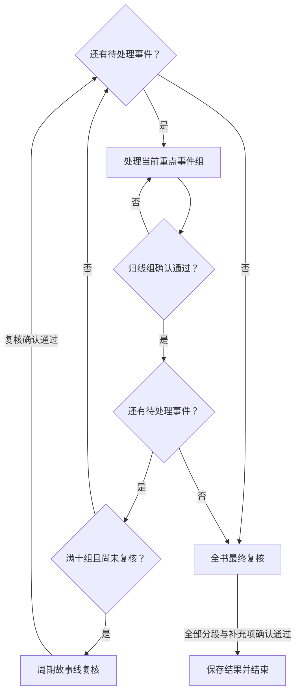

# P3 叙事大纲重建 Agent 设计方案

**项目**：WestWorld / 小说叙事资产整理  
**阶段**：P3 · 叙事大纲重建  
**版本**：V4 修订版（2026-11-22，本轮业务规则确认）  
**核心流程**：节点整理为事件 → 全书事件复核 → 事件整理为故事线 → 全书最终复核。两个整理阶段各自穿插周期复核。  
**执行主体**：同一个 Agent 按任务模式运行，不另设后续独立复核 Agent。

## 0. 本轮确认的规则

本版沿用 V4 的两阶段处理顺序，并根据本轮确认重写事件边界、故事线关系、任务工具集合和复核流程。

| 项目       | 当前规则                                                               |
| -------- | ------------------------------------------------------------------ |
| 事件尺度     | 一幕：围绕当前主体人物与当前地点、场景展开；叙事转到另一组主体人物或发生转场时，开始下一事件                     |
| 明确示例     | “皇帝召见并授职”“主角回家告别”“主角调集出征军队”分别建立事件                                  |
| 故事线尺度    | “翠云山剿匪”这样的完整剧情篇章；故事线可以前后接续或交织，不要求贯穿全书                              |
| 层级       | 保持“故事线—事件—节点”三层，不增加主线／子线层                                          |
| 节点—事件    | 保留多对多；一个 P1 节点跨越多幕时可被多个事件引用                                        |
| 事件—故事线   | 新增明确的多对多要求；同一幕可以同时推进多个篇章故事                                         |
| 第一阶段     | 每批 20 个节点，先整理事件；不建立故事线，不因事件未归线自动生成疑点                               |
| 第一阶段周期复核 | 每 10 个节点批次，复核最近 2 批涉及及实际修改的事件；检查重复、重叠、边界、错分、漏放和混入节点，同时检查全部 OPEN 疑点 |
| 阶段间复核    | 全书节点遍历结束后，执行全书事件复核，利用全书信息逐项收尾疑点，完成后才进入归线                           |
| 第二阶段     | 每次下发一组重点事件，始终提供全书事件目录；允许一并处理其他组的相关事件，按实际事件 ID 更新进度                 |
| 第二阶段周期复核 | 按“与第一阶段类似”落实为每 10 个已确认事件组，复核最近 2 组涉及及实际修改的故事线，同时检查全部 OPEN 疑点       |
| 全书最终复核   | 两个整理阶段完成后，收尾全部疑点，逐条检查全部孤立节点；重点读取 P1 已有伏笔、线索、事实等字段                  |
| Agent 数量 | 不另设独立复核 Agent，整理与复核均为同一 Agent 的不同任务                                |
| 工具提供     | 按任务开放相应工具；事件任务使用事件工具包，大纲任务增加故事线工具；同一任务内保持定义稳定                      |

“人物切换”按叙事转到另一组主体人物、形成另一幕理解。同一幕内皇帝和主角轮流说话，仍属于同一事件。实际转场以叙述内容为准，提到远处的人物或地点不等于已经转场。

本轮的场景规则优先于早期宽泛的“按共同主题归组”例子：同一主题出现在不同场景，应分别建事件，再由故事线组织。场景 A → 场景 B → 回到 A，按三幕处理；回到原地点不自动与上一幕合并。

### 0.1 继续沿用的运行规则

- 事件、故事线允许暂定，后续可改名、合并、拆分和调整成员。
- 使用 P1、P2 已有字段与资产，不新增“关键联系”“组织依据”等必填语义字段。
- 完整目录不超过 2000 字时展开节点层；超过时收起节点层，仍提供全部事件及当前阶段的全部故事线。
- 当前批次材料独立注入，不按最近 100 个节点裁剪历史事件目录。
- 每个整理批次、复核任务和复核分段分别重新组装上下文，不继承上一任务聊天或占位记录。
- 同一任务内继续采用 x=2 的持续滚动占位；每个旧轮次只转换一次，System Prompt 保持完整。
- 第一阶段逐批处理期间不预读未来节点；完成全书遍历后，整体复核及第二阶段可查全书。
- 处理状态与归属状态分开记录。已有独立保留结论的孤立节点，也必须参加最终复核。

第二阶段每组事件数量尚未指定，作为独立的正整数运行参数配置，不沿用“全书只有一个归线任务”的默认，也不把它与 20 节点批次绑定。

## 1. 执行流程与职责

### 1.1 输入与产出

输入是 P1 已抽取的叙事节点，以及 P2 整理后的相关人物、地点资产。节点已有 ID、名称、概况、经过、人物、地点、线索、事实以及与伏笔有关的字段，按现有数据库字段名映射使用。

产出包括故事线、事件、两层多对多关联、疑点及复核结果。原始节点与事件各保存一份；同一对象可以在多个父级目录中被引用。

“重建大纲”指根据成书内容整理可继续使用的剧情结构，不表示恢复作者曾经写过的唯一原始文档。

### 1.2 六种任务模式

| 任务模式 | 类型示例 | 工作目标 |
|---|---|---|
| 节点整理为事件 | `node_batch` | 处理当前节点，按人物与场景划分、续接事件 |
| 周期事件复核 | `event_review` | 检查最近两批相关事件及全部 OPEN 疑点 |
| 全书事件复核 | `event_global_review` | 全书节点已读完，逐项收尾事件层疑点，修正涉及事件 |
| 事件整理为故事线 | `storyline_group` | 处理重点事件组，并可一并归类全书相关事件 |
| 周期故事线复核 | `storyline_review` | 检查最近两组相关故事线及全部 OPEN 疑点 |
| 全书最终复核 | `book_review` | 收尾疑点，逐条审查全部孤立节点及本轮修订影响范围 |

仍然只有两个整理阶段。全书事件复核是阶段之间的必经任务；全书最终复核是整个流程结束前的必经任务。两个任务都可分段执行，不等于一次 API 请求。

### 1.3 分工

| 承担方 | 职责 |
|---|---|
| Agent | 判断场景边界与归属、组织故事线、查阅 P1 字段、复核伏笔与疑点、保存修订、提交处理结论 |
| 后台程序 | 管理待办清单、提供当前任务及工具包、执行关联修改、记录复核覆盖、调度下一任务、组装上下文与滚动占位 |

程序核验任务覆盖、对象存在与关联一致性；小说内容是否构成同一幕、同一故事或伏笔，由 Agent 根据材料判断。没有另一个独立复核 Agent 接手收尾。

## 2. 数据关系与任务记录

### 2.1 三层对象、两层多对多

| 对象或关系 | 保存内容与规则 |
|---|---|
| `node` 节点 | P1 原始记录，只存一份，不因归属复制 |
| `event` 事件 | 一幕的名称、概况、已有章节等字段；第一阶段可以没有故事线 |
| `storyline` 故事线 | 一个完整剧情篇章的名称、概况与已有范围字段 |
| `event_node` 事件—节点 | 每对事件 ID 与节点 ID 一条关联，允许同一节点引用于多个事件 |
| `storyline_event` 故事线—事件 | 每对故事线 ID 与事件 ID 一条关联，允许同一事件进入多条故事线 |

关系表名称按现有实现映射。若旧表用单个 `event_id` 或 `storyline_id` 代表全部归属，应迁移为关联集合或关系表；单个父级字段不能继续限制归属数量。分别对两种 ID 组合去重，不对单个子对象 ID 加唯一归属约束。

已归属节点指至少有一个有效事件关联；已归线事件指至少有一个有效故事线关联。是否还应有其他关联，仍是 Agent 及复核的内容判断问题。

### 2.2 场景、节点共享与故事线交叉

一幕审问同时查出内奸、揭示父亲旧案，应优先保留一个“营帐审问内奸”事件，再关联到“翠云山剿匪”和“追查父亲冤案”两条故事线。不能仅因同幕包含两个主题，就拆成两个内容重复的事件。

节点多事件能力继续保留。例如 P1 的一条节点同时写了“在宫中告退”和“回家开始告别”，它实际跨越两幕，可以分别引用到两个事件；各事件概况只描述本幕发生的内容。无需为多重引用复制或重写 P1 节点。

事件、节点在多个目录位置出现，不直接等于重复数据。复核应判断是否是合理引用，不能只按成员交集判定应合并。

### 2.3 已处理、已归属与已复核分别记录

| 节点状态 | 当前节点任务能否完成 |
|---|---|
| 已有有效事件关联 | 可以 |
| 尚不能确定归属，已有对应 OPEN 节点归属疑点 | 可以 |
| 已检查并明确独立保留，有任务处理说明 | 可以 |
| 无关联、无疑点、无独立保留说明 | 不可以，返回漏项 |

“孤立节点”与此前“零散节点”指同一集合：当前没有有效事件关联的已处理节点，由后台查询生成，不另建一份业务数据表。

前期检查并独立保留，不代表最终复核已经完成。全书最终复核必须重新覆盖当时所有孤立节点，包含没有疑点、曾被当作日常或过渡片段保留的节点。

### 2.4 长任务记录

| 记录 | 用途 |
|---|---|
| `job` | 本书执行、当前整理阶段、当前任务模式及检查点 |
| `node_task`、`node_batch` | 每个节点的处理结果、20 节点批次范围与确认状态 |
| `event_task`、`storyline_group` | 每个事件的归线处理结果、重点事件组及实际处理事件 ID |
| `review_task`、`review_item` | 复核范围、分段进度、每项复核结论及待补充对象 |
| `operation_log` | 实际修改、影响范围、完整工具结果与确认记录 |
| `doubt` | 分类疑点及解决状态 |

复核任务中的“已经检查”与疑点表中的“已经解决”分开。没有新结论的疑点不反复改写原描述，复核覆盖记录保存于任务表。

### 2.5 动态维护任务范围

- 第二阶段开始时，为全部存续事件建立待处理项；每次下发一组重点事件。
- 模型可以同时处理组外事件。确认时提交实际已处理 ID，后台按这些 ID 更新进度，后续不机械重复下发。
- 新建、拆分产生的新事件加入待处理范围；合并、删除后失效的事件任务撤销。
- 实质改变事件成员或归属依据时，重新检查其归线；所有受影响故事线进入相关复核范围。
- 删除某条故事线关联，只影响这一条关系。事件仍有其他有效归线时，不能自动改成“未归线”。
- 未归线事件如果原先依靠 OPEN 归属疑点完成，后来该疑点失效，且仍没有任何有效故事线关联，需重新处理。
- 复核中完成的事件回修、归线及疑点修订，可在本次确认中覆盖；未处理完的新对象继续留在当前复核待办，不重启整轮前置阶段。
- 复核中新产生的孤立节点加入本次待办；已经检查后又被实质修改的对象，按其当前状态重新确认。

进度按唯一节点 ID、唯一事件 ID 分别统计。关系数量可以大于对象数量，不使用关系条数代替任务完成数。

## 3. 疑点与收尾结论

### 3.1 分类

| 分类 | 适用问题 |
|---|---|
| `NODE_ASSIGNMENT` 节点归属 | 不清楚所属场景事件、疑似伏笔尚无合理归属、可能涉及多个事件 |
| `EVENT_ASSIGNMENT` 事件归属 | 第二阶段或其后复核中，实际检查后仍不能确定所属故事线或额外归线 |
| `OTHER` 其他 | 场景边界、重复事件、故事线重叠、概况失真或其他内容疑问 |

第一阶段尚未归线是正常中间状态，不因此建立 `EVENT_ASSIGNMENT`。第二阶段尚未轮到处理的事件，也不自动生成疑点。

### 3.2 疑点字段

沿用 `id`、`category`、`targets`、`description`、`status`、`resolution` 及自动维护的任务、时间信息。目标可引用多个节点、事件或故事线。

新建默认 OPEN；有依据解决后改为 RESOLVED。已解决项不再自动注入，必要时仍可查询或重新打开。不新增“关键联系”字段，也不另建一套伏笔识别模型或伏笔资产表。

### 3.3 日常处理规则

1. 同一问题沿用原记录，不反复创建。
2. 普通批次、周期复核没有新信息时，保留 OPEN，不为了表示看过而修改疑点正文。
3. 归属能够确定时，先保存实际关联，再更新疑点为已解决。
4. 确认节点应独立保留或原疑点误设时，可写明结论后关闭；若节点仍无关联且没有其他 OPEN 归属疑点，要通过当前确认保存独立保留结果。
5. 节点已有一个事件、事件已有一条故事线，不自动关闭关于它的其他归属疑点。
6. 归属确定不等于伏笔已经在小说中回收；不同问题分别记录。

### 3.4 两次整体复核的收尾要求

全书事件复核和全书最终复核都以解决疑点为目标，必须逐项查看全部 OPEN 问题并给出本次处理结论，不能只浏览列表后整体打勾。

| 本次结论 | 操作 |
|---|---|
| 已能确认归属或修正结构 | 先落库，再关闭相应疑点 |
| 确认无需归组，或问题本身误设 | 写明结论，保存必要的独立保留结果，再关闭 |
| 查阅后仍缺乏足够依据 | 继续保留 OPEN，在本次复核结果中说明已查对象和无法确认的原因 |

收尾任务完成要求每项都被实际复核、已有结论可查、所有能够确定的修订已保存。确实没有依据的事项作为明确遗留项报告，不通过强行归属或直接清零制造“已解决”。第一阶段收尾后，相关未决事项继续进入第二阶段；最终收尾仍未确定的事项保存在同一任务结果中，不交给另一个独立 Agent。

## 4. 按任务提供工具

底层读写能力复用，面向模型的工具集合按当前任务开放。同一任务内部保持定义稳定；切换任务时可以选择另一工具包。原来的统一 `edit_outline` 可作为内部实现复用，对模型区分事件编辑与故事线编辑两个入口。

### 4.1 工具集合

| 工具 | 节点批次／周期事件复核／全书事件复核 | 事件归线／周期故事线复核／全书最终复核 |
|---|---|---|
| `edit_events` 修改事件及节点关系 | 开放 | 开放，允许回修事件和处理孤立节点 |
| `edit_storylines` 修改故事线及事件关系 | 不提供 | 开放 |
| `get_detail` 读取已有字段 | 节点、事件 | 节点、事件、故事线 |
| `get_outline` 读取目录 | 事件成员、孤立节点集合 | 增加故事线成员及未归线事件集合 |
| `manage_doubts` 管理疑点 | 节点归属、其他 | 全部分类 |
| `confirm` 确认当前任务 | 当前事件层任务 | 当前大纲层任务 |

第一阶段有五个可用工具，第二阶段及最终复核增加故事线编辑工具。查询工具的对象范围和疑点分类也随任务裁剪，不向第一阶段展示不可执行的故事线写入操作。

整理与复核可以共享同一编辑工具，但起始材料、检查目标和完成条件分别定义。复核可以直接修正，不限制为只读。

### 4.2 事件编辑：`edit_events`

支持创建、修改、删除、合并、拆分事件；添加、移除、迁移事件—节点关系。第一阶段从当前节点创建场景事件，默认不附带故事线归属。

```json
{
  "operations": [
    {
      "type": "create_event",
      "temp_id": "e1",
      "title": "宫殿中皇帝召见并授职",
      "summary": "皇帝在宫殿召见主角，交代任务、授予职务并安排护卫。",
      "status": "provisional"
    },
    {"type": "attach_node", "event_ref": "e1", "node_id": "N001", "position": 1},
    {"type": "attach_node", "event_ref": "e1", "node_id": "N002", "position": 2},
    {"type": "attach_node", "event_ref": "e1", "node_id": "N003", "position": 3}
  ]
}
```

工具返回真实事件 ID 后使用真实 ID。临时引用只在一次提交内有效。多个操作按顺序校验后整体保存或整体失败。

事件关系的修改语义：

- `attach_node` 增加指定关系，不移除节点的其他事件关联。
- 移除关联必须同时指定事件与节点。将节点从 A 移到 B，保留它与 C 的关系。
- 合并事件时成员按节点 ID 去重，保留原文顺序信息；只有符合本版同一幕标准的重复或误拆结构才应合并。
- 拆分事件时允许一个跨幕节点进入多个结果事件。各结果事件只描述对应场景。
- 删除事件不删除 P1 节点；仅移除该事件相关关系。失去最后一个有效事件关系的节点成为孤立节点，进入当前任务的补充处理范围。
- 第二阶段合并或拆分事件时，已有故事线关系需要按结果内容重新核对。可保留候选关联供检查，不能复制全部旧关系就算已经确认。

事件成员发生实质变化时，Agent 同步判断名称、概况是否仍准确，必要时更新已有字段。涉及章节、成员数量等由程序根据真实关联计算。工具回执提供实际影响对象、新事件及新孤立节点，供任务更新和复核定位。

### 4.3 故事线编辑：`edit_storylines`

只在第二阶段及其复核中提供。支持创建、修改、删除、合并、拆分故事线，以及添加、移除、迁移故事线—事件关系。

```json
{
  "operations": [
    {
      "type": "create_storyline",
      "temp_id": "s1",
      "title": "翠云山剿匪",
      "summary": "主角受命出征翠云山，在行动中查明营中内奸，完成任务后返京复命。",
      "status": "provisional"
    },
    {
      "type": "create_storyline",
      "temp_id": "s2",
      "title": "追查父亲当年的冤案",
      "summary": "主角在相关人物的供述中发现旧案线索，逐步追查父亲受冤的经过。",
      "status": "provisional"
    },
    {"type": "attach_event", "storyline_ref": "s1", "event_id": "E005"},
    {"type": "attach_event", "storyline_ref": "s2", "event_id": "E005"}
  ]
}
```

示例中的 E005 是同一个“营帐审问内奸”事件，同时进入两条故事线，事件不复制。

- 添加故事线关联不解除事件的其他故事线关系。
- 移除关系必须指定故事线 ID 和事件 ID。从 S1 移到 S2 时保留 S3 的关联。
- 删除故事线只删除该线及其关联，保留事件；事件没有任何剩余故事线关系时才算未归线。
- 合并故事线的成员去重；拆分时允许同一事件进入多条结果故事线，并依据实际内容重新确认。
- 仅共享事件不构成故事线重复。判断重复应看是否把同一完整故事过程反复建立成不同对象。
- 故事线成员变化后，必要时更新名称、概况；涉及章节和首次出现顺序由已有成员来源计算。

两层编辑工具修改的是同一套底表和关系集合。最终复核既能使用事件工具，也能使用故事线工具，完成“孤立节点 → 场景事件 → 故事线”的完整修复。

### 4.4 统一字段读取：`get_detail`

支持单个对象，也支持一次提交多个对象及各自所需字段。字段名按实际数据表映射，不自动生成额外语义字段。

```json
{
  "queries": [
    {"entity_type": "node", "id": "N038", "fields": ["summary", "characters", "locations", "facts", "clues"]},
    {"entity_type": "event", "id": "E005", "fields": ["summary", "chapters"]}
  ]
}
```

P1 如果使用其他字段名称，按其真实名称替换示例；P1 已有与伏笔有关的字段应列入可读字段清单。最终孤立节点审查应主动读取这些现有内容，不只读取标题。

- `fields: ["*"]` 表示对象全部已有可读业务字段。
- 对象字段查询不自动递归展开所有子对象正文；成员目录使用 `get_outline`。
- 结果按对象 ID 和字段对应返回。长字段分段时明确剩余范围，不将截断内容当作完整结果。
- 当前人物、地点字段缺失或只能表示被提及对象时，结合概况、详细经过判断真实转场，不能用数组变化直接自动切事件。
- 第一阶段普通批次和期间复核限于当前批次及已处理节点；全书节点遍历完成后，整体事件复核、归线及其复核可访问全书。

### 4.5 目录读取：`get_outline`

只返回成员 ID、名称、层级、顺序及分页信息，不返回完整经过，也不添加自动推测的关联理由。

```json
{"entity_type": "event", "id": "E005", "depth": 1}
```

```json
{"entity_type": "storyline", "id": "S001", "depth": 2}
```

```json
{"entity_type": "unassigned_nodes", "depth": 1}
```

| 查询范围 | 返回内容 |
|---|---|
| 事件，depth=1 | 事件内节点 ID、名称与顺序 |
| 故事线，depth=1 | 该线的事件 ID、名称与顺序 |
| 故事线，depth=2 | 该线事件及事件内节点目录 |
| `unassigned_nodes` | 已处理且当前没有有效事件关系的节点 |
| `unassigned_events` | 当前没有任何有效故事线关系的事件，第二阶段提供 |

两个未归属范围都是数据库查询结果，不新增虚构“零散事件”或“待分类故事线”。第一阶段未处理的未来节点不包含在孤立集合中。

目录可分页，明确总量和后续范围。同一事件或节点被不同父级引用时，显示同一 ID。按需查询分页不改变任务起始输入中全量上层目录的约定。

### 4.6 疑点管理：`manage_doubts`

支持创建、查询、更新、解决、重新打开；重复或误设的记录可合并、删除。第一阶段只提供节点归属和其他分类，第二阶段增加事件归属分类。

```json
{
  "action": "create",
  "category": "NODE_ASSIGNMENT",
  "targets": [{"type": "node", "id": "N038"}],
  "description": "该片段提及一封密信，P1 线索字段提示可能是伏笔，目前尚不能确定所属场景事件。"
}
```

```json
{
  "action": "resolve",
  "id": "D007",
  "resolution": "已核对 P1 内容，补入原场景事件 E012，并保存相应故事线关系。"
}
```

默认查询 OPEN，已解决项可按 ID 或筛选读取。关系变更先保存再解决疑点；无法解决时保持疑点业务记录不变，本次已查内容与原因写入复核结果。

### 4.7 当前任务确认：`confirm`

当前 job、阶段、任务类型、任务 ID 和本次范围由后台绑定，模型确认当前任务，不自行选择下一阶段。工具回执包含确认的真实任务和下一步安排。

节点批次示例：

```json
{
  "retained_unassigned_nodes": [
    {"node_id": "N060", "note": "已检查，独立背景片段，当前不单设场景事件；最终复核仍需覆盖。"}
  ],
  "summary": "当前节点批次已处理，场景事件及节点关系已保存，未确定事项已登记。"
}
```

归线组示例：

```json
{
  "handled_event_ids": ["E001", "E002", "E005", "E048"],
  "summary": "当前重点事件及组外相关事件 E048 已完成本次归线判断，关联与疑点已保存。"
}
```

后台校验当前重点事件中的存续对象都已覆盖，再将实际处理的组外事件同步标记完成。事件被操作过不直接等于已经判断完；未完成判断的受影响对象仍然待处理。

复核结论示例：

```json
{
  "review_results": [
    {"target_type": "doubt", "target_id": "D007", "outcome": "resolved", "note": "原场景与后续关联已核对，修订和疑点状态已保存。"},
    {"target_type": "node", "target_id": "N060", "outcome": "independent", "note": "已读取 P1 概况、事实和线索字段，判断为独立背景片段，保留无事件归属。"},
    {"target_type": "doubt", "target_id": "D011", "outcome": "retained_open", "note": "已查 N081、E020 的现有字段，仍不能确认密信对象，保留疑点。"}
  ],
  "summary": "本复核分段已逐项检查。"
}
```

`review_results` 保存到复核任务记录，不给 P1 资产新增判断字段。结论可使用 `repaired`、`no_change`、`resolved`、`independent`、`retained_open` 等枚举，并按对象类型校验。`independent` 结论可以同时作为本节点的明确保留说明，无需重复填写两份。

| 任务类型 | 确认条件 |
|---|---|
| 节点批次 | 本批节点有有效事件关系、对应 OPEN 节点归属疑点或明确独立保留结果；修改已保存 |
| 周期事件复核 | 指定事件、成员及本次 OPEN 疑点范围已检查；修改与复核结果已保存 |
| 全书事件复核 | 全书事件目录已检查，全部疑点及其修订影响范围有本次结论；合并的周期检查也已覆盖 |
| 归线事件组 | 当前重点存续事件已处理；实际声明完成的事件有有效故事线关联或对应 OPEN 事件归属疑点 |
| 周期故事线复核 | 指定故事线、成员事件及本次 OPEN 疑点范围已检查；跨组影响对象未遗漏 |
| 全书最终复核 | 全部 OPEN 疑点、全部孤立节点及新增影响对象有结论；所有能够确定的结构修订已落库 |

范围较大时，整体复核拆成多个带明确目标清单的任务分段。每次 `confirm` 只完成当前分段；全部分段和动态补充项完成后，整体复核才通过。每段可以多轮调用工具。

确认失败继续当前任务上下文；确认成功保存检查点并结束当前上下文，下一任务重新组装。重复确认不重复推进。OPEN 是否为零不作为复核循环的唯一结束条件。

## 5. 第一阶段：按人物与场景把节点整理为事件

### 5.1 事件按“一幕”划分

一幕围绕当前主体人物、地点与场景中的连续经过展开。叙事转向另一组主体人物的独立经历，或明确转入其他场景时，新建下一事件。

| 节点内容 | 事件划分 |
|---|---|
| 宫殿中召见、授职、安排护卫 | 一个“皇帝召见并授职”事件 |
| 之后回家告别亲人 | 新建“主角回家告别”事件 |
| 之后到军营调集出征军队 | 新建“主角调集出征军队”事件 |
| 皇帝说话后主角回答 | 同一幕，继续当前事件 |
| 叙事切到另一处人物的密谈 | 新建密谈事件 |
| 从宫殿切到王府，再切回宫殿 | 按三个场景段落处理，不仅因回到原地点而自动并回 |
| 同一幕恰好跨章节或批次 | 续接同一事件，章节／批次边界不代替场景边界 |

人物、地点字段用于帮助判断；由 Agent 结合概况和实际经过识别转场。新增一个说话人、同幕有人走进房间，或同一地点使用另一名称，不应由程序仅凭字段数组变化自动拆分。

同一人物在同一地点，经过明确时间跳跃后重新展开的一幕，也应重新判断事件边界。只有编号不连续、但实际仍属同一幕时，才可以把这些不连续编号的节点放在同一事件；真实转场后的两幕分别保留。

一个节点本身已经构成清晰的一幕时，可以独立建立事件，没有最低节点数量。事件暂不知道属于哪条故事线，不妨碍它在第一阶段成立。

### 5.2 初始材料

默认每批 20 个节点，提供以下 P1 已有信息：

- 节点 ID、名称、概况。
- 涉及人物与地点的已有 ID、名称。
- 原始章节与章内顺序。

这些都是已有字段，不新增“主要人物”“组织依据”等必填语义字段。人物或地点缺失时按需查详细经过，不把缺失值当成发生了转场。

同时提供全部已建事件目录、孤立节点入口和全部 OPEN 疑点。当前批次材料与目录分别注入，目录收起节点层也不影响当前节点信息。

### 5.3 每批处理顺序

1. 通读本批节点，识别人物、地点及叙事是否发生场景切换。
2. 对照已有事件，判断本批开头是否仍续接上一批的一幕，是否存在误拆或重复结构。
3. 按场景建立或续接事件，保存节点关系；一个 P1 节点跨幕时可引用到多个事件。
4. 对信息不足的节点或边界问题，按需查详情；仍不能判断则记录疑点。
5. 对确实应独立保留的片段，记录保留结果。发现旧疑点已能解决时，及时修订。
6. 检查事件名称、概况是否准确描述当前成员，必要时更新已有字段。
7. 调用 `confirm`；后台校验节点覆盖与实际结果后，推进批次或复核任务。

已明确出征任务时也仍先整理场景事件。“临行前准备”可能概括多个场景，不能因此把宫殿、家中、军营三个事件合成一个。第一阶段不建立故事线。

### 5.4 节点遍历后的安排

所有节点批次确认，只表示全书已完成一轮事件整理。后台随后进入全书事件复核，利用已经读完的全书材料收尾疑点，必要时修改事件。

全书事件复核完成后，再根据最新存续事件建立第二阶段待处理清单；不提前冻结一份可能已在整体复核中变化的事件列表。

## 6. 第二阶段：按事件组组织篇章故事线

### 6.1 故事线的尺度

故事线表示“翠云山剿匪”这样的完整剧情过程，包含受命、出发、遇到问题、应对与结果等实际发生的相关事件。具体内容由原作决定，不要求套固定情节模板。

故事线可以先后出现，也可以交织展开，不要求贯穿全书。同层保持完整故事过程的尺度，不新增“主线—篇章—事件—节点”的第四层。

事件参与多条故事线时，分别建立关联。例如同一幕“营帐审问内奸”既推动剿匪进展，也揭开父亲旧案，可以在两条故事线中引用。

故事线与事件的默认目录顺序依据成员在原文中的首次出现位置；相关章节范围由成员来源归集。先后顺序不自动生成父子故事线关系，也不限制故事线章节范围发生交织。

### 6.2 重点事件组与全书视野

后台维护全部存续事件的待处理清单，每次下发一组重点事件，不再默认全书由一个归线任务处理。

每组输入包括：

- `focus_event_ids`：当前组必须处理的事件及已有概况等简要信息。
- 全书全部事件目录，包括未归线事件。
- 已建全部故事线及事件目录。
- 孤立节点查询入口。
- 全部 OPEN 疑点。

事件组大小是独立正整数配置，本轮没有指定具体数量。它不与第一阶段 20 节点绑定，也不限制模型查看或处理组外事件。

### 6.3 允许跨组处理

模型整理“翠云山剿匪”时，可能发现 E048 与当前重点组中的 E001、E005 属于同一故事线。它可以同时处理 E048，不需要等到某个按编号排好的后续组。

确认时提交 `handled_event_ids`，后台分别记录：

1. 当前组实际完成判断的事件。
2. 同时完成的组外事件。
3. 本组实际修改、但尚未完成判断的受影响对象。

下一组从实时待处理清单生成，跳过已经确认的组外事件。组号按实际执行并确认的组计数，不把多处理一个事件当成多完成一个组。

### 6.4 查看与归线顺序

1. 先浏览全书目录，再分析当前重点事件及其候选故事过程。
2. 信息明确时直接创建或复用故事线；不明确时查询事件概况、章节、成员目录和必要节点字段。
3. 保存一个或多个故事线关联，不因为已有一个归属就忽略合理的交叉故事。
4. 发现事件场景边界错误时，使用事件编辑工具修正；按修订结果处理相关归线。
5. 检查 OPEN 疑点是否因全书信息变得可解，并保存结论。
6. 当前重点事件全部完成判断后调用 `confirm`，按实际事件 ID 更新进度。

“受命”“遇袭”“受封”等标题可能在书中反复出现，目录信息不足时应查询内容，不仅凭标题归组。继续使用现有字段，无需新增关键联系字段。

### 6.5 多重归线示例

| 场景事件 | 可参与的故事线示例 |
|---|---|
| 宫殿中皇帝召见并授职 | 翠云山剿匪 |
| 主角在家中告别亲人 | 翠云山剿匪；其他关联需要原文依据 |
| 军营中调集出征军队 | 翠云山剿匪 |
| 翠云山下安营并部署行动 | 翠云山剿匪 |
| 营帐中审问内奸，供述同时揭示父亲旧案 | 翠云山剿匪、追查父亲当年的冤案 |
| 返京后在殿中复命受封 | 翠云山剿匪 |

这是层级关系示例，不表示每本书必须有这些事件，也不要求为两个主题重复创建同一幕。

### 6.6 周期复核与阶段结束

每完成 10 个事件组，进入周期故事线复核，检查最近两组实际处理或修改的事件涉及的故事线，以及全部 OPEN 疑点。未完成该次复核前，不下发下一组。

如果事件在其他组中提前完成，周期范围仍依据实际处理记录确定。共享事件关联的多条故事线、迁移的来源与目标故事线都应纳入影响范围。

归线待办清空后，进入全书最终复核，不能直接结束整个 Agent。即使第二阶段开始时没有任何事件，也执行最终复核；最终复核中新形成事件时，可以在当前任务中补建故事线并完成关联。

## 7. 目录与各任务的起始材料

### 7.1 两千字只控制节点层

| 当前阶段 | 完整目录不超过 2000 字 | 超过 2000 字 |
|---|---|---|
| 事件整理及事件复核 | 全部事件及节点 ID、名称；已处理孤立节点单列 | 全部事件 ID、名称；孤立节点数量与查询入口 |
| 故事线整理及其复核 | 全部故事线、全部事件及节点目录；未归线事件与孤立节点单列 | 全部故事线、全部事件及其关联；未归线事件单列；孤立节点入口 |

按统一渲染后的字符数计长，不等同于 token 数。共享对象在不同父级出现时使用同一 ID；显示长度按实际文本计算，进度按对象 ID 去重。

上层目录本身超过两千字时仍完整提供。不能删掉早期事件，也不退回最近 100 节点窗口。完整输入确实超出模型容量时，保存进度并明确处理容量问题，不能静默裁剪必要目录。

### 7.2 当前任务材料

| 任务 | 在全量目录与 OPEN 疑点之外提供的材料 |
|---|---|
| 节点批次 | 当前节点 ID、名称、概况、已有涉及人物与地点、原文章节及顺序 |
| 周期事件复核 | 最近两批节点摘要、当前关系、实际影响事件及需检查的成员范围 |
| 全书事件复核 | 当前疑点复核段、全书事件目录扫描要求、涉及的事件与节点信息 |
| 归线事件组 | 当前重点事件 ID、名称、已有概况、当前多重归线情况 |
| 周期故事线复核 | 最近两组实际处理事件及影响故事线、成员目录、当前疑点范围 |
| 全书最终复核 | 当前疑点和孤立节点复核段、P1 可用字段清单、修订影响对象 |

当前任务材料不随目录节点层折叠。全书复核在材料很多时拆段下发，每一段仍能看到完整上层目录并按需查询其他对象。

### 7.3 未解决疑点与孤立集合

每个新任务提供最新 OPEN 疑点的 ID、分类、目标和描述。通常完整提供；过长时通过明确的分页或复核分段覆盖全部，不能把遗漏部分视为已处理。

孤立集合来源于真实关系查询。全书最终复核建立覆盖清单时，包含全部当前孤立节点，不能仅取疑点表中出现的节点。

复核开始时保存待检查 ID 范围，处理过程按实际关系更新，采用稳定游标或明确的待办清单。疑点被解决、节点获得关联后，记录其结果；不能因实时列表缩短而跨过尚未检查项。修订中新产生的孤立节点和真实疑点追加待办。

### 7.4 同一任务内的快照

任务起始目录、节点／事件材料和疑点快照保持稳定。后续变更通过工具回执或重新查询体现；下一任务重新读取最新状态。

人物、地点、任务编号等动态材料放在任务输入中，不嵌入固定 System Prompt。当前工具包在任务启动时选择，任务内部不反复更换。

## 8. 两类周期复核与两次整体复核

### 8.1 第一阶段周期事件复核

每完成 10 个节点批次触发。结构范围取最近 2 批实际涉及及修改的事件；疑点范围为全部 OPEN 问题，早期疑点可查询已处理的历史内容。

必须检查：

1. 目标批次的事件串联是否合理，是否重复建立同一幕。
2. 事件是否存在不合理重叠、错分，人物与场景边界是否正确。
3. 是否把已经明确转场的不同幕合在一起，或把同一幕误拆。
4. 事件里的节点是否放错、漏放，是否混入本不属于该幕的节点。
5. 多重引用是否有内容依据，不能只因共享节点就认定事件重复。
6. 名称、概况是否仍准确描述成员，未解决疑点现在是否能够解决。

发生移动、拆分或合并时，包含原对象、目标对象和结果对象；不能只看修改后的最终目录。当前范围内孤立节点也需检查。与本次无关的旧事件不逐项重审；处理早期疑点时按需扩展范围。

### 8.2 阶段之间的全书事件复核

所有节点批次遍历完成后，必须执行一次全书事件复核，然后才进入故事线整理。

目的与范围：

- 查看全书事件目录，核对明显重复、场景边界和本次需要调整的结构。
- 逐项复核全部 OPEN 疑点，利用全书信息尝试解决。
- 检查疑点涉及的事件、节点及其修订影响范围，必要时合并、拆分、补建事件或重新关联节点。
- 对疑似伏笔的问题，直接查询 P1 已有线索、事实及伏笔相关字段，需要时再读详细经过。

本任务仍使用事件工具包，不提前建立故事线。第一阶段事件没有故事线不属于待解决错误。

整体复核的“全书”表示可利用全书信息和目录；逐项必须覆盖的是全部疑点及其修订范围。它不要求为了复核再一次性注入所有节点正文。完成条件遵循第 3.4 节：每项有本次结论、能确定的修订已保存，确实未能确定的事项明确保留。

### 8.3 第二阶段周期故事线复核

按用户“像第一阶段一样”的要求，采用每完成 10 个事件组复核最近 2 组的规则，频率与范围参数独立配置。

范围根据最近两组的 `handled_event_ids`、实际修改对象及全部受影响故事线生成，包含组外提前处理的事件，以及原、目标和其他相关故事线；不只看最初 `focus_event_ids`。

检查内容对应事件复核上移一层：

1. 故事线是否构成合理的完整剧情过程，是否把无关故事混在一起。
2. 是否重复建立同一段故事，是否存在不合理重叠或边界不清。
3. 故事线内事件是否错放、漏放，是否混入与该故事无关的事件。
4. 同一事件的多重归线是否成立，是否还遗漏应参与的另一故事线。
5. 故事线名称、概况与事件成员是否一致，原文中的先后关系是否清楚。
6. 全部 OPEN 疑点是否出现可解决的信息。

共享事件不直接构成重复。两条独立故事在同一幕交叉时，应保留多重关联。发现根因在事件划分时，可以使用事件工具回修，之后更新所有相关故事线和任务记录。

### 8.4 两阶段完成后的全书最终复核

所有事件完成归线处理后，执行全书最终复核。它是流程内的必经任务，不另设独立复核 Agent。

必查材料包括：

- 全书故事线、事件与关联目录。
- 全部 OPEN 疑点，每项给出本次处理结论。
- 全部孤立节点，每个都重新审查，包括前面明确作为日常、背景或过渡片段保留且没有疑点的节点。
- 本次修订产生的新增、变化对象及孤立节点。

孤立节点的审查顺序：

1. 读取 P1 已有概况、事实、线索及与伏笔有关的字段；需要时查看详细经过、人物、地点和章节。
2. 判断该节点在原文中描述了什么，是否属于已有的一幕，是否本身构成独立一幕。
3. 结合全书事件与故事线判断其暴露的事实、发生的事情是否为后文埋下伏笔，或承担某条故事中的必要信息。
4. 有归属依据时保存事件及故事线关联；明确独立时保存本次审查结论；仍缺依据时保留具体疑点并说明已查材料。

这一步使用 P1 已经解析的字段，不仅凭节点标题或“当前没有归属”作判断，也不只依赖此前的日常标签。最终覆盖清单必须逐项完成，不能抽样替代。

| 审查结果 | 处理方式 |
|---|---|
| 原来漏放在某一幕之外 | 补入对应事件，必要时修正事件的故事线关系 |
| 节点本身构成独立场景 | 创建该幕事件，再判断一个或多个故事线归属 |
| 确认为独立背景、日常或过渡片段 | 保存基于 P1 与全书信息的保留结论，允许继续孤立 |
| 可能是伏笔但仍不能确定对应结构 | 保留明确疑点和本次已查范围，不强行混入无关事件 |

### 8.5 伏笔归属保持原场景位置

后文解释了一个伏笔，不改变它原本发生在哪一幕。早期“王府后院密谈”若是后来“营帐审问内奸”的伏笔，应先归入早期密谈事件，再让相应事件参与相关故事线；不能仅为给伏笔找归属，就将早期节点塞进后面的营帐审问事件。

仍然通过“节点 → 事件 → 故事线”建立结构，不增加节点直接挂故事线的关系。明确伏笔属于哪个故事与原作是否已经回收该伏笔，可以是两个不同问题，按实际情况记录。

### 8.6 复核分段、合并与结束

- 两次整体复核可按疑点、孤立节点等待办分段运行，分段之间重新组装上下文。
- 同一复核任务中，已检查进度存入任务表；没有新结论的疑点正文保持不变。
- 修订产生的新对象继续加入当前整体复核的待办，直到覆盖当前结构；不自动重跑整轮第一、第二阶段。
- 最后一个节点批次恰逢周期触发点时，可以把周期事件复核合并进全书事件复核；合并任务必须保留原有最近两批的结构检查。
- 最后一个事件组恰逢周期触发点时，可以把周期故事线复核合并进全书最终复核；合并任务必须保留最近两组故事线结构检查。
- 末批／末组不足一个完整周期时，整体复核中也加入最后两批／两组的相关结构收尾；不足两批／两组则取已有范围。
- 整体复核覆盖清单完成、已确定修改保存后才能推进；最终复核通过后整个 Agent 才结束。

## 9. 上下文：任务之间重建，任务内部持续滚动压缩

### 9.1 所有任务切换重新组装

节点批次、两类周期复核、全书事件复核、归线事件组、全书最终复核，以及整体复核的分段之间，都重新组装上下文，不继承上一任务的原文、占位记录或最近两轮。

任务连续性由底表、两层关联、疑点、处理与复核任务清单、检查点承担。没有依赖某个长期聊天窗口记住全书进度。

### 9.2 每个任务的固定起始输入

| 部分 | 内容 |
|---|---|
| 固定指令 | 完整 System Prompt，不压缩 |
| 当前工具包 | 按任务选择事件工具包或完整大纲工具包，同一任务内定义稳定 |
| 当前任务 | 模式、任务 ID、范围、节点或事件简要材料、复核检查要求 |
| 起始目录 | 当前阶段的全量上层目录，按 2000 字规则展开节点层 |
| 孤立与未归属入口 | 当前范围的数量、查询入口或短目录 |
| 疑点与待办快照 | 最新 OPEN 疑点，以及本次任务需覆盖的明确目标 |

固定指令放在前部，动态任务材料放在后部。工具选择随任务模式改变；不能为了维持所有任务同一套定义，向事件阶段开放故事线写入能力。

任务开始后不逐轮改写初始目录、任务清单和疑点快照；实际新增、修改与待办变化通过工具回执或查询体现。下一任务读取最新状态。历史操作记录不能覆盖当前数据库关系。

### 9.3 “一轮”与保留窗口

一轮指一次模型 response，以及由该 response 发起的全部工具返回。一次 response 并行调用多个工具，仍算一轮；没有工具调用时，该模型 response 自身构成一轮。

默认 `keep_recent_rounds = 2`，记为 x。第 n 次 API 请求前已有 n−1 轮历史：

- 第 1～max(0,n−x−1) 轮进入压缩范围。
- 最近 x 轮保持原始模型消息、工具调用和返回。
- 尚未完成的工具交互保持完整，不提前跨过处理边界。
- n 按实际记录的逻辑轮次计算；同一次请求重试不额外推进边界。

| 准备发起的请求 | 进入压缩范围，x=2 | 完整保留 |
|---|---|---|
| 第 1 次 | 无 | 无历史 |
| 第 2 次 | 无 | 第 1 轮 |
| 第 3 次 | 无 | 第 1、2 轮 |
| 第 4 次 | 第 1 轮 | 第 2、3 轮 |
| 第 5 次 | 第 1、2 轮 | 第 3、4 轮 |
| 第 6 次 | 第 1～3 轮 | 第 4、5 轮 |
| 第 10 次 | 第 1～7 轮 | 第 8、9 轮 |

第 4 次请求保留第 3 轮刚返回的工具结果，压缩的是更早的第 1 轮。最新结果不会在首次交给模型前被省略。

这是一条持续滚动规则：每进入下一次调用，检查新越过边界的旧轮次。它不以达到 token 阈值作为常规触发条件，也不是只集中处理一次。

### 9.4 旧轮次按内容选择性缩短

所有越过边界的轮次进入规则处理；并不要求其中每一条短消息都被删除。

| 内容 | 转换规则 |
|---|---|
| 较长的模型文字说明 | 用简短省略说明替代；需要延续的决定和问题应已保存到大纲或疑点表 |
| 原生查询调用与较长参数 | 从工具名、对象类型、ID、字段或范围生成操作说明 |
| 大段节点／事件／故事线详情 | 保留查询对象、字段和实际成功／失败状态，省略正文 |
| 目录查询的长成员列表 | 保留查询对象、展开层级、返回范围或数量；原成员可再次查询 |
| 创建、绑定、迁移等短回执 | 保留有用的对象 ID、操作结果，或原样保留短回执 |
| 尚需处理的错误 | 保留错误及对象信息，不把失败记录写成成功 |
| 已经生成的压缩记录 | 原样复用，不重复改写 |

压缩只作用于当前任务的历史轮次；System Prompt、工具定义、当前任务材料和任务起始快照不随轮龄替换。短小必要回执保留后，历史总长度仍会增长，但不再累积全部原始长正文。

### 9.5 由代码生成固定操作记录

程序使用已知工具名、参数、对象 ID、字段、返回状态等生成文本，不额外调用模型总结。

示例：

> 第 1 轮操作记录：查询节点 N023 的“详细经过”和“人物”字段，查询成功。详细返回已省略，需要时可按节点 ID 与字段重新查询。

> 第 2 轮操作记录：创建 E023“皇帝召见”成功；当轮已将 N001、N002 关联到 E023。

> 第 3 轮操作记录：查询节点 N045 失败，返回“节点不存在”。

自由文本无法由代码可靠提炼时，只记录“本轮较长文字说明已省略”，不凭空生成剧情判断。查询成功不自动意味着模型已确认其归属；操作摘要只描述实际执行结果。

较早说明中若有影响后续的未决问题，应当已通过 `manage_doubts` 保存。无需增加“关键联系”字段或另一个总结 Agent。

### 9.6 每轮转换一次，后续保持不变

第 4 次请求首次转换第 1 轮；第 5 次复用第 1 轮的固定文本，只新转换第 2 轮；后续按同样方式滚动。

程序保存每轮的压缩表示。不要每轮重新概括全部旧历史，也不要把靠前标题反复改成“前七轮已省略”“前八轮已省略”。已生成记录的文本、角色、顺序保持稳定；它们是历史操作记录，不随着当前归属变化重写。

伪代码：

```python
def build_task_input(task, keep_recent_rounds=2):
    # completed_rounds：每项是一个模型 response 及其全部已返回工具结果
    n = len(task.completed_rounds) + 1
    cutoff = max(0, n - keep_recent_rounds - 1)

    for r in task.completed_rounds[:cutoff]:
        if r.compact_view is None:
            r.compact_view = compact_by_code_rules(r)

    history = []
    for index, r in enumerate(task.completed_rounds, start=1):
        view = r.compact_view if index <= cutoff else r.raw_view
        history.extend(view)

    return task.fixed_start_input + history
```

`compact_by_code_rules` 可以保留短小回执，生成后的表示只需一次持久化。它不读取未来节点，不进行小说语义推理。

### 9.7 同时压缩工具调用与返回时，保持消息完整

提供两种实现方式：

1. **整组转文字。** 如果连模型原生工具调用也需要压缩，将该旧轮次的调用及全部对应结果一并从发送视图移走，替换为普通文本形式的历史操作记录。
2. **保留合法配对。** 如果原生调用及参数本来很短，可以保持原始调用和标识，仅缩短允许缩短的工具结果正文。

不能留下没有对应调用的原生工具结果。多工具 response 应按完整关联处理。最近两轮保持原始结构；不篡改接口要求原样保留的签名或不透明字段。具体格式由 API 适配层处理。[3]、[4]

原始模型返回和工具原文继续保存于运行日志；修改的只是给模型的输入视图。

### 9.8 缓存影响与费用记录

固定指令、固定工具和已稳定的历史记录具有前缀复用机会。每次新转换一个旧轮次，都会在相应位置产生输入变化；该位置后的原有前缀缓存可能无法继续匹配。相同内容还必须对应实际存在的可用缓存条目，才能命中。[1]、[2]

因此：

- x=2 不等于“恰好只有两轮缓存未命中”。
- 不承诺固定前缀每次必然命中，也不承诺滚动压缩一定更省钱。
- 维持已生成记录与任务起始输入稳定，减少额外、无意义的改写。
- 按当前节点批次、复核或归线任务汇总输入、缓存读取／写入、输出用量与实际费用；不只看命中比例。
- 缓存策略的评估不改变本版已确定的常规滚动规则。

如果在保护最近两轮和必要输入的前提下仍达到模型硬容量，走明确的容量异常处理；不自动丢弃未完成交互、System Prompt 或全量上层目录。

### 9.9 任务结束与恢复

`confirm` 成功后结束当前上下文，下一任务的 API 轮次从 1 开始。之前任务的原文和压缩记录保留在日志中，不进入下一任务输入。

中断恢复当前任务时，保留原始轮次、已经生成的压缩表示、任务起始输入及检查点，避免重复执行已提交操作或重复生成不同的占位文本。若必须重建运行上下文，则从当前持久状态恢复同一任务，不能把恢复误认为完成或跳到下一任务。

## 10. 后台调度与配置

### 10.1 第一阶段调度



确认失败继续当前工具循环；成功后进入另一批次或复核任务时，才重新组装上下文。全书事件复核同时承担最后两批的结构收尾，末批恰逢周期时合并覆盖。

### 10.2 第二阶段与最终复核



第二阶段开始时没有事件，也会进入最终复核。最后一组的周期结构检查可合并进最终复核；最终复核中新建事件、故事线或发现待处理关系时，在当前整体复核中继续处理，全部目标覆盖后才结束。

### 10.3 调度要点

1. 每次选择当前任务类型、工具包和目标清单，构造一份稳定起始输入。
2. 工具写入成功即持久化；`confirm` 核验当前范围、更新任务结果并推进。
3. 第一阶段只按已确认节点批次计数；第二阶段只按已确认事件组计数。复核分段、工具调用轮次不进入这两个计数器。
4. 事件组范围从实时待办生成。跨组完成、删除、合并和拆分都按实际 ID 更新，不能继续使用冻结的初始分组。
5. 周期结构范围从最近两批／两组的实际处理和修改记录生成；共享对象的相关父级、来源和目标都可进入影响范围。
6. 全书事件复核未完成，不进入第二阶段；全书最终复核未完成，不结束整个 Agent。
7. 整体复核使用明确的待检查集合和动态补充项。疑点仍 OPEN 但已有本次充分查阅及结论时，可以完成这一复核项，不使用“OPEN 非空就一直重跑”的条件。
8. 当前复核完成的修订直接确认最新状态，未处理的新增对象继续当前待办；不反复重启已完成的全书整理阶段。
9. 对象仍未归属且其唯一支撑疑点被关闭、删除后，需要补充实际归属、独立保留结果或真实未决问题，不能仅靠旧确认记录过关。

### 10.4 运行配置

| 参数 | 当前规则 |
|---|---|
| `node_batch_size` | 20 个节点 |
| `event_review_interval_batches` | 10 个已确认节点批次 |
| `event_review_scope_batches` | 最近 2 批及其实际影响事件 |
| `event_group_size` | 独立配置的正整数，本轮未指定数值；不使用 null 默认全书单任务 |
| `storyline_review_interval_groups` | 10 个已确认事件组 |
| `storyline_review_scope_groups` | 最近 2 组实际处理及修改涉及的故事线 |
| `event_global_review_required` | true，阶段之间必须执行 |
| `book_review_required` | true，整个流程结束前必须执行 |
| `review_all_unassigned_nodes` | true，最终复核逐项覆盖全部孤立节点 |
| `review_segment_size` | 独立的复核分段配置，不与整理批次计数混用 |
| `node_event_cardinality` | many_to_many |
| `event_storyline_cardinality` | many_to_many |
| `outline_expand_threshold_chars` | 2000 字符，仅控制节点层展开 |
| 上层目录 | 全部存续事件；第二阶段和最终复核另含全部故事线及多重关联 |
| `context_per_task` | 每个整理任务、周期复核、整体复核分段分别新建 |
| `keep_recent_rounds` | 2，按既定公式持续滚动 |
| `history_compaction_policy` | 越界轮次按内容规则只转换一次，短回执可保留 |
| `summary_generation` | 代码模板，不另调模型总结旧轮次 |
| 节点读取范围 | 逐批事件阶段：当前与历史；全书节点遍历后：全书 |
| 实际请求容量 | 按当前模型检查，超限保存进度并明确处理，不静默截断 |

后台保留完整原始交互日志和实际发送给模型的视图，两者分别保存。界面可展示完整的提示词、输入、模型调用、工具结果和修改对比，滚动占位不删除原始日志。

## 11. 完成条件与最终产出

### 11.1 第一阶段进入第二阶段的条件

1. 全部节点批次已确认，每个节点有事件关联、真实疑点或明确独立保留结果。
2. 应做的周期事件复核已完成；末批相关结构由整体复核收尾。
3. 全书事件复核已完成，全部疑点有本次结论，能够确定的事件和节点修订已保存。
4. 修订过程中新增、变化对象已经得到处理，不存在未覆盖的补充项。

这时才依据最新事件集合创建归线待办。事件没有故事线正常，不用提前补事件归属疑点。

### 11.2 第二阶段进入最终复核的条件

1. 全部当前存续事件已经得到归线判断，包括跨组处理及合并、拆分产生的事件。
2. 每个事件已有至少一条有效故事线关联，或有实际检查后的 OPEN 事件归属疑点；存在合理额外归属时已保存。
3. 应执行的周期故事线复核已完成，最后两组结构可由最终复核合并收尾。
4. 事件与故事线的实际修改已保存，待处理清单与当前存续对象一致。

归线待办清空只能触发最终复核，不能直接把整个流程标成完成。

### 11.3 整个 Agent 的完成条件

1. 全书最终复核已执行，全部 OPEN 疑点及其补充项都有本次处理结论。
2. 全部孤立节点均经过本次审查，包括此前没有疑点的独立片段，以及复核中新产生的孤立节点。
3. 审查已使用 P1 中与内容、事实、线索、伏笔有关的已有字段；必要的详细经过和全书关联已核对。
4. 能确定的节点、事件和故事线关系已修复，相关疑点已更新；新增和变化对象没有被漏掉。
5. 确认独立保留的节点有本次结论；仍无法确定的事项有具体原因及已查对象，作为明确遗留项保留。
6. 所有复核分段、动态补充项和当前必要任务均已确认，最终检查点已保存。

全书节点不要求全部进入事件，事件也不为消除未归线统计而强行挂入无依据故事线。收尾必须逐项处理问题，不能以直接清空疑点记录代替复核。

### 11.4 最终结果与统计

输出完整的三层大纲、多重关联、孤立与未归线对象、疑点处理结果，以及本次复核覆盖记录。结果留在当前任务中，不再移交给独立复核 Agent。

分别报告：

- 全书节点数、已检查节点数、至少关联一个事件的节点数、当前孤立节点数。
- 当前事件数、已完成归线判断的事件数、至少关联一条故事线的事件数、未归线事件数。
- 当前故事线数、两层关联总数；对象数按 ID 去重。
- 两类周期复核的已完成次数、两次整体复核及分段完成情况。
- 最终孤立审查覆盖数、补入事件数、新建场景事件数、确认独立保留数。
- 已解决疑点数，以及仍保留的每条具体未决问题。

最终复核中新增的孤立节点也计入需审查总量。任务完成与结构是否全部归类分开呈现，合理共享成员不计作重复资产。

## 12. System Prompt 修订稿

以下提示词覆盖六种任务模式。后台独立注入当前阶段、任务类型、任务 ID、目标清单及所需工具包；模型无需选择下一阶段。System Prompt 原文保留，各任务的具体材料与进度单独提供。

```text
你是 P3 叙事大纲重建 Agent。你使用 P1 已抽取的节点，先整理全书场景事件，再组织完整剧情故事线，并在指定任务中直接复核和修正。同一个 Agent 完成整理与复核，不另设后续独立复核 Agent。

完整顺序是：节点整理为事件，期间进行周期事件复核；全书节点遍历完成后执行全书事件复核；随后分组将事件整理为故事线，期间进行周期故事线复核；最后执行全书最终复核。

通用判断与数据规则：
1. 按后台给出的任务类型和目标清单工作，不自行跳过任务或切换阶段。任务之间不继承聊天，已有结构、疑点与处理进度以当前数据库和任务表为准。
2. 保持“故事线—事件—节点”三层。事件是一幕；故事线是“翠云山剿匪”这样的完整剧情过程，可以前后接续或交织，不要求贯穿全书，不新增主线／子线层级。
3. 事件围绕当前主体人物和当前地点、场景的一段连续经过展开。叙事转到另一组主体人物或明确转场时，开始下一事件。同一幕里人物轮流说话不另拆；仅提到远处的人物、地点也不代表实际转场。
4. 同一主题发生在不同场景，应分别建立事件。场景 A 转到 B 再回到 A，按各幕处理，不因回到原人物、原地点自动合并。跨章节或跨任务批次仍是同一幕时，可以继续原事件。
5. 两层关系均允许多对多：一个节点可属于多个事件，一个事件可属于多条故事线。原始节点和事件各保存一份，多个目录位置引用同一 ID。删除或迁移某一关系时，保留其他有效关系。
6. 同幕审问同时揭示内奸和父亲旧案，保留一个场景事件并关联两条故事线。不要仅按同幕中的不同主题重复建立事件。P1 单个节点确实跨越多幕时，可以关联多个事件，各事件只概括相应场景内容。
7. 使用 P1、P2 已有名称、概况、人物、地点、原文位置、线索、事实及伏笔相关字段。材料不足时查询已有详情，不修改原始事实，不新增“关键联系”“组织依据”等必填语义字段。人物或地点字段变化不能代替对实际转场的判断。
8. edit_events 修改事件和节点关系；第二阶段及其复核另有 edit_storylines 修改故事线和事件关系。get_detail 读取现有字段，get_outline 查看目录，manage_doubts 管理疑点，confirm 提交当前任务结果。成员实质变化后，检查名称和概况是否仍准确，必要时同步修改。
9. 孤立节点表示当前没有有效事件关联，不自动表示日常叙事。已检查并独立保留的节点可以完成前期任务，但仍须参加全书最终复核。节点或事件已有一个归属，也不自动排除其他合理归属。
10. 同一疑点沿用原记录。能够确定归属时，先保存关联再解决疑点；无需归组时保存明确保留结论。没有新信息时保持 OPEN，复核已查内容写入任务结果。关闭最后一条归属疑点后，仍无关联的对象必须得到相应处理，不能靠失效疑点保留旧完成状态。

第一阶段任务：
11. node_batch：先通读给定节点的名称、概况、人物、地点和原文位置，再与全部已建事件比较，判断续接、新建或暂缓。只使用当前及已处理节点，不预读后续批次。
12. 事件名称和概况忠于当前一幕已经出现的内容。一条节点若已经构成清晰的一幕，也可以独立建立事件，无须达到最低节点数。第一阶段不创建故事线，不因事件尚未归线建立事件归属疑点。
13. 本批每个节点有有效事件关联、对应 OPEN 节点归属疑点，或明确独立保留说明后，调用 confirm。需要独立保留的节点通过 retained_unassigned_nodes 提交 ID 与说明，后台记录其已处理状态。
14. event_review：检查最近两批涉及及实际修改的事件，核对是否重叠、重复、错分、边界不合理，成员是否漏放、错放或混入无关节点。同时检查全部 OPEN 疑点；早期疑点可以查询所需已处理对象。合理共享节点不能仅凭成员交集认定重复。
15. event_global_review：全书节点已经遍历完成，可以使用全书信息。检查全书事件目录，逐项收尾全部 OPEN 疑点，修正相应事件及节点关系，并覆盖本次变化影响的对象。本任务仍只处理事件层，不提前创建故事线。
16. 全书事件复核中，每项疑点都需形成有依据的处理结论。仍缺少依据时，保留 OPEN，在 review_results 中写明查过的对象和无法确认的原因。各分段及动态补充项完成后，由后台进入第二阶段。

第二阶段任务：
17. storyline_group：处理当前重点事件组，始终结合全书事件目录判断。可以同时处理组外相关事件，不受当前组限制。信息不足时查已有概况、章节、成员节点及所需字段，不仅凭含混标题强行归线。
18. 依照完整剧情过程创建或复用故事线，允许同一事件关联多条故事线。故事线的先后与范围由实际剧情和原文位置判断，不因它没有贯穿全书而合并入别的故事线，也不因共享事件就认定重复。
19. 通过 handled_event_ids 声明本次实际完成判断的事件，包含当前重点事件及已一并处理的组外事件。当前重点清单中的存续事件必须全部处理；仅被修改但尚未判断完的事件不能标为完成。不能确定归线时登记对应 EVENT_ASSIGNMENT 疑点。
20. storyline_review：检查最近两组涉及及实际修改的故事线，核对是否重复、重叠、错分、边界不合理，成员事件是否漏放、错放或混入无关内容。同时检查全部 OPEN 疑点；跨组处理的实际影响对象、原归属和新归属都要覆盖。必要时可以回修事件与节点关系。
21. 新建、合并、拆分或删除事件、故事线后，处理工具返回的新增及受影响对象。复核中已经完成的回修可以在本次确认中覆盖；新产生但尚未处理的对象继续留在待办，不重新启动整轮前置阶段。

全书最终复核：
22. book_review：逐项收尾全部 OPEN 疑点，并逐条检查所有孤立节点，包括曾被认定为日常、背景或过渡片段且没有疑点的节点。主动读取 P1 已有概况、事实、线索及伏笔相关字段，需要时查询详细经过和全书相关事件，不只依据节点标题判断。
23. 判断孤立节点是否为某个事件或故事线的伏笔。找到归属后，先放回其原本发生的场景事件，再组织对应故事线；必要时新建原场景事件。后文揭示意义不改变前文的场景位置，不把前文节点硬塞入后文回收场景，也不绕过事件层直接将节点挂到故事线。
24. 全书最终复核可以使用两层编辑工具直接完成修复。确认独立保留的节点记录依据；确实仍不能判断的事项保留 OPEN 并说明原因。归属已确定与原作伏笔已回收分别判断。所有目标和新增影响对象都必须有本次结论，不通过强行归属或清空疑点完成收尾。

上下文与提交：
25. 任务起始材料和目录是固定快照，后续变更通过成功工具结果及最新查询体现。System Prompt 不压缩；同一任务内工具定义和起始材料保持稳定。需要延续的结构、疑点和处理结论必须保存，不能只留在较早文字说明中。
26. 后台完整保留最近两轮模型及工具交互，更早轮次持续滚动转换为固定操作记录，每轮只转换一次。需要已经省略的详情时重新查询，不根据占位文字猜测原文。进入新任务或复核分段时重新组装上下文，不继承旧聊天或占位记录。
27. confirm 由后台绑定当前任务。归线任务提交实际 handled_event_ids；复核任务通过 review_results 提交各目标的本次结论；独立保留说明按工具要求提交。结构与疑点修改必须先成功落库，单纯文字说明不代表已经修改完成。
28. 确认失败时继续当前任务修复；确认成功后由后台推进。一次确认只结束当前任务或分段，整体复核要等全部目标及动态补充项完成。疑点尚未清零时，必须有逐项复核结果和明确原因，不能未经审查就整体确认。
```

## 13. 开发顺序与验收

### 13.1 实施顺序

1. 沿用原始资产底表，落实事件—节点、故事线—事件两层多对多；对象只存一份，编辑和统计都按真实关联处理。
2. 将一幕作为事件边界。节点批次摘要增加 P1 已有人物、地点和原文位置；同步更新名称、概况维护规则与场景示例。
3. 提供事件工具包和完整大纲工具包，按任务裁剪查询对象与疑点分类。后台绑定当前确认任务，接入跨组 `handled_event_ids` 和逐项 `review_results`。
4. 建立六种任务模式及两个独立的周期计数：节点批次每十批、事件归线每十组；第二阶段组大小作为独立正整数参数配置。
5. 实现节点整理后的全书事件复核、归线后的全书最终复核，以及复核分段、动态补充对象和覆盖记录。全书最终复核覆盖所有孤立节点，不仅覆盖已有疑点的节点。
6. 按实际处理的事件 ID 推进第二阶段任务，允许跨组处理；对象合并、拆分、删除及关联改变后同步维护待办与相关复核范围。
7. 保留全量上层目录和 2000 字节点层展开规则，保留跨任务重新组装、同任务 x=2 持续滚动占位、固定起始材料和完整原始日志。
8. 使用以下业务场景核对预期行为。范围、疑点及孤立节点的收尾由当前 Agent 完成，不另接独立复核 Agent。

### 13.2 场景划分与两层关联验收

| 场景 | 应有结果 |
|---|---|
| 皇帝在宫殿召见主角、授职、安排护卫 | 同一幕整理为一个事件 |
| 主角受命后回家告别，再到军营调集军队 | 按转场分别建立三个事件 |
| 同一幕中皇帝说话后主角回答 | 不因说话人轮替另建事件 |
| 节点提到远处的王爷或另一座城市 | 结合实际叙述判断，不把提及等同于转场 |
| 人物或地点字段缺失、名称表述发生变化 | 按需查询详情，不由字段变化机械切分 |
| 同一幕跨章节或跨两个节点批次继续 | 续接已有事件，不以章节、批次切分 |
| 明确从场景 A 转到 B，之后再次回到 A | 按各幕处理，不因回到原人物、地点自动合并 |
| 同一组人物在同一地点隔日重新会面 | 识别为新的叙事场景，不仅凭人物、地点相同合并 |
| 单条节点已完整描述一幕 | 可以建立单节点事件，不等待更多节点或故事线 |
| 一条 P1 节点实际跨越宫中告退与家中告别 | 可以引用到两个事件，节点保存一份，各事件概括对应场景 |
| 同幕营帐审问同时推进剿匪与父亲旧案 | 一个事件关联两条故事线，不按两个主题重复建立场景事件 |
| 节点属于 A、C，现将它从 A 移到 B | 保留 B、C 两条关系，不误删其他归属 |
| 事件属于 S1、S3，现将它从 S1 移到 S2 | 保留 S2、S3 两条关系 |
| 删除事件所属的其中一条故事线 | 保留事件及其他关联；只有没有任何有效归线才算未归线 |
| 两条故事线共用事件，两个事件共用跨幕节点 | 不凭成员交集直接判定重复 |
| 故事线先后出现在不同篇章 | 可以分别成立，不要求贯穿全书或增加主线／子线层级 |
| 事件或故事线成员发生实质变化 | 判断现有名称、概况是否准确，必要时同步更新已有字段 |
| 统计多重关联对象的进度 | 按唯一节点、事件 ID 计数，关系数单独统计 |

### 13.3 分组处理与周期复核验收

| 场景 | 应有结果 |
|---|---|
| 第一阶段事件尚无故事线 | 正常，不自动建立事件归属疑点，不影响节点批次确认 |
| 本批节点没有关联、没有疑点，也没有保留说明 | 返回漏项，继续当前任务 |
| 第一阶段第十个节点批次确认 | 复核最近两批相关事件及实际修改对象，同时检查全部 OPEN 疑点 |
| 周期事件复核发现两个重复事件或一个混合多幕的事件 | 可以直接合并、拆分和调整节点，保存修订结果 |
| 事件中有错放、漏放或不属于本幕的节点 | 根据 P1 内容纠正关联，必要时补建事件或明确保留 |
| 早期疑点在近期复核中已有依据 | 可以回查所需已处理对象，不受最近两批结构范围限制 |
| 第二阶段启动 | 下发一组重点事件并提供全书事件目录；组大小使用独立配置 |
| 当前组发现另一个组的相关事件 | 可以一并处理，通过实际 handled_event_ids 更新进度 |
| 事件只被操作过，但尚未完成归线判断 | 不因出现修改记录就自动标为已处理 |
| 当前重点事件尚有未处理项，组外事件已处理很多 | 当前组仍不能以组外处理量替代本组覆盖 |
| 第二阶段第十个归线事件组确认 | 复核最近两组涉及及实际修改的故事线，同时检查全部 OPEN 疑点 |
| 最近两组处理了原组外事件或迁移了归属 | 相关原故事线、目标故事线及其他实际影响对象进入复核范围 |
| 周期故事线复核发现错分、漏放、无关成员或不合理边界 | 调整故事线及事件关系，需要时回修事件和节点 |
| 某条线与另一条线共享一个事件 | 结合完整剧情判断，不直接当作重复故事线 |
| 周期复核被拆成多个分段 | 不将分段数、API 轮数计入节点批次或归线组计数 |
| 末批／末组的周期检查与整体复核合并执行 | 保留原周期范围及疑点覆盖要求，不能因合并遗漏检查 |

### 13.4 两次整体复核与孤立节点验收

| 场景 | 应有结果 |
|---|---|
| 全书节点整理结束 | 进入全书事件复核，完成后才开始故事线整理 |
| 全书事件复核需要后文材料判断早期疑点 | 可查询全书，因为节点遍历已经完成 |
| 第一阶段最终没有形成任何事件 | 仍完成阶段间整体复核及其适用目标，不因事件清单为空跳过 |
| 整体复核存在多条 OPEN 疑点 | 每项都有本次复核结论，不能仅浏览列表后统一打勾 |
| 某疑点已有足够依据解决 | 先保存结构修订，再更新疑点状态和复核结果 |
| 已查相关材料仍缺少依据 | 保留 OPEN，记录实际查阅对象和未能确认的原因，不强行归属或假解决 |
| 关闭节点最后一条归属疑点后仍无事件关联 | 保存明确保留结论或继续处理，不能留下无处理结果的空归属 |
| 未归线事件原来依赖的归属疑点失效 | 重新处理当前归属，不能靠旧疑点沿用完成状态 |
| 两个整理阶段结束 | 执行全书最终复核，不交给另一个独立复核 Agent |
| 孤立节点先前已被记作日常、背景或过渡片段，且没有疑点 | 仍逐条参加最终复核 |
| 最终复核审查孤立节点 | 主动读取 P1 已有概况、事实、线索及伏笔相关字段，必要时查详细经过和全书关联内容 |
| 孤立节点被确认是后文剧情的伏笔 | 补入或建立原场景事件，再组织相关故事线，不直接越过事件层挂线 |
| 早期密谈由后文营帐审问揭示意义 | 保留早期节点的原场景归属，不硬塞进后文审问事件 |
| 孤立节点经全书材料核对后确认独立 | 保存有依据的独立保留结论，可以继续无事件归属 |
| 复核中新建事件、拆分事件或产生新孤立节点 | 加入当前复核补充范围，完成相关判断后再确认，不重启全书前置阶段 |
| 已复核对象之后又被实质修改 | 依据当前状态重新覆盖，旧结论不能替代修改后的检查 |
| 疑点已解决且孤立节点已全部处理，仍有动态补充对象 | 继续处理补充范围，不能提前结束整体复核 |
| 全书最终复核结束时仍有未确证事项 | 报告逐项结论及原因，保存在当前任务结果中，不伪装为全部已解决 |

### 13.5 工具、目录与上下文验收

| 场景 | 应有结果 |
|---|---|
| 启动节点批次、周期事件复核或全书事件复核 | 提供五个事件层工具；不暴露 edit_storylines 或故事线写入能力 |
| 启动归线、周期故事线复核或全书最终复核 | 增加 edit_storylines，并保留事件回修能力 |
| 切换任务类型 | 选择对应工具包与材料，当前确认对象由后台绑定 |
| 同一任务连续多轮 API 调用 | 工具定义、System Prompt 和任务起始材料保持稳定 |
| 全量目录超过 2000 字 | 收起节点层，全部事件及当前阶段全部故事线仍完整提供 |
| 第一阶段节点层被收起 | 当前节点名称、概况、人物、地点和原文位置仍独立提供 |
| 第一阶段当前批次或周期复核查询节点 | 仅读取当前及已处理范围，不预读未来批次 |
| 查询多个对象的不同字段 | 结果分别对应对象 ID 和字段，保留按需读取能力 |
| 节点批次、复核分段、阶段或归线任务切换 | 重新组装上下文，不继承上一任务原始消息、占位记录或最近两轮 |
| x=2，准备第三次请求 | 第一、二轮原始交互完整 |
| x=2，准备第四次请求 | 第一轮进入规则转换，第二、三轮完整 |
| x=2，准备第五次请求 | 第一轮固定记录原样复用，仅新增第二轮转换 |
| x=2，准备第十次请求 | 第一至七轮使用规则处理后的表示，第八、九轮完整 |
| 一轮包含多个工具调用与结果 | 作为完整一轮保留或转换，不留下孤立原生工具结果 |
| 较早详情很长、修改回执较短 | 长详情按代码模板缩短；有用的短回执、对象 ID 和实际状态继续保留 |
| 任务中创建结构、解决疑点或补充待办 | 通过工具回执及查询体现变化，起始快照不反复重写 |
| confirm 校验未通过 | 留在当前任务与当前上下文，不重新初始化或跳到下一任务 |
| 复核某分段确认通过 | 只推进当前分段；整体范围和动态补充项全部完成后才通过整体复核 |

以上验收表规定设计实施后的预期行为。文档中的核对不代表项目代码已经实现，也不表示这些运行场景已经通过代码测试。

## 14. 技术说明来源

业务层级、两阶段顺序、任务、疑点与复核规则来自本次讨论。缓存与工具消息格式参考以下官方资料，查阅日期为 2026-11-22；具体适配以实际接入的模型和接口为准。

1. [OpenAI：Prompt caching](https://developers.openai.com/api/docs/guides/prompt-caching)——相同前缀、实际缓存边界和内容变化的影响。
2. [DeepSeek：Context Caching](https://api-docs.deepseek.com/guides/kv_cache/)——已保存前缀单元、公共前缀识别与实际命中统计。
3. [OpenAI：Function calling](https://developers.openai.com/api/docs/guides/function-calling)——模型调用、调用 ID 与工具结果的对应关系。
4. [Claude：Handle tool calls](https://platform.claude.com/docs/en/agents-and-tools/tool-use/handle-tool-calls)——工具调用及结果的配对和返回要求。

[1]: https://developers.openai.com/api/docs/guides/prompt-caching
[2]: https://api-docs.deepseek.com/guides/kv_cache/
[3]: https://developers.openai.com/api/docs/guides/function-calling
[4]: https://platform.claude.com/docs/en/agents-and-tools/tool-use/handle-tool-calls
