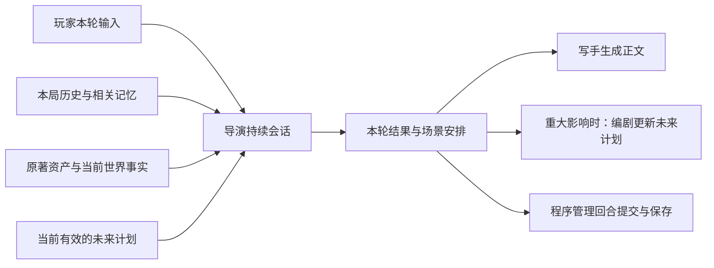
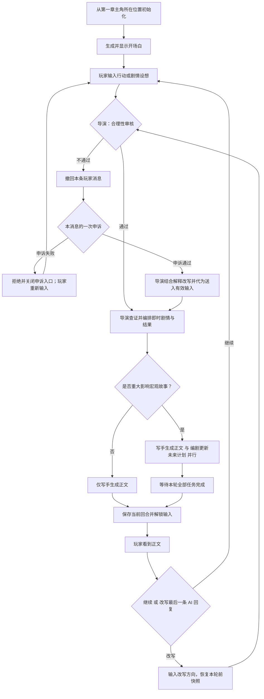

# WestWorld｜游戏 Agent 产品需求（分阶段）

> 版本：v0.2｜更新：2026-11-19  
> 性质：游戏阶段的**产品需求与架构讨论稿**，将先前的游戏 Agent 架构讨论与最新明确的 **首版的玩家操作流程** 整合，按 **P0 → P1 → P2** 排实现优先级。**P0 编号已按本版开发依赖重新排序**，不与旧版编号一一对应。
> 范围：仅涉及**进入游戏以后的**开局、自由输入、Agent 决策、剧情编排、正文生成、状态、存档及后续世界运行。小说导入、人物/地点/关系提取、世界书整理、原著事件网络和时间线串联等，均视为**已完成的上游资产**，不再重新列为需求。  
> 状态：这是**需求规划，不是代码已实现清单**。下文区分「已明确的产品流程」与「推荐的实现方式」「尚待确认」；不把尚未详细设计的约束写成已实现。

本页保存包含编剧在内的分阶段构想。现行首期只接入导演和写手；用语、剧情动作链和存档字段见[游玩产品需求](../openspec/changes/play-three-agent-mvp/proposal.md#terms)。

## 1. 产品目标与底层原则

**定位：** 从依赖原著路线的文字冒险，升级为玩家能够自由行动、世界可以演化、AI 像作家一样持续创作的**平行世界互动小说**。

1. **玩家行动开放。** 没有固定选项和预编完的分支；可延续、绕开、破坏原著路线，或完全离开原著舞台开辟新的生活与故事。
2. **世界约束真实。** 允许玩家提出极端行动，但「允许尝试」不等于「宣告成功」；能力、物品、人物动机和当前事实仍约束结果。
3. **后果长期有效。** 人物存亡、物品归属、已发生的事、关系、承诺与认知不能因上下文遗忘而失效。
4. **原著是参考路径，不是必须回归的轨道。** 事件可保留、改写、提前收束、延后、取消或变为新故事线。
5. **AI 具有作家能力。** 编剧维护阶段目标、人物弧光、伏笔与冲突，先画靶子、再找铺垫；玩家改变前提后必须允许改稿。
6. **程序负责确定性与可恢复性。** 世界事实、回合历史、分支、提交和回滚由程序管理；Prompt 不需要穷举玩家的无限种输入。
7. **体验延迟受控。** MVP 每轮同步等待的是「导演→写手」，仅重大影响再并行启动编剧；**编剧未完成时不得开启下一轮输入**。

**基本权限：已确认的世界事实 > 导演结算的本轮结果 > 编剧尚未发生的剧情计划 > 写手的文学表达。**

## 2. 目标职责划分：三 Agent + 世界引擎

| 组件 | 核心职责 | 边界 |
|---|---|---|
| **编剧 Agent（宏观）** | 维护未来篇章方向、主要矛盾、人物弧光、伏笔与回收；重大偏离后修订受影响计划 | 无权推翻已结算事实；不参加普通回合的同步规划 |
| **现场导演 Agent（即时）** | **维持本局持续会话与长期记忆**，结合过往交流理解玩家意图；审核合理性、处理申诉；查证当前事实、判定行动结果；编排当轮场景/NPC 行动链；**判断是否需要编剧介入** | 不负责每轮重写宏观大纲；不能为了保留原著强行改变事实 |
| **写手 Agent（表达）** | 根据导演的剧情执行框架写成正文，控制人物语言、文风、节奏与描写 | 不得擅自改动关键结果；**不要求独立保存长期世界记忆**，按需读取本轮交接资料 |
| **世界引擎（程序）** | 保存本局状态、原著资产引用、回合快照、剧情计划、状态变更、Agent 任务及历史；校验与回滚 | 不预先穷举所有行动和剧情答案 |

- 玩家只看见一个游玩输入框和生成的正文，不直接选择三 Agent。
- `Canon`＝只读原著资料；`State`＝本局已经成立的事实；`Plan`＝编剧对未来的安排。三者分开存储，不互相覆盖。
- 导演负责**事实结算与即时场景**；编剧负责**未来计划**。需要二者协调时，以已结算事实为准。
- 三 Agent 指三个角色职责。导演具备本局持续会话和长期记忆，写手每轮独立执行；编剧的会话方式后续讨论。内部实例生命周期及会话恢复的具体实现由技术设计确定。

### 2.1 写手 Agent 初步规划

> 2026-11-19 讨论记录：用户要求先将写手的职责、记忆方式和每轮所需材料记入需求规划，后续继续讨论其他 Agent。

**写手每轮独立执行，不维护自己的长期记忆。** 它根据导演给出的本轮剧情安排，结合上一轮发生的事和本轮涉及的人物、地点等资产，写出下一段小说正文。导演确定当下发生什么，写手负责将这些内容写成连贯的对白、动作和描写。

写手无需读取全部历史回合。当前描写涉及更早的经历、承诺或已透露的信息时，将相关事实随本轮材料提供给它；长期事实仍由程序保存。

| 每轮输入 | 内容与用途 |
|---|---|
| **导演的本轮剧情安排** | 本轮发生什么、人物如何行动、结果是什么、正文写到哪里停下。 |
| **近期正文与上一轮事实** | 上一轮发生了什么，以及需要承接的正文片段；必要时补充最近的相关片段，用于衔接对白、动作、情绪和行文节奏。事实摘要与正文片段分别承担事实交代和表达衔接的作用。 |
| **本轮涉及的资产与当前状态** | 相关人物的性格、说话习惯、关系，地点环境，以及此刻的伤势、位置、持有物品等。 |
| **本轮相关的历史事实** | 按当前剧情需要提供旧承诺、旧经历、已经透露的信息等，无需把所有过往回合都交给写手。 |

例如，人物十轮前承诺“绝不透露你的身份”，本轮再次谈及此事时，材料中应包含这项承诺。写手凭这条相关事实承接对白，无需回读此前十轮的完整对话。

#### 2.1.1 文学表达与创作自由度（待需求评审）

写手接收导演的[场景演出方案](#226-场景演出方案与决策范围待需求评审)，自行组织具体对白、反驳方式、表情、动作、情绪和叙述节奏。一轮正文可以包含多个人物的连续互动，不必每写一句对白就询问导演；对白先后与细节安排须保持导演确定的必要因果顺序。

写手保持场景结果、关系变化和信息变化不变。例如导演确定乙成功误导甲，写手可以设计乙如何说服甲，但不能改成甲识破乙。写手也不能为了悬念新增未发生的历史事件，或超出本轮允许揭示的范围透露秘密。

正文写到导演指定的玩家介入点，给玩家留下下一次决定的机会。近期正文、相关历史、文风及长期偏好由本轮材料提供，仍沿用每轮独立执行的方式。

场景方案的字段、材料组装方式及自由细节的具体范围待评审；用多人争执场景核对对白是否自然、因果和结果是否一致、信息是否越界、是否替玩家决定后续行动。

### 2.2 导演 Agent 初步架构

> 2026-11-19 确认记录：用户希望导演像穿越网文中持续陪伴主角的“系统”，拥有长期记忆，能结合过往交流理解玩家行动、了解当前世界状态并安排后续剧情；本轮要求将所需能力和初步架构写入需求文档。以下区分已明确的产品定位与建议的内部组织方式。

#### 2.2.1 定位与连续性

**导演是贯穿一局游戏、拥有长期记忆的主持者。** 玩家每次输入时，它都应接着这局游戏的前因后果理解意图，结合当前处境决定接下来发生什么。玩家离开后再次打开同一存档，也应延续此前的经历和交流。

这种连续性包含两部分：一是记得玩家说过什么、想做什么，能理解“按之前那个办法”“去找上次救过的人”等表达；二是掌握本局已经发生的事及其后果，能够据此安排人物反应和场景发展。导演对事情的推测、玩家的愿望、编剧的未来计划，都要与已经成立的世界事实区分。

导演的持续会话和基础长期记忆纳入 P0，关联 P0-01、P0-02、P0-09、P0-15、P0-16。P2-05 继续负责长篇游玩中的记忆检索和上下文效率优化。

#### 2.2.2 应具备的能力

| 能力 | 具体要求 |
|---|---|
| **理解玩家意图与上下文** | 结合此前交流识别人物指代、行动对象、目的和前后关联；区分玩家正在尝试的行动、希望 NPC 做出的反应和希望故事发展的方向。 |
| **保留并调用长期记忆** | 记住本局重要经历、玩家明确表达的目标、人物关系变化、承诺和未完成事项；本轮涉及旧事时能查回相关记录及依据。 |
| **自主调查相关资料** | 接收程序自动发现的候选线索，判断是否读取完整事件、关系和原文，并按需要继续搜索；见[两层检索构想](#24-导演的两层检索与按需加载)。 |
| **了解当前世界状态** | 查询原著资产、本局事实和当前场景，核对人物存亡、位置、关系、物品及已发生事件；发生偏离后按本局有效事实继续推进。 |
| **审核行动并处理申诉** | 判断输入在当前条件下能否尝试；沿用 MVP 的撤回与一次申诉规则，结合补充理由重新理解原意。允许尝试之后，仍需判断实际结果。 |
| **编排当前剧情** | 根据行动条件、人物性格和动机，确定成功、失败或部分成功，以及 NPC 反应、现场行动链、场景变化和本轮停下的位置。 |
| **向写手交付本轮内容** | 交代确定的剧情结果、人物行动和需要表现的信息，并提供或引用相关资产与历史事实，使写手能够衔接近期正文。具体材料组装方式待细化。 |
| **识别重大影响并联系编剧** | 将本轮实际结果与现有未来计划、原著重要事件前提对照；发生重大影响时上报事实和影响依据，由编剧调整未来发展。 |
| **延续存档与配合改写** | 恢复存档后接续有效会话；改写最后一轮时使用该轮行动之前的事实、记忆和计划，重新审核、编排，避免引用已废弃结果。 |

导演负责当前场景及即时后果，编剧负责未来篇章计划，写手负责正文表达。具体交互顺序继续遵循第 3.2 节 MVP 流程。

#### 2.2.3 建议的内部组织方式

建议采用“持续导演会话 + 持久记录 + 按需查询工具”的结构。导演会话负责理解、推理和调用工具；程序负责保存记录、提供查询和管理有效版本。每轮处理从同一存档的有效会话继续。

图中写手与按需触发的编剧沿用并行规则。程序汇集本轮相关任务的结果，完成保存后解锁下一轮；具体提交与恢复机制仍按第 3.4 节继续设计。

导演需要读取的材料分为以下几类：

| 材料 | 保存与使用方式 |
|---|---|
| **持续交流记录** | 保存玩家输入、补充解释、审核与申诉结果及已展示正文。近期内容用于直接承接；较早内容在相关时查回。被拒绝的行动可以作为交流记录保留，其内容不能记成已发生事件。 |
| **本局长期事实** | 保存已发生事件、重要选择的实际结果、承诺及关系变化等，并能追溯对应回合和依据；由程序维护，供导演查询。 |
| **当前状态** | 读取当前有效的人物、地点、物品和场景状态。旧回合记录用于解释变化经过，当前行动按现状判定。 |
| **玩家目标与未完成事项** | 记录玩家明确表达的打算、尚未兑现的约定等，帮助理解后续行动；愿望及尚未执行的安排保持其原有含义。 |
| **未来剧情计划** | 读取编剧当前有效的安排，作为即时编排和重大影响判断的参考；计划执行并形成实际结果后，才能成为已发生事实。 |

会话中保留近期交流和本轮相关材料，较早历史通过查询补回；存储分层和压缩规则见[第 2.3 节](#23-分层记忆与上下文压缩)，候选发现与按需读取见[第 2.4 节](#24-导演的两层检索与按需加载)。具体加载预算和摘要格式后续确定。存档恢复时，程序应能重新提供这条持续会话及其所需记录。

#### 2.2.4 一轮处理中的输入、输出与记忆变化

- **输入：** 玩家本轮消息、此前有效交流、必要的当前世界状态与资产简短档案、程序自动发现的候选资料，以及编剧当前有效计划；详细加载方式见第 2.4 节。
- **处理：** 程序自动检索候选线索 → 导演结合本轮意图判断候选并按需深入查询 → 审核是否可以尝试 → 判定实际结果并编排场景 → 判断是否重大影响后续剧情。
- **输出：** 审核或申诉结论、导演确定的本轮结果、给写手的场景安排、必要时给编剧的影响说明，以及交由程序校验和保存的状态变化。
- **记忆生效：** 玩家表达和审核结果按交流记录保存；本轮实际发生的事随有效回合保存，成为后续可查询事实。改写时，以恢复后的有效版本组织导演记忆，旧版本只保留在历史记录中。

例如，第 3 轮玩家与人物甲约定“入夜到东门会合”。第 12 轮玩家说“去赴之前那个约”，导演应能查回约定，识别人物甲、入夜和东门，再核对当前时间、位置及约定是否仍有效，安排前往或抵达后的场景。若玩家随后改写第 12 轮为留在客栈，有效记忆应采用新结果，不能在下一轮继续认定玩家已到东门。

这些能力的验收场景见第 7 节新增的连续交流、存档恢复和改写记忆检查。

#### 2.2.5 后续需要细化

1. 按第 2.3 节的三层职责细化存储字段、记忆整理者和更新时间，以及按回合恢复有效版本的方式。
2. 按第 2.4 节的初始加载方案细化候选范围、排序、读取预算及继续调查的条件；相关信息不足或指代不明时，如何向玩家澄清。
3. 导演与写手、编剧之间的交接字段，以及事实、推测、计划在交接中的表达方式。
4. 玩家是否可以单独向“系统”提问、讨论策略；这类交流是否推进回合，以及如何在界面上呈现。

#### 2.2.6 场景演出方案与决策范围（待需求评审）

导演向写手交付本轮“场景演出方案”，决定整场互动的因果发展和各人物的作用。导演无需逐句编写对白，交付内容至少覆盖以下叙事决策；最终名称与字段结构待评审。

| 内容 | 导演需要决定什么 |
|---|---|
| 场景目标 | 本场推进的冲突与本轮停止位置 |
| 人物意图 | 各参与人物希望获得什么 |
| 关键事件 | 重要行动、回应及必要因果顺序 |
| 关系变化 | 谁与谁的关系发生什么变化 |
| 信息变化 | 谁获知什么，谁仍不知情或存在误解；本轮向玩家揭示什么 |
| 场景结果 | 实际结果及留下的后果 |

例如甲当众质问乙，乙否认并转移嫌疑，丙因秘密而隐瞒，丁指出漏洞，甲转而要求搜查；最终只有嫌疑加深，没有确凿证据。导演确定这一行动链，具体文学表达交给写手。

导演只安排玩家当前行动的合理后果，到下一次适合玩家介入的节点停下，不能预定玩家接下来的多次决定。对当前观察和人物知情范围的判断以有效世界事实为依据，编剧的揭示计划作为参考。

现场结果导致重要人物死亡、故事线前提失效等重大变化时，导演向编剧交付已确定结果及影响依据，由编剧重评未来计划。重大程度标准仍待细化；[条件式独立复核](#28-重大剧情条件式独立复核待需求评审)是导演结果的后续研究项，不纳入 MVP。

### 2.3 分层记忆与上下文压缩

> 2026-11-19 需求记录：用户要求采用三层存储，保证摘要不会成为唯一记忆，压缩不会改变游戏事实，并区分人物认知与世界实际发生的事。本节补充导演长期记忆架构，关联 REQ-003。

#### 2.3.1 三层存储职责

| 层次 | 保存内容 | 使用与更新要求 |
|---|---|---|
| **第 1 层：权威业务状态** | 玩家物品、人物位置、事件发生记录、世界状态及其版本。 | 由数据库持久维护，通过既定业务校验和回合提交更新；判断实际发生了什么时读取这一层，不依赖对话摘要。 |
| **第 2 层：长期记忆与资料索引** | 人物认知、故事伏笔、目标、未来计划、证据引用及相关资料索引。 | 以结构化记录持久保存在工作上下文之外，按当前任务检索；保留认知主体、内容性质和来源依据，使“谁相信什么”“计划发生什么”可以与事实区分。 |
| **第 3 层：当前工作上下文** | 最近几轮消息、当前任务、查询结果及必要摘要。 | 按上下文预算裁剪、压缩；本轮需要的旧事从前两层及原始历史记录中查回。 |

第 1 层保存实际发生的事，第 2 层提供可检索的认知、创作资料和依据，第 3 层组织本次模型调用需要阅读的内容。查询结果进入工作上下文后，持久记录仍保留在原处。

#### 2.3.2 压缩规则

1. **压缩只作用于第 3 层。** 压缩过程不得直接改写第 1 层的状态或事件，也不得覆盖第 2 层的持久记录。业务状态、人物认知和计划的更新分别经过对应流程。
2. **摘要不作为唯一记忆或事实依据。** 原始历史及证据仍可查询；摘要与有效记录冲突时，查回原始记录和权威状态，修正工作上下文，不能按错误摘要反向修改事实。
3. **保留信息性质。** “怀疑”“否认”“已证实”“尚未执行的计划”等含义在压缩后仍需明确，不能把人物的说法或推测改写成已经发生的事。
4. **先保证重要信息能被找回，再减少冗余。** 优先保留当前行动所需的关键事实、未解决问题和依据引用，再逐步精简重复内容。
5. **人物认知可以与真实情况不同。** NPC 误信某事可以持续影响其行为；其他角色或玩家发现真相，不意味着所有 NPC 自动得知。认知变化需要相应的信息来源。

#### 2.3.3 钥匙案例与验收

| 回合 | 历史内容 | 必须保留的含义 |
|---|---|---|
| 第 12 回合 | 玩家怀疑管家偷走了钥匙。 | 这是玩家的怀疑，不能据此确认管家偷窃。 |
| 第 17 回合 | 管家否认了偷窃行为。 | 记录管家的否认；否认本身不等于案件真相已经确定。 |
| 第 24 回合 | 玩家找到证据，证实钥匙实际上被女仆拿走。 | 保存已证实的结果及证据，保留此前怀疑与否认的历史。 |

可接受的摘要为：“玩家曾怀疑管家拿走钥匙，管家否认；第 24 回合玩家找到证据，确认钥匙由女仆拿走。”

“管家曾经偷走钥匙，后来真相被揭露”属于错误摘要，不能成为后续剧情的事实依据。

验收时，以这三条历史和对应持久记录为样本，执行压缩后继续询问钥匙事件：导演应能正确区分原先怀疑、人物否认和最终证据。检查前两层的数据及版本未因压缩改变；即使工作摘要出错，也应能依据持久记录恢复正确内容。另设一名只听到早期怀疑、尚未获知真相的 NPC，确认其认知不会因玩家找到证据而自动更新。

三层职责和上述压缩规则作为后续实现约束。检索与资料加载的初步构想见[第 2.4 节](#24-导演的两层检索与按需加载)；具体存储字段、笔记更新方式、检索算法、压缩触发阈值及错误摘要的发现方式，在详细设计中继续确定。

#### 2.3.4 摘要、外部笔记与历史回读

> 2026-11-19 补充需求：用户要求结合摘要压缩、结构化笔记、原始历史持久化、按需检索和工具结果清理。参考材料为用户提供的 [Effective context engineering for AI agents](https://www.anthropic.com/research/effective-context-engineering-for-ai-agents)。本节记录 WestWorld 的需求方向，关联 REQ-003、REQ-025。

**摘要负责延续当前工作，外部持久化记录负责保留信息，检索工具负责重新取回。** 摘要遗漏某个细节后，仍应能通过独立保存的记录找回该信息。

| 机制 | 职责 |
|---|---|
| **摘要压缩** | 保留当前任务、处理进度、必要背景和下一步，使 Agent 能继续工作。 |
| **结构化笔记** | Agent 在执行过程中，将已完成任务、关键决定、重要发现、待解决问题及历史证据引用保存到上下文之外，后续按需读取。 |
| **原始历史持久化** | 完整保留原始消息、工具调用结果及相关证据，压缩和上下文清理不删除这些记录。 |
| **按需检索** | 支持从笔记或引用定位旧消息、工具结果和原始证据，读取当前需要的部分，补入工作上下文。 |
| **工具结果清理** | 对已经完成使用、仍占据大量上下文的旧工具输出，优先从当前模型上下文中移除冗长内容；外部原始记录及回读定位仍保留。 |

新的模型上下文由基础规则、压缩摘要、近期消息和按需召回的笔记或证据组成。结构化笔记需要在任务推进中保存，不能只依赖压缩时临时生成的一份摘要。

例如，一次工具调用读取了约 20,000 Token 的小说原文，相关判断完成后，这份输出可以从后续工作上下文中清理；再次需要核对时，通过保存的引用重新读取。工具结果清理的触发条件、保留范围和回读参数在详细设计中确定。

该机制依赖 Agent 知道需要查什么，或由程序发现相关历史；候选发现沿用第 2.4 节，P3 的定向检索与缺环查找见第 9 节。保存历史和提供回读通道本身不能保证发现跨章节伏笔。

#### 2.3.5 压缩后回读的验收场景

以 P3 已处理 80 个事件后发生压缩为样本：摘要保留进度和当前问题，但有意不保留第 15 个事件的某个细节。第 81 个事件需要核对该细节时，应能通过笔记或引用定位持久记录，读取相关证据并继续判断。

验收检查以下结果：

- 压缩后仍能恢复正确进度，已保存的任务笔记、决定和待解决问题可以读取。
- 第 15 个事件的原始记录仍完整存在，摘要遗漏的细节可经工具重新取回。
- 清理旧工具结果后，当前上下文用量减少，外部记录保持完整，原有引用仍可定位和回读。
- 对比清理前后的上下文用量、回读调用次数和耗时，评估实际收益。

P3 读取小说原文的权限与第 9.3 节的缺环补查一并设计；本场景描述目标能力。后续需核查现有压缩、笔记保存、历史查询和工具权限的实现情况，再确定需要补充的部分。

#### 2.3.6 压缩前触发（PreCompact）

> 2026-11-19 补充需求：用户要求加入压缩前触发能力，并提出 Pi 可能没有对应钩子。先列为待细化需求；Pi 本地锁定版本是否提供此接口、是否需要在 WestWorld 压缩流程中扩展，后续核查。

在正式压缩上下文之前提供一个明确的触发点。结合结构化笔记需求，可考虑在此整理并保存重要发现、未解决问题、当前进度及证据引用，使这些信息在压缩后仍可检索；具体执行内容尚未确定。

待讨论：自动压缩和强制压缩如何触发；由程序执行还是调用模型；输入输出是什么；处理失败时是否继续压缩；重复触发时如何避免重复保存。实施时明确它与请求前处理、摘要生成和压缩后恢复各自的职责。

#### 2.3.7 分层压缩与记忆预取（待需求评审）

> 2026-11-19 补充需求：用户要求先纳入规划，后续进行需求评审。参考材料为用户提供的 [Claude Code query.ts 第三方源码快照](https://github.com/dhrbc/claude-code/blob/main/src/query.ts)。该快照的来源与完整性未独立验证，部分功能可能受开关控制；本节记录可研究的设计方向。WestWorld 当前覆盖程度尚待核查，不能据此认定全部未实现。

**候选方向一：先做低成本清理，再做完整摘要压缩。** 在第 2.3.4 节工具结果清理的基础上，评估以下处理顺序：

1. 工具结果预算控制：限制历史工具输出在当前请求中占用的体积。
2. 微压缩与局部折叠：通过程序替换、精简或折叠已完成使用的冗长内容，尽量保留仍有价值的详细上下文。
3. 完整摘要压缩：前两步仍无法满足上下文预算时，再调用模型总结历史。

例如，某次工具返回约 15,000 Token 的章节片段，Agent 已完成分析和事件关联提交后，可以在后续请求的上下文视图中，将该结果替换为“已读取第 50 章相关片段，原始结果引用 tool_result_082”。这只是示例形式，工具名称和引用格式待设计。完整输出仍保存在外部，能够按引用取回；工具调用与结果的对应关系要保留，当前判断仍依赖的证据不能被清理。

**候选方向二：完整历史与模型可见视图分别管理。**

| 内容 | 候选保存方式 |
|---|---|
| 完整原始消息 | 持久保留，压缩与折叠不覆盖原件。 |
| 工具输出 | 独立存储，支持按 ID 查询。 |
| 压缩摘要与局部折叠记录 | 分别保存，记录模型可见内容如何变化。 |
| 本次请求上下文 | 根据摘要、折叠记录、近期消息和当前所需资料动态生成。 |

评审时检查现有 context.ts（上下文组装）和 compaction.ts（压缩处理）的历史投影能力，确定哪些可复用、哪些需要扩展。原始数据保留和回读继续遵循第 2.3.4 节。

**候选方向三：按任务启动相关记忆预取。** Agent 开始处理当前任务时，提前启动可能相关的记忆检索；结果完成后缓存到该任务中，后续需要时直接读取。避免在每轮工具循环中重复启动同一检索。结果尚未完成时，按任务需要选择等待或走正常检索工具；未返回的内容不能视为已经进入模型请求。

第 2.4 节规定的首轮必要资料与候选发现仍需满足其加载要求。异步预取用于减少后续等待，哪些资料必须先就绪、哪些可以后台准备，评审时明确。

**评审待办：** 核查现有实现；确定各层预算和触发条件、哪些证据可以折叠、PreCompact 在处理顺序中的位置、引用回读方式，以及预取缓存的任务归属和失效条件。用相同样本比较模型摘要调用次数、上下文用量、总 Token、耗时及信息恢复情况，再决定采用范围和实施顺序。

#### 2.3.8 用户长期偏好（待需求评审）

> 2026-11-19 新增需求：用户希望游戏 Agent，尤其导演和编剧，能够记住长期偏好，减少每次重复说明和纠正。关联 REQ-003。

除当前任务和世界资料外，持久保存用户希望长期沿用的偏好，并在相关 Agent 工作时按需提供。文风、叙事节奏和互动方式可作为评审时讨论的偏好示例，具体记忆内容尚未确定。

偏好与本局已发生事实分别管理，不把偏好当作世界事实。写手仍按第 2.1 节每轮独立执行，需要的偏好可以随本轮写作材料提供。

评审需确定偏好来自用户明确设置还是对话中的确认，如何更新、纠正、查看和删除，适用范围是当前存档、当前书籍还是跨书籍，以及本轮指令与既有偏好冲突时的处理。跨 Agent 共享范围、存储字段及回合回滚对偏好的影响也待确定。

验收方向：用户明确一次偏好后，后续相关回合能继续采用；用户修改或撤销后不再使用旧值，减少重复纠正。

#### 2.3.9 可逆上下文表示（待需求评审）

> 2026-11-19 补充需求：用户提供 [ACE: Adaptive Context Elasticizer](https://arxiv.org/html/2606.31564) 作为研究入口，要求记录可逆上下文方向。本文仅登记候选方案，论文细节与现有实现覆盖程度后续核查。

每条历史消息或工具记录保留原始内容，并按本次请求选择表示方式：

| 模式 | 本次请求中的表示 |
|---|---|
| Raw（完整） | 使用完整内容。 |
| Abstract（摘要） | 使用对应的简短摘要。 |
| Drop（暂不加载） | 本次请求不包含该内容，原始记录继续保留。 |

通过记录 ID 关联原始内容、已有摘要和表示选择，每次请求重新组装工作视图；需要旧细节时可以恢复完整内容，无需因切换模式重新生成摘要。若完整内容仍在缓存中可直接使用，外部存储场景仍可能需要读取，不能承诺无需数据库访问。

初步建议先对导演的工具结果研究 Raw / Abstract 两种表示，暂不引入自动 Drop 或每步额外调用模型选择上下文。保留完整工具结果与引用，确保工具调用和结果配对。与第 2.3.7 节的局部折叠共同评审。

各 Agent 的历史分别管理：导演可折叠旧场景查询，编剧可折叠旧规划过程并保留有效计划及决定；写手主要接收本轮场景、近期正文和文风要求，不因此新增独立长期会话。世界事实继续以业务数据库为准。

评审需确定摘要生成与失效条件、表示选择的责任主体、引用恢复和预算；用相同任务比较 Token、延迟及决策正确率，再决定是否扩展自动选择模式。

### 2.4 导演的两层检索与按需加载

> 2026-11-19 需求记录：用户提出导演的初步构想——由程序先自动发现候选线索，再由导演自主判断、深入调查；同时采用分批加载资料的方式。本节记录架构方向、初始加载方案及后续核查项，关联 REQ-003。

#### 2.4.1 两层检索的分工

**第一层：程序自动发现候选线索。** 在导演开始本轮推理之前，程序根据当前人物、物品、地点、事件，以及数据库中已有的关联，主动批量检索可能相关的历史事件、伏笔和资料。发现候选不以导演预先知道某条线索存在为前提。

例如，当前场景出现“黑鹰徽章”，程序可以沿数据库中的关联找到“阿尔德家族”，再找到“王室旧案”，将旧案列入候选资料。导演此前不需要主动搜索“王室旧案”。

这一步需要可检索的实体关系、关键词、语义索引等数据支持；具体采用哪些索引及如何组合，在设计时核查。关系或索引不完整时，仍可能漏掉重要伏笔，检索覆盖率需要通过样本评估。

**第二层：导演自主深入调查。** 导演收到候选后，结合玩家行动和当前任务，判断哪些需要阅读原文、哪些可以忽略，以及是否需要进一步搜索其他资料。导演可调用工具读取候选详情，也可沿新发现的线索继续查询。

程序负责发现可能相关的信息，导演负责理解关联的意义，并据此判断和编排剧情。候选命中只表示可能相关，其内容是否属于有效事实、人物认知或未来计划，仍按第 2.3 节核对来源与性质。

#### 2.4.2 初始资料加载方案

| 资料 | 初始加载方式 |
|---|---|
| **当前场景、玩家行动、必要的权威世界状态** | 直接进入导演本轮工作上下文，供其理解当下处境和判定行动。 |
| **当前涉及的人物、物品、地点** | 加载简短档案，提供本轮理解对象所需的基本信息。 |
| **相关历史事件和伏笔** | 程序自动找出一批候选，先提供标题、摘要、关联理由和引用 ID（用于继续读取对应记录的标识）。 |
| **完整事件、人物关系细节、小说原文** | 导演判断有需要时，通过工具继续读取。 |

导演应当拥有发现重要资料并继续读取的渠道。初始加载数量根据当前任务和上下文预算确定，不预设适用于所有场景的固定条数。

例如，“王室旧案”候选的关联理由可以说明“本轮黑鹰徽章关联阿尔德家族，该家族又与此案相关”，并附可读取旧案的引用 ID。导演据此决定是否阅读完整事件及原文依据。

#### 2.4.3 数据流转与调用方式

本轮玩家行动及当前场景 → 程序根据当前实体和已有关系批量发现候选 → 将必要状态、简短档案及候选目录交给导演 → 导演选择读取详情或继续搜索 → 结合查询结果审核行动、编排本轮剧情。

这些资料按第 2.3 节进入第 3 层工作上下文，原始记录仍保留在其存储位置。导演读取某项隐藏资料，不会因此让玩家或所有 NPC 自动知道该信息。

多轮工具调用会增加延迟。初始检索应尽量批量返回候选；可根据任务需要直接返回部分详细内容，减少无必要的逐条查询。候选组织、单次读取范围和上下文预算需要一并设计。

#### 2.4.4 与现有实现的衔接及待核查项

实施前先检查已有检索、工具调用、上下文投影和状态管理能力，确定可复用与需要补充的部分。现有检索入口为 [retrieval.ts（资料检索模块）](../src/features/story/retrieval.ts)，后续重点核查：

1. **推理前的候选发现：** 能否在导演首次推理前，从当前对象出发发现跨对象关联的线索，包括导演事先不知道名称的资料。
2. **导演自主读取：** Pi Agent Core 的运行与工具接入能否支持导演依据首批结果选择详细资料，并继续搜索。
3. **资料与预算：** 实体关系、关键词和语义索引有哪些缺口；候选如何排序、合并重复项、说明关联理由，以及如何安排加载量。
4. **继续调查的条件：** 导演在什么情况下应继续查证、何时已有足够依据进入剧情编排；如何兼顾检索覆盖率、上下文预算和延迟。

上述能力是否已由当前代码实现，需经后续核查确认。具体索引方案、工具参数及调用预算仍属于详细设计内容。

#### 2.4.5 黑鹰徽章案例与验收

准备“黑鹰徽章 → 阿尔德家族 → 王室旧案”的关联资料，当前场景只出现徽章，测试输入不直接点名王室旧案；旧案线索由程序检索发现。

- **候选发现：** 程序在导演推理前找出王室旧案，返回标题、摘要、关联理由及可读取的引用 ID。
- **深入读取：** 导演能根据玩家行动选择读取旧案全文、相关人物关系或原文，并在需要时沿新线索继续搜索；无需细读的候选可忽略。
- **覆盖检查：** 用关联完整与关联缺失的样本比较召回结果，记录漏检情况；未检索到旧案不等于证明世界中不存在该关联。
- **加载检查：** 检查首轮请求是否按第 2.4.2 节组织资料，并记录批量检索及后续读取的调用次数、耗时和上下文用量，作为调整依据。

#### 2.4.6 工具结果整理与候选分层读取（待需求评审）

> 2026-11-19 补充需求：用户要求登记代码先整理工具结果、模型分层读取的方向，关联 REQ-003、REQ-025。方法、采用范围和实施均未确定，后续评审。

候选方案优先将批量查询、完全重复记录去重、明确章节范围查询、不同工具结果汇总、分页和按 ID 读取交给程序。事件是否与当前剧情有关、是否构成伏笔，则结合资料由模型判断；固定相关度或相似度排名不作为唯一筛选方式。

检索得到的完整结果应保留可访问途径。例如共找到 500 条事件，程序整理成包含事件 ID、章节、人物和简短摘要的目录，模型先读取一部分，按需继续翻页、改变查询条件或按 ID 获取详情。原文读取仍需结合相应 Agent 的工具权限设计。减少一次发送的内容不应导致其余候选不可再读，也不应删除数据库中的原始事件。

去重只合并确实重复的结果，保留来源引用；相似但不同的事件不能仅因相似而被当作重复。候选目录仍可能遗漏重要信息，模型也可能不继续翻页；“可以回读”不等于“不会漏检”。

**候选验证方法：** 使用独立人工确认的跨章节关联样本，对比 A、B 两种处理：

- A：完整候选可供模型分批阅读，不做语义筛除。
- B：采用拟议程序筛选或整理方式提供资料。

比较候选召回率与 Token 节省率，并另行核对最终串联结果。候选召回率为“进入候选集的正确关联事件数 ÷ 应当找到的正确关联事件数”；采用 Recall@K 时须明确 K 和统计范围。Token 节省率为“1 − B 的 Token 消耗 ÷ A 的 Token 消耗”，两组使用一致的任务、模型和统计口径。

评审关注低排名、跨章距离远、没有共同关键词或相似度较低的正确关联。不能仅凭节省 Token 认定方案有效；例如节省 70% Token、召回仅 60% 的情况，应作为明显损害准确率的反例，实际验收阈值待定。

与第 2.4.4 节的排序和加载预算一起评审：区分“当前页暂未加载”与“从可访问候选中排除”，明确分页、完整结果保留和再次检索方式，检查现有候选截取是否会让重要资料失去读取机会。

### 2.5 编剧 Agent 初步规划

编剧负责未来篇章、人物发展、长期冲突、伏笔与回收，并在玩家改变关键前提后修订受影响的计划。已发生事实由导演结算和程序保存，编剧据此规划未来，不能将候选路线当成已经发生的事件。

#### 2.5.1 输入、输出与调用时机

- **输入：** 当前有效世界事实、已有未来计划、原著参考、导演提交的本轮结果及影响依据，以及相关长期记忆和玩家偏好。
- **输出：** 更新后的未来计划及其成立条件、保留或修改的故事方向和依据，供导演后续回合参考。
- **调用：** 初始规划，以及导演认定本轮实际结果重大影响后续剧情时。普通谈话等局部变化由导演处理，编剧不必每轮参与。“未来计划不足时是否另行触发补充”继续评审。
- **交接：** 编剧不直接规定本轮每句对白；与写手并行更新计划时，按共用回合流程完成提交后才开放下一次输入。

#### 2.5.2 长期叙事规划能力（待需求评审）

编剧识别未来事件的前置条件，先判断玩家改变了哪些事实，再分析哪些未来事件受影响，决定修改范围。多个条件、替代触发和局部重规划的例子见[事件依赖与重规划](#29-事件依赖与受影响范围重规划待需求评审)。

编剧还可规划多条故事线如何交织、秘密如何逐步揭露，将“世界发生时间”与“玩家获知时间”分开考虑。导演决定当前场景实际发生和可观察的内容，写手按确定的揭示范围表达；共用记录要求见[事实与叙事揭示](#210-世界事实与叙事揭示顺序分离待需求评审)。

复杂重规划可试验[调查后以新上下文执行](#26-编剧规划与执行分离待需求评审)；跨回合认识可借鉴[两阶段记忆整合](#27-两阶段叙事记忆整合待需求评审)。这些机制分别服务于执行质量和长期记忆，采用范围、会话方式与触发频率待评审。

#### 2.5.3 编剧前瞻规划实验（待需求评审）

> 2026-11-20 补充需求：用户要求登记前瞻规划方向。研究入口为用户提供的 [Fact-Augmented Lookahead Planning](https://proceedings.mlr.press/v300/holt26a.html) 与 [LATS](https://proceedings.mlr.press/v235/zhou24r.html)，论文细节后续核查。关联 REQ-003。

先仅在编剧 Agent 上实验：重大剧情偏离触发重规划时，临时生成两三条未来发展路线，结合已发生的世界事实与人物目标比较合理性，再选择或修订未来计划。候选路线属于推演内容，不能作为已经发生的世界事实写入。

该方向不改变“导演决定当下、编剧安排未来”的职责，也不要求导演每回合进行多次推演。候选数量、比较标准、调用方式和 Token 预算待设计。

实验使用相同剧情偏离样本，对比直接规划与前瞻规划的剧情一致性、人物目标承接、长期发展质量、Token 和耗时。重点判断额外推演成本是否换来可观察的规划改善；如果只是增加文字和消耗、没有改善一致性，则放弃此方案。评审时再确定评价方法及采用标准。

### 2.6 编剧规划与执行分离（待需求评审）

> 第 2.6—2.11 节于 2026-11-20 根据用户提供的第三十二至三十四课、StoryWriter 学习材料和场景演出构想登记，关联 REQ-003。材料中的 Codex 与 StoryWriter 机制作为研究线索，源码及论文细节后续核查；采用范围、实现方法和验收标准待评审。

重大剧情重规划可由同一个编剧 Agent 分阶段完成：

1. 调查与推演：读取原著、当前世界和已有计划，分析受影响的情节；探索结果暂不修改正式计划。
2. 形成方案：说明哪些原著发展失效、人物目标如何变化、保留哪些未来方向，以及依据和成立条件。
3. 执行方案：重新组装当前事实、有效计划、最终方案及必要证据，减少已否定假设和冗长探索记录对执行的影响。执行前核对事实与条件是否仍有效。

“干净上下文”是本次请求的工作视图，探索原始记录仍按第 2.3 节保存。无需新增常驻 Agent，也不为导演的普通回合增加这一流程。

先比较“沿用探索历史”与“最终方案加新上下文”的剧情矛盾、过期假设、人物动机错误及成本。上下文交接内容、阶段完成条件和失败处理待设计。

### 2.7 两阶段叙事记忆整合（待需求评审）

在既有分层记忆上研究“局部提取，再全局整合”：

- 局部提取：从成功完成的回合记录中提取重要事件、长期影响及来源事件 ID，保存详细记录与简短摘要。
- 全局整合：编剧更新长期规划时，结合新增、修改、删除的记忆与已有综合认识，更新人物矛盾、未解决问题和剧情变化。优先增量处理，减少重复总结全部历史。

例如两人先冲突、再互相威胁、后来合作，综合记忆应保留这些发展及证据；此前矛盾是否解决需要判断，不能直接推定双方仍然敌对。相同人物或关键词不意味着事件属于同一故事线。

综合认识与推测继续区别于权威事实。可由运行层在特定时机调用模型，无需第四个常驻 Agent。此项优先级不高；提取频率、整合触发、来源失效及回合改写后的更新方法待评审。检查重点是整合后能追溯依据，且不会把不相关事件或已作废分支合并成事实。

### 2.8 重大剧情条件式独立复核（待需求评审）

低优先级研究项，明确不纳入 MVP。参考用户材料中的 Guardian 思路，先判断决策的影响与不确定性，再对值得复核的结果发起独立模型请求。

候选触发场景包括重要人物死亡、阵营背叛、重大世界变化和长期剧情不可逆转折。普通回合沿用现有结算流程；重大决定可先试验一次复核。

复核上下文包含玩家行动、导演拟定结果、人物档案、在场立场、相关事件及已确定的规划约束，允许补查证据。不能只接收导演的解释并沿用其结论。检查行动依据、遗漏事实、人物动机冲突和证据缺口；发现有证据支持的矛盾时交回导演重判，无法确定时保留不确定性。

复核请求不成为新的常驻角色，导演仍负责现场结果。触发标准、复核反馈处理、调用预算和超时路径待设计；通过小样本比较矛盾发现率、误报和延迟后再决定采用。

### 2.9 事件依赖与受影响范围重规划（待需求评审）

结合已有故事节点，研究以事件关系表达未来计划的成立条件。事件关系图与事件合理性检查来自用户提供的 StoryWriter 学习线索；多前置条件、失效传播及动态重规划属于 WestWorld 的候选改造方向。

编剧可记录未来事件依赖的历史条件、人物目标、其他事件及替代触发条件。玩家改变事实后，先定位受影响条件，再重新评估相关未来事件，决定修改范围，而不是默认所有原定剧情继续发生或全部重写。

例如 E1 为甲背叛乙，E2 为乙发现背叛，E3 为两家决裂。玩家劝说甲放弃背叛后，E1 原前提失效，E2 的发生依据需要重审；E3 可能由其他冲突触发，不能机械删除，也不能强行补造冲突来保留原结局。

可结合第 2.5.3 节的前瞻实验比较保留冲突方向、转向合作或暂不确定结局等候选。未来计划与已发生事实分别管理；关系类型、条件表达、依赖传播和模型判断范围待设计。验收样本应覆盖多个前置条件、替代触发及仅局部计划受影响的情况。

### 2.10 世界事实与叙事揭示顺序分离（待需求评审）

参考 StoryWriter 的事件拆分与多线交织思路，研究将世界事件发生顺序和玩家获知顺序分别管理。例如乙昨天藏起证据、玩家今天发现，发生时间与获知时间不同，不能为了安排呈现顺序改写事实。

编剧规划不同故事线及秘密逐步揭露的方式；导演决定当前场景实际发生、可被观察和获知的内容；写手在已确定的揭示范围内组织小说。写手不能为制造悬念创造未发生的历史事件，也不能提前泄露角色或玩家尚未获知的秘密。

事件拆分、交织和倒叙的适用范围，以及发生时间、获知主体和揭示记录的存储方式待评审。检查重点为多线呈现仍符合因果与人物知情范围；这一方向不自动确定启用倒叙或后台世界演化。

### 2.11 三 Agent 回合协作与玩家介入（待需求评审）

各角色的设计分别见[写手](#21-写手-agent-初步规划)、[导演](#22-导演-agent-初步架构)和[编剧](#25-编剧-agent-初步规划)。本节集中说明三者如何衔接一轮游戏。

1. 玩家提交行动，导演结合世界事实与有效计划判断并编排本轮场景，确定下一次玩家介入的位置。
2. 导演将场景演出方案及相关材料交给写手；若实际结果重大影响未来剧情，同时向编剧提供结果与影响依据。
3. 写手生成本轮正文，按需触发的编剧并行更新未来计划。普通回合无需编剧参与。
4. 正文可以先展示；程序完成本轮全部任务的校验、保存后，才开放下一轮输入。
5. 玩家再次行动时进入新一轮导演决策。多人连续对话可以属于同一轮，调用边界不以某个人物说完一句话划分。

评审用多人争执样本检查三方交接：导演决定关键行动链，写手能将其展开为自然对白且保持结果与知情范围，编剧只在需要时调整未来计划，正文停在玩家可介入的位置。重大变化标准、介入节点选择、交接字段及计划不足时的补充触发仍待细化。

## 3. P0｜MVP：从第一章开局，到可申诉、可改写的完整游戏回合

> **P0 完成标准：** 玩家从小说第一章进入，收到开场白，能自由输入行动/剧情设想；导演进行合理性判断与即时编排；必要时编剧重规划；写手输出正文；流程全部完成才可进入下一回合；最后一条 AI 回复可整体回滚重写；重新打开存档后保持一致。

### 3.1 P0 需求清单（按建议实现依赖排序）

| ID | 需求 | 验收要点 |
|---|---|---|
| **P0-01** | **每局独立存档与世界线**：同一本书可有不同游玩存档；记录当前场景、回合、版本 | 关闭恢复正常；两局事实和计划互不污染 |
| **P0-02** | **最小世界状态**：人物存亡/位置、当前地点、时间、重要关系、物品、已发生事件、承诺、关键事实 | 未取得的钥匙不能凭空使用；已死人物不能无故出现 |
| **P0-03** | **查询与受控提交工具**：读取已完成的小说资产及本局状态；导演提出结构化变更，程序检查与保存 | 模型不得任意写库；能记录变更前后值及来源 |
| **P0-04** | **第一章开局与开场白**：从第一章起点确定原著主角所处位置、环境、在场人物与当时可知背景，生成开场正文 | 初始剧情不提前泄露后期才获知的秘密；展示开场后玩家可行动 |
| **P0-05** | **编剧最小初始计划**：围绕第一章开局建立可修改的近期矛盾/发展方向；不预写死唯一分支 | 下一幕有基本方向，玩家偏离时计划可取消或改写 |
| **P0-06** | **自由输入接收**：允许玩家输入一个行动、一串行动，或包含 NPC 行为、后续发展方向的剧情描述 | 能区分「玩家试图做什么」与「玩家希望他人/世界怎样响应」，后者不自动生效 |
| **P0-07** | **导演合理性审核**：先判断输入能否作为本世界可尝试的行动/剧情；明显违反既有世界规则者拒绝 | 「我要刺杀皇帝」若有行动可能则可尝试；「开局凭空成神」若无依据则不通过；通过不代表成功 |
| **P0-08** | **拒绝、撤回及一次申诉**：不通过时，界面显示原消息已撤回，并提供一次「申诉/重新编辑」入口；导演结合补充理由重新审核 | 申诉通过：导演根据玩家最初输入的全文和申诉说明确定本次采用的行动，替代原消息进入正常链；申诉不通过：维持撤回，关闭本消息申诉入口，玩家须重新输入；拒绝不改动世界 |
| **P0-09** | **导演持续理解与即时剧情编排**：延续本局会话与长期记忆理解玩家输入，查询事实、判定行动结果、NPC 即时反应和场景变化，产出供写手执行的结构化剧情框架；见[导演初步架构](#22-导演-agent-初步架构) | 能结合相关旧事理解行动，处理成功、失败、部分成功及连贯行动；必要时指出哪些玩家所述 NPC 行动并未实际发生 |
| **P0-10** | **重大剧情影响识别**：导演在本轮结果形成后，仅判断是否足以改变宏观事件/剧情目标及其依据；无需自己写完整的新大纲 | 姿势、地点、措辞等不改变关键结果的微小偏差不触发编剧；关键人物死亡、原事件前提失效等触发 |
| **P0-11** | **本轮事实和任务版本**：为导演确认的结果、待生成正文、待更新计划建立同一回合的版本关联；准备本轮前快照 | 编剧、写手接收到一致的有效事实；旧任务不会覆盖新版本 |
| **P0-12** | **写手正文生成**：依据导演的场景框架、人物信息及写作约束完成本轮小说正文；不要求写手有长期独立记忆 | 文本贴合当前结果，不擅自生成影响状态的关键新事实 |
| **P0-13** | **编剧按需重规划**：首次开局之外，普通回合不调用编剧；只有导演标记重大偏离才更新受影响的未来计划 | 计划改动以本轮事实为前提；无重大偏离时省去额外调用 |
| **P0-14** | **并行下游 + 回合输入锁**：导演完成后，写手始终执行；若需编剧，编剧与写手**并行**执行；本轮涉及的任务完成前禁止输入下一轮 | 写手可先显示正文，但编剧未完成仍禁发新消息；无编剧任务则写手完成后解锁 |
| **P0-15** | **最后一条 AI 回复「改写」**：玩家通过消息右下角菜单发起改写，输入期望方向；系统从**本轮前快照**恢复，再由导演重新审核/编排、必要时重规划、写手重新生成 | 正文、人物/物品状态、记忆、伏笔和宏观计划整体替换；上一版任务作废；MVP 仅支持改写**最后一条 AI 回复** |
| **P0-16** | **回合提交、重试与失败恢复**：记录玩家输入、审核、申诉、导演结果、写手正文、编剧计划和世界变化；异常时可重试/恢复 | 失败不造成重复扣物品或重复推进时间；不能因编剧失败而永久锁住输入 |
| **P0-17** | **日志与 MVP 回归测试**：记录 Agent 输入、工具调用、结果、模型/Prompt 版本及存档版本 | 可追查审核原因、重规划触发原因与改写前后的差异 |

### 3.2 首版已确认的玩家操作流程

> 图示为**业务逻辑**：玩家发送后直到本轮完成一直锁住「新回合输入」；可在写手完成时先展示正文，若编剧尚未完成，界面仍显示规划中并保持锁定。改写意图在恢复快照后走同一导演审核流程。**拒绝申诉时不视为成功的一轮世界变更。**

### 3.3 玩家操作规则

**A. 合理性 ≠ 行动成功。** 例如玩家可以尝试刺杀皇帝，但实际刺杀结果由导演结合当前条件判断。玩家可以叙述他人的行动或未来剧情；这部分作为**提议/期望**进入审核，不自动成为世界事实。

**B. 一条被拒绝的输入只有一次申诉机会。** 申诉成功后，导演可根据玩家最初输入的全文与补充理由改写成可被接受的输入，然后代为继续本轮；分别保存玩家最初输入的全文、申诉理由和导演实际采用的行动，供日后回看。申诉失败关闭**本条**申诉，玩家可以重新发出新输入。

**C. 「重大影响」看结果和前提，不看文本差异。** 场景细节变化、一般交流和动作细节不需要宏观改稿；若关键角色死亡、重要原著事件前提变化、长期人物目标或篇章结局需要改变，则触发编剧。边界判定的具体口径仍需要用样例调试。

**D. 编剧和写手可以并行，但不能放开下一轮。** 导演的当轮事实先确定；写手生成**当轮正文**，编剧只修订**未来计划**。本轮涉及的所有任务（若触发编剧也包括编剧）完成且状态保存后，才允许新的玩家输入；失败需提供重试或恢复。

**E. 改写是「回合重跑」，不是文本重生成。** 只能改写最后一条 AI 回复：先恢复到该轮**玩家行动之前**的世界状态和剧情计划，再根据玩家给出的改写方向重走导演 →（按需编剧）/写手。旧结果、旧规划任务、旧正文全部作废，不能残留在当前世界线。历史日志可保留作调试版本。

**F. 不能强行回原著。** 如果玩家不沿着原著路线，导演承接当前行动；宏观偏离触发编剧时，新计划要符合已发生事实。即使不符合原著，仍可继续游玩。

### 3.4 P0 实现约束与边界

- **建议实现方式（不是已敲定代码设计）：** 回合前保存一致性快照；导演结果作为本轮待提交版本，写手/编剧基于同一版本并行；任务成功后再将正式正文、计划与事实确认为可继续的回合。改写通过恢复快照/切换回合修订版本实现。
- **不在 P0 穷举：** 所有故事类型的专用 Prompt、完整物理引擎、逐个 NPC 的独立 Agent、全书人物每轮模拟、成熟伏笔打分。
- **已完成资产不重做：** P0 只调用人物/地点/事件/时间线等现有查询能力；如现有数据缺少开局当时的状态或事件依赖，属于需进一步设计的游戏侧映射/补足，不默认已存在。
- **性能：** 每个正常回合以「导演、写手」两次主要 Agent 创作为同步主链；编剧在重大偏离时并行触发，不承诺固定耗时，但保证下一轮不会读到尚未完成的旧计划。

## 4. P1｜动态剧情规划、伏笔与事件因果

> **目标：** 在 P0 流程稳定的基础上，让编剧真正能够持续维护篇章方向、人物发展、伏笔和动态改稿，提高长期剧情质量。

| ID | 需求 | 验收要点 |
|---|---|---|
| **P1-01** | **结构化创作档案**：阶段目标、主要矛盾、人物目标、备选场景、伏笔及回收意图、未完事项和计划版本 | 重新打开游戏后仍知道当前在铺垫什么、为什么铺垫 |
| **P1-02** | **计划生命周期**：保留、改写、提前兑现、延后、转后台、取消、新建篇章，并说明变更原因 | 玩家提前解决的冲突不应换皮再来；允许一段故事提前收束 |
| **P1-03** | **影响分析与因果关联检索**：根据人物、事件、地点、资源、目标和时间找相关资料；重大事件扩大关联范围 | 关键人物死亡能找到明显受影响的原事件和当前计划 |
| **P1-04** | **人物认知和动机**：保存 NPC 知道/相信什么、想做什么、承诺了什么、采取了什么行动 | 未得到消息的人不能全知；救过或欺骗过某人会改变后续行为 |
| **P1-05** | **新增人物、地点、故事线**：允许基于世界设定创作原著外内容，并保存进当前存档 | 玩家远走乡村，可持续展开新的关系和目标，不被强制回贾府 |
| **P1-06** | **动态事件路径**：复用原著事件网络，管理本局的前提、依赖、参与者、结果和替代路径 | 没救某人不会得到相应恩情，但仍能寻求合理的替代办法 |
| **P1-07** | **编剧触发策略优化**：在 P0 重大影响判定基础上，覆盖阶段目标达成、计划失效、长期未推进等信号 | 减少误触发、漏触发和无意义重规划 |
| **P1-08** | **导演—编剧交接协议深化**：明确导演上报事实和影响提示、编剧返回未来计划及适用范围 | 编剧只改变未来，不能覆盖导演已结算的过去 |

**编剧方法：** 从已发生的玩家行动**往后推真实后果**；从未发生的创作目标**往前安排铺垫**。两者冲突时修改创作目标，不篡改事实。

## 5. P2｜后台世界、自主 NPC 与长期运行

> **目标：** 玩家长期不参与原著主线，或同时有多条发展线时，世界仍能延续并保持可追溯的历史。

| ID | 需求 | 验收要点 |
|---|---|---|
| **P2-01** | **后台事件调度**：以游戏时间、事件条件、NPC 目标和约定推进重要后台事项 | 玩家远离原剧情时，重要事件不全部静止 |
| **P2-02** | **前台/后台故事切换**：前台表现玩家可感知的事；后台事件通过消息传播和因果联系再进入玩家视野 | 角色不会凭空获知远方秘密；回到旧地能发现合理变化 |
| **P2-03** | **多线事件网络和长期伏笔台账**：维护并行事件、未兑现承诺、伏笔回收及失效原因 | 多线运行时重要旧线索不会无故消失 |
| **P2-04** | **大跨度时间推进**：旅行、隐居、种田三年等批量推进；遇需玩家决定的关键事项停下交互 | 不擅自替玩家作出重大人生选择 |
| **P2-05** | **长期记忆/上下文检索优化**：区分当前摘要、世界事实、人物认知、创作计划和日志；按相关性装配上下文 | 不依赖无限增长的对话历史；必要时召回旧因果 |
| **P2-06** | **剧情质量、成本及耗时评测**：一致性、伏笔质量、偏离主线表现、调用次数/延迟/Token | 能复盘遗漏召回、错误判定和失败重试等问题 |
| **P2-07** | **多分支历史及恢复增强**：分支树、版本比较、多轮回溯、异常修复 | 读档分叉不互相污染；超出 P0「只改最后一轮」的范围 |

**后台原则：** 重要变化结算并保存，普通细节在不冲突的前提下延后展开；没有必要逐人逐秒推演整个世界。

## 6. 通用技术约定

- `pi-ai`：统一模型 API；`pi-agent-core`：导演/编剧等工具调用与循环底座。写手是否采用完整 Agent 循环按实际需求决定。
- `TypeBox`：规范工具、导演交接、写手输入、计划更新与状态提交的结构；类型检查不能代替剧情合理性判断。
- **Prompt 独立 `.md` 管理并版本化**：固定角色职责、判断路径、资料检索策略、边界和交付协议，不穷举玩家行为。
- 不同 Agent 可以用不同模型，统一由现有模型配置经 Pi 接口调用。
- 沿用项目的本地数据库；原著资产只读使用，游戏内变化存到独立世界线。
- **重现的定义：** 已保存的输入、输出、状态、计划可按历史记录重放；重跑概率模型不保证产生完全一样的创作文本。
- 导演的持续会话和基础长期记忆按[第 2.2 节](#22-导演-agent-初步架构)规划，存储分层与压缩遵循[第 2.3 节](#23-分层记忆与上下文压缩)，两层检索与按需加载见[第 2.4 节](#24-导演的两层检索与按需加载)；具体字段、压缩触发阈值及检索算法后续细化。

## 7. 优先验收场景

| 场景 | 预期 | 优先级 |
|---|---|---|
| 第一章开局 | 从主角所处位置发出环境/已知背景开场白 | P0 |
| 「我凭空成为神」 | 无事实依据时拒绝、撤回并开放一次申诉；失败后只能重新输入 | P0 |
| 合理刺杀皇帝的尝试 | 审核通过不等于刺杀成功；导演先判断结果 | P0 |
| 刺杀真的成功并破坏原剧情 | 导演提交结果，编剧与写手并行；写手完毕但编剧未完成时输入仍锁定 | P0 |
| 改写刚才的「皇帝死亡」 | 本轮前状态恢复、旧计划作废、重新判定和生成；皇帝不保留上一版死亡事实 | P0 |
| 普通对话、场景细节和轻微剧情变动 | 只经导演+写手，不触发编剧 | P0 |
| 玩家同时写出自己的行为与 NPC 反应 | 导演审查 NPC 行为，不直接采信玩家声明的结果 | P0 |
| 玩家没有钥匙却想开门 | 不能凭空变出钥匙；可以尝试其他合理方法 | P0 |
| 玩家退出原著去乡村生活 | 可持续自由游玩，不强行回主线 | P0 可运行、P1 丰富 |
| 提前救下原著必死人物 | 后续依赖死亡的计划与事件重新判断 | P1 |
| NPC 获知秘密或误信谣言 | 按认知行动，其他 NPC 不自动全知 | P1 |
| 玩家三年后重返旧地 | 后台重要事件与人物变化可以被合理承接 | P2 |
| 较早回合已约定入夜到东门会合，玩家说“去赴之前那个约” | 导演查回约定，识别对象、时间和地点，并结合当前状态编排本轮结果 | P0 |
| 保存并关闭同一局，重新打开后继续提及此前约定 | 导演恢复有效会话和相关记忆，能够承接此前经历 | P0 |
| 改写最后一轮，将前往东门改为留在客栈后继续行动 | 导演使用改写后的状态与记忆，旧版已到东门的结果不再参与当前判定 | P0 |
| 按[钥匙案例](#233-钥匙案例与验收)压缩历史并继续游玩 | 摘要保留怀疑、否认和已证实结果的区别；持久事实与人物认知不被压缩改写，错误摘要可依据记录纠正 | 随压缩功能验收 |
| 按[黑鹰徽章案例](#245-黑鹰徽章案例与验收)发现并调查旧案 | 程序自动发现跨对象候选，导演能按引用读取详情并继续搜索；核对加载量、耗时及漏检情况 | 随检索能力验收 |

## 8. 尚待细化，不应当作已敲定

1. **导演交付给写手的场景协议**：事件事实、人物动作链、玩家可见信息、叙事目标、停手点、可创作范围如何结构化。
2. **合理性规则的细则**：玩家一次输入多个行动、代写 NPC 行为、创造新设定、要求神级能力，哪些拒绝、哪些视为尝试或提议；申诉通过时改写输入如何展示。
3. **重大影响的阈值**：判断对象是玩家输入还是导演结算结果（本版建议以**结算结果为主**）；如何召回相关未来事件避免漏判。
4. **P0 编剧初始计划和触发规模**：第一章初始化规划多少，以及何种偏离需要立即修改。
5. **回合提交和撤销的具体事务机制**：快照/事件日志、并行任务版本、改写后旧任务终止、正文提前展示与最终确认时机。
6. **写手新事实与场景变化的校验**：如何处理写手自行产生的关键事实和超出框架的结果。
7. **失败与锁定恢复**：模型超时、编剧更新失败、浏览器刷新时，如何保留结果并允许重试而不是死锁。
8. **导演记忆的具体实现与后续世界运行**：导演持续会话、基础长期记忆和恢复能力纳入 P0；按第 2.3 节细化三层存储字段、更新与压缩触发方式，按第 2.4 节核查自动检索和自主读取能力、细化加载预算。后台推进和长期检索优化按 P1/P2 继续设计。

---

**实施顺序一句话：** **P0** 做成「第一章开场 → 自由输入 → 导演审核/一次申诉 → 导演即时编排/重大影响识别 → 写手（必要时与编剧并行）→ 本轮任务完成解锁 → 可回滚改写」；**P1** 完善编剧长期创作；**P2** 让远离玩家的世界持续演化。

## 9. P3 故事串联改进设想

> 2026-11-19 讨论记录：用户要求先记录以下两个后续改进方向，关联 REQ-025，服务于 REQ-003 游玩阶段对原著事件线的使用。当前状态为待细化；本节的 P1、P3 指资产提取和故事串联阶段。

### 9.1 问题与目标

用户反馈当前 P3 搜索方向不够明确，Token 消耗和耗时偏高，对能否有效串起故事存在疑虑。改进目标是让搜索围绕具体线索和明确缺口展开，提高关联事件的发现与串联效果，并减少无目标的反复查询。实际消耗和串联质量后续用小说样本核对。

### 9.2 方向一：围绕明确线索定向串联

以特殊人物、特殊物品、地点或组织为检索线索，寻找围绕它们发生的一系列事件。例如，围绕某个特殊人物、某块宝玉或某个帮派，检索其出现、流转、参与和影响的相关事件，再判断这些事件如何承接。

为支持这种检索，P1 事件提取需要补充可检索的线索信息：除涉及人物外，记录事件涉及的特殊物品、地点、组织等，并保留它们与该事件的关联。P3 据此快速定位候选事件，再结合事件内容判断是否属于同一条发展线。共同出现某个人物或物品是检索依据，具体归线仍需核对事件关系。

拟议数据流：章节原文 → P1 提取事件及相关线索 → 保存线索与事件的关联 → P3 按指定线索检索候选事件 → 核对发展关系并串联。

待细化：哪些信息需要提取、如何识别“特殊”线索、名称和别名如何对应，以及新增字段、索引和已有书籍数据如何补充。

### 9.3 方向二：围绕两个已知节点查找缺失环节

已有两个确定相关的事件节点，但中间缺少事件或关键细节、无法解释承接关系时，以这两个节点为起点定位缺口。

Agent 根据已知人物、物品、地点或组织形成关键词，调用工具在两个节点涉及的章节及需要核对的中间章节范围内搜索相关内容，再按需读取命中片段，寻找缺失环节的原文依据。

拟议数据流：两个已知节点及尚未解释的联系 → 确定章节范围和关键词 → 工具检索原文片段 → Agent 核对是否存在中间事件或遗漏细节 → 提出补充或修正关联的结果；未找到依据时保留缺口。

待细化：章节范围如何确定、关键词如何调整、搜索何时停止，以及找到遗漏后是补充已有节点还是新建节点。当前 P3 的原文读取和补点权限需要随方案重新设计、确认。

### 9.4 后续核对方式

- 用包含同一特殊人物、物品或组织的跨章样本，检查线索提取是否完整、候选事件能否快速找到，以及串联是否有内容依据。
- 用两个端点已知但中间事件遗漏的样本，检查关键词搜索能否找到对应原文；没有证据时应保留未解缺口。
- 对同一批样本比较改进前后的请求次数、Token 消耗、耗时及正确串联情况，再确定具体方案和验收标准。

## 10. 长任务 Agent 运行机制候选待办

> 2026-11-19 需求记录：用户要求将以下方向加入待办，具体做法尚未确定，也不一定全部实施。关联 REQ-003、REQ-025。参考材料为用户提供的 [Effective harnesses for long-running agents](https://www.anthropic.com/research/effective-harnesses-for-long-running-agents)。

这些待办用于评估长任务执行、中断恢复、重复执行和完成判断的改进机会。先核查已有能力和实际问题，再逐项决定采用、调整或暂不采用；以下复选框表示评估待办，不代表已批准的开发任务，也不改变已有需求的验收标准。

- [ ] **评估持久化任务清单。** 将任务目标、状态、已处理对象、待处理对象和疑点保存在数据库中，启动时恢复进度。可用“围绕某个人物串联事件”作为样本；具体字段、状态和任务组织方式待定。
- [ ] **评估可验证的任务单元。** 每次领取并推进一个任务单元，Agent 检索、判断和提交后，由代码核实结果、更新进度，再继续后续单元。单元可以是一组相关事件；划分粒度、领取方式和核实条件待定。
- [ ] **评估断点恢复。** 考察在任务执行层保存任务编号、当前对象、已提交结果、未解决问题、最近成功检查点和状态的必要性；重新启动时核对已提交结果，继续未完成工作。重点检查 API 报错、上下文压缩、浏览器关闭，以及“业务数据已写入、进度尚未更新就中断”的情况。事务和幂等提交作为候选处理方式，具体方案待定。
- [ ] **评估独立完成验证。** 在 Agent 宣布结束后，由代码检查未处理对象、实际写入、疑点保留情况及业务校验结果，再按预先确定的条件标记完成。哪些疑点允许保留、哪些必须阻止完成，以及不同任务的完成标准，后续讨论。

数据库任务清单、执行层检查点、事务和幂等提交是面向 WestWorld 的候选实现方式。是否需要修改现有运行模块、采用哪些条目及其优先级，均在核查后确定。

### 10.1 异常分类与恢复策略（待需求评审）

> 2026-11-19 补充需求：用户要求登记异常恢复方向，后续评审。关联 REQ-003、REQ-025；与现有 REQ-030 相关优化的重合部分需核查后复用。用户提供的参考为 [Claude Code 查询循环第三方快照](https://github.com/dhrbc/claude-code/blob/main/src/query.ts) 和 [DeepSeek 思考模式文档](https://api-docs.deepseek.com/guides/thinking_mode/)。第三方快照的来源、完整性和功能开关影响尚未独立核验。

按失败原因选择恢复方法，避免对不同异常统一重复请求。以下为候选策略，具体阈值、模型参数、适用任务和实施范围待评审。

| 异常类别 | 候选恢复方式 |
|---|---|
| 输入上下文超限 | 按第 2.3.7 节先清理旧工具结果，必要时压缩历史，再有限重试。 |
| 输出 Token 耗尽 | 检查是否已有有效正文、工具结果或业务提交，再决定调整输出预算、降低任务复杂度或暂停。 |
| 只有思考、没有正文或工具调用 | 识别输出截断或无进展情况；结束无进展请求，评估降低思考强度或拆小任务后恢复。 |
| API 超时或限流 | 按具体错误类型设置有限重试和退避。 |
| 工具参数被截断 | 禁止执行不完整的工具调用，记录截断错误，按已保存任务状态恢复。 |
| 连续多次没有业务进展 | 停止自动重试，保留已提交结果和任务进度，等待继续或调整。 |

输入上下文超限与输出 Token 耗尽分别处理。缩短历史不一定能解决纯思考耗尽输出的问题；需核对实际输出预算、思考强度及服务商支持情况。

**纯思考截断的检查方向：** 在模型网关或任务运行层检查停止原因、正文、工具调用和可获得的思考用量。输出预算耗尽且没有有效结果时，记录明确原因，不计为任务成功；再按恢复策略继续尚未完成的工作。reason_only_truncation 仅为候选分类名称，需与现有错误码统一。模型设置应通过网关转换，并以实际 HTTP 请求和响应核查生效情况，不能只依据界面档位名称判断。

**恢复控制器候选方案：** 评估在现有 Pi Agent Core 外层统一协调异常分类、恢复动作、次数上限和暂停状态；是否独立成模块，先核查现有 gateway.ts 与 runtime.ts 的职责和已实现处理。该控制器是应用层设计候选，不是 Pi 自带接口。

恢复流程需要保留以下约束：

- 为同类失败设置自动恢复次数上限；一次或两次只是讨论示例，具体次数和计数重置条件待定。
- 重试前核对数据库中的实际提交和检查点，从尚未完成的工作继续，不能直接重放已产生副作用的调用。
- 根据任务定义“业务进展”，明确哪些查询、保存或阶段完成可以清除无进展计数。
- 保留失败分类、已用恢复次数和最后成功位置，便于继续任务和核对实际效果。

后续评审先核查已有能力，再确定缺口。验收候选包括：输入超限、纯思考截断、不完整工具参数、限流、写入成功后响应丢失，以及持续无进展；检查分类是否正确、重试是否有界、已提交修改是否重复、暂停后是否可恢复。

### 10.2 无效循环检测与重复结果引用（待需求评审）

> 2026-11-19 补充需求：用户要求纳入后续评审。重复提供的循环检测材料合并记录。参考入口为用户提供的 [Pydantic AI Detect Loops](https://pydantic.dev/docs/ai/harness/detect-loops/) 和 [Hermes Tool Guardrails](https://github.com/NousResearch/hermes-agent/blob/main/agent/tool_guardrails.py)。具体实现与现有能力覆盖程度待核查。

**无效循环检测候选方案：** 利用 Pi 的工具执行前后接口及现有 trace.ts 记录，识别以下模式：

| 模式 | 检查方向 |
|---|---|
| 连续重复调用 | 同一工具、相同参数和未变化的结果反复出现。 |
| 多工具交替循环 | A → B → A → B 等调用序列重复，未获得新信息或推进任务。 |
| 相同错误反复出现 | 相同参数持续产生相同错误，未调整策略。 |
| 持续无业务进展 | 消耗请求和 Token，却没有新增有效信息或完成任务。 |

候选调用指纹包含工具名、规范化参数哈希、结果哈希、数据版本和任务进展版本；字段、比较范围及检测窗口待定。优先评估程序检测，不增加专门检测 Agent 或额外模型调用。

先以警告方式观察 P2/P3 真实轨迹，提醒模型改变参数或检索方式、根据现有证据完成判断，或保留未知。确认误报较少后，再评估重复发生时拦截、暂停和保存检查点。连续三次、一次策略调整机会等均为讨论示例，不作为已确认阈值。

**避免误报：** 参数改变、数据版本变化、获得不同证据、正常分页、任务轮询及修改后的复查，应结合任务语义区分。不能仅按工具名重复或没有数据库写入判为无进展。

**重复结果引用候选方案：** 完整保存工具输出和对应 ID；确认工具、参数、数据版本及结果一致后，在后续模型上下文中用“结果与某次调用一致”的短引用代替重复的大段输出。原始结果仍可定位和读取，并保留工具调用与结果的对应关系。与第 2.3.7 节的微压缩共同设计；被引用内容已折叠或不在当前上下文时，也需要可用的回读途径。

评审与验证：核查现有重复错误处理；用连续重复、交替循环和上述正常操作样本评估误报、无效调用减少量、Token 节省及恢复结果，再决定检测阈值和是否强制停止。

### 10.3 动态推理预算与全任务预算（待需求评审）

> 2026-11-19 补充需求：用户要求登记动态推理预算和全任务预算，具体策略、服务商支持及实施范围待评审。

**动态推理预算：** 研究同一任务执行过程中按当前工作需要调整思考强度，避免始终使用一个固定档位。由谁决定调整、触发条件、可用档位和质量检查方式待定；实际参数需经模型网关转换，并核查服务商支持及请求是否生效。与第 10.1 节的纯思考截断恢复一起评审。

**全任务预算：** 研究为整个工具循环设置 Token 额度，区别于单次请求的输出上限。每次调用后更新累计用量和剩余额度，并让 Agent 获知当前剩余预算。接近上限时优先提交已有有效结果或保存未完成状态；达到约定的硬限制时由代码停止继续消耗，不能只依赖模型自行遵守。

预算用尽不等于任务完成。停止前后的业务数据、进度和恢复入口需保持一致；游戏回合还需结合第 11.5 节的候选作废策略确定最终处理。

评审需明确预算是否计入输入、输出、思考、缓存、重试和摘要调用，如何处理缺失用量，以及为收尾预留多少额度。用户提供的 Claude 实验性 Task Budgets 作为后续核查线索，不假定当前模型或 Pi 版本已支持；应用层预算统计与服务商提供的预算功能分别评估。

验证时比较固定与动态思考策略的任务质量、Token 和耗时，检查预算更新、接近上限提示、硬限制停止及中断恢复。最终阈值和采用范围待评审确定。

### 10.4 单次请求的工具与执行环境快照（待需求评审）

> 2026-11-19 补充需求：用户提供 [Codex session/turn.rs](https://github.com/openai/codex/blob/main/codex-rs/core/src/session/turn.rs) 作为研究入口，要求记录单次请求的一致性方案。关联 REQ-003，采用范围与当前实现待核查。

为单次模型请求固定一份工具注册表及相关执行配置，模型看到的工具名称、参数定义、校验和实际路由实现应对应同一版本，直至该响应的工具执行完成。动态加载或更新工具时，下一次请求再采用新定义。

例如，请求使用版本 12 的工具定义，等待模型回复期间注册表更新为版本 13，该响应仍按版本 12 的定义及执行实现处理。具体快照内容、版本标识、生命周期和动态工具加载衔接待设计。

快照固定工具接口，实际写入仍须核对当前任务是否取消、执行权限和业务数据版本，不能因持有旧快照绕过第 11.3 节的有效性校验。

验收方向：模型请求发出后修改工具定义，核对返回调用是否仍使用一致版本；下一请求采用新版本；任务失效后仍拒绝写入。

### 10.5 工具排队与执行耗时分离（待需求评审）

> 2026-11-19 补充需求：用户提供 [Codex tools/parallel.rs](https://github.com/openai/codex/blob/main/codex-rs/core/src/tools/parallel.rs) 作为研究入口。本次只保留耗时分离方向，细粒度读写锁调度不列入实施待办。关联 REQ-003，后续评估 P2/P3 共用观测能力。

在现有 trace.ts 中评估记录工具进入队列、开始执行和执行结束三个时间点，分别计算等待耗时与实际执行耗时，帮助判断延迟来自调度还是工具本身。

候选字段为 queuedAt（入队时间）、startedAt（开始时间）、finishedAt（结束时间）。字段位置、计时口径，以及取消、未获执行许可和失败调用的记录方式待定。

并行工具的执行区间可能重叠，不能将各工具耗时直接相加作为回合总耗时。评审时明确模型请求、工具等待和执行的展示及汇总方式；用可控等待与执行样本验证区分是否准确。

### 10.6 结构化结果有限修复（待需求评审）

> 2026-11-20 补充需求：用户要求登记结构化结果修复方向，关联 REQ-003。参考入口为用户提供的 [QueryEngine.ts 第三方源码快照](https://github.com/dhrbc/claude-code/blob/main/src/QueryEngine.ts)。源码来源与具体行为后续核查；修复次数不照搬参考实现。

先检查导演最终交付的 Schema（数据结构）校验及局部修复能力，已有能力满足需求时直接复用，不重复建设。

候选流程：导演完成调查并生成本轮结果 → 代码进行结构校验 → 通过后进入业务校验与状态提交；结构不符时保留已有结果，返回具体字段错误，给予有限次数的局部修复机会，不默认重跑整个任务。

| 失败类别 | 候选处理 |
|---|---|
| 字段遗漏、类型错误、JSON 格式错误 | 反馈具体位置与要求，修复已有结果后重新校验。 |
| 剧情不合理、世界状态冲突、行动结果无法成立 | 交回导演重新判断；是否回滚本轮，结合第 11 节的回合策略确定。 |

例如，导演交付包含场景结果、世界变更和是否触发编剧；“是否触发编剧”误写为字符串时属于类型错误。若世界变更与当前人物状态冲突，则属于业务问题。此处仅说明检查内容，正式交接字段仍待设计。

格式修复通过后仍须执行世界状态、版本和权限校验，修复过程不得绕过提交条件，也不能重复执行已经产生副作用的操作。次数上限、失败后暂停或回滚的策略，以及与第 10.1 节恢复次数和第 10.3 节预算的关系，后续评审。

验收方向：缺字段、错误类型和无效 JSON 能得到有针对性的反馈；超过上限停止修复；业务冲突不能仅靠格式修复通过；已有调查结果可复用，数据库修改不重复生效。

## 11. 回合快照、分支与状态回滚

> 2026-11-19 需求记录：用户要求将快照与分支回滚纳入需求池，关联 REQ-003，补充 P0-11、P0-15、P0-16 的设计候选。参考材料为用户提供的 [Claude Code Checkpointing](https://code.claude.com/docs/en/checkpointing) 与 [Pi 会话存储机制](https://github.com/earendil-works/pi/blob/main/packages/coding-agent/docs/session-format.md)。具体存储和提交方案待设计。

### 11.1 可实际恢复的回合版本

每个已提交回合需要关联父回合、所属分支、执行前状态和执行后状态。版本必须能实际恢复人物、物品、地点、NPC 状态、有效记忆和剧情计划；对话历史也要恢复到同一位置。

可考虑“定期完整快照 + 增量变更”的存储方式，减少每回合复制整库的开销。快照频率、增量内容、恢复算法及备份兼容后续确定。回合编号、父回合编号、分支编号、前后状态版本属于拟议数据内容，字段名称和结构尚未定案。

### 11.2 改写时保留旧分支

候选流程：

1. 锁定新回合输入，取消或使旧版本尚未完成的 AI 任务失效。
2. 以待改写回合的执行前状态恢复世界、有效记忆、剧情计划及模型对话历史。
3. 创建候选新分支，重新执行导演审核与编排、写手生成；编剧沿用重大影响时才触发的规则。
4. 本轮所需任务完成、新结果提交成功后，将新分支设为当前有效分支。
5. 旧分支保留为历史记录，不参与当前世界状态和有效上下文的计算。

例如，第 100 回合原行动为“推门进入”，状态从 v99 变为 v100；改写为“悄悄观察”时，以 v99 为起点生成另一分支的 v100B。人物位置、物品变化、NPC 反应和对话历史均应对应所选分支。

MVP 仍只支持改写最后一条 AI 回复。任意历史节点回溯和分支浏览、切换界面，继续按 P2-07 另行设计。

### 11.3 旧任务结果与原子提交

取消 API 请求后，旧任务仍可能返回结果。写入时需要校验结果所属分支、回合修订和基础状态版本是否仍被允许提交，过期结果不得修改当前有效世界。

版本校验和业务数据写入应在同一个原子操作中完成，避免校验通过后状态变化。候选新分支在成为当前分支之前如何接收结果、并行写手与编剧如何提交，需与回合事务一起设计，不能只靠比较当前分支编号决定所有写入。

### 11.4 待细化与验收方向

- 明确快照和增量覆盖的数据，以及世界状态、记忆、计划、对话历史如何保持同一版本。
- 明确改写允许发生的时机，以及新分支失败、取消、页面刷新后的保留、重试和恢复方式。
- 用“推门进入改为悄悄观察”检查恢复结果、新旧分支隔离和成功后的切换。
- 模拟旧编剧任务晚到、重复提交及版本校验期间发生变化，检查过期结果被拒绝、有效结果只生效一次。

### 11.5 失败回合整体作废（待需求评审）

> 2026-11-19 补充需求：用户要求先记录此方向，不一定按该方式实施。关联 REQ-003。该方案与第 10.1 节保留进度后恢复的策略存在选择关系，适用范围及最终行为待评审。

候选规则：玩家发送消息后，以用户输入之前的状态 S100 为本轮起点；导演、写手和按需触发的编剧全部成功后提交 S101。若本轮最终未成功，则整轮作废，回到 S100，等待玩家重新输入。

- **恢复业务与对话状态。** 回合前快照包含人物、物品、世界事件、NPC 状态、有效记忆、对话历史和编剧计划等；废弃剧情不得继续进入模型的有效上下文。
- **评估临时状态执行。** 本轮修改先写入临时分支，全部成功后统一提交；失败时丢弃临时结果，避免逐条撤销正式世界中的修改。
- **拒绝失效执行的写入。** 每轮关联执行 ID，提交时核对执行是否仍有效；取消或作废后晚到的 API 结果不得生效。与第 11.3 节的版本校验和原子提交一起设计。

失败回合的日志可以作为诊断历史保留，不能参与当前世界状态计算。已提前展示的正文如何撤回、玩家输入如何保留或重新编辑，需要明确界面反馈。

评审需确定：哪些错误直接导致回合作废、是否允许内部有限重试、取消和刷新如何处理，以及编剧尚未完成时已展示正文的恢复方式。该方向暂不替换已有重试与恢复要求，也不默认用于 P3 等长任务的全部失败情况。

验收候选：分别在导演阶段、下游任务阶段及提交前模拟失败或取消，核对业务与对话恢复一致；再返回旧执行结果，确认不能写入；成功回合仅统一生效一次。
