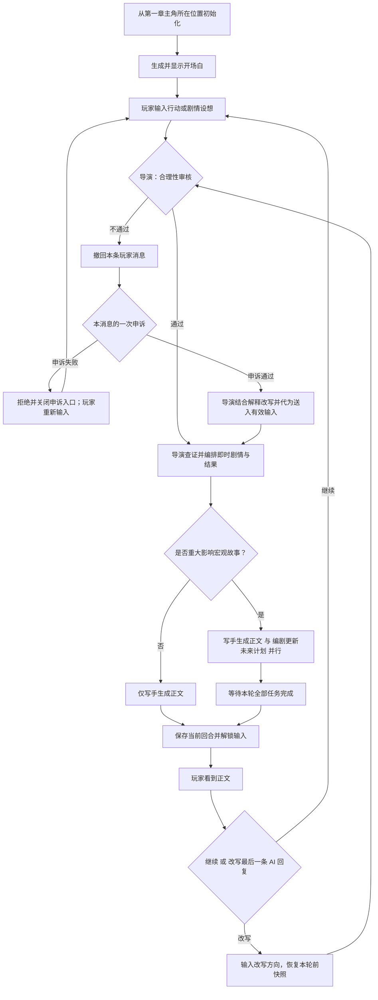

# WestWorld｜游戏 Agent 产品需求（分阶段）

> 版本：v0.2｜更新：2026-11-19  
> 性质：游戏阶段**产品需求与架构讨论基线**，将先前的游戏 Agent 架构讨论与最新明确的 **MVP 交互 SOP** 整合，按 **P0 → P1 → P2** 排实现优先级。**P0 编号已按本版开发依赖重新排序**，不与旧版编号一一对应。  
> 范围：仅涉及**进入游戏以后的**开局、自由输入、Agent 决策、剧情编排、正文生成、状态、存档及后续世界运行。小说导入、人物/地点/关系提取、世界书整理、原著事件网络和时间线串联等，均视为**已完成的上游资产**，不再重新列为需求。  
> 状态：这是**需求规划，不是代码已实现清单**。下文区分「已明确的产品流程」与「推荐的实现方式」「尚待确认」；不把尚未详细设计的约束写成已实现。

## 1. 产品目标与底层原则

**定位：** 从依赖原著路线的文字冒险，升级为玩家能够自由行动、世界可以演化、AI 像作家一样持续创作的**平行世界互动小说**。

1. **玩家行动开放。** 没有固定选项和预编完的分支；可延续、绕开、破坏原著路线，或完全离开原著舞台开辟新的生活与故事。
2. **世界约束真实。** 允许玩家提出极端行动，但「允许尝试」不等于「宣告成功」；能力、物品、人物动机和当前事实仍约束结果。
3. **后果长期有效。** 人物存亡、物品归属、已发生的事、关系、承诺与认知不能因上下文遗忘而失效。
4. **原著是参考路径，不是必须回归的轨道。** 事件可保留、改写、提前收束、延后、取消或变为新故事线。
5. **AI 具有作家能力。** 编剧维护阶段目标、人物弧光、伏笔与冲突，先画靶子、再找铺垫；玩家改变前提后必须允许改稿。
6. **程序负责确定性与可恢复性。** 世界事实、回合历史、分支、提交和回滚由程序管理；Prompt 不需要穷举玩家的无限种输入。
7. **体验延迟受控。** MVP 每轮同步等待的是「导演→写手」，仅重大影响再并行启动编剧；**编剧未完成时不得开启下一轮输入**。

**基本权限：已确认的世界事实 > 导演结算的本轮结果 > 编剧尚未发生的剧情计划 > 写手的文学表达。**

## 2. 目标职责划分：三 Agent + 世界引擎

| 组件 | 核心职责 | 边界 |
|---|---|---|
| **编剧 Agent（宏观）** | 维护未来篇章方向、主要矛盾、人物弧光、伏笔与回收；重大偏离后修订受影响计划 | 无权推翻已结算事实；不参加普通回合的同步规划 |
| **现场导演 Agent（即时）** | 审核玩家输入合理性；处理申诉；查证当前事实、判定行动结果；编排当轮场景/NPC 行动链；**判断是否需要编剧介入** | 不负责每轮重写宏观大纲；不能为了保留原著强行改变事实 |
| **写手 Agent（表达）** | 根据导演的剧情执行框架写成正文，控制人物语言、文风、节奏与描写 | 不得擅自改动关键结果；**不要求独立保存长期世界记忆**，按需读取本轮交接资料 |
| **世界引擎（程序）** | 保存本局状态、原著资产引用、回合快照、剧情计划、状态变更、Agent 任务及历史；校验与回滚 | 不预先穷举所有行动和剧情答案 |

- 玩家只看见一个游玩输入框和生成的正文，不直接选择三 Agent。
- `Canon`＝只读原著资料；`State`＝本局已经成立的事实；`Plan`＝编剧对未来的安排。三者分开存储，不互相覆盖。
- 导演负责**事实结算与即时场景**；编剧负责**未来计划**。需要二者协调时，以已结算事实为准。
- 三 Agent 指三个角色职责，是否分别采用独立的长期 Agent Session 以及内部实例生命周期，属于技术设计阶段决定。

### 2.1 写手 Agent 初步规划

> 2026-11-19 讨论记录：用户要求先将写手的职责、记忆方式和每轮所需材料记入需求规划，后续继续讨论其他 Agent。

**写手每轮独立执行，不维护自己的长期记忆。** 它根据导演给出的本轮剧情安排，结合上一轮发生的事和本轮涉及的人物、地点等资产，写出下一段小说正文。导演确定当下发生什么，写手负责将这些内容写成连贯的对白、动作和描写。

写手无需读取全部历史回合。当前描写涉及更早的经历、承诺或已透露的信息时，将相关事实随本轮材料提供给它；长期事实仍由程序保存。

| 每轮输入 | 内容与用途 |
|---|---|
| **导演的本轮剧情安排** | 本轮发生什么、人物如何行动、结果是什么、正文写到哪里停下。 |
| **近期正文与上一轮事实** | 上一轮发生了什么，以及需要承接的正文片段；必要时补充最近的相关片段，用于衔接对白、动作、情绪和行文节奏。事实摘要与正文片段分别承担事实交代和表达衔接的作用。 |
| **本轮涉及的资产与当前状态** | 相关人物的性格、说话习惯、关系，地点环境，以及此刻的伤势、位置、持有物品等。 |
| **本轮相关的历史事实** | 按当前剧情需要提供旧承诺、旧经历、已经透露的信息等，无需把所有过往回合都交给写手。 |

例如，人物十轮前承诺“绝不透露你的身份”，本轮再次谈及此事时，材料中应包含这项承诺。写手凭这条相关事实承接对白，无需回读此前十轮的完整对话。

写手输出本轮小说正文，遵循导演确定的关键结果。场景执行单的具体字段、材料由谁检索和组装，以及写手可以自由补充哪些细节，后续继续细化。

## 3. P0｜MVP：从第一章开局，到可申诉、可改写的完整游戏回合

> **P0 完成标准：** 玩家从小说第一章进入，收到开场白，能自由输入行动/剧情设想；导演进行合理性判断与即时编排；必要时编剧重规划；写手输出正文；流程全部完成才可进入下一回合；最后一条 AI 回复可整体回滚重写；重新打开存档后保持一致。

### 3.1 P0 需求清单（按建议实现依赖排序）

| ID | 需求 | 验收要点 |
|---|---|---|
| **P0-01** | **每局独立存档与世界线**：同一本书可有不同游玩存档；记录当前场景、回合、版本 | 关闭恢复正常；两局事实和计划互不污染 |
| **P0-02** | **最小世界状态**：人物存亡/位置、当前地点、时间、重要关系、物品、已发生事件、承诺、关键事实 | 未取得的钥匙不能凭空使用；已死人物不能无故出现 |
| **P0-03** | **查询与受控提交工具**：读取已完成的小说资产及本局状态；导演提出结构化变更，程序检查与保存 | 模型不得任意写库；能记录变更前后值及来源 |
| **P0-04** | **第一章开局与开场白**：从第一章起点确定原著主角所处位置、环境、在场人物与当时可知背景，生成开场正文 | 初始剧情不提前泄露后期才获知的秘密；展示开场后玩家可行动 |
| **P0-05** | **编剧最小初始计划**：围绕第一章开局建立可修改的近期矛盾/发展方向；不预写死唯一分支 | 下一幕有基本方向，玩家偏离时计划可取消或改写 |
| **P0-06** | **自由输入接收**：允许玩家输入一个行动、一串行动，或包含 NPC 行为、后续发展方向的剧情描述 | 能区分「玩家试图做什么」与「玩家希望他人/世界怎样响应」，后者不自动生效 |
| **P0-07** | **导演合理性审核**：先判断输入能否作为本世界可尝试的行动/剧情；明显违反既有世界规则者拒绝 | 「我要刺杀皇帝」若有行动可能则可尝试；「开局凭空成神」若无依据则不通过；通过不代表成功 |
| **P0-08** | **拒绝、撤回及一次申诉**：不通过时，界面显示原消息已撤回，并提供一次「申诉/重新编辑」入口；导演结合补充理由重新审核 | 申诉通过：导演结合原文和解释形成可执行输入，替代原消息进入正常链；申诉不通过：维持撤回，关闭本消息申诉入口，玩家须重新输入；拒绝不改动世界 |
| **P0-09** | **导演即时剧情编排**：对有效输入查询事实、判定行动结果、NPC 即时反应和场景变化，产出供写手执行的结构化剧情框架 | 能处理成功、失败、部分成功及连贯行动；必要时指出哪些玩家所述 NPC 行动并未实际发生 |
| **P0-10** | **重大剧情影响识别**：导演在本轮结果形成后，仅判断是否足以改变宏观事件/剧情目标及其依据；无需自己写完整的新大纲 | 姿势、地点、措辞等不改变关键结果的微小偏差不触发编剧；关键人物死亡、原事件前提失效等触发 |
| **P0-11** | **本轮事实和任务版本**：为导演确认的结果、待生成正文、待更新计划建立同一回合的版本关联；准备本轮前快照 | 编剧、写手接收到一致的有效事实；旧任务不会覆盖新版本 |
| **P0-12** | **写手正文生成**：依据导演的场景框架、人物信息及写作约束完成本轮小说正文；不要求写手有长期独立记忆 | 文本贴合当前结果，不擅自生成影响状态的关键新事实 |
| **P0-13** | **编剧按需重规划**：首次开局之外，普通回合不调用编剧；只有导演标记重大偏离才更新受影响的未来计划 | 计划改动以本轮事实为前提；无重大偏离时省去额外调用 |
| **P0-14** | **并行下游 + 回合输入锁**：导演完成后，写手始终执行；若需编剧，编剧与写手**并行**执行；本轮涉及的任务完成前禁止输入下一轮 | 写手可先显示正文，但编剧未完成仍禁发新消息；无编剧任务则写手完成后解锁 |
| **P0-15** | **最后一条 AI 回复「改写」**：玩家通过消息右下角菜单发起改写，输入期望方向；系统从**本轮前快照**恢复，再由导演重新审核/编排、必要时重规划、写手重新生成 | 正文、人物/物品状态、记忆、伏笔和宏观计划整体替换；上一版任务作废；MVP 仅支持改写**最后一条 AI 回复** |
| **P0-16** | **回合提交、重试与失败恢复**：记录玩家输入、审核、申诉、导演结果、写手正文、编剧计划和世界变化；异常时可重试/恢复 | 失败不造成重复扣物品或重复推进时间；不能因编剧失败而永久锁住输入 |
| **P0-17** | **日志与 MVP 回归测试**：记录 Agent 输入、工具调用、结果、模型/Prompt 版本及存档版本 | 可追查审核原因、重规划触发原因与改写前后的差异 |

### 3.2 MVP 确认的玩家体验 SOP

> 图示为**业务逻辑**：玩家发送后直到本轮完成一直锁住「新回合输入」；可在写手完成时先展示正文，若编剧尚未完成，界面仍显示规划中并保持锁定。改写意图在恢复快照后走同一导演审核流程。**拒绝申诉时不视为成功的一轮世界变更。**

### 3.3 SOP 关键规则

**A. 合理性 ≠ 行动成功。** 例如玩家可以尝试刺杀皇帝，但实际刺杀结果由导演结合当前条件判断。玩家可以叙述他人的行动或未来剧情；这部分作为**提议/期望**进入审核，不自动成为世界事实。

**B. 一条被拒绝的输入只有一次申诉机会。** 申诉成功后，导演可根据玩家原文与补充理由改写成可被接受的输入，然后代为继续本轮；需要保留原文、申诉理由和改写版本用于回看。申诉失败关闭**本条**申诉，玩家可以重新发出新输入。

**C. 「重大影响」看结果和前提，不看文本差异。** 场景细节变化、一般交流和动作细节不需要宏观改稿；若关键角色死亡、重要原著事件前提变化、长期人物目标或篇章结局需要改变，则触发编剧。边界判定的具体口径仍需要用样例调试。

**D. 编剧和写手可以并行，但不能放开下一轮。** 导演的当轮事实先确定；写手生成**当轮正文**，编剧只修订**未来计划**。本轮涉及的所有任务（若触发编剧也包括编剧）完成且状态保存后，才允许新的玩家输入；失败需提供重试或恢复。

**E. 改写是「回合重跑」，不是文本重生成。** 只能改写最后一条 AI 回复：先恢复到该轮**玩家行动之前**的世界状态和剧情计划，再根据玩家给出的改写方向重走导演 →（按需编剧）/写手。旧结果、旧规划任务、旧正文全部作废，不能残留在当前世界线。历史日志可保留作调试版本。

**F. 不能强行回原著。** 如果玩家不沿着原著路线，导演承接当前行动；宏观偏离触发编剧时，新计划要符合已发生事实。即使不符合原著，仍可继续游玩。

### 3.4 P0 实现约束与边界

- **建议实现方式（不是已敲定代码设计）：** 回合前保存一致性快照；导演结果作为本轮待提交版本，写手/编剧基于同一版本并行；任务成功后再将正式正文、计划与事实确认为可继续的回合。改写通过恢复快照/切换回合修订版本实现。
- **不在 P0 穷举：** 所有故事类型的专用 Prompt、完整物理引擎、逐个 NPC 的独立 Agent、全书人物每轮模拟、成熟伏笔打分。
- **已完成资产不重做：** P0 只调用人物/地点/事件/时间线等现有查询能力；如现有数据缺少开局当时的状态或事件依赖，属于需进一步设计的游戏侧映射/补足，不默认已存在。
- **性能：** 每个正常回合以「导演、写手」两次主要 Agent 创作为同步主链；编剧在重大偏离时并行触发，不承诺固定耗时，但保证下一轮不会读到尚未完成的旧计划。

## 4. P1｜动态剧情规划、伏笔与事件因果

> **目标：** 在 P0 流程稳定的基础上，让编剧真正能够持续维护篇章方向、人物发展、伏笔和动态改稿，提高长期剧情质量。

| ID | 需求 | 验收要点 |
|---|---|---|
| **P1-01** | **结构化创作档案**：阶段目标、主要矛盾、人物目标、备选场景、伏笔及回收意图、未完事项和计划版本 | 重新打开游戏后仍知道当前在铺垫什么、为什么铺垫 |
| **P1-02** | **计划生命周期**：保留、改写、提前兑现、延后、转后台、取消、新建篇章，并说明变更原因 | 玩家提前解决的冲突不应换皮再来；允许一段故事提前收束 |
| **P1-03** | **影响分析与因果关联检索**：根据人物、事件、地点、资源、目标和时间找相关资料；重大事件扩大关联范围 | 关键人物死亡能找到明显受影响的原事件和当前计划 |
| **P1-04** | **人物认知和动机**：保存 NPC 知道/相信什么、想做什么、承诺了什么、采取了什么行动 | 未得到消息的人不能全知；救过或欺骗过某人会改变后续行为 |
| **P1-05** | **新增人物、地点、故事线**：允许基于世界设定创作原著外内容，并保存进当前存档 | 玩家远走乡村，可持续展开新的关系和目标，不被强制回贾府 |
| **P1-06** | **动态事件路径**：复用原著事件网络，管理本局的前提、依赖、参与者、结果和替代路径 | 没救某人不会得到相应恩情，但仍能寻求合理的替代办法 |
| **P1-07** | **编剧触发策略优化**：在 P0 重大影响判定基础上，覆盖阶段目标达成、计划失效、长期未推进等信号 | 减少误触发、漏触发和无意义重规划 |
| **P1-08** | **导演—编剧交接协议深化**：明确导演上报事实和影响提示、编剧返回未来计划及适用范围 | 编剧只改变未来，不能覆盖导演已结算的过去 |

**编剧方法：** 从已发生的玩家行动**往后推真实后果**；从未发生的创作目标**往前安排铺垫**。两者冲突时修改创作目标，不篡改事实。

## 5. P2｜后台世界、自主 NPC 与长期运行

> **目标：** 玩家长期不参与原著主线，或同时有多条发展线时，世界仍能延续并保持可追溯的历史。

| ID | 需求 | 验收要点 |
|---|---|---|
| **P2-01** | **后台事件调度**：以游戏时间、事件条件、NPC 目标和约定推进重要后台事项 | 玩家远离原剧情时，重要事件不全部静止 |
| **P2-02** | **前台/后台故事切换**：前台表现玩家可感知的事；后台事件通过消息传播和因果联系再进入玩家视野 | 角色不会凭空获知远方秘密；回到旧地能发现合理变化 |
| **P2-03** | **多线事件网络和长期伏笔台账**：维护并行事件、未兑现承诺、伏笔回收及失效原因 | 多线运行时重要旧线索不会无故消失 |
| **P2-04** | **大跨度时间推进**：旅行、隐居、种田三年等批量推进；遇需玩家决定的关键事项停下交互 | 不擅自替玩家作出重大人生选择 |
| **P2-05** | **长期记忆/上下文检索优化**：区分当前摘要、世界事实、人物认知、创作计划和日志；按相关性装配上下文 | 不依赖无限增长的对话历史；必要时召回旧因果 |
| **P2-06** | **剧情质量、成本及耗时评测**：一致性、伏笔质量、偏离主线表现、调用次数/延迟/Token | 能复盘遗漏召回、错误判定和失败重试等问题 |
| **P2-07** | **多分支历史及恢复增强**：分支树、版本比较、多轮回溯、异常修复 | 读档分叉不互相污染；超出 P0「只改最后一轮」的范围 |

**后台原则：** 重要变化结算并保存，普通细节在不冲突的前提下延后展开；没有必要逐人逐秒推演整个世界。

## 6. 通用技术约定

- `pi-ai`：统一模型 API；`pi-agent-core`：导演/编剧等工具调用与循环底座。写手是否采用完整 Agent 循环按实际需求决定。
- `TypeBox`：规范工具、导演交接、写手输入、计划更新与状态提交的结构；类型检查不能代替剧情合理性判断。
- **Prompt 独立 `.md` 管理并版本化**：固定角色职责、判断路径、资料检索策略、边界和交付协议，不穷举玩家行为。
- 不同 Agent 可以用不同模型，统一由现有模型配置经 Pi 接口调用。
- 沿用项目的本地数据库；原著资产只读使用，游戏内变化存到独立世界线。
- **重现的定义：** 已保存的输入、输出、状态、计划可按历史记录重放；重跑概率模型不保证产生完全一样的创作文本。
- 上下文压缩、检索和记忆机制本次**暂不细化**；不能因此省略 P0 必需的事实持久化与读取。

## 7. 优先验收场景

| 场景 | 预期 | 优先级 |
|---|---|---|
| 第一章开局 | 从主角所处位置发出环境/已知背景开场白 | P0 |
| 「我凭空成为神」 | 无事实依据时拒绝、撤回并开放一次申诉；失败后只能重新输入 | P0 |
| 合理刺杀皇帝的尝试 | 审核通过不等于刺杀成功；导演先判断结果 | P0 |
| 刺杀真的成功并破坏原剧情 | 导演提交结果，编剧与写手并行；写手完毕但编剧未完成时输入仍锁定 | P0 |
| 改写刚才的「皇帝死亡」 | 本轮前状态恢复、旧计划作废、重新判定和生成；皇帝不保留上一版死亡事实 | P0 |
| 普通对话、场景细节和轻微剧情变动 | 只经导演+写手，不触发编剧 | P0 |
| 玩家同时写出自己的行为与 NPC 反应 | 导演审查 NPC 行为，不直接采信玩家声明的结果 | P0 |
| 玩家没有钥匙却想开门 | 不能凭空变出钥匙；可以尝试其他合理方法 | P0 |
| 玩家退出原著去乡村生活 | 可持续自由游玩，不强行回主线 | P0 可运行、P1 丰富 |
| 提前救下原著必死人物 | 后续依赖死亡的计划与事件重新判断 | P1 |
| NPC 获知秘密或误信谣言 | 按认知行动，其他 NPC 不自动全知 | P1 |
| 玩家三年后重返旧地 | 后台重要事件与人物变化可以被合理承接 | P2 |

## 8. 尚待细化，不应当作已敲定

1. **导演交付给写手的场景协议**：事件事实、人物动作链、玩家可见信息、叙事目标、停手点、可创作范围如何结构化。
2. **合理性规则的细则**：玩家一次输入多个行动、代写 NPC 行为、创造新设定、要求神级能力，哪些拒绝、哪些视为尝试或提议；申诉通过时改写输入如何展示。
3. **重大影响的阈值**：判断对象是玩家输入还是导演结算结果（本版建议以**结算结果为主**）；如何召回相关未来事件避免漏判。
4. **P0 编剧初始计划和触发规模**：第一章初始化规划多少，以及何种偏离需要立即修改。
5. **回合提交和撤销的具体事务机制**：快照/事件日志、并行任务版本、改写后旧任务终止、正文提前展示与最终确认时机。
6. **写手新事实与场景变化的校验**：如何处理写手自行产生的关键事实和超出框架的结果。
7. **失败与锁定恢复**：模型超时、编剧更新失败、浏览器刷新时，如何保留结果并允许重试而不是死锁。
8. **后台推进与长期记忆**：属于后续 P1/P2 详细设计；不得提前虚构已落地。

---

**实施顺序一句话：** **P0** 做成「第一章开场 → 自由输入 → 导演审核/一次申诉 → 导演即时编排/重大影响识别 → 写手（必要时与编剧并行）→ 本轮任务完成解锁 → 可回滚改写」；**P1** 完善编剧长期创作；**P2** 让远离玩家的世界持续演化。
