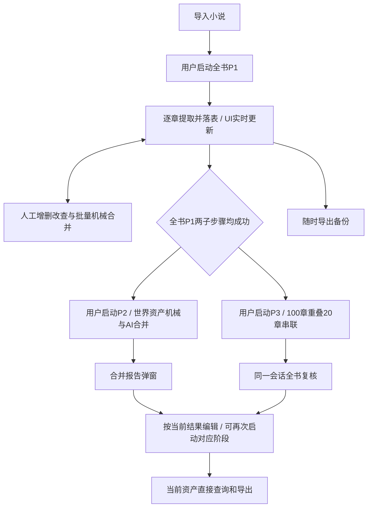
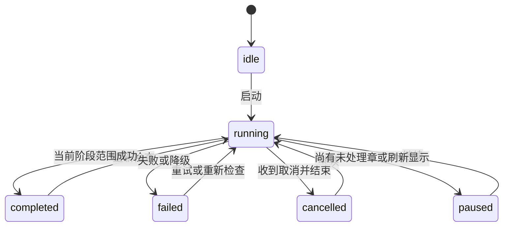

# WestWorld V2 · 产品需求文档

> **阶段0修订（2026-10-24）：** P2持有world域锁时禁止同书人物/地点人工写入，P3持有narrative域锁时禁止节点/事件线人工写入；UI与命令事务均校验，拒绝返回`ASSET_DOMAIN_LOCKED`。取消须等在途提交停止并释放锁才恢复编辑。P1人工编辑、跨书编辑、只读和备份不受此域锁限制。P2/P3仍可并行，保留跨域实际读依赖校验。direct首次/网络重发/至多一次修正合计最多3次实际请求；P2身份核实按[世界资产整理决策](../decisions/world-organization.md)收尾；P3预算见[叙事整理的排队与恢复](../decisions/story-organization.md)。详见[阶段0决策](../decisions/stage-edit-lock-and-request-budget.md)及当前机器契约。历史证据不代表新规则已在业务应用执行。

| 文档控制项 | 内容 |
|---|---|
| 文档编号 | WW-PRD |
| 文档版本 | 2.2 |
| 产品 / 应用包版本 | WestWorld V2 / 1.0.0 |
| 复现基线 | WWV2-WORKTREE-20261021；实际工作区快照，含未提交文件 |
| 文档状态 | 2.2 目标规格待评审；本次只改文档，未宣称应用已实现 |
| 编写 / 维护 | Codex 编写；后续维护责任人待指定 |
| 产品决策 / 审核 | 用户；本文尚未标记为已审核通过 |
| 创建 / 更新 | 2026-10-21 / 2026-10-24（Asia/Shanghai） |
| 共同术语 / 文档导航 | [统一入口](00-阅读入口与术语.md) |
| 缺陷策略 | 已知缺陷优先修复，禁止复现旧错误；07修复条款优先 |

### 修订记录

| 版本 | 日期 | 变更 | 影响 |
|---|---|---|---|
| 2.0 | 2026-10-21 | 建立正式重建规格、机器契约、交互与兼容验收 | 确立2.0规格基线与忠实复现范围；不修改应用 |
| 2.1 | 2026-10-21 | 补17张实际表、60组UI动作、14字段流、完整工具返回及独立验收 | 保留应用与兼容行为 |
| 2.2 | 2026-10-21 | 全书P1先行；P2世界资产整理与P3事件组织解耦；补实时编辑、批量合并和同书持续会话 | 目标设计变更；旧实现证据不作新验收结论 |
| 2.2 | 2026-10-22 | 用户澄清：提取直接存实体，后续直接CRUD/合并；删除草稿/入库双层 | 单书15表，无发布按钮或重编号 |
| 2.2 | 2026-10-22 | AI统一Pi：direct/agent共用模型层、校验与错误；Agent受控工具读写，应用持久化长期记忆 | 目标规格澄清；未改应用代码 |
| 2.2 | 2026-10-23 | 补18表完整字段与样例、16业务工具契约、Pi迁移/coding取舍与禁用能力 | 明确当前实现与目标补充；专项验收待应用执行 |
| 2.2 | 2026-10-24 | 明确任务身份、命令意图、逐项覆盖、完整Prompt组装和隔离探测；补接口与验收夹具 | 目标需求补全；应用及独立重建仍待执行 |
| 2.2 | 2026-10-24 | 用户明确要求规划时修复已知缺陷，撤销错误行为兼容义务 | 修复后结果作为重建验收；旧失败只作历史证据 |

> **版本边界：** 本文为2.2目标规格。2.1源码取证、旧机器契约、截图和51项历史验收只证明旧实现；新流程的权威机器补充见[2.2契约](resources/v2.2/pipeline-contract.json)，变更对照见[13](13-流程变更与冲突对照.md)。未涉及的字段与算法沿用旧定义；不得把旧资源的流程、锁、会话和按钮规则用于覆盖2.2。

## 1. 产品定义与目标

WestWorld V2 为单用户提供小说资产工作台。用户必须能够导入小说、预览分章、配置模型、提取人物地点与事件、归并资产、串联事件线、直接修改数据库资产、查看事件网络与编辑过程，并通过备份迁移工作成果。

### 1.1 目标与成功条件

| 目标 | 可验收成功条件 |
|---|---|
| 形成可检查的小说资料 | 分章后的正文可持久保存；人物地点与事件可查看、修订并重载 |
| 支持分步处理 | 单章试跑与直接写入实体的阶段执行有明确区别，失败和取消后保留已提交结果 |
| 组织故事事件 | 支持事件线、多线共享节点、散落节点及章节轴展示 |
| 直接使用当前实体 | P1成功即写characters/locations/nodes；后续直接改同一记录，不复制发布或重编ID |
| 迁移单书工作成果 | 备份可作为新书恢复，保留当前实体、进度和编辑历史 |
| 流程可用 | P1逐章可见和可编辑；P2/P3独立并行、可取消恢复，按2.2验收 |

不设未经产品决定的商业转化、模型正确率、响应耗时或容量指标。功能验收与真实模型内容质量评测分开。

### 1.2 范围

**资产主线：** 资产、设置与游玩入口，TXT导入、模型配置与探测、全书三阶段处理、资产管理、网络、编辑记忆、会话压缩、备份与整书删除。

**后续游玩接入：** 每本书对应独立会话窗口，用户与该书的智能体交互，在同一窗口查看回复、工具执行和上下文压缩状态。离开窗口、切书或刷新后，可以恢复该书已保存的历史。工程顺序见[分阶段计划](../分阶段实现与人工验收计划.md)的游玩会话接入安排。

应用采用单用户浏览器与本地数据库运行。玩家行动结算、世界演化、世界线与回合存档由游玩业务工具契约定义。

**范围外：** 多人账户、组织权限、云同步、独立业务服务器、新增格式导入和移动版重设计。

### 1.3 业务数据与表数量

全局库3表：credentials、appSettings、books。每书15表：chapters、chapterTexts、characters、locations、nodes、eventLines、compileProgress、storyEditorMemory、storyEditorNotes、storyEditorCheckpoints、storySessions、storySessionEntries、extractionReceipts、assetLifecycle、pipelineRuns。

characters/locations/nodes/eventLines是唯一当前业务数据。P1成功直接写入，用户与P2/P3都在这些表上操作；不存在独立草稿层、冻结实体副本或“入库/发布”按钮。提取成功即能查询、编辑、合并和导出，P2/P3未完成不会让已写数据失效。

节点保存行动人物编号和对象人物编号，名称作为当前显示值。人物删除、改名或合并时，代码在同一事务更新关联节点；原文章节与参考引文保留。事件线人物集合由节点关联读取生成。P2操作世界资产并同步维护人物关联，P3比较节点修订号后提交。

节点编辑统一使用“涉及人物”，支持搜索、多选和按身份区分同名，资料中找不到的称呼可暂存。概述与详细经过说明行为方向、物品和地点。已有两类人物统一展示，存储保留原有归类；非人物对象保留并在详细经过中呈现。

全局3+单书15，共18种表定义。记录修订号、幂等凭证和并入/删除映射保障直接修改的并发安全，不构成待发布草稿。

## 2. 用户、权限与数据边界

产品角色为本机浏览器使用者。三个标签必须始终可见，不提供登录、管理员或租户选择。操作限制按任务、选书和组件状态执行，不得增设服务器授权。

| 资源/动作 | 权限与限制 |
|---|---|
| 查看书架、设置 | 无登录条件 |
| 查看/编辑资产 | 需要当前书；直接存于该书当前实体表 |
| 启动编译 | 入口可点击条件及同书锁按UI与技术Spec执行 |
| 模型探测 | 读取已保存配置，要求Key；不得自动使用输入框未保存内容 |
| 读取凭据 | 页面仅获配置状态和掩码；底层调用读取明文 |
| 导出 | 当前书的资产与历史；不得包含设置库Key |
| 整书删除 | 弹窗确认，同书编译锁未占用；只删本书浏览器数据 |

本地分库不提供对同源脚本的安全隔离。API Key必须按基线明文保存并显示明确告知；不得将密码框描述为加密。

## 3. 信息架构与用户旅程

P2和P3入口彼此独立，不自动启动下一阶段，也不要求P2完成才能P3。P1失败或尚未提取的章仍允许查看和人工处理已落表内容；“全书P1完成”只表示每章的世界/叙事子步骤均已成功提交，不要求用户保留所有提取条目。

## 4. 功能需求

### FR-01 书架与切换

- 书籍必须按导入时间倒序排列，显示导入时间、书名（相同名称的在书名后加入（1）（2）...等标识）、章/块数和人物/地点/节点/线的）资产数量。
- 书架显示当前人物/地点/节点/线数量与各阶段进度，
- 首次载入资产页时，未选书且书架非空必须选最新书。刷新回到资产标签；不恢复上次活动标签。
- 切书清空资产详情选择；保留其他界面状态的范围按UI规范。可以在左侧书架自由切换不同书籍的资产
- 书架必须提供进入、导入、导出、整书删除以及目录选择。禁用条件按UI-02，不得用一个“忙碌”变量替换全部独立条件。
- 当空书架时或者用户点击“导入小说/导入另一本”时资产界面切换到小说导入界面，书架显示保持不动。

### FR-02 TXT导入与预览

**入口：** 空书架或“导入小说/导入另一本”。**输入：** 首个文件、编码、章节正则。**结果：** 新书、分章正文、初始进度。

1. 选择器与拖放统一校验单个TXT；busy禁用，仅最新加载结果生效，失败不得导入旧预览。
2. 自动先UTF-8严格解码再GBK；提供两种重读按钮。
3. 必须允许编辑正则、恢复默认、重新预览；无效/零宽匹配报错。编辑后旧预览不得用于导入。
4. 预览最多展示全部解析到的章节，在可以滑动的列表中展示。切段/切块阈值、编号及首标题前丢弃行为见ALG-01和BUG-01。
5. 预览展示的是正则提取到的小说章节名称以及该章节的字数（注意超过字数阈值的要切分）有一个函数专门用来检测和切分章节，新的章节命名用小数表示，例如可能章节ID为30的切分以后变成30.1/30.2
6. “仅导入”只保存；“导入并开始P1提取”保存后进入工作台并启动全书P1，完成后等待用户选择P2/P3。
7. 空结果阻止导入。新书ID每次不同，书名去掉文件名最后扩展名；不复用已有同名书。书名（相同名称的在书名后加入（1）（2）...等标识）

### FR-03 模型、凭据与探测

- 必须独立保存服务地址、提取模型、归并模型及归并上下文容量；默认值见AR-05。
- Key单独保存/清除，已有Key仅显示末4位提示（长度≤4全部打码）。输入Key未保存时不得影响探测。
- 并发默认3，保存四舍五入限制1–16；保持无效数字边界行为，不额外发明校验。
- 拉取模型、文本测试与归并工具测试必须采用AI-01规定的不同协议，不得将“连接成功”视为结构化提取成功。
- 设置页必须展示明文存储与原文发送告知、存储估算、清空日志及备份区。按适配器鉴权能力统一禁用条件与提示，修复BUG-05。

### FR-04 逐章提取与即时可编辑

- P1按Chapter.order逐章执行，同章依次尝试世界资产、叙事资产两个独立请求；一个失败仍尝试另一个。P1固定单章在途，不受旧并发3配置影响。
- 用户在**预览列表**中就能看到每个章节的提取情况（例如✓/×（分别是世界资产和叙事资产的提取情况））
- 每个子步骤最多3次实际Provider请求（含首次、网络重发及至多一次修正），鉴权等不可重试错误立即失败；用尽后可以人工手动点击重跑（这个列表不仅能看到章节名字和字数还能看到章节资产提取的情况，提取失败时还能点击旁边的按钮手动调用AI重新提取）
- 提取完后，P1按钮变为重跑失败的章节  
- 每个成功子步骤将结果、提交凭证和进度放入同一事务；提交后响应式列表立即更新，每章结束更新计数，不等待100章或全书结束。
- 模型将同一人物的主名和别名放在一条记录；真实同名异人按身份区分。代码仅去除完整DTO相同项，同名不同身份资料分别保留，跨章条目保留；代码分配ID进入数据库。用户可在提取期间增删改查世界/叙事资产、手动合并人物地点。
- 成功凭证控制幂等；恢复只补未成功的子步骤。人工已删/已并入的原始ID不得被重试复活，用户编辑不得被在途模型结果覆盖。
- 取消不提交取消后的在途结果，已提交成果保留。P1不调用归并或事件串联。

### FR-05 全书前置与独立恢复

全书每章/块的两子步骤成功后P1完成，解锁P2、P3。两者可按任意先后启动，也可同时运行；同阶段禁止重复启动，取消/失败只影响该阶段。P1阶段失败、部分完成或历史样本完成均不能解锁。

“继续P1”“重新整理世界资产”“重新串联与复核”分别操作对应任务；不再存在每窗口P1→归并→串联或自动全流程入口。恢复检查本阶段的范围、计划版本和依赖指纹，保留人工成果和已经提交的批次。

 
### FR-07 世界资产整理P2

P2提供代码整理与AI整理两个独立入口。代码整理自动查找名称候选，由用户核对成员并确认后，以纯代码融合资料；全程使用本地数据。AI整理通过Pi智能体分页查询精简资料、核对原文并提交有证据的合并，再筛选冗长、重复或冲突档案按需整编，保存报告。用户可以单独运行任一入口。代码合并累加资料并做确定性去重；AI整编保留有来源的事实底稿。

同名、包含与别名相似度严格大于0.9仅生成候选；实际融合须人工确认或通过带原文证据的AI提交。阈值、事实覆盖、冲突和预算见04。低把握分组保留分开并报告，不凭相似描述合并不同实体。P2不创建事件线、不写故事记忆、不重置P3。

结束报告列出人物/地点前后数量、机械/AI分组、保留ID与主名、别名、整编变化、失败/跳过/冲突、用量及最终状态。部分成功不能标为全部成功；刷新后可重开报告。

### FR-08 事件组织P3

P3为同一本书的持续story_editor Agent。先按100原章、重叠20章顺序扫描所有窗口，只提交高置信关联；窗口详情可分页分批，不能因节点批量上限漏掉章内后续节点。窗口扫描结束后才进入全书复核。

全书复核遍历全部孤立节点、全部事件线和待复核事项，检查跨窗关联、伏笔回收、关键因果环节是否遗漏；允许自由调用本书只读工具、节点/线详情和对应章节原文。孤立可以合理存在，无证据不得强行归线或补点。节点参考引文可为空，未精确匹配时提示并保留节点；事件内容应以章节为依据。

支持新建/追加/更新/合并事件线、多线共享节点；节点、线、记忆、覆盖游标、检查点同批提交。P2并行变化只在P3实际读取并依赖的世界资料发生变化时使相应判断过期，不因全库世界指纹变化拒绝所有P3提交。

### FR-09 人工编辑与批量合并

人物、地点、节点、事件线均提供增删改查；手工新增的必要字段、来源说明和ID见03/06。本次新增与编辑先核同书对应资产域锁，再执行必要字段/引用校验，保存采用revision比较；编辑期间外部更新显示冲突，不覆盖用户未保存输入。

人物/地点列表点击“手动合并”进入多选，至少选择同类型两项，点击“确定合并”进入预览，明确保留条目及主名（从所选主名/别名选择，也可输入新非空主名）；其余称呼归别名。确认后调用机械融合事务。资料变化须重新预览；成功清多选并展示结果；失败保留选择供刷新。具体可恢复边界见ALG-07。

人工操作使相关阶段结果按实际依赖过期，但不撤销P1成功凭证。P1进行中仍可操作，重复名称的新章快照照常显示，用户可再次手动合并或等P2。

### FR-10 直接持久化与即时生效

P1校验成功的子步骤直接写characters/locations/nodes。人工新增、保存、删除和机械/AI合并均更新同一份记录；P3直接写nodes/eventLines。事务成功就是本次数据修改生效的时点，不需要再复制到另一份实体表。

实体ID在创建时分配，后续修改不变；合并保留用户选择或规则选出的目标ID，其余来源写redirect；删除留墓碑。取消或AI失败只影响尚未提交的工作，已提交机械/人工/AI结果继续有效。

阶段completed/current只表示整理覆盖是否完成；stale只表示相关整理结论需要重查，不能禁用已存资产或要求重新“入库”。P2/P3的启动仍要求全书P1完成，与已写数据即时可用是两个不同条件。

人物称呼到ID在读取时解析，重名歧义展示待核实。不得为当前实体增加P001/L001发布重编号、冻结副本或发布门槛。

### FR-11 事件网络

所有节点须按章与章内次序展示，含散落点；共享点只画一次。虚线仅表示线内顺序，不表示因果。线名点击高亮并淡化其他内容，节点点击打开编辑。支持缩放、全图、起点与1:1；禁止拖动节点和手工连线。布局与缩放参数见UI-06、ALG-09。

### FR-12 编辑记忆与会话

故事编辑必须按书和会话保存摘要、带引用判断、复核事项、原始消息与压缩记录。资料变化计算过期标记。历史会话仅供回查，不代表新会话完成。继续、失败重试、重新串联和全书复核均续用本书同一个活动会话，追加新任务消息；不同bookId不共享历史或记忆；压缩不删除原始条目。

记忆列表50条分页、完整消息30条分页、单条12000字符分段；最近5个批次不能包装为五回合存档。读写工具与两个Agent职责按AI Spec隔离，业务/记忆写入由受控工具提交。

### FR-13 备份、恢复与删除

备份必须包含单书原文、当前四类资产、提取凭证、来源映射、报告、进度、记忆和会话；排除API Key、应用配置和内存日志。导出支持目录与下载两种方式；下载提示保持“已请求下载”语义。

恢复必须先显示可用预检结果，确认后新建书和数据库、标题加“（导入）”，不覆盖原书。预览统计当前实体；新格式按03校验，书架/单书跨库非原子边界仍明确。整书删除必须弹窗确认，可先导出；不删除其他书、凭据和本地备份。

### FR-14 按书独立的游玩会话

每本书有自己的游玩会话窗口、智能体实例、历史和摘要。打开书籍时加载或创建该书会话，恢复时重新创建运行实例并装入已保存上下文。不同书籍可以使用同一套模型配置，各自的消息、摘要和工具作用范围按书隔离。

发送消息、查看回复、调用工具、取消和查看压缩状态均在当前书的窗口呈现。原书仍在执行的任务按原书身份保存结果，切书后的窗口显示目标书记录。完整对话、工具结果和原文章节持续保存，压缩只改变后续发送给模型的上下文。

游玩入口按工程计划启用真实会话；启用前明确显示占位状态。会话生命周期见[AI-16](05-Spec-AI与会话.md#ai-16-按书运行与会话生命周期)，窗口交互见[UI-10](06-界面与交互规格.md#ui-10-游玩入口与书籍会话窗口)。

### FR-15 统一Pi AI运行与可持久化Agent

AI统一采用pi-ai模型调用层和pi-agent-core Agent执行/运行状态管理层。支持direct（API+Prompt，无自主工具循环）和agent（Pi管理循环、工具和运行状态），共用设置里的模型配置、校验和错误处理。模型角色配置与执行模式分开，不要求用户维护两套Provider/Key。

所有生成测试、P1提取、整编、压缩、结果修正和Agent底层请求均通过pi-ai；设置页不能走另一条生成HTTP实现。模型目录发现接口不属于推理。缺少所需协议/工具能力时显示统一明确错误，不因换模型而绕开框架。

P2判同使用临时Pi Agent；P3使用本书持续Pi Agent会话。长期消息/记忆和业务资产由应用持久化，Agent通过受控读写工具访问。写工具与直接调用共用业务校验/事务，成功确认即修改当前实体；最终回复只报告已提交结果，失败后不能回滚已成功提交的部分。细节见02 AR-11及05 AI-00/04/11。

## 5. 状态与业务闭环

`completed`只对记录的阶段、全书范围与依赖指纹有效；资料变化显示`stale`并要求重跑对应工作，不把旧成功标记当作当前完成。成功数、失败数、总数和进度条必须分开。类型包含`cancelling`不意味着取消按钮必定显示该过渡状态。进度条包含失败单元，100%不可解释为全部通过。内存事件按bookId+stage+runId隔离；P2/P3各有自己的状态、计数、日志和取消控制器。

## 6. 非功能与兼容要求

1. 数据保存在当前浏览器来源的IndexedDB；清理浏览器数据会影响成果，备份为单独文件。
2. 页面关闭中断任务，无独立服务器续跑；恢复须用户点击继续。
3. 技术栈和未变协议沿用2.1；变更流程和Prompt按2.2资源实现，不新增云端代理。
4. 工具返回、步数、超时、重试和上下文预算必须有界；不增加原基线不存在的费用预算硬停止。
5. 桌面验证基准1440×1000；窄视口保证全部操作可达；小于768px使用堆叠区域和内部滚动，不复现拥挤缺陷。
6. 不设未经测量的响应时间、总字数或语义正确率SLA；模型错误和费用展示按实际边界定义。

## 7. 验收与开放决策

功能验收以[07](07-验收与兼容缺陷.md)为执行清单，结构与数据以[03](03-Spec-数据与存储.md)为准，界面以[06](06-界面与交互规格.md)为准。已知缺陷按07修复要求纳入本基线；未知服务适配、模型语义质量保证及未来游戏引擎仍需另外定义。

## 2026-10-23 · 字段与工具契约对接

业务对象字段的完整定义见[03第8–9节](03-Spec-数据与存储.md#8-完整逐表字段字典2026-10-23校订)。模型能执行的业务工具见11第6节；本产品不因使用Pi而获得编码Shell或任意文件访问，包与能力范围见02 AR-12。

## FR-CLARIFY 可恢复、可判断完成的处理要求（2026-10-24）

1. 运行与批次必须有稳定身份：关闭页面后继续同一任务，已完成写入不得再次应用；新一轮重查与继续中断任务要区分。
2. 成功必须有数据依据：模型回复、工具调用开始和请求HTTP成功都不等于写入成功。阶段完成必须由当前清单的有效覆盖证明，允许合理孤点和待人工核实判断保留。
3. 人工编辑必须受尊重：只使依赖被修改事实的任务重查；不覆盖人工内容，不因无关修改重跑整书。持续变化或无进展时明确暂停及剩余项，而不是无限重试或伪装完成。
4. 模型设置测试必须验证真实目标链路：文本生成走同一模型层，Agent探测在隔离样本执行规定读写和总结；不查询或修改真实小说。

这些要求的字段/事务见03第10节和04 ALG-12，精确模型请求见05 AI-14/15，界面反馈见06 UI-12，固定恢复用例见12。名称误合并已纳入修复规格，实际实现通过回归后才可标记已修复。
