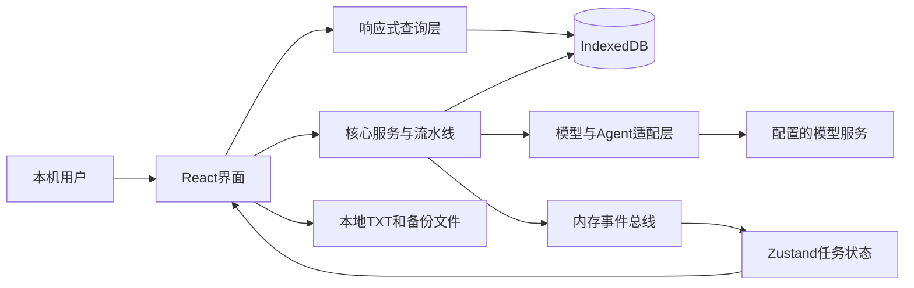
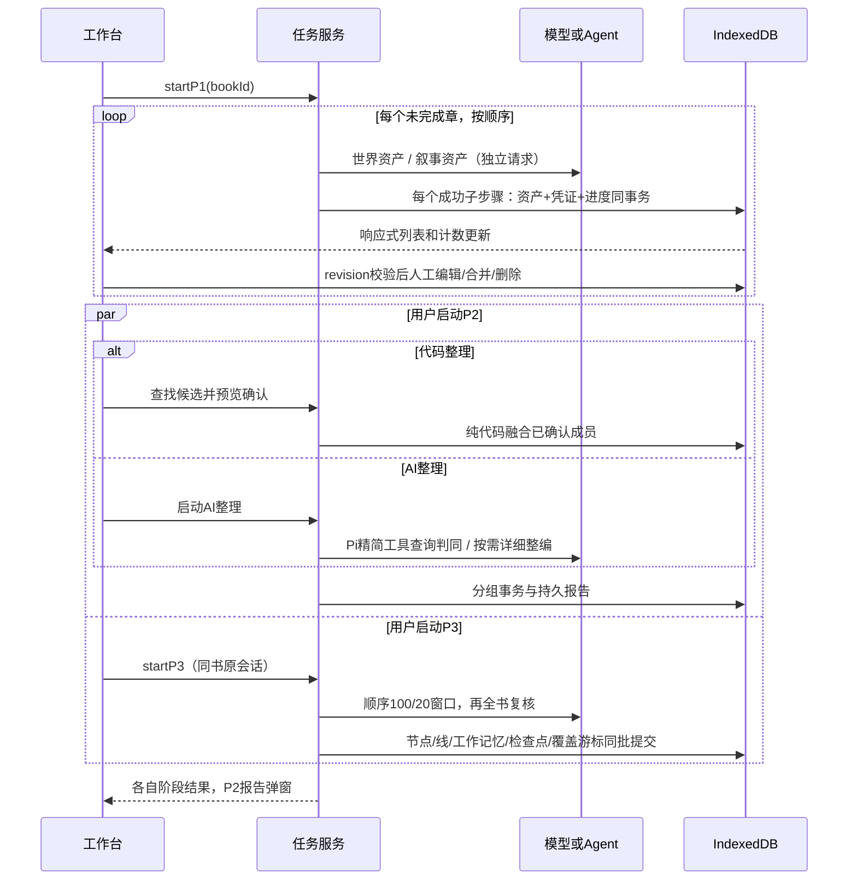
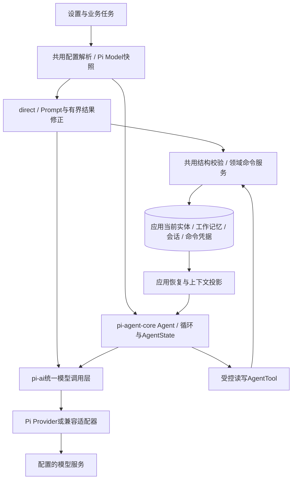
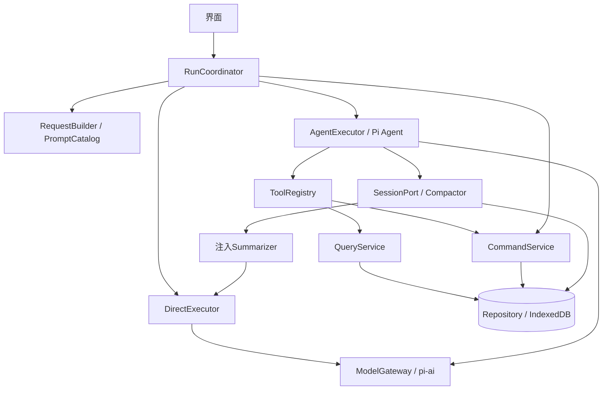

# WestWorld V2 · 架构与技术规格

> **阶段0修订（2026-10-24）：** P2持有world域锁时禁止同书人物/地点人工写入，P3持有narrative域锁时禁止节点/事件线人工写入；UI与命令事务均校验，拒绝返回`ASSET_DOMAIN_LOCKED`。取消须等在途提交停止并释放锁才恢复编辑。P1人工编辑、跨书编辑、只读和备份不受此域锁限制。P2/P3仍可并行，保留跨域实际读依赖校验。direct首次/网络重发/至多一次修正合计最多3次实际请求；P2身份核实按[世界资产整理决策](../decisions/world-organization.md)收尾；P3预算见[叙事整理的排队与恢复](../decisions/story-organization.md)。详见[阶段0决策](../decisions/stage-edit-lock-and-request-budget.md)及当前机器契约。历史证据不代表新规则已在业务应用执行。

| 文档控制项 | 内容 |
|---|---|
| 文档编号 | WW-ARCH |
| 文档版本 | 2.2 |
| 产品 / 应用包版本 | WestWorld V2 / 1.0.0 |
| 复现基线 | WWV2-WORKTREE-20261021；实际工作区快照，含未提交文件 |
| 文档状态 | 2.2 目标规格待评审；本次只改文档，未宣称应用已实现 |
| 编写 / 维护 | Codex 编写；后续维护责任人待指定 |
| 产品决策 / 审核 | 用户；本文尚未标记为已审核通过 |
| 创建 / 更新 | 2026-10-21 / 2026-10-24（Asia/Shanghai） |
| 共同术语 / 文档导航 | [统一入口](00-阅读入口与术语.md) |
| 缺陷策略 | 已知缺陷优先修复，禁止复现旧错误；07修复条款优先 |

### 修订记录

| 版本 | 日期 | 变更 | 影响 |
|---|---|---|---|
| 2.0 | 2026-10-21 | 建立正式重建规格、机器契约、交互与兼容验收 | 确立2.0规格基线与忠实复现范围；不修改应用 |
| 2.1 | 2026-10-21 | 补17张实际表、60组UI动作、14字段流、完整工具返回及独立验收 | 保留应用与兼容行为 |
| 2.2 | 2026-10-21 | 全书P1先行；P2世界资产整理与P3事件组织解耦；补实时编辑、批量合并和同书持续会话 | 目标设计变更；旧实现证据不作新验收结论 |
| 2.2 | 2026-10-22 | 用户澄清：提取直接存实体，后续直接CRUD/合并；删除草稿/入库双层 | 单书15表，无发布按钮或重编号 |
| 2.2 | 2026-10-22 | AI统一Pi：direct/agent共用模型层、校验与错误；Agent受控工具读写，应用持久化长期记忆 | 目标规格澄清；未改应用代码 |
| 2.2 | 2026-10-23 | 补18表完整字段与样例、16业务工具契约、Pi迁移/coding取舍与禁用能力 | 明确当前实现与目标补充；专项验收待应用执行 |
| 2.2 | 2026-10-24 | 明确任务身份、命令意图、逐项覆盖、完整Prompt组装和隔离探测；补接口与验收夹具 | 目标需求补全；应用及独立重建仍待执行 |
| 2.2 | 2026-10-24 | 用户明确要求规划时修复已知缺陷，撤销错误行为兼容义务 | 修复后结果作为重建验收；旧失败只作历史证据 |

> **版本边界：** 本文为2.2目标规格。2.1源码取证、旧机器契约、截图和51项历史验收只证明旧实现；新流程的权威机器补充见[2.2契约](resources/v2.2/pipeline-contract.json)，变更对照见[13](13-流程变更与冲突对照.md)。未涉及的字段与算法沿用旧定义；不得把旧资源的流程、锁、会话和按钮规则用于覆盖2.2。

## AR-01 运行形态与系统边界

应用必须为浏览器SPA，无业务HTTP服务器、桌面壳或独立任务进程。静态资源由Vite开发服务器或构建后的静态站点提供。React页面、核心处理、数据库和模型客户端均运行在浏览器；网络请求直接到配置模型服务。文件读入和下载由浏览器执行。

UI调用核心能力、通过查询层观察数据。数据库是持久业务来源；Zustand仅保存界面选择及任务实时状态，不能维护另一份权威资产数组。

## AR-02 技术栈与依赖

以[完整依赖锁](resources/runtime/pnpm-lock.yaml)和[实际安装版本](resources/runtime/resolved-dependencies.json)为版本依据，不仅依赖package中的范围声明。

| 层 | 基线 |
|---|---|
| 语言/构建 | TypeScript 6.0.3，Vite 8.3.2，React插件6.1.1 |
| 页面 | React/ReactDOM 19.3.0；StrictMode；ReactDOM createRoot |
| 样式 | Tailwind CSS 4.3.3；无自定义CSS设计系统，入口`@import "tailwindcss"` |
| 状态 | Zustand 5.0.15；业务查询dexie-react-hooks 4.4.0 |
| 存储 | Dexie 4.4.6，IndexedDB |
| 结构 | TypeBox 0.34.52 |
| 模型/Agent | @earendil-works/pi-ai 1.0.2、pi-agent-core 1.0.2 |
| 当前图 | @xyflow/react 12.12.0；当前章节布局为应用自定义算法 |
| 备份 | fflate 0.8.3、Web Crypto SHA-256 |
| 测试 | Vitest 5.0.3、fake-indexeddb 6.2.5 |

`@dagrejs/dagre`虽在依赖中，当前网络不采用旧辅助图流程。第三方依赖的协议/消息行为由锁定包实现；重建不应凭同名API选择不兼容版本。

## AR-03 模块与依赖方向

| 模块 | 职责 | 可依赖 / 约束 |
|---|---|---|
| app-shell | 三个顶层标签、事件总线唯一订阅 | features、stores |
| features/import | 选文件、预览和导入出口 | pipeline、stores；不直接访问db/llm |
| features/assets | 书架、工作台、四类编辑、记忆、试跑、下载 | 核心公开服务、queries |
| features/compile | 进度日志和阶段入口 | pipeline、stores、queries |
| features/network | React Flow画布与交互 | 当前章节布局和Schema |
| features/settings | 配置、探测、备份界面 | config和export公共能力 |
| features/play | 内存占位消息 | 仅UI选书状态，无模型调用 |
| queries | useLiveQuery读取和排序 | db、memory、session；禁止依赖features |
| core/schema | TypeBox字段与结果结构 | 独立类型定义 |
| core/db | 设置库、单书库、仓储、迁移 | Dexie、Schema；不得依赖UI |
| core/pipeline | 导入、提取、归并、串联和编排 | db/config/llm/tools/session/memory |
| core/assets | 编辑、融合、删除与书库操作 | db及必要纯规则 |
| core/llm | 唯一pi-ai模型调用、Provider/配置解析、统一消息/用量/错误 | 不向业务暴露原生Provider请求对象 |
| core/agent、tools | pi-agent-core Agent执行/状态、受控读写AgentTool、预算/事件桥接 | 写工具调用与direct相同的命令服务 |
| core/session、memory | 会话原始记录、投影、摘要、工作记忆和检查点 | db、Schema、受控模型摘要 |
| core/graph | 排序和章节布局 | Schema；无React |
| core/export | 备份字节、校验、恢复、目录写入接口 | db、fflate、Web Crypto；DOM下载在features |
| core/events | 任务及日志事件 | 内存总线 |

ESLint必须禁止core导入React/features或使用window/document/localStorage/sessionStorage；features不得直接导入db/llm；queries不得导入features。上述是本基线的执行约束，不附加虚构历史动机。

## AR-04 数据和状态归属

| 内容 | 存储与生命周期 |
|---|---|
| 书架、配置、Key、目录句柄 | `westworld_settings`，version2 |
| 单书数据 | `westworld_canon_{bookId}`，目标version5；15个表，见DATA-01 |
| 当前顶层/书籍/资产标签 | 全局内存ui-store；刷新重置；同书工作台重新挂载范围见UI |
| 活动任务、费用和最近日志 | 按bookId+stage+runId隔离的内存任务状态；运行结果/报告持久化，实时日志刷新不恢复 |
| 表单、选中详情、弹窗、游玩消息 | 各组件局部状态；卸载销毁 |
| 原始会话与工作记忆 | 单书库按sessionId分组持久化 |
| 导出文件 | 浏览器下载或用户授权目录，不随删书删除 |

## AR-05 配置与凭据

| 键 / 标识 | 默认与规则 |
|---|---|
| providerId / api | 默认deepseek对应的Pi适配器；可从已保存Provider/协议配置解析，不能将所有地址硬编码为deepseek |
| `llm.config` | `{baseUrl:'https://api.deepseek.com',extractionModel:'deepseek-flash',aggregationModel:'deepseek-v4-pro'}` |
| `aggregationContextWindow` | 可省略；UI保存要求整数≥8192；只覆盖归并角色的窗口 |
| `compile.concurrency` | 旧配置保留兼容；2.2正式P1固定单章在途，不用于章级并发；P2/P3独立运行 |
| `assets.exportDirectory` | 用户选择的FileSystem目录句柄；无默认授权 |
| `credentials[providerId]`（默认deepseek） | `{type:'api_key',key:trimmedInput}`；明文持久化；备份不读取 |

无需通过环境变量提供业务Key。模型地址/角色名走配置，Key通过CredentialStore进入调用；源代码和重建包不得包含真实Key。所有生成/流式/摘要/修正/生成探测统一经pi-ai注册的Provider或兼容适配器。OpenAI兼容chat-completions是适配器内部协议，不允许业务或设置页另写生成HTTP路径。未知模型元数据来自明确配置/适配器默认并标估算，缺能力则明确失败，不继承目录第一模型后假报可用。

## AR-06 核心时序与事务

人工新增/保存/合并/删除在记录revision比较后短事务提交。模型请求、摘要、文件写入不进入IndexedDB长事务。P1提交凭证与成功资产/进度同事务，取消后的返回不提交。P2世界资产组独立提交并同步生命周期映射；后组失败保留前组，不回滚整个P2。P3每批节点、线、工作记忆、检查点和代码确认同事务。

P3只比较实际叙事读写集、memory revision、活动会话及本次查询读取的世界记录revision。人物变更在世界域命令事务中同步维护节点人物编号与显示名称，允许这一确定性的关联更新。节点修订号随更新递增，P3按实际读集重查；世界域命令不接受任意事件内容编辑。事件线人物集合从当前节点编号派生。

当前四类实体的成功事务立即生效，不存在发布服务或二次实体复制。人物ID引用在查询层基于当前人物/别名和redirect派生；P2不为刷新引用而写P3表。备份导出为单书全表一致只读快照，清除租约；恢复新建书。

## AR-07 并发、锁与事件

按`bookId+resource`管理资源：`extraction`用于P1；`world`用于P2；`narrative`用于P3。同书P1与P2/P3任务互斥，P2与P3允许并行；同阶段重入拒绝。整书删除取得三个资源；人工CRUD/机械合并不长期占用阶段资源，但必须在写事务内核同书域锁：P2占world时拒绝人物/地点人工写，P3占narrative时拒绝节点/线人工写。锁定返回ASSET_DOMAIN_LOCKED；允许写时仍比较revision。阶段启动取得锁与人工写事务串行化，取消停稳后才能释放。

资源租约存于pipelineRuns的lease记录（唯一lockKey，owner/runId/expiresAt）。多标签获取必须在同一单书事务内检查全部所需资源，全部可得才获取；活owner不可抢占。沿用300000ms租期和存活探测，任务主动续租，刷新/崩溃后仅在owner确认失效时允许恢复；无BroadcastChannel时等租约到期。finally释放自己持有的租约，旧owner不得清新owner租约。

故事会话另外有story_editor owner保护同书消息链；只有P3持有，P2不获取。不同书创建不同Agent逻辑实例，不共享消息、摘要、检查点或内存缓存。进程内Agent对象可重建，逻辑sessionId持续不变。

事件均带bookId/stage/runId；compile-store按三元组投影。一个P2 task:start/done/cancel不能清P3费用、日志、进度或AbortController，切书显示目标书任务。P1提交发资产失效通知；UI读取数据库而非自行拼接一份资产数组。

每次P3提交记录读依赖。P2变化若与本批依赖无关则不阻断提交；命中依赖时只拒绝该批并加入复核队列，使用同会话重查。

## AR-08 构建、初始化和部署

**WestWorldV3阶段0落地：** 当前仓库保留既有npm/package-lock、React/Vite和oxlint配置；下列pnpm整包恢复步骤只适用于重建历史基线，不能覆盖WestWorldV3工程。执行npm install、npm run lint、npm run typecheck、npm test、npm run test:browser、npm run build。业务工具Schema使用与Pi一致的typebox 1.3.27，不另装@sinclair/typebox；旧JSON Schema继续作数据契约。两Pi包固定1.0.2；阶段0已验证严格编译和浏览器模拟响应，真实服务仍在阶段6验收。

1. 在新工程根放置`resources/runtime`内package和pnpm-lock；恢复TS/Vite/ESLint配置和index.html。配置中的相对路径以工程根为准。
2. 使用支持该Vite版本的Node；本基线执行环境Node 24.14.0。pnpm安装锁定依赖；命令`pnpm install --frozen-lockfile`。
3. 创建HTML的`#root`容器，main导入CSS、StrictMode和App；`@`别名映射到`src`。
4. 按本文模块和Spec实现；使用随包Prompt/Schema/素材。`pnpm dev`启动；`pnpm build`执行TypeScript构建和Vite构建；产物为静态dist。
5. 首次启动创建设置库；选择书籍时按需建单书库。不得预置人工验证样本为真实用户书籍，也不得预置Key。
6. 运行`pnpm lint`、`pnpm typecheck`、`pnpm test`、`pnpm build`。原package的`render:prompts`属于维护工具；重建可从机器Schema渲染生成表，不应依赖原仓库脚本。

浏览器需支持IndexedDB、TextDecoder、Web Crypto；目录保存额外依赖showDirectoryPicker与权限。外部服务需兼容工具调用、认证及浏览器跨域请求；不新增代理绕过原协议。

## AR-09 架构记录与范围

本包区分2.1实际结构与2.2目标执行契约，不声称恢复历史决策理由。没有足够证据重建“否决方案”或原始审批过程，因此不伪造历史ADR；未来架构变更再记录新的决策。

## AR-10 逐表与触发链规范

2.1为17种表定义；2.2目标为设置3表、单书15表，共18种。每实例范围、字段、索引、写入/读取消费者及删除/迁移见03；不得以Schema导出代替建库设计。核心跨层执行和原子边界以10的14个字段流为准，UI/非UI触发以09为准。结构类型已整理为可独立编译的contracts.d.ts，原函数签名摘录不要求直接编译。

## AR-11 AI统一Pi边界与状态归属

AI统一基于Pi架构：pi-ai为统一模型调用层；pi-agent-core为Agent执行与运行状态管理层。direct和agent共用已保存模型配置的解析快照、凭据、Pi消息/用量接口、结构/领域校验及错误处理；设置接入何种受支持模型不改变业务调用接口。

应用在浏览器中运行，使用 IndexedDB（浏览器本地数据库）保存书籍和会话。Pi 的协议转换、智能体循环、消息与工具事件直接使用固定版本的运行库；应用适配保存的配置、书籍归属、会话存储、上下文选择和业务提交。运行实例、逻辑会话和会话窗口的职责分别如下。

| 对象 | 职责 | 生命周期 |
|---|---|---|
| Agent（智能体运行实例） | 使用 Pi 执行本书的模型与工具循环 | 当前页面进程内创建或恢复，始终绑定所属书籍和职责 |
| 会话 | 保存原始消息、工具结果、摘要与提交记录 | 随书持久保存，运行实例重建后继续使用 |
| 会话窗口 | 展示当前书历史、接收用户输入、显示执行状态 | 切页可卸载，再次打开从本书会话恢复 |

书籍可以共用模型服务配置。每个运行实例持有独立消息和工具集合，异步事件按创建时的书籍、会话与运行编号分发。打开、切书、刷新和取消的处理以[AI-16](05-Spec-AI与会话.md#ai-16-按书运行与会话生命周期)为准。

Pi Agent管理运行时消息/工具调用/循环/事件；应用持久化storySessions/Entries、工作记忆、业务资产和检查点，借读工具检索、写工具更新，并用operationKey实现事务幂等。不得假定SDK自动把长期记忆写入IndexedDB。P3保持原书sessionId，P2临时Agent不读故事记忆。

AgentTool.execute提交成功后数据立即生效；最终submit_result只总结commitIds，不二次写业务。资源租约、revision和业务事务仍由应用负责，Pi AgentState不能替代它们。目录GET /models属于配置发现，可由目录适配器调用；所有推理，包括设置页测试，必须经过Pi。

SDK接口依据当前随包README的Models、Agent、streamFn及状态/事件钩子；版本升级须复核这些契约。本次只改目标文档，不更换依赖或修改应用实现。

## AR-12 Pi接入、coding包取舍与迁移顺序

运行依赖采用 pi-ai（统一模型库）和 pi-agent-core（智能体运行库），版本均固定为1.0.2。会话保存与恢复通过 Pi 的公开状态和事件接口接入浏览器数据库，压缩使用同一模型入口生成摘要并按AI-08组装上下文。编码应用包与常驻本地服务均不是这套会话机制的依赖。

本地 Node 服务是另一个在电脑上常驻、由网页通过接口访问的执行程序。当前模型调用和智能体运行由浏览器完成；开发网页所用的构建服务负责网页开发与资源交付。页面关闭后的任务恢复使用已保存记录和用户继续操作。

### AR-12.1 包和能力逐项取舍

| 包/层 | 处理 | 接入内容/替代职责 |
|---|---|---|
| @earendil-works/pi-ai 1.0.2 | 保留 | Models/Provider、模型描述、complete/stream、Pi原始消息和usage、工具声明；direct与Agent共用。 |
| @earendil-works/pi-agent-core 1.0.2 | 保留 | Agent、AgentTool、AgentState、streamFn、prepareRequest、beforeToolCall、finishTurn、异步subscribe、abort；不重新实现模型→工具循环。 |
| coding / coding-agent高层应用包 | 不纳入Web应用 | 不引入编码任务提示词、CLI/TUI、宿主目录扫描、文件工具、Shell、coding会话落盘/扩展加载器。仅使用低层两个包足以承载本项目业务Agent。 |
| TUI/终端界面层 | 不接入 | 使用React、现有事件总线和进度/会话面板展示；不是隐藏终端。 |
| coding层文件会话/会话管理器 | 使用浏览器存储适配 | 应用T16/T17保存整理会话的原始消息和树链；T13–T15保存工作状态；运行实例从已保存的 Pi 消息恢复。 |
| 会话压缩 | 使用应用上下文策略与 Pi 模型入口 | AI-08规定预算、完整历史、摘要和近期消息的选取；压缩成功后追加摘要记录，原始存档保留。 |
| coding层配置/认证文件/OAuth命令 | 不接入 | T01/T02与IndexedDbCredentialStore；当前产品只提供API Key配置，不能把SDK可携带OAuth对象写成已提供登录能力。 |
| Pi间接依赖pi-telemetry | 随锁文件管理 | 它是pi-ai传递依赖，不能因为“不接coding”而手动删依赖文件；本规格未授权新增应用遥测流程。 |

锁文件固定 Pi 的复现版本。模型请求、工具循环、消息配对、事件顺序与取消沿用 Pi 原生接口，项目在公开接入点处理预算、存储和业务校验。连接探测的单轮结束与短输出参数由测试入口提供；正式任务使用对应阶段的运行规则。版本变更须核对接口、原始消息、工具声明与浏览器运行结果。

### AR-12.2 原生工具及环境限制

“不能用”分为**当前未实现**、**本项目不开放**和**浏览器不能直接执行宿主能力**，不能混成一个原因。

| 能力/工具 | 本项目可用性 | 原因与替代 |
|---|---|---|
| coding的read/write/edit等任意路径文件读写 | 不开放，不能原样迁移 | 浏览器没有Node fs的任意宿主路径权限；项目需要IndexedDB业务对象校验。读取小说用read_original/详情工具，改资产用commit_*。用户导入/导出文件仍由UI触发。 |
| bash/shell/exec/子进程 | 不开放，浏览器不能直接运行 | 无child_process或PTY宿主；目标无本地执行后端。不能把工具调用转到开发机Shell。 |
| grep/find/ls等宿主目录检索 | 不开放 | 无任意工作目录；用query_nodes/query_characters/query_locations等同书检索；不是把目录字符串换成数据库名。 |
| 任意SQL/IndexedDB CRUD、删库、改凭据 | 不注册 | 会绕过同书范围、revision、事实校验和事务；仅领域命令服务持有DB。 |
| 浏览器自动化、网页搜索、任意fetch | 未提供业务工具 | 不在本书原文证据范围；Pi通用Agent不会自动附带这些能力。模型网络请求仍通过配置的Provider。 |
| MCP、远程工具、动态扩展/skills加载 | 当前目标未接入 | 没有发现/鉴权/执行适配层，不能因使用Pi就宣称具备；本项目仅固定白名单。 |
| get_location_detail / commit_asset_changes / commit_story_changes | 2.2必须实现，当前代码没有 | 分别补地点详情、世界写命令、叙事/记忆写命令；完整参数与返回见11。 |
| asset_editor读取故事记忆/原始会话 | 禁止注册 | P2临时Agent不复用P3历史；那5个故事读工具仅story_editor。 |
| story_editor调用commit_asset_changes，或asset_editor调用commit_story_changes | 禁止注册/执行 | 两阶段写域不同；修改工具参数不能提升权限。 |
| include_facts=true | 有条件 | 仅应用绑定asset_editor/optimize预读；P3及P2判同拒绝。direct整编拿应用组装的完整事实，不自行跑查询循环。 |
| direct运行中的查询/写工具循环 | 不可用 | 仅结构化submit_result返回约束，调用方校验后写库；Agent才使用业务工具调度。 |
| 依赖Node/Bun认证或文件能力的Provider入口 | 未适配时不可用 | Web只注册经浏览器验证的API适配器；不自动打入所有Provider或用polyfill假装具备文件/进程能力。 |
| 自定义URL但CORS/认证/工具能力不匹配 | 配置存在也不代表可用 | 连接/能力探测须通过；不支持报unsupported_provider/unsupported_capability，禁止业务层raw HTTP兜底。 |

工具白名单及角色绑定是应用执行约束，不只是Prompt中的“不要调用”。工具输出和原文属于任务数据，不能让其中的文字修改工具注册范围。

### AR-12.3 当前模块到目标模块的迁移表

路径以应用包根为基准，供定位；下列执行职责本身已完整说明，第三方重建无需取得原源文件。

| 模块 | 当前行为 | 目标改动 | 可保留部分 |
|---|---|---|---|
| core/llm/provider.ts、models.ts | 已用Pi Models；以DeepSeek目录模板构造自定义模型，resolveModel固定deepseek | 共用解析器输出一次不可变{mode,modelRole,model,models,modelSnapshot}；Provider/API/能力从明确适配器解析；未知模型不能套目录首项价格/窗口；配置缓存键纳入所有影响解析的字段 | createModels、Provider注册、懒加载openai-completions入口、凭据存储适配 |
| core/llm/call.ts | 已有direct与runAgent分派、submit_result校验/修正 | 入口显式mode；direct仍使用提取/整编Schema；Agent返回任务总结与已应用确认；共用错误、usage和校验，生成探测也走该入口 | Pi消息、最多一次结构修正、网络重试分类、取消 |
| core/agent/profiles.ts | asset_editor 8读，story_editor 13读 | 增地点详情；分别注册9读+世界写、14读+叙事写；独立finalizer；按phase限制写能力和include_facts | 两职责隔离、任务Prompt选择 |
| core/tools/types.ts、compile-tools.ts | ReadTool；默认读快照；地点查询返回完整行 | 定义read/write/finalize契约，统一输入/成功输出/错误适配；读当前实体；补摘要游标、详情、实际依赖读集和两写工具 | 章范围/过滤/字节限额、原文分段、故事只读查询 |
| core/agent/run.ts | 已用Pi Agent；过滤kind=read；submit_result收集后交调用方执行 | 移除“所有工具必须read”的旧过滤，改显式角色/阶段白名单；AgentTool.execute调用领域命令服务；整批预检混合finalizer；submit_result仅总结；保存每次已成功commitId | Agent类、sequential、streamFn、awaited事件、prepareRequest、步数超时 |
| 应用领域命令服务（目标新增边界，不是SDK） | 旧pipeline各自应用最终结果 | 人工/direct/Agent共用；参数结构→作用域→事务内幂等账本→读集/租约/引用/引文→业务写入+确认；返回CommitAck | 机械融合、引文核验、排序、成员反向引用等已有效算法 |
| core/db/canon.ts、stores.ts | 单书v4，14表，存在两张快照表 | 实现03 v5迁移：快照优先迁成当前实体；退役两表、新增三表，单书15表；目标新Schema/索引与18表字典一致 | 单书隔离和全局设置库 |
| core/pipeline/run-p1/run-merge/run-link | 旧阶段组织、最后结果应用、发布层 | P1直接写实体+成功凭证；P2读写世界域；P3持续会话写叙事；消费已应用确认，不能再将Agent最终摘要当业务payload重复应用 | 提取结果校验、机械合并/事实覆盖等未变规则 |
| core/session/store/pi-context/compaction | 已存Pi原始消息、压缩投影和会话租约；重查可新建review会话 | 目标重查继续同sessionId；保留原始调用/结果配对；DB成功但toolResult丢失时原run/key恢复；commit注释在投影中排到对应工具结果后 | 应用存档、上下文预算、原始历史不删 |
| core/config/settings.ts与设置页面 | 当前文本测试可直发生成HTTP | 所有生成探测走共用Pi边界；GET模型目录仅发现；测试工具写入隔离样本库/探针，不能用真实书库 | 设置表单、API Key存取、目录展示 |
| core/export/import-book、export-book | 旧备份结构 | v5交换18表对应内容，排除Key、句柄、资源/会话租约；保留命令账本；导入新bookId后重写归属和相关作用域引用 | ZIP、manifest/hash、原文文件组织 |

### AR-12.4 实施顺序与完成门槛

1. **固定依赖与协议。** 使用随包锁文件的Pi 1.0.2；开发工具链满足两个包Node≥22.19声明和项目构建工具要求。验证AgentTool参数类型兼容：应用`@sinclair/typebox`与Pi内部`typebox`是不同包，必须通过TS编译和实际参数验证，不能靠`as any`掩盖。锁定版本支持awaited subscribe、outputSchema/structuredContent、prepareRequest/beforeToolCall/finishTurn；其他Pi版本不自动等价。
2. **先落数据/领域层。** 在隔离数据库验证v4→v5、空快照不复活、引用清理、revision、命令账本原子性；未完成前不注册模型写工具。迁移失败整体回滚升级事务，旧库保持可用；不要先删旧表再网络读取或模型修复。
3. **统一模型边界。** direct、Agent、摘要、设置探测从同一配置快照解析；用模拟Provider验证两模式实际发送同一model/baseUrl及正确凭据引用。未知能力拒绝，不新增隐式HTTP通道。
4. **完成14读工具。** 按11逐项实现参数/过滤/返回/分页/超限；角色外工具不注册。读工具不能一面返回旧快照一面让写工具操作当前实体。
5. **完成两写工具和finalizer。** 测试事务失败零写、提交后反馈丢失重放、同键异payload拒绝、混合finalizer批零写；逐命令校验已应用确认，避免旧pipeline二次应用。
6. **恢复与UI接线。** P3恢复同会话；取消保留已提交命令并显示报告；页面刷新重新建Agent而非反序列化运行对象；P2/P3并行读集冲突只重查相关批。
7. **完成验收才切换。** 通过12新增AC-PI-DOC-01–08以及原30项2.2场景；构建产物无coding/终端/Node执行工具入口；运行浏览器验证CORS和实际选用Provider能力。静态文档检查不满足此门槛。

不设双写过渡层：同一运行不能一边写旧快照一边写新实体。发布新应用前备份旧数据；成功升级v5后旧v4应用不具备向后读写保证，回退应用版本必须通过备份恢复，不能只把数据库版本号降回4。

## AR-13 更松耦合的重建方案（目标接口已补全，尚未实施）

用户本轮提出可以修复缺陷、使结构更松耦合。以下建议服务于改进版重建，不伪称旧应用已经如此实现，也不把包名分得更多当作解耦成功。

| 边界 | 唯一职责 | 输入/输出及禁止依赖 |
|---|---|---|
| ConfigRepository / ModelResolver | 读保存配置与凭据引用，一次解析本run模型快照 | 不导入Agent、流水线或探测；探测是它的调用方 |
| PromptCatalog / RequestBuilder | 按callId组装有效Prompt、变量、工具Schema和Pi请求 | 输入是显式任务快照；纯构建，不查DB、不发模型、不提交业务；输出可快照验收 |
| ModelGateway | 只适配pi-ai complete/stream及Provider协议 | 传入已解析配置、Context、signal，返回Pi消息/用量；不导入Agent/会话库 |
| DirectExecutor | direct输出解析、校验修正和统一错误 | 依赖ModelGateway和传入的校验函数；不根据tools是否存在隐式切换模式 |
| AgentExecutor | 包装pi-agent-core的循环、预算、工具调度和事件 | 注入ModelGateway、ToolRegistry、SessionPort；不回调总入口callModel再次分派 |
| Compactor | 按预算选择历史、调用摘要、输出压缩候选 | 注入`Summarizer`函数和SessionPort；Summarizer在组装层绑定DirectExecutor，避免compaction→总调度→Agent环 |
| ToolRegistry | 角色/阶段白名单与Pi工具参数/结果适配 | 查询依赖QueryService；写依赖CommandService；不直接持有整个流水线或UI |
| CommandService | 结构/领域校验、读集/版本/租约检查、事务、幂等确认 | 供人工/direct/Agent共用；不调用模型，不向Prompt层泄漏DB句柄 |
| RunCoordinator / SessionPort | 子任务调度、覆盖恢复、原始消息与状态持久化 | 明确taskId/workItemId/command归属后再实现；不能用AgentState替代持久账本 |
| CompositionRoot | 创建上述实现并注入依赖 | 唯一组装入口；UI只调用公开任务/命令/查询能力 |

本图规定依赖不回流：DirectExecutor不能再导入AgentExecutor；ConfigRepository不能导入探测或Agent；CommandService不能调用模型。允许在CompositionRoot把摘要函数绑定到DirectExecutor，避免编译时形成环。目标接口见[architecture-ports.ts](resources/v2.2/architecture-ports.ts)；其任务/事务行为由03第10节、04 ALG-12及05 AI-14规定。类型文件是可编译的应用边界契约，保留Pi消息扩展槽位，接入时仍必须按锁定Pi SDK核验原始消息；不是完整SDK或可直接运行的服务实现。

已纳入必须修复：人物名称包含直接融合导致误合并、目标提交全表重写残留、提交后断线的子任务归属、覆盖完成误判。Provider价格/能力模板、单层实体和详情revision问题已有2.2修订方向，不重复造另一套方案。取消等待改为可中断退避等体验优化单独列验收，不能用“更好”泛化成未经定义的任意行为变化。
