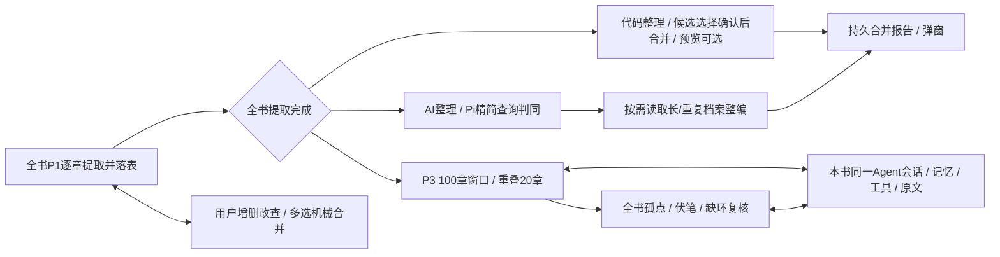

# WestWorld V2 · 2.2流程变更与冲突对照

> **阶段0修订（2026-10-24）：** P2持有world域锁时禁止同书人物/地点人工写入，P3持有narrative域锁时禁止节点/事件线人工写入；UI与命令事务均校验，拒绝返回`ASSET_DOMAIN_LOCKED`。取消须等在途提交停止并释放锁才恢复编辑。P1人工编辑、跨书编辑、只读和备份不受此域锁限制。P2/P3仍可并行，保留跨域实际读依赖校验。direct首次、网络重发与修正共用最多3次实际请求；P1修正规则见逐章提取决策；Agent每轮最多3次且task总共最多6次。详见[阶段0决策](../decisions/stage-edit-lock-and-request-budget.md)及当前机器契约。历史证据不代表新规则已在业务应用执行。

| 控制项 | 内容 |
|---|---|
| 版本/日期 | 2.2 / 2026-10-24（Asia/Shanghai）；初稿2026-10-21 |
| 依据 | 本次用户对P1/P2/P3及人工合并的流程说明 |
| 状态 | 目标规格；仅修改文档，应用实现与新流程验收未执行 |
| 主入口 | [00-阅读入口与术语](00-阅读入口与术语.md) |

## 1. 用户意图与目标流程

先执行全书P1，AI按章提取世界资产和叙事资产，成功即写当前资产表。用户无需等合并完成，可以在提取期间查看、补录、编辑、删除或手动合并。

全书P1两子步骤均成功后，用户可分别点击P2/P3，任意先后或同时运行。P2整理世界资产，P3整理叙事资产；P2不是窗口串联，P3不再负责人物地点全局合并。

## 2. 本次补全的设计决定和解释

这些是为实现本次意图补齐的设计选择，不冒充用户逐条指定的细节；后续评审可修改，当前文档按统一值编写。

| 问题 | 本次采用的规则 | 原因/影响 |
|---|---|---|
| “每天一次表UI上变动” | 按“每完成一章更新一次”解释，成功子步骤可更早刷新 | 与边提取边处理的目标一致；不增加每日刷新任务 |
| “一章一章” | Chapter.order顺序，单章在途；章内两个请求顺序独立 | 旧默认并发3不再用于正式P1；长章切块仍按顺序处理 |
| 0–100、80–180边界 | 用零基半开区间[0,100)、[80,180)，即第1–100/81–180章 | 明确恰100原章和20原章重叠，切块不多计原章 |
| 机械合并阈值 | 严格>0.9仅作为候选阈值；名称包含不直接合并 | 最新用户授权修复误合并；人工确认或有效证据后才融合 |
| 高置信串联 | op.confidence>=0.85，有reason/evidenceNodeIds | 是设计默认，非模型语义准确率承诺；低置信只记复核事项 |
| 详细内容过长/重复 | >1200估算tokens或非相同片段3-gram Jaccard>=0.85（至少20字符）；兼容原1800字符/8事实/冲突等触发 | 仅筛选按需整编，不用于判同；数值写入计划版本以便重查 |
| 手工合并主名与ID | keepId与canonicalName分开选；可选旧称呼或自定义非空名；其余转别名 | 改主名不等于换保留ID，人工目标/名优先；多个人工保护目标冲突不自动吞并 |
| 手工合并资料 | 确定性融合、去完全重复，不语义压缩 | 与P2机械路径相同，后续P2按需AI整编 |
| 用户增删改查 | 四类资产均可新增；P2/P3运行时按所属域禁止人工写；人物关系继续只读 | 旧“不得手动新增”与本次需求冲突，补必要字段和manual来源 |
| 恢复不覆盖人工 | 原子成功凭证+来源redirect/墓碑+revision | 成功后并入/删除不影响P1覆盖，不重试复活旧行 |
| 同书持续Agent | 一个活动sessionId，窗口/全局/重试/重查都追加消息 | 进程对象可重建；持久逻辑会话不变；跨bookId独立 |
| 全书复核含义 | 全部孤点、全部线、active/stale事项分页遍历；新对象入队 | 前30/50条仅分页；不以孤点清零作为完成条件 |
| P2/P3并行依赖 | 世界和叙事写资源分开；P3仅核实际读取资料/查询页依赖 | P2无关合并不使整本P3失败，相关变化只重查受影响单元 |
| 直接存储（用户澄清） | P1成功即存当前实体，后续直接CRUD/合并；无入库入口或固定副本 | 这是用户明确的单层数据模型，阶段状态只表示整理进度 |
| 新持久结构 | 合并两组世界表后新增3表；v5备份 | 目标全局3表、单书15表，共18种；保留原始ID与来源 |

## 3. 冲突定位与替换范围

| 旧约定 | 新约定 | 修改位置 |
|---|---|---|
| P2 rolling merge/link，P3全局资产+事件复核 | P2全书世界资产，P3窗口串联+全书事件复核 | 00术语；01 FR-05/07/08；04 ALG-03/04/06 |
| 每窗口P1→资产合并→事件串联，最后P3 | 全书P1先行，完成后由用户独立启动P2/P3 | 01旅程；02 AR-06；04 ALG-02/03；09 OP-10/27/28 |
| 四阶段前100章写正式草稿，P3样本可入库 | 三正式阶段；试跑无写，开发样本只用隔离副本 | 01 FR-06；06 UI-04；07目标场景；09 OP-28（旧OP-30退役） |
| 同书Set锁阻止所有阶段并发 | 按资源租约；P2 world与P3 narrative并行 | 02 AR-07；03 T20；09 OP-28/29；10 DF-03 |
| 全局runtime最后任务覆盖当前界面 | bookId/stage/runId隔离，分别取消和计费 | 02 AR-07；04 ALG-11；06 UI-04；07 BUG-13替换 |
| P1资产与进度分事务、重跑bulkPut | 资产+成功凭证+进度原子提交，来源映射防复活 | 03 T18/T19；04 ALG-02；10 DF-02/07 |
| 仅详情Select单条并入、缺项忽略 | 列表批量多选、主名/目标预览、全体revision校验 | 01 FR-09；04 ALG-07；06 UI-05；09 OP-21 |
| 不可手动新增、必填可写空、详情保旧对象 | 可人工新增/必填校验，dirty表单冲突提示和详情刷新 | 03增量；06 UI-05；07 BUG-06/16；09 OP-15–20/61 |
| AI判同常驻长字段或地点查询返回完整description | 人物地点精简工具分页；详情按需独立工具 | 04 ALG-04；05 AI-02/06；11 TOOL-05/06/07/14 |
| AI别名组仅按名称、本页不可跨查 | 已查询同类ID分组，可通过工具跨页查候选 | 04 ALG-04；11模型输出；v2.2/model-output-contract.json |
| 地点AI描述再追加原长文、人物只按旧触发 | 人物地点按Token/重复指标整编，底稿保事实、展示去重 | 03 T11；04 ALG-04；P2/地点目标Prompt |
| P3串联每400节点和30线即全局范围 | 100/20原章窗口；容量仅内部分页，全书队列覆盖 | 04 ALG-03/06；05 AI-10；07 AC-V22-14/15/19 |
| 重新检查归档旧会话、新开复核会话 | 同书同sessionId持续追加；不同book新Agent | 01 FR-12；03 T16；05 AI-08；06 UI-07 |
| 全库世界指纹进入所有P3校验 | 仅实际读依赖与查询页指纹，命中才重查 | 02 AR-06；03/05依赖；11执行边界 |
| 草稿→入库→固定实体 | 撤销双层；P1直接写实体，所有CRUD合并直接生效；读取引用随当前实体刷新 | 01 FR-10；03；04 ALG-08；06 UI-04；10 DF-09 |
| 原51场景/截图直接代表新规格 | 全部标2.1历史；2.2新增30项待实现验收 | 07/08/12；v2.2/acceptance-cases.json |

## 4. 资源和证据纪律

`resources/v2.2/`为当前变更机器契约；`resources/`原Schema、旧操作/字段清单、Prompt、截图及`acceptance/`suite保留为2.1资料。未变技术协议/算法可以复用，但不能从旧资料恢复旧阶段职责。资源权威映射见[resource-authority.json](resources/v2.2/resource-authority.json)。

旧回放仍按其当时Prompt和stage解释，不改录制结果去伪装2.2证据。原生成脚本只生成历史规格，禁止直接重跑覆盖本次主文档。维护时先按版本更新源契约和正文，再运行当前文档校验器。

## 5. 本轮完成与后续实现边界

本轮完成需求、架构、数据增量、算法、AI/会话、UI、操作、字段流、Prompt和验收文档的一致调整。文档校验可证明JSON/链接/枚举/数量等结构一致，不能证明真实模型质量、浏览器竞争或新应用流程已实现。应用代码、数据库迁移和30项端到端执行属于后续实现任务。

## 6. 2026-10-22用户澄清：删除草稿/入库双层

用户明确：AI提取后直接存数据库实体，后续增删改查与合并直接操作原数据。此前沿用旧“草稿管理/入库”的设计已撤销。characters/locations是唯一人物地点数据表；nodes/eventLines同样直接生效。没有等待发布的第二份实体，没有P001/L001重编号，也没有P2/P3完成后才能用数据的门槛。

为保持P2/P3并行，人物引用在读取时由当前人物主名/别名和redirect派生，不需要P2写叙事表或另加一次发布刷新。迁移不能把旧双层相加或从旧固定副本复活已删条目。OP-30/31退役；当前60组UI动作、14组字段流仍有完整契约。

## 7. 2026-10-22用户澄清：AI统一Pi架构

用户明确：pi-ai是统一模型调用层；pi-agent-core是Agent执行与运行状态管理层。支持direct和agent两模式，共用设置配置、校验和错误处理。Agent长期记忆/业务状态由应用持久化，通过工具读写。对应主规范02 AR-11、05 AI-00/01/04/11与resources/v2.2/ai-runtime-contract.json。

| 旧内容或遗漏 | 2.2修订 | 影响 |
|---|---|---|
| 只列Pi依赖名，缺少统一入口约束 | 所有生成/流式/修正/摘要/生成测试均经pi-ai；Pi Agent绑定同一模型层 | 业务不暴露服务商原始请求/消息 |
| 设置文本测试直接POST生成接口、2xx即成功 | 走正式direct边界并核Pi结束/有效输出；目录GET仅发现 | 06/09/10与探测验收同步 |
| Provider永远deepseek、未知模型复制首项元数据 | deepseek仅默认；使用Pi注册适配器/能力描述，未知能力明确报错 | 更换受支持模型不改变业务接口 |
| 只注册read工具、最后submit才写数据 | 增commit_asset_changes/commit_story_changes，Pi AgentTool.execute内经共用领域服务实际提交 | 14读+2写；角色10/15业务工具，最终收集器另计 |
| 最终submit结果即业务增量 | Agent最终用AgentTaskSummarySchema报告commitIds/待办，不二次写 | direct结构化输出与Agent最终总结分开 |
| 长期记忆与AgentState边界隐含 | Pi管运行状态，应用保存会话/摘要/资产并恢复规范上下文 | 同书session/跨书隔离延续 |
| 写成功后循环/网络失败无明确恢复约定 | T20命令幂等凭据与业务同事务；中断续原runId/key，已提交结果保留 | 不重复合并、补点或记忆revision |
| 两模式错误/校验可能各自实现 | 同一模型解析、Schema/领域校验、错误分类和服务重试策略 | 新增AC-V22-26–30，全部待应用执行 |

此处明确允许通过应用注册的受控业务/记忆写工具写数据，不是给模型任意数据库句柄。未改变单层实体直接生效、P1先行、P2/P3并行和P3同书持续会话。没有新增草稿/发布层，也不把Pi当作自动长期存储系统。

## 8. 2026-10-23字段、工具和Pi迁移校订

本次用户指出：00–13正文未充分定义数据字段与Agent工具，未交代Pi如何迁移、coding包如何取舍、哪些工具不可用。本次补正文及与正文绑定的机器契约，不修改应用。以下分清实现纠错与目标设计补充，不把目标写成源码取证结论。

| 问题 | 修订 | 性质/位置 |
|---|---|---|
| 字段用“原有结构”“沿用”带过 | 18张目标表逐字段含嵌套路径、类型、枚举、必填/null、默认、来源更新、索引与生命周期；补入口赋值 | 03第8–9节；完整storage.schema.json，与data-contract同源 |
| 字段名与实现/机器结构不一致 | relation_label、mergeFacts[].chapters、world_delta/new_facts/started_actions/time_text/time_hint、lineStatus按真实拼写统一；线索引改lineStatus | 实现与已有机器结构纠错 |
| 地点mergeFacts仅object、usage/coverage/modelSnapshot空对象 | 补LocationFact/Usage/Coverage/ModelSnapshot及实际依赖结构；新的2.2行按正文服务规则赋值 | 目标明确化；尚未实现，不假装旧Schema已提供 |
| createdBy不区分资产类型 | 人物地点P1/manual；节点P1/P3/manual、线P3/manual；旧节点/线P2只历史兼容 | 按既定职责校正目标枚举 |
| 新命令payload指纹算法含糊 | 递归键排序JSON→UTF-8 SHA-256，数组保序；省略与null不同 | 新目标明确化，不兼容旧指纹有效性 |
| 工具只列用途和条数 | 16种业务工具逐项参数、过滤、顺序、完整返回对象/投影、读写表、空/错误/截断与恢复；finalizer另列 | 11第6节；目标返回Schema同步 |
| 部分详情正文说missingIds、机器没有 | 四种资产详情统一missingIds；条数截断项不算missing；未返回ID须重请求 | 目标契约纠错/补充 |
| 指标仅写“本地计算” | 确定详细字段连接顺序、ceil(length/2)、duplicateScore取有效配对3-gram Jaccard最大值 | 目标算法明确化，11第6.2节 |
| 工具成功仅details可能不进模型 | 成功content JSON+details+structuredContent；outputSchema匹配成功结果；失败isError=true | 锁定Pi SDK契约映射；不是另加模型协议 |
| “最终提交独占批”缺实现时点 | assistant message_end持久化后整批检查、beforeToolCall阻断全部，首次副作用前拒绝 | 02/11；基于Pi awaited事件可实现的目标顺序 |
| 只提Pi两包，缺coding取舍 | coding整包/CLI/TUI/文件工具/宿主Shell/文件会话不接入；保留低层ai/agent-core，应用负责业务工具和IndexedDB | 02 AR-12；没有实际卸载依赖或删除coding源码 |
| “不可用”含义不明 | 区分浏览器无宿主能力、项目不注册、角色禁止、当前未实现、Provider未适配 | 02能力矩阵 |
| 新增读写工具与当前状态混淆 | 当前13读（8/13）；目标14读+2写；角色业务10/15，另加finalizer后11/16 | 00/02/11；旧代码测试不证明新写工具完成 |

本轮无须重新选择单层实体、P1先行、P2/P3并行和Pi两模式等既定方向。新增细化是待评审目标规格；真实Provider兼容、浏览器竞争、目标迁移和独立重建仍须执行验收。字段结构与工具章节存在不再作为“目标实现已完成”的证据。

## 9. 2026-10-23再次审查：仍不满足独立重建完成条件

用户继续要求核查Prompt/Agent调用和其他差漏，并询问能否复现或改进项目。本次重新区分三件事：仅00–13 Markdown不包含完整资源；完整v2包仍存在RQ-01/03/04/05/06目标契约缺口；修复缺陷、降低耦合是改进版设计目标，不等于对旧应用逐行为复制。

已修正文档冲突：05 P3最终输出改为AgentTaskSummarySchema，Link只作为写工具payload；04去掉旧“全部线校验/全表重写”语义，按实际受影响读写集定义。新补05 AI-13十种调用清单，02 AR-13解耦建议，12 RQ-01–08详细反例与完成门槛。

本轮产出是审查和可评阅的改进建议，没有实施新应用。Prompt包装、持久task/command归属和覆盖账本尚未最终定义，机器Schema不把建议字段冒充最终契约。上轮“325/91机械检查通过”保持其狭义含义，不作为语义闭合结论。

## 10. 2026-10-24需求补全决定

用户授权“先把明显缺漏补上，尤其未阐述好、模糊的需求”。本轮正式补目标规则，不将新定义写成旧源码事实；上节2026-10-23“尚未定义”状态由本节及12闭合表更新。

| 模糊项 | 采用的规则 | 对交付的影响 |
|---|---|---|
| 子任务身份与P2恢复 | taskId在请求前持久化；同任务重试不改ID，剩余项续任务新ID；P2保任务/意图而不保P3长对话 | T20嵌套tasks/commandIntents，不增表 |
| 写入丢反馈 | prepared意图先存原payload/读集，业务和确认同事务；同key不同task也拒绝；恢复先核真实账本 | 明确五种中断处理、备份导入不自动重放 |
| 覆盖何时有效 | workItemId含phase/scope/type/id，逐项事实hash/依赖；计数不是权威；依赖仅相关项失效 | 选择性恢复、完成守卫、3次变化/无进展暂停 |
| 模型报告如何验收 | finalizer增加reviewedItems，逐项判断与remaining精确分割任务集合；确认必须归属本task | 新机器Schema与所有目标请求样例同步；旧四字段总结仅历史 |
| Agent完整提示词 | 独立active目录、角色包装、精确输入、末轮/修正/冲突/恢复模板 | 不沿用旧末轮交业务payload的提示 |
| 探测是否真的调用写工具 | asset/story各三轮；完整声明+指定读写链路；内存fixture、无真实书库 | 不能只收到{ok:true}便称新工具可用 |
| 更松耦合如何落地 | 明确接口与单向依赖、注入摘要、统一命令边界 | 提供自包含类型契约；不实施重构 |

范围保持单层实体、P1先行、P2/P3并行、同书持续故事会话和18种表定义。此前补缺阶段未更改名称包含规则；此限制已被后续用户“规划时直接修复BUG”的授权取代，当前按07及ALG-FIX执行。新的目标文本去掉不实“模型数据仅留本地”保证，同时保留忠实提取、不编造事实的要求。

## 11. 用户明确改变缺陷策略：规划时修复，禁止复现旧BUG

当前目标采用fix-first策略（bugfixPolicyRevision=2026-10-24.fix-first）。这覆盖此前“忠实保留兼容缺陷”“不更改名称包含”的限制；旧错误行为只留在历史证据，不得用于指导新实现。

已将BUG-01–16逐项改为修复后验收要求，另明确退避取消、非法数值、缺失原文和URL回收四项缺陷。名称相等/包含/相似度只作候选，AI合并需要confidence及原文证据；P1引文硬校验；分章保证规范化全文守恒；备份完整恢复后才发布书架，生命周期日志含owner/lease避免跨标签误清理；旧对象回显、歧义首项、未知费用和窄屏不可达均不得保留。

表总数仍18。T02日志为既有键值表的新分支，AUTO-17补齐启动恢复触发。20项缺陷规则、6个固定新回归夹具和当前工具Schema/Prompt均已同步；应用代码未修改，回归尚未连接重建adapter。只有实现并通过对应修复后验收，才能把状态从“修复已规格化”改为“已验证修复”。

## 12. 阶段0：收紧人工编辑与统一重试

用户明确P2运行中不改世界资产、P3运行中不改叙事资产，并授权统一重试。现按域锁全写入口，含即时字段，取消停稳后释放；P1与跨书人工操作不变。P2/P3并行保留，所以跨域依赖校验仍必需。direct 3次总实际请求包含修正；Agent每轮最多3次且task最多6次；替代旧限流5次及修正另计。机器策略位于pipeline-contract.manualEditPolicy与ai-runtime-contract.requestBudget。规格、测试、SDK探针完成不等于产品已实现锁与重试，业务按分阶段计划验收。

## 13. 阶段2：统一全部章节预览

01 FR-02要求展示全部解析章节，06旧条款为最多200行。阶段2按前者实现：列表限高滚动，全部章节可预览，已保存书籍也可逐章读取完整原文；不把显示上限当作处理范围。分章在原生Worker运行，超时可终止。仅导入已落地，P1提取入口在阶段7前保持禁用。具体实现边界与验收见[阶段2决策](../decisions/transactional-text-import.md)。
