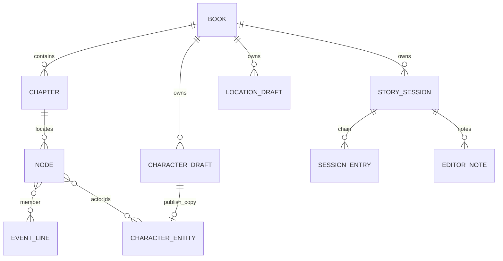

# 历史Schema展开参考（非17表目录）

> **2.1历史资源：** 本文记录变更前实现/验收。2.2阶段、锁、会话、人工合并和新增字段以主文档及resources/v2.2为准；此处旧条款不得覆盖新流程，也不证明新流程已实现。

当前实际存储和字段生命周期以[逐表规格](../03-Spec-数据与存储.md)为准。以下保留原结构描述，不能据此新增预留功能。

## DATA-01 数据库、表与索引

系统必须创建全局`westworld_settings`，版本2：`credentials:'providerId'`、`appSettings:'key'`、`books:'id, createdAt'`。凭据和设置不属于任何单书库。

每书数据库名为`westworld_canon_{bookId}`，版本4。主键、复合索引和唯一约束必须按下表创建；Dexie索引声明的第一项为主键，`&`唯一，`[a+b]`复合。没有索引的字段可在内存排序，不得自动新增跨书全局表。

| 表 | 数据结构 | Dexie索引声明 |
|---|---|---|
| `chapters` | `ChapterSchema` | `chapterIndex, order` |
| `chapterTexts` | `ChapterTextSchema` | `chapterIndex` |
| `characterSnapshots` | `StoredCharacterSnapshotSchema` | `id, chapterIndex, name` |
| `locationSnapshots` | `StoredLocationSnapshotSchema` | `id, chapterIndex, name` |
| `nodes` | `StoredNodeSchema` | `id, chapterIndex, order` |
| `eventLines` | `EventLineSchema` | `id` |
| `characters` | `CharacterSchema` | `id, name` |
| `locations` | `StoredLocationSchema` | `id, name` |
| `compileProgress` | `CompileProgressSchema` | `stage` |
| `storyEditorMemory` | `StoryEditorMemorySchema` | `id, sessionId` |
| `storyEditorNotes` | `StoryEditorNoteSchema` | `id, &[sessionId+key], sessionId, kind, status, updatedAt` |
| `storyEditorCheckpoints` | `StoryEditorCheckpointSchema` | `id, sessionId, stage, phase, status, updatedAt` |
| `storySessions` | `StorySessionSchema` | `id, status, createdAt, parentSessionId` |
| `storySessionEntries` | `StorySessionEntrySchema` | `id, &[sessionId+ordinal], sessionId, parentId, type` |

### 数据关系

关系为业务引用，不是数据库外键。节点actorIds包含行动者和对象。人物relations.target仍是称呼。单书库隔离书内重复ID；实体/节点引用不会自动跨书解析。

## DATA-02 值、默认与校验阶段

1. 未提供可选属性时保留省略，不自动填空字符串、空数组或null；显式构造处的默认按下表及算法执行。
2. 模型工具边界须执行对应Schema和业务校验；strict协议可选null按原Schema恢复为省略，必填null不得删除来逃避校验。
3. 普通人工编辑写入不统一运行完整Schema。必填string被界面清空后可写成undefined；不得在复现中自动添加required校验（BUG-06）。
4. JSON导出省略undefined；IndexedDB与JSON的undefined处理差异必须保留。书内字段命名中snake_case/camelCase混用为外部兼容结构，不统一改名。
5. 字段描述中历史用途仅表示字段含义；实际执行规则由流程/AI/UI Spec决定。例如timeCoord存在不要求实现自动推断。

| 值 / 对象 | 创建源 | 明确默认或更新方式 |
|---|---|---|
| Book | 小说/备份导入 | id见DATA-03；createdAt为当前ISO字符串，作者未提供则省略 |
| Chapter/ChapterText | 固定分章 | order从0；正文与元数据分表；bookId统一 |
| 人物/地点快照 | P1、归并、手动编辑 | confidence来自模型；roleWeight可省略，UI显示NPC |
| 人物/地点实体 | 入库 | roleWeight缺省NPC、relations缺省[]、实体aliases去主名 |
| 节点 | P1或P2/P3补点 | P1 order从0；补点confidence=0.6、createdBy=当前阶段；actorIds入库才生成 |
| 事件线 | AI操作 | chapters派生、characterIds由节点派生、updatedAt当前ISO |
| 进度 | 导入和任务 | 初次P1 idle、completed/failed=[]；不同stage总数单位不同 |
| 工作记忆 | 按会话提交 | 初次revision0、摘要与指纹空字符串、更新时间空；提交revision+1 |
| 复核/判断 | 模型有效增量 | revision≥1，主题键在会话内唯一；依据指纹随提交更新 |
| 会话 | 初次或新全书复核 | UUID、active、nextOrdinal0；复核归档旧会话、parentSessionId指旧会话 |
| 条目 | 追加消息/压缩/确认/省略 | UUID，ordinal=nextOrdinal，parentId=旧leafId或null，然后更新末端 |
| 目录句柄 | 浏览器选择 | 存在appSettings，导出只显示目录名；不是JSON文件路径 |

### 全部关键枚举

| 字段 | 值：文案/用途 |
|---|---|
| CompileStage | P1：逐章提取；P2：窗口归并与串联；P3：全书合并与检查 |
| CompileStatus | idle：未运行；running：运行；paused：暂停；cancelling：声明存在但取消入口不强制经过；cancelled：已取消；failed：失败；completed：本阶段范围完成 |
| roleWeight | 主要人物；重要配角；NPC；路人（值与文案相同） |
| roleWeightSource | frequency：自动频次；manual：人工 |
| lineStatus | open：进行中；closed：已结束 |
| relation.direction | bidirectional：双向；directed：有向 |
| timePrecision | explicit、inferred_hour、inferred_day、order_only；仅字段兼容，不新增推断过程 |
| EditorNote.kind/status | decision：编辑判断；review：复核事项；active：有效/待处理；resolved：已解决 |
| NoteView.validity | current：依据当前；stale：依据变化 |
| Checkpoint.phase/status | link：节点串联；review：线复核；completed/failed/cancelled |
| Session.kind/status/profile | initial：初次；review：新复核；active/archived；profile固定story_editor |
| SessionEntry.type | message、compaction、omit、commit |
| NativeMessage.role | system、user、assistant、toolResult |
| EventLineOp.op | append、create、update、merge |
| ErrorKind | network、rate_limit、server、auth、content_policy、context_length、validation、unknown |

## DATA-03 ID、编号与时间

| 对象 | 规则 |
|---|---|
| 小说新书 | `bk_${crypto.randomUUID()}` |
| 备份新书 | `bk_${Date.now().toString(36)}_${Math.random().toString(36).slice(2,6)}` |
| P1快照/节点 | `C{chapterIndex}-{P或L或N}{序号padStart(3,'0')}`；序号从1，不截断大于3位 |
| 自动合并保留项 | ID numeric locale顺序最早；手动合并保留指定keepId |
| 固定人物/地点 | 每次入库从P001/L001重新编排，不保持跨次永恒ID |
| 新线 | 现有匹配`^L(\d+)$`最大值+1，至少2位，不冲突；merge保留目标 |
| 检查补点 | 原章最大-N数字+1，至少3位；同章同name同quote视为已存在并重映射 |
| 会话/消息/租约 | crypto.randomUUID；条目序号从0递增 |
| 工作记录 | 跨本书所有旧notes最大`SN`数字+1，至少6位；更新同会话key沿用id |
| 检查点 | 对work（含sessionId）和去重排序scopeIds作JSON序列化后SHA-256十六进制 |

书籍和业务更新时间用ISO8601；leaseUntil用毫秒时间戳；日志时间由运行环境`toLocaleTimeString('zh-CN')`显示。备份文件名用UTC ISO日期片段，不使用客户端显示时区替换。原文时间文本与系统时间分开。

## DATA-04 迁移

| 升级 | 必须执行的变换 |
|---|---|
| 设置v1→v2 | 保留credentials/appSettings，新增books |
| 单书v1→v2 | 人物/地点sourceChapters缺省[chapterIndex]、mergeNotes缺省[]；地点aliases缺省[]；P1 partialChapters缺省{}；地点实体aliases缺省[] |
| 单书v2→v3 | 新增storyEditorMemory/Notes/Checkpoints，旧资产与人工资料不改 |
| 单书v3→v4 | 新会话及条目表；记忆相关会话索引按stores.json；旧notes/checkpoints的sessionId缺省空串 |
| 首次建立完整故事会话 | 旧story_editor记忆复制到新sessionId；旧未归属notes迁至新会话；旧检查点保留但不冒充新完整会话恢复点 |

不得将旧工作记录伪造成历史原始聊天。数据库迁移与备份版本兼容分别实现。

## DATA-05 备份结构与恢复

manifest字段：`format='westworld-v2'`、`formatVersion=4`、`appVersion='1.0.0'`、`exportedAt:ISO`、`book:{id,title,author?,chapterCount}`、`contents:string[]`、`excludes:['apiKey','eventLog']`、`checksums:{相对路径:'sha256:'+64位hex}`。

`data/book.json`为单个Book；其余下列JSON是数组：chapters、characterSnapshots、locationSnapshots、characters、locations、nodes、eventLines、compileProgress、storyEditorMemory、storyEditorNotes、storyEditorCheckpoints、storySessions、storySessionEntries。每个文件UTF-8、JSON缩进2。原文为`chapters/{chapterFileName}.txt`，普通101→0101.txt，101.1→0101_1.txt。ZIP压缩level6；manifest自身不加入自己的checksum。

导出必须在单书全表只读事务中读取资产/进度/历史，去掉session leaseOwner/leaseUntil；book元数据从全局书架读取。文件名书名替换Windows非法字符为`_`并截前40字符，加`new Date().toISOString().slice(0,16).replace(/[:T]/g,'')`和`.wwv2`。保存到目录另加UUID前8字符，不覆盖成固定文件。

预检顺序：解ZIP→manifest存在/可解析→format和过新版本→校验manifest列出的文件→解析五类统计JSON。保持BUG-07的无完整基础Schema/缺失统计文件抛错分支，不新增友好兜底。

恢复前必须对记忆、notes、checkpoints、sessions、entries做对应Schema与重复id检查，notes会话+key唯一；最多一个active session；父会话必须存在且不指自己；leaf属于本session；nextOrdinal>0须有leaf；entry必须有session、同session序号唯一且小于nextOrdinal；父entry同session且序号更小；compaction边界属于该session。仅执行上述已有检查，不自行增强为任意图完整性审计。

导入所有归属改为newBookId，其余书内ID保持。新标题为原书名+“（导入）”；createdAt为新时间；lease清空；缺省旧会话字段sessionId归一空串。章节正文只从manifest checksums中列出的chapters文件匹配恢复。先创建全局书架，再单书事务写入；后者失败不自动回滚书架。不得增加覆盖原书模式。

## DATA-06 字段字典使用规则

以下各表完整展开对象与数组成员，必填以当前层及父对象存在为条件。`未定义`表示Schema无default；实际构造默认见DATA-02。类型联合分支分行列出。来源按对象段落确定，字段语义以中文含义及详细Spec共同约束；原始描述保留供理解，但其中历史推断功能不自动生效。

### BookSchema

来源：章节导入/进度代码。对象约束：additionalProperties=false。

| 英文字段路径 | 中文含义 | 类型 / 枚举值 | 必填 | Schema默认 | 校验 | 来源 | 语义说明 |
|---|---|---|---|---|---|---|---|
| id | 记录编号 | string | 是 | 未定义 | 无额外结构约束 | 代码生成/更新；恢复时按DATA-05映射 | 书籍唯一 id。例：bk_001 |
| title | 标题 | string | 是 | 未定义 | 无额外结构约束 | 文件名/导入参数或备份元数据 | 书名。默认取文件名。 |
| author | 作者 | string | 否 | 未定义 | 无额外结构约束 | 文件名/导入参数或备份元数据 | 作者。原文没写就留空。 |
| sourceFileName | 源文件名 | string | 否 | 未定义 | 无额外结构约束 | 文件名/导入参数或备份元数据 | 导入时的原始文件名。 |
| createdAt | 创建时间 | string | 是 | 未定义 | 无额外结构约束 | 代码生成/更新；恢复时按DATA-05映射 | 导入时间，ISO 8601 字符串。 |

### ChapterSchema

来源：章节导入/进度代码。对象约束：additionalProperties=false。

| 英文字段路径 | 中文含义 | 类型 / 枚举值 | 必填 | Schema默认 | 校验 | 来源 | 语义说明 |
|---|---|---|---|---|---|---|---|
| bookId | 书籍归属 | string | 是 | 未定义 | 无额外结构约束 | 代码生成/更新；恢复时按DATA-05映射 | 所属书籍 id。 |
| chapterIndex | 章节标识 | string | 是 | 未定义 | 无额外结构约束 | 导入分章结果 | 章节标识，字符串。超长章节切块后形如 "101.1"。用于排序与区间计算。 |
| chapterName | 章节名称 | string | 是 | 未定义 | 无额外结构约束 | 导入分章结果 | 章节名，导入预处理后的结果。 |
| charCount | 字符数 | number | 是 | 未定义 | 无额外结构约束 | 导入分章结果 | 本章字数。 |
| order | 章内/全书顺序 | number | 是 | 未定义 | 无额外结构约束 | 导入分章结果 | 在书中的顺序，从 0 开始。 |

### ChapterTextSchema

来源：章节导入/进度代码。对象约束：additionalProperties=false。

| 英文字段路径 | 中文含义 | 类型 / 枚举值 | 必填 | Schema默认 | 校验 | 来源 | 语义说明 |
|---|---|---|---|---|---|---|---|
| bookId | 书籍归属 | string | 是 | 未定义 | 无额外结构约束 | 代码生成/更新；恢复时按DATA-05映射 | 所属书籍 id。 |
| chapterIndex | 章节标识 | string | 是 | 未定义 | 无额外结构约束 | 导入分章结果 | 章节标识。 |
| text | 正文 | string | 是 | 未定义 | 无额外结构约束 | 导入分章结果 | 本章正文。 |

### StoredCharacterSnapshotSchema

来源：模型提交后代码执行/人工编辑/备份恢复。对象约束：无额外结构约束。

| 英文字段路径 | 中文含义 | 类型 / 枚举值 | 必填 | Schema默认 | 校验 | 来源 | 语义说明 |
|---|---|---|---|---|---|---|---|
| name | 名称/主名 | string | 是 | 未定义 | 无额外结构约束 | 模型提取/合并或允许的人工编辑；恢复可携带 | 本章主要使用的称呼。可能是别名，例：琏二爷。 |
| aliases_mentioned | 本章提及别名 | array<string> | 否 | 未定义 | 无额外结构约束 | 模型提取/合并或允许的人工编辑；恢复可携带 | 本章出现过的其他称呼，用于后续归并同一个人。例：["琏二哥哥"] |
| identity | 身份 | string | 否 | 未定义 | 无额外结构约束 | 模型提取/合并或允许的人工编辑；恢复可携带 | 身份 / 职务 / 归属。例：荣国府长孙。原文没写就留空。 |
| profile | 基础资料 | object | 否 | 未定义 | additionalProperties=false | 模型提取/合并或允许的人工编辑；恢复可携带 | 人物基础资料；精确年龄与原文年龄描述分开保存。 |
| profile.age | 精确年龄 | number | 否 | 未定义 | 无额外结构约束 | 模型提取/合并或允许的人工编辑；恢复可携带 | 原文明确写出的精确年龄。范围、约数或未知年龄不填此字段，不取平均值、不猜测。 |
| profile.ageText | 原文年龄描述 | string | 否 | 未定义 | 无额外结构约束 | 模型提取/合并或允许的人工编辑；恢复可携带 | 原文的年龄描述，逐字保留，如“十四五岁”“年过三旬”；不知道则省略或填 null。 |
| profile.gender | 性别 | string | 否 | 未定义 | 无额外结构约束 | 模型提取/合并或允许的人工编辑；恢复可携带 | 原文写明的性别，不知道则省略或填 null。 |
| appearance | 外貌 | string | 否 | 未定义 | 无额外结构约束 | 模型提取/合并或允许的人工编辑；恢复可携带 | 外貌。**仅当原文写到**，不要推断。 |
| personality | 性格 | string | 否 | 未定义 | 无额外结构约束 | 模型提取/合并或允许的人工编辑；恢复可携带 | 性格。**必须能从原文找到依据**，不要凭印象概括。多条用「；」分隔。 |
| background | 背景 | string | 否 | 未定义 | 无额外结构约束 | 模型提取/合并或允许的人工编辑；恢复可携带 | 背景 / 来历。仅当原文写到。 |
| speech_style_sample | 原话片段（草稿字段） | string | 否 | 未定义 | 无额外结构约束 | 模型提取/合并或允许的人工编辑；恢复可携带 | 本章这个人的**原话片段**（直接摘录），用于后续学习他的说话味道。 |
| relations | 人物关系 | array<object> | 否 | 未定义 | 无额外结构约束 | 模型提取/合并或允许的人工编辑；恢复可携带 | 本章观察到的关系。 |
| relations[].target | 关系目标称呼 | string | 父对象存在时必填 | 未定义 | 无额外结构约束 | 模型提取/合并或允许的人工编辑；恢复可携带 | 关系指向的人。用本章原文的称呼，还没归并。 |
| relations[].relation_type | 关系类型 | string | 父对象存在时必填 | 未定义 | 无额外结构约束 | 模型提取/合并或允许的人工编辑；恢复可携带 | 关系的英文类型标记，小写下划线风格。例：spouse / parent_child / mentor / friendship |
| relations[].relation_label | 关系文案 | string | 否 | 未定义 | 无额外结构约束 | 模型提取/合并或允许的人工编辑；恢复可携带 | 关系的中文说法，用原文里的词。例：夫妻 / 父子 / 知己。原文没写就留空。 |
| relations[].direction | 关系方向 | "bidirectional" / "directed" | 否 | 未定义 | 无额外结构约束 | 模型提取/合并或允许的人工编辑；恢复可携带 | 关系方向。bidirectional = 对称（如夫妻、朋友）；directed = 有向（如父子、师徒）。 |
| confidence | 置信度 | number | 是 | 未定义 | minimum=0；maximum=1 | 模型提取/合并或允许的人工编辑；恢复可携带 | 抽取置信度，0 到 1 之间的小数。不确定时给低分，不要编造。 |
| frequency | 出场统计 | object | 否 | 未定义 | additionalProperties=false | 代码派生；见相关算法 | 出场统计 |
| frequency.chapters | 涉及/覆盖章节 | integer | 父对象存在时必填 | 未定义 | 无额外结构约束 | 代码派生；见相关算法 | 涉及/覆盖章节 |
| frequency.mentions | 主名提及次数 | integer | 父对象存在时必填 | 未定义 | 无额外结构约束 | 代码派生；见相关算法 | 主名提及次数 |
| frequency.scopeChapters | 统计原章总数 | integer | 父对象存在时必填 | 未定义 | 无额外结构约束 | 代码派生；见相关算法 | 统计原章总数 |
| frequency.percentile | 相对分位 | number | 父对象存在时必填 | 未定义 | 无额外结构约束 | 代码派生；见相关算法 | 相对分位 |
| sourceChapters | 来源章集合 | array<string> | 否 | 未定义 | 无额外结构约束 | 代码派生；见相关算法 | 来源章集合 |
| mergeNotes | 冲突与复核信息 | array<string> | 否 | 未定义 | 无额外结构约束 | 模型提取/合并或允许的人工编辑；恢复可携带 | 冲突与复核信息 |
| mergeFacts | 合并事实底稿 | array<object> | 否 | 未定义 | 无额外结构约束 | 代码派生；见相关算法 | 合并事实底稿 |
| mergeFacts[].id | 记录编号 | string | 父对象存在时必填 | 未定义 | 无额外结构约束 | 代码生成/更新；恢复时按DATA-05映射 | 记录编号 |
| mergeFacts[].field | 事实所属字段 | string | 父对象存在时必填 | 未定义 | 无额外结构约束 | 模型提取/合并或允许的人工编辑；恢复可携带 | 事实所属字段 |
| mergeFacts[].text | 正文 | string | 父对象存在时必填 | 未定义 | 无额外结构约束 | 模型提取/合并或允许的人工编辑；恢复可携带 | 正文 |
| mergeFacts[].chapters | 涉及/覆盖章节 | array<string> | 父对象存在时必填 | 未定义 | 无额外结构约束 | 代码派生；见相关算法 | 涉及/覆盖章节 |
| optimizedFactIds | 已整编事实编号 | array<string> | 否 | 未定义 | 无额外结构约束 | 代码派生；见相关算法 | 已整编事实编号 |
| optimizationFingerprint | 整编资料指纹 | string | 否 | 未定义 | 无额外结构约束 | 代码派生；见相关算法 | 整编资料指纹 |
| roleWeightSource | 层级来源 | "frequency" / "manual" | 否 | 未定义 | 无额外结构约束 | 主名频次统计或人工选择 | 层级来源 |
| id | 记录编号 | string | 是 | 未定义 | 无额外结构约束 | 代码生成/更新；恢复时按DATA-05映射 | 代码分配的快照 id。格式 C{章号}-P{3 位序号}，例：C037-P003 |
| bookId | 书籍归属 | string | 是 | 未定义 | 无额外结构约束 | 代码生成/更新；恢复时按DATA-05映射 | 所属书籍 id。 |
| chapterIndex | 章节标识 | string | 是 | 未定义 | 无额外结构约束 | 模型提取/合并或允许的人工编辑；恢复可携带 | 章节标识。字符串以支持切块，例："37" 或 "101.1"。 |
| chapterName | 章节名称 | string | 是 | 未定义 | 无额外结构约束 | 模型提取/合并或允许的人工编辑；恢复可携带 | 导入预处理后的章节名。 |
| aliases | 累计别名 | array<string> | 否 | 未定义 | 无额外结构约束 | 模型提取/合并或允许的人工编辑；恢复可携带 | 合并后的别名列表。例：["琏二爷", "琏二哥哥"] |
| roleWeight | 人物层级 | "主要人物" / "重要配角" / "NPC" / "路人" | 否 | 未定义 | 无额外结构约束 | 主名频次统计或人工选择 | 出场频次分位数计算的默认层级，可由用户手动覆盖。 |
| updatedAt | 更新时间 | string | 否 | 未定义 | 无额外结构约束 | 代码生成/更新；恢复时按DATA-05映射 | 最后一次编辑时间 |

### StoredLocationSnapshotSchema

来源：模型提交后代码执行/人工编辑/备份恢复。对象约束：无额外结构约束。

| 英文字段路径 | 中文含义 | 类型 / 枚举值 | 必填 | Schema默认 | 校验 | 来源 | 语义说明 |
|---|---|---|---|---|---|---|---|
| name | 名称/主名 | string | 是 | 未定义 | 无额外结构约束 | 模型提取/合并或允许的人工编辑；恢复可携带 | 地点名称，用原文的叫法。例：荣国府 / 县一中。 |
| description | 描述 | string | 否 | 未定义 | 无额外结构约束 | 模型提取/合并或允许的人工编辑；恢复可携带 | 一句话描述。原文没写就留空。 |
| confidence | 置信度 | number | 是 | 未定义 | minimum=0；maximum=1 | 模型提取/合并或允许的人工编辑；恢复可携带 | 抽取置信度，0 到 1 之间的小数。不确定时给低分，不要编造。 |
| frequency | 出场统计 | object | 否 | 未定义 | additionalProperties=false | 代码派生；见相关算法 | 出场统计 |
| frequency.chapters | 涉及/覆盖章节 | integer | 父对象存在时必填 | 未定义 | 无额外结构约束 | 代码派生；见相关算法 | 涉及/覆盖章节 |
| frequency.mentions | 主名提及次数 | integer | 父对象存在时必填 | 未定义 | 无额外结构约束 | 代码派生；见相关算法 | 主名提及次数 |
| frequency.scopeChapters | 统计原章总数 | integer | 父对象存在时必填 | 未定义 | 无额外结构约束 | 代码派生；见相关算法 | 统计原章总数 |
| frequency.percentile | 相对分位 | number | 父对象存在时必填 | 未定义 | 无额外结构约束 | 代码派生；见相关算法 | 相对分位 |
| sourceChapters | 来源章集合 | array<string> | 否 | 未定义 | 无额外结构约束 | 代码派生；见相关算法 | 来源章集合 |
| mergeNotes | 冲突与复核信息 | array<string> | 否 | 未定义 | 无额外结构约束 | 模型提取/合并或允许的人工编辑；恢复可携带 | 冲突与复核信息 |
| aliases | 累计别名 | array<string> | 否 | 未定义 | 无额外结构约束 | 模型提取/合并或允许的人工编辑；恢复可携带 | 累计别名 |
| id | 记录编号 | string | 是 | 未定义 | 无额外结构约束 | 代码生成/更新；恢复时按DATA-05映射 | 代码分配的 id。格式 C{章号}-L{章内序号}，例：C37-L002 |
| bookId | 书籍归属 | string | 是 | 未定义 | 无额外结构约束 | 代码生成/更新；恢复时按DATA-05映射 | 所属书籍 id。分库后冗余，保留便于导出与调试。 |
| chapterIndex | 章节标识 | string | 是 | 未定义 | 无额外结构约束 | 模型提取/合并或允许的人工编辑；恢复可携带 | 章节标识。 |
| chapterName | 章节名称 | string | 是 | 未定义 | 无额外结构约束 | 模型提取/合并或允许的人工编辑；恢复可携带 | 章节名。 |
| updatedAt | 更新时间 | string | 否 | 未定义 | 无额外结构约束 | 代码生成/更新；恢复时按DATA-05映射 | 最后一次编辑时间（合并或人工修改过） |

### StoredNodeSchema

来源：模型提交后代码执行/人工编辑/备份恢复。对象约束：无额外结构约束。

| 英文字段路径 | 中文含义 | 类型 / 枚举值 | 必填 | Schema默认 | 校验 | 来源 | 语义说明 |
|---|---|---|---|---|---|---|---|
| name | 名称/主名 | string | 是 | 未定义 | 无额外结构约束 | 模型提取/合并或允许的人工编辑；恢复可携带 | 事件名称，客观描述，**不得是结论**。例：贾琏的资金来源异常 |
| summary | 摘要 | string | 是 | 未定义 | 无额外结构约束 | 模型提取/合并或允许的人工编辑；恢复可携带 | 事件概述，一到两句。 |
| process | 详细经过 | string | 否 | 未定义 | 无额外结构约束 | 模型提取/合并或允许的人工编辑；恢复可携带 | 这个完整事件的详细经过：交代起因、连续行动、对话要点和结果；相关小动作合在这里，不拆成独立节点，不逐句复述。 |
| actors | 行动者称呼 | array<string> | 是 | 未定义 | 无额外结构约束 | 模型提取/合并或允许的人工编辑；恢复可携带 | 行动者。用**本章原文的称呼**，还没归并。例：["贾琏"] |
| targets | 对象称呼 | array<string> | 否 | 未定义 | 无额外结构约束 | 模型提取/合并或允许的人工编辑；恢复可携带 | 对象 / 承受者。例：["王熙凤"] |
| world_delta | 状态变化描述 | array<string> | 否 | 未定义 | 无额外结构约束 | 模型提取/合并或允许的人工编辑；恢复可携带 | 世界状态因此改变了什么。例：["贾琏手头多出大笔银子"] |
| new_facts | 新出现事实 | array<string> | 否 | 未定义 | 无额外结构约束 | 模型提取/合并或允许的人工编辑；恢复可携带 | 新出现的信息。例：["贾琏近期有大笔来路不明的钱"] |
| started_actions | 开始的行动 | array<string> | 否 | 未定义 | 无额外结构约束 | 模型提取/合并或允许的人工编辑；恢复可携带 | 谁开始了什么行动（尚未完成）。例：["贾琏开始变卖田产"] |
| time_text | 明确时间原文 | string | 否 | 未定义 | 无额外结构约束 | 模型提取/合并或允许的人工编辑；恢复可携带 | 原文里的**明确**时间表述。可空。例：洪武十四年三月六日 / 亥时三刻 |
| time_hint | 相对时间原文 | string | 否 | 未定义 | 无额外结构约束 | 模型提取/合并或允许的人工编辑；恢复可携带 | 原文里的**相对**时间表述。可空。例：次日 / 过了半月 |
| quote | 逐字引文 | string | 是 | 未定义 | 无额外结构约束 | 模型提取/合并或允许的人工编辑；恢复可携带 | 原文片段，用于回查校验。必须是原文里真实存在的句子。 |
| offset | 字符偏移 | number | 否 | 未定义 | 无额外结构约束 | 模型提取/合并或允许的人工编辑；恢复可携带 | 该片段在**本章正文**中的字符起点（从 0 开始）。拿不准就留空。 |
| confidence | 置信度 | number | 是 | 未定义 | minimum=0；maximum=1 | 模型提取/合并或允许的人工编辑；恢复可携带 | 抽取置信度，0 到 1 之间的小数。不确定时给低分，不要编造。 |
| id | 记录编号 | string | 是 | 未定义 | 无额外结构约束 | 代码生成/更新；恢复时按DATA-05映射 | 代码分配的节点 id。格式 C{章号}-N{3 位序号}，例：C037-N002 |
| bookId | 书籍归属 | string | 是 | 未定义 | 无额外结构约束 | 代码生成/更新；恢复时按DATA-05映射 | 所属书籍 id。 |
| chapterIndex | 章节标识 | string | 是 | 未定义 | 无额外结构约束 | 模型提取/合并或允许的人工编辑；恢复可携带 | 章节标识。 |
| chapterName | 章节名称 | string | 是 | 未定义 | 无额外结构约束 | 模型提取/合并或允许的人工编辑；恢复可携带 | 章节名。 |
| order | 章内/全书顺序 | number | 是 | 未定义 | 无额外结构约束 | 模型提取/合并或允许的人工编辑；恢复可携带 | 本章内的顺序，从 0 开始。用于按出现顺序展示与排序（比按 id 排序可靠）。 |
| createdBy | 节点创建阶段 | "P1" / "P2" / "P3" | 否 | 未定义 | 无额外结构约束 | 模型提取/合并或允许的人工编辑；恢复可携带 | 节点来源。P1 = 章节提取；P2 = 聚合时补建。 |
| eventLineIds | 所属线编号 | array<string> | 否 | 未定义 | 无额外结构约束 | 代码派生；见相关算法 | 所属事件线 id。多对多，聚合后才有。 |
| actorIds | 映射人物编号 | array<string> | 否 | 未定义 | 无额外结构约束 | 代码派生；见相关算法 | 入库时由代码把 actors（人名）映射成的人物实体 id。draft 阶段为空；重新入库会整体重算。 |
| timeCoord | 已有时间坐标 | string | 否 | 未定义 | 无额外结构约束 | 模型提取/合并或允许的人工编辑；恢复可携带 | 虚构时间坐标。由 P2 推断，P1 阶段为空。例："003-02-15 08:00" |
| timePrecision | 时间精度标记 | "explicit" / "inferred_hour" / "inferred_day" / "order_only" | 否 | 未定义 | 无额外结构约束 | 模型提取/合并或允许的人工编辑；恢复可携带 | 时间精度。explicit = 原文直接写的；inferred_hour = 推断到小时；inferred_day = 只能推到天；order_only = 只能定先后。 |
| canonicalId | 去重主节点编号 | string | 否 | 未定义 | 无额外结构约束 | 模型提取/合并或允许的人工编辑；恢复可携带 | 若本节点被判定与另一节点重复，指向主节点 id。 |

### EventLineSchema

来源：模型提交后代码执行/人工编辑/备份恢复。对象约束：additionalProperties=false。

| 英文字段路径 | 中文含义 | 类型 / 枚举值 | 必填 | Schema默认 | 校验 | 来源 | 语义说明 |
|---|---|---|---|---|---|---|---|
| id | 记录编号 | string | 是 | 未定义 | 无额外结构约束 | 代码生成/更新；恢复时按DATA-05映射 | 事件线 id，例：L01 |
| bookId | 书籍归属 | string | 是 | 未定义 | 无额外结构约束 | 代码生成/更新；恢复时按DATA-05映射 | 所属书籍 id |
| title | 标题 | string | 是 | 未定义 | 无额外结构约束 | 模型提取/合并或允许的人工编辑；恢复可携带 | 这条线的名字，例：贾赦父子走私案 |
| nodeIds | 成员/依据节点 | array<string> | 是 | 未定义 | 无额外结构约束 | 模型提取/合并或允许的人工编辑；恢复可携带 | 涉及的事件节点 id（多对多） |
| chapters | 涉及/覆盖章节 | array<string> | 是 | 未定义 | 无额外结构约束 | 代码派生；见相关算法 | 涉及章节（代码生成） |
| timeRange | 已有时间范围 | array<string> | 否 | 未定义 | 无额外结构约束 | 代码派生；见相关算法 | 虚构时间区间 [最早, 最晚]（代码生成） |
| cause | 起因 | string | 是 | 未定义 | 无额外结构约束 | 模型提取/合并或允许的人工编辑；恢复可携带 | 起因 |
| process | 详细经过 | string | 是 | 未定义 | 无额外结构约束 | 模型提取/合并或允许的人工编辑；恢复可携带 | 经过 |
| result | 结果 | string | 是 | 未定义 | 无额外结构约束 | 模型提取/合并或允许的人工编辑；恢复可携带 | 结果 |
| lineStatus | 事件线状态 | "open" / "closed" | 是 | 未定义 | 无额外结构约束 | 模型提取/合并或允许的人工编辑；恢复可携带 | 这条线在逻辑上是否已经讲完。已结束的线之后若发现新节点，允许重新打开。 |
| characterIds | 人物实体编号 | array<string> | 是 | 未定义 | 无额外结构约束 | 代码派生；见相关算法 | 涉及人物。draft 阶段为空；**入库时由代码**把成员节点的 actors 映射成人物实体 id 后写入。重新入库会整体重算。 |
| updatedAt | 更新时间 | string | 是 | 未定义 | 无额外结构约束 | 代码生成/更新；恢复时按DATA-05映射 | ISO 8601 |

### CharacterSchema

来源：模型提交后代码执行/人工编辑/备份恢复。对象约束：additionalProperties=false。

| 英文字段路径 | 中文含义 | 类型 / 枚举值 | 必填 | Schema默认 | 校验 | 来源 | 语义说明 |
|---|---|---|---|---|---|---|---|
| id | 记录编号 | string | 是 | 未定义 | 无额外结构约束 | 代码生成/更新；恢复时按DATA-05映射 | 入库时重新编码的 id。例：P001 |
| bookId | 书籍归属 | string | 是 | 未定义 | 无额外结构约束 | 代码生成/更新；恢复时按DATA-05映射 | 所属书籍 id。 |
| chapterIndex | 章节标识 | string | 否 | 未定义 | 无额外结构约束 | 模型提取/合并或允许的人工编辑；恢复可携带 | 章节标识 |
| name | 名称/主名 | string | 是 | 未定义 | 无额外结构约束 | 模型提取/合并或允许的人工编辑；恢复可携带 | 主名 |
| aliases | 累计别名 | array<string> | 是 | 未定义 | 无额外结构约束 | 模型提取/合并或允许的人工编辑；恢复可携带 | 所有已知称呼（不含主名） |
| roleWeight | 人物层级 | "主要人物" / "重要配角" / "NPC" / "路人" | 是 | 未定义 | 无额外结构约束 | 主名频次统计或人工选择 | 出场频次分位数计算的默认层级，可由用户手动覆盖。 |
| identity | 身份 | string | 否 | 未定义 | 无额外结构约束 | 模型提取/合并或允许的人工编辑；恢复可携带 | 身份 / 职务 / 归属 |
| profile | 基础资料 | object | 否 | 未定义 | additionalProperties=false | 模型提取/合并或允许的人工编辑；恢复可携带 | 人物基础资料；精确年龄与原文年龄描述分开保存。 |
| profile.age | 精确年龄 | number | 否 | 未定义 | 无额外结构约束 | 模型提取/合并或允许的人工编辑；恢复可携带 | 原文明确写出的精确年龄。范围、约数或未知年龄不填此字段，不取平均值、不猜测。 |
| profile.ageText | 原文年龄描述 | string | 否 | 未定义 | 无额外结构约束 | 模型提取/合并或允许的人工编辑；恢复可携带 | 原文的年龄描述，逐字保留，如“十四五岁”“年过三旬”；不知道则省略或填 null。 |
| profile.gender | 性别 | string | 否 | 未定义 | 无额外结构约束 | 模型提取/合并或允许的人工编辑；恢复可携带 | 原文写明的性别，不知道则省略或填 null。 |
| appearance | 外貌 | string | 否 | 未定义 | 无额外结构约束 | 模型提取/合并或允许的人工编辑；恢复可携带 | 外貌 |
| personality | 性格 | string | 否 | 未定义 | 无额外结构约束 | 模型提取/合并或允许的人工编辑；恢复可携带 | 性格 |
| background | 背景 | string | 否 | 未定义 | 无额外结构约束 | 模型提取/合并或允许的人工编辑；恢复可携带 | 背景 / 来历 |
| speechStyleSample | 原话片段（实体字段） | string | 否 | 未定义 | 无额外结构约束 | 模型提取/合并或允许的人工编辑；恢复可携带 | 原话片段（说话味道） |
| relations | 人物关系 | array<object> | 是 | 未定义 | 无额外结构约束 | 模型提取/合并或允许的人工编辑；恢复可携带 | 关系（目标用人物名，检索时再解析） |
| relations[].target | 关系目标称呼 | string | 是 | 未定义 | 无额外结构约束 | 模型提取/合并或允许的人工编辑；恢复可携带 | 关系指向的人。用本章原文的称呼，还没归并。 |
| relations[].relation_type | 关系类型 | string | 是 | 未定义 | 无额外结构约束 | 模型提取/合并或允许的人工编辑；恢复可携带 | 关系的英文类型标记，小写下划线风格。例：spouse / parent_child / mentor / friendship |
| relations[].relation_label | 关系文案 | string | 否 | 未定义 | 无额外结构约束 | 模型提取/合并或允许的人工编辑；恢复可携带 | 关系的中文说法，用原文里的词。例：夫妻 / 父子 / 知己。原文没写就留空。 |
| relations[].direction | 关系方向 | "bidirectional" / "directed" | 否 | 未定义 | 无额外结构约束 | 模型提取/合并或允许的人工编辑；恢复可携带 | 关系方向。bidirectional = 对称（如夫妻、朋友）；directed = 有向（如父子、师徒）。 |
| confidence | 置信度 | number | 是 | 未定义 | minimum=0；maximum=1 | 模型提取/合并或允许的人工编辑；恢复可携带 | 抽取置信度，0 到 1 之间的小数。不确定时给低分，不要编造。 |
| updatedAt | 更新时间 | string | 否 | 未定义 | 无额外结构约束 | 代码生成/更新；恢复时按DATA-05映射 | 更新时间 |

### StoredLocationSchema

来源：模型提交后代码执行/人工编辑/备份恢复。对象约束：无额外结构约束。

| 英文字段路径 | 中文含义 | 类型 / 枚举值 | 必填 | Schema默认 | 校验 | 来源 | 语义说明 |
|---|---|---|---|---|---|---|---|
| name | 名称/主名 | string | 是 | 未定义 | 无额外结构约束 | 模型提取/合并或允许的人工编辑；恢复可携带 | 地点名称，用原文的叫法。例：荣国府 / 县一中。 |
| description | 描述 | string | 否 | 未定义 | 无额外结构约束 | 模型提取/合并或允许的人工编辑；恢复可携带 | 一句话描述。原文没写就留空。 |
| confidence | 置信度 | number | 是 | 未定义 | minimum=0；maximum=1 | 模型提取/合并或允许的人工编辑；恢复可携带 | 抽取置信度，0 到 1 之间的小数。不确定时给低分，不要编造。 |
| id | 记录编号 | string | 是 | 未定义 | 无额外结构约束 | 代码生成/更新；恢复时按DATA-05映射 | 入库时重新编码的 id。例：L001 |
| aliases | 累计别名 | array<string> | 否 | 未定义 | 无额外结构约束 | 模型提取/合并或允许的人工编辑；恢复可携带 | 累计别名 |
| bookId | 书籍归属 | string | 是 | 未定义 | 无额外结构约束 | 代码生成/更新；恢复时按DATA-05映射 | 所属书籍 id。 |
| chapterIndex | 章节标识 | string | 否 | 未定义 | 无额外结构约束 | 模型提取/合并或允许的人工编辑；恢复可携带 | 最早出现的章节（合并后的那条保留的信息） |
| updatedAt | 更新时间 | string | 否 | 未定义 | 无额外结构约束 | 代码生成/更新；恢复时按DATA-05映射 | 更新时间 |

### CompileProgressSchema

来源：章节导入/进度代码。对象约束：additionalProperties=false。

| 英文字段路径 | 中文含义 | 类型 / 枚举值 | 必填 | Schema默认 | 校验 | 来源 | 语义说明 |
|---|---|---|---|---|---|---|---|
| bookId | 书籍归属 | string | 是 | 未定义 | 无额外结构约束 | 代码生成/更新；恢复时按DATA-05映射 | 所属书籍 id。 |
| stage | 编译阶段 | "P1" / "P2" / "P3" | 是 | 未定义 | 无额外结构约束 | 编排器/检查流程 | 编译阶段。P1 = 逐章提取；P2 = 每 100 章滚动归并；P3 = 全书收尾。 |
| status | 状态 | "idle" / "running" / "paused" / "cancelling" / "cancelled" / "failed" / "completed" | 是 | 未定义 | 无额外结构约束 | 编排器/检查流程 | 任务状态，见 ADR-008 的状态机。 |
| totalChapters | 阶段总单元数 | number | 是 | 未定义 | 无额外结构约束 | 编排器/检查流程 | 总章节数。 |
| completedChapters | 完成单元标识 | array<string> | 是 | 未定义 | 无额外结构约束 | 编排器/检查流程 | 已完成的章节标识。 |
| failedChapters | 失败单元标识 | array<string> | 是 | 未定义 | 无额外结构约束 | 编排器/检查流程 | 重试后仍失败的章节标识。 |
| lastWindowIndex | 连续完成窗口索引 | number | 否 | 未定义 | 无额外结构约束 | 编排器/检查流程 | P2 已完成的窗口序号，从 0 开始。 |
| planKey | 编排计划签名 | string | 否 | 未定义 | 无额外结构约束 | 编排器/检查流程 | 窗口配置及编译版本签名；不匹配时重新检查窗口。 |
| editorSessionId | 编排所用会话 | string | 否 | 未定义 | 无额外结构约束 | 编排器/检查流程 | 编排所用会话 |
| testScope | 样本章块范围 | array<string> | 否 | 未定义 | 无额外结构约束 | 编排器/检查流程 | 临时分阶段测试的已提取章节范围；不代表全书流水线已完成。 |
| partialChapters | 缺失子步骤 | object | 否 | 未定义 | 无额外结构约束 | 编排器/检查流程 | 部分提取成功章节尚缺的子步骤；恢复时只重试缺失部分。 |
| partialChapters{动态键} | 按键索引的值 | array<"worldAssets" / "narrativeAssets"> | 由记录键决定 | 无 | 无额外结构约束 | 编排器/检查流程 | 键匹配 ^(.*)$ |
| updatedAt | 更新时间 | string | 是 | 未定义 | 无额外结构约束 | 代码生成/更新；恢复时按DATA-05映射 | 最后更新时间，ISO 8601 字符串。 |

### StoryEditorMemorySchema

来源：故事编辑会话与工作记忆流程；部分结构为工具返回视图。对象约束：additionalProperties=false。

| 英文字段路径 | 中文含义 | 类型 / 枚举值 | 必填 | Schema默认 | 校验 | 来源 | 语义说明 |
|---|---|---|---|---|---|---|---|
| id | 记录编号 | string | 是 | 未定义 | 无额外结构约束 | 代码生成/更新；恢复时按DATA-05映射 | 记录编号 |
| bookId | 书籍归属 | string | 是 | 未定义 | 无额外结构约束 | 代码生成/更新；恢复时按DATA-05映射 | 书籍归属 |
| sessionId | 会话归属 | string | 否 | 未定义 | 无额外结构约束 | 代码生成/更新；恢复时按DATA-05映射 | 会话归属 |
| revision | 修订号 | integer | 是 | 未定义 | minimum=0 | 代码生成/更新；恢复时按DATA-05映射 | 修订号 |
| workingSummary | 工作摘要 | string | 是 | 未定义 | maxLength=2000 | 经校验的模型增量与代码元数据 | 工作摘要 |
| dataFingerprint | 全局资料指纹 | string | 是 | 未定义 | 无额外结构约束 | 代码派生；见相关算法 | 全局资料指纹 |
| updatedAt | 更新时间 | string | 是 | 未定义 | 无额外结构约束 | 代码生成/更新；恢复时按DATA-05映射 | 更新时间 |

### StoryEditorNoteSchema

来源：故事编辑会话与工作记忆流程；部分结构为工具返回视图。对象约束：additionalProperties=false。

| 英文字段路径 | 中文含义 | 类型 / 枚举值 | 必填 | Schema默认 | 校验 | 来源 | 语义说明 |
|---|---|---|---|---|---|---|---|
| key | 稳定主题键 | string | 是 | 未定义 | minLength=1；maxLength=120 | 经校验的模型增量与代码元数据 | 稳定的工作主题键；更新或解决同一事项时复用该键。 |
| kind | 类型 | "decision" / "review" | 是 | 未定义 | 无额外结构约束 | 经校验的模型增量与代码元数据 | 类型 |
| status | 状态 | "active" / "resolved" | 是 | 未定义 | 无额外结构约束 | 经校验的模型增量与代码元数据 | 状态 |
| statement | 判断/事项说明 | string | 是 | 未定义 | minLength=1；maxLength=1000 | 经校验的模型增量与代码元数据 | 简短结论、待核事项或解决说明，不保存长篇推理。 |
| nodeIds | 成员/依据节点 | array<string> | 是 | 未定义 | maxItems=20 | 经校验的模型增量与代码元数据 | 成员/依据节点 |
| lineIds | 依据线编号 | array<string> | 是 | 未定义 | maxItems=20 | 经校验的模型增量与代码元数据 | 依据线编号 |
| evidence | 原文证据 | array<object> | 是 | 未定义 | maxItems=5 | 经校验的模型增量与代码元数据 | 逐字原文证据。已有有效 nodeIds/lineIds 时可用空数组；不要为每条判断重复抄原文或猜章节号。 |
| evidence[].chapterIndex | 章节标识 | string | 是 | 未定义 | 无额外结构约束 | 经校验的模型增量与代码元数据 | 工具返回的原文章节标识，必须与逐字引文所在章节对应，不能猜章节编号。 |
| evidence[].quote | 逐字引文 | string | 是 | 未定义 | minLength=1；maxLength=1000 | 经校验的模型增量与代码元数据 | 该章节中连续存在的逐字原句，不要改写、拼接或增加标点。 |
| id | 记录编号 | string | 是 | 未定义 | 无额外结构约束 | 代码生成/更新；恢复时按DATA-05映射 | 记录编号 |
| bookId | 书籍归属 | string | 是 | 未定义 | 无额外结构约束 | 代码生成/更新；恢复时按DATA-05映射 | 书籍归属 |
| revision | 修订号 | integer | 是 | 未定义 | minimum=1 | 代码生成/更新；恢复时按DATA-05映射 | 修订号 |
| sessionId | 会话归属 | string | 否 | 未定义 | 无额外结构约束 | 代码生成/更新；恢复时按DATA-05映射 | 会话归属 |
| stage | 编译阶段 | "P2" / "P3" | 是 | 未定义 | 无额外结构约束 | 经校验的模型增量与代码元数据 | 编译阶段 |
| basisFingerprint | 引用依据指纹 | string | 是 | 未定义 | 无额外结构约束 | 代码派生；见相关算法 | 引用依据指纹 |
| createdAt | 创建时间 | string | 是 | 未定义 | 无额外结构约束 | 代码生成/更新；恢复时按DATA-05映射 | 创建时间 |
| updatedAt | 更新时间 | string | 是 | 未定义 | 无额外结构约束 | 代码生成/更新；恢复时按DATA-05映射 | 更新时间 |

### StoryEditorCheckpointSchema

来源：故事编辑会话与工作记忆流程；部分结构为工具返回视图。对象约束：additionalProperties=false。

| 英文字段路径 | 中文含义 | 类型 / 枚举值 | 必填 | Schema默认 | 校验 | 来源 | 语义说明 |
|---|---|---|---|---|---|---|---|
| id | 记录编号 | string | 是 | 未定义 | 无额外结构约束 | 代码生成/更新；恢复时按DATA-05映射 | 记录编号 |
| bookId | 书籍归属 | string | 是 | 未定义 | 无额外结构约束 | 代码生成/更新；恢复时按DATA-05映射 | 书籍归属 |
| stage | 编译阶段 | "P2" / "P3" | 是 | 未定义 | 无额外结构约束 | 编排器/检查流程 | 编译阶段 |
| sessionId | 会话归属 | string | 否 | 未定义 | 无额外结构约束 | 代码生成/更新；恢复时按DATA-05映射 | 会话归属 |
| phase | 检查阶段类型 | "link" / "review" | 是 | 未定义 | 无额外结构约束 | 编排器/检查流程 | 检查阶段类型 |
| scopeIds | 批次对象范围 | array<string> | 是 | 未定义 | 无额外结构约束 | 编排器/检查流程 | 批次对象范围 |
| sourceFingerprint | 检查输入指纹 | string | 是 | 未定义 | 无额外结构约束 | 代码派生；见相关算法 | 检查输入指纹 |
| status | 状态 | "completed" / "failed" / "cancelled" | 是 | 未定义 | 无额外结构约束 | 编排器/检查流程 | 状态 |
| memberships | 节点归线快照 | object | 是 | 未定义 | 无额外结构约束 | 代码派生；见相关算法 | 节点归线快照 |
| memberships{动态键} | 按键索引的值 | array<string> | 由记录键决定 | 无 | 无额外结构约束 | 编排器/检查流程 | 键匹配 ^(.*)$ |
| updatedAt | 更新时间 | string | 是 | 未定义 | 无额外结构约束 | 代码生成/更新；恢复时按DATA-05映射 | 更新时间 |

### StorySessionSchema

来源：故事编辑会话与工作记忆流程；部分结构为工具返回视图。对象约束：additionalProperties=false。

| 英文字段路径 | 中文含义 | 类型 / 枚举值 | 必填 | Schema默认 | 校验 | 来源 | 语义说明 |
|---|---|---|---|---|---|---|---|
| id | 记录编号 | string | 是 | 未定义 | 无额外结构约束 | 代码生成/更新；恢复时按DATA-05映射 | 记录编号 |
| bookId | 书籍归属 | string | 是 | 未定义 | 无额外结构约束 | 代码生成/更新；恢复时按DATA-05映射 | 书籍归属 |
| profile | 基础资料 | "story_editor" | 是 | 未定义 | 无额外结构约束 | PI原始消息或会话执行器 | 基础资料 |
| kind | 类型 | "initial" / "review" | 是 | 未定义 | 无额外结构约束 | PI原始消息或会话执行器 | 类型 |
| title | 标题 | string | 是 | 未定义 | 无额外结构约束 | PI原始消息或会话执行器 | 标题 |
| status | 状态 | "active" / "archived" | 是 | 未定义 | 无额外结构约束 | PI原始消息或会话执行器 | 状态 |
| parentSessionId | 父复核会话 | string | 否 | 未定义 | 无额外结构约束 | PI原始消息或会话执行器 | 父复核会话 |
| leafId | 消息链末端 | string | 否 | 未定义 | 无额外结构约束 | 代码生成/更新；恢复时按DATA-05映射 | 消息链末端 |
| nextOrdinal | 下一消息序号 | integer | 是 | 未定义 | minimum=0 | 代码生成/更新；恢复时按DATA-05映射 | 下一消息序号 |
| createdAt | 创建时间 | string | 是 | 未定义 | 无额外结构约束 | 代码生成/更新；恢复时按DATA-05映射 | 创建时间 |
| updatedAt | 更新时间 | string | 是 | 未定义 | 无额外结构约束 | 代码生成/更新；恢复时按DATA-05映射 | 更新时间 |
| leaseOwner | 当前租约持有者 | string | 否 | 未定义 | 无额外结构约束 | 代码生成/更新；恢复时按DATA-05映射 | 当前租约持有者 |
| leaseUntil | 租约到期毫秒 | number | 否 | 未定义 | 无额外结构约束 | 代码生成/更新；恢复时按DATA-05映射 | 租约到期毫秒 |

### StorySessionEntrySchema

来源：故事编辑会话与工作记忆流程；部分结构为工具返回视图。对象约束：无额外结构约束。

| 英文字段路径 | 中文含义 | 类型 / 枚举值 | 必填 | Schema默认 | 校验 | 来源 | 语义说明 |
|---|---|---|---|---|---|---|---|
| <分支1>.id | 记录编号 | string | 是 | 未定义 | 无额外结构约束 | 代码生成/更新；恢复时按DATA-05映射 | 记录编号 |
| <分支1>.sessionId | 会话归属 | string | 是 | 未定义 | 无额外结构约束 | 代码生成/更新；恢复时按DATA-05映射 | 会话归属 |
| <分支1>.bookId | 书籍归属 | string | 是 | 未定义 | 无额外结构约束 | 代码生成/更新；恢复时按DATA-05映射 | 书籍归属 |
| <分支1>.ordinal | 消息序号 | integer | 是 | 未定义 | minimum=0 | 代码生成/更新；恢复时按DATA-05映射 | 消息序号 |
| <分支1>.parentId | 父条目编号 | string / null | 是 | 未定义 | 无额外结构约束 | 代码生成/更新；恢复时按DATA-05映射 | 父条目编号 |
| <分支1>.createdAt | 创建时间 | string | 是 | 未定义 | 无额外结构约束 | 代码生成/更新；恢复时按DATA-05映射 | 创建时间 |
| <分支1>.type | 条目/结构类型 | "message" | 是 | 未定义 | 无额外结构约束 | PI原始消息或会话执行器 | 条目/结构类型 |
| <分支1>.message | 原始PI消息 | object | 是 | 未定义 | additionalProperties=true | PI原始消息或会话执行器 | 原始PI消息 |
| <分支1>.message.role | 消息角色 | "system" / "user" / "assistant" / "toolResult" | 是 | 未定义 | 无额外结构约束 | PI原始消息或会话执行器 | 消息角色 |
| <分支1>.message.content | 消息内容 | string / array<unknown> | 否 | 未定义 | 无额外结构约束 | PI原始消息或会话执行器 | 消息内容 |
| <分支1>.message.timestamp | 毫秒时间戳 | number | 否 | 未定义 | 无额外结构约束 | PI原始消息或会话执行器 | 毫秒时间戳 |
| <分支2>.id | 记录编号 | string | 是 | 未定义 | 无额外结构约束 | 代码生成/更新；恢复时按DATA-05映射 | 记录编号 |
| <分支2>.sessionId | 会话归属 | string | 是 | 未定义 | 无额外结构约束 | 代码生成/更新；恢复时按DATA-05映射 | 会话归属 |
| <分支2>.bookId | 书籍归属 | string | 是 | 未定义 | 无额外结构约束 | 代码生成/更新；恢复时按DATA-05映射 | 书籍归属 |
| <分支2>.ordinal | 消息序号 | integer | 是 | 未定义 | minimum=0 | 代码生成/更新；恢复时按DATA-05映射 | 消息序号 |
| <分支2>.parentId | 父条目编号 | string / null | 是 | 未定义 | 无额外结构约束 | 代码生成/更新；恢复时按DATA-05映射 | 父条目编号 |
| <分支2>.createdAt | 创建时间 | string | 是 | 未定义 | 无额外结构约束 | 代码生成/更新；恢复时按DATA-05映射 | 创建时间 |
| <分支2>.type | 条目/结构类型 | "compaction" | 是 | 未定义 | 无额外结构约束 | PI原始消息或会话执行器 | 条目/结构类型 |
| <分支2>.summary | 摘要 | string | 是 | 未定义 | minLength=1；maxLength=64000 | PI原始消息或会话执行器 | 摘要 |
| <分支2>.firstKeptEntryId | 压缩保留边界 | string | 是 | 未定义 | 无额外结构约束 | PI原始消息或会话执行器 | 压缩保留边界 |
| <分支2>.tokensBefore | 压缩前token估算 | number | 是 | 未定义 | 无额外结构约束 | PI原始消息或会话执行器 | 压缩前token估算 |
| <分支2>.tokensAfter | 压缩后token估算 | number | 是 | 未定义 | 无额外结构约束 | PI原始消息或会话执行器 | 压缩后token估算 |
| <分支2>.systemMessage | 系统消息快照 | object | 否 | 未定义 | additionalProperties=true | PI原始消息或会话执行器 | 系统消息快照 |
| <分支2>.systemMessage.role | 消息角色 | "system" / "user" / "assistant" / "toolResult" | 父对象存在时必填 | 未定义 | 无额外结构约束 | PI原始消息或会话执行器 | 消息角色 |
| <分支2>.systemMessage.content | 消息内容 | string / array<unknown> | 否 | 未定义 | 无额外结构约束 | PI原始消息或会话执行器 | 消息内容 |
| <分支2>.systemMessage.timestamp | 毫秒时间戳 | number | 否 | 未定义 | 无额外结构约束 | PI原始消息或会话执行器 | 毫秒时间戳 |
| <分支2>.usage | 用量 | object | 否 | 未定义 | 无额外结构约束 | PI原始消息或会话执行器 | 用量 |
| <分支2>.usage.input | 输入量 | number | 父对象存在时必填 | 未定义 | 无额外结构约束 | PI原始消息或会话执行器 | 输入量 |
| <分支2>.usage.output | 输出量 | number | 父对象存在时必填 | 未定义 | 无额外结构约束 | PI原始消息或会话执行器 | 输出量 |
| <分支2>.usage.totalTokens | 总token量 | number | 父对象存在时必填 | 未定义 | 无额外结构约束 | PI原始消息或会话执行器 | 总token量 |
| <分支2>.usage.cost | 估算费用 | number | 父对象存在时必填 | 未定义 | 无额外结构约束 | PI原始消息或会话执行器 | 估算费用 |
| <分支3>.id | 记录编号 | string | 是 | 未定义 | 无额外结构约束 | 代码生成/更新；恢复时按DATA-05映射 | 记录编号 |
| <分支3>.sessionId | 会话归属 | string | 是 | 未定义 | 无额外结构约束 | 代码生成/更新；恢复时按DATA-05映射 | 会话归属 |
| <分支3>.bookId | 书籍归属 | string | 是 | 未定义 | 无额外结构约束 | 代码生成/更新；恢复时按DATA-05映射 | 书籍归属 |
| <分支3>.ordinal | 消息序号 | integer | 是 | 未定义 | minimum=0 | 代码生成/更新；恢复时按DATA-05映射 | 消息序号 |
| <分支3>.parentId | 父条目编号 | string / null | 是 | 未定义 | 无额外结构约束 | 代码生成/更新；恢复时按DATA-05映射 | 父条目编号 |
| <分支3>.createdAt | 创建时间 | string | 是 | 未定义 | 无额外结构约束 | 代码生成/更新；恢复时按DATA-05映射 | 创建时间 |
| <分支3>.type | 条目/结构类型 | "omit" | 是 | 未定义 | 无额外结构约束 | PI原始消息或会话执行器 | 条目/结构类型 |
| <分支3>.omittedEntryIds | 不参与投影的条目 | array<string> | 是 | 未定义 | 无额外结构约束 | PI原始消息或会话执行器 | 不参与投影的条目 |
| <分支3>.reason | 原因 | string | 是 | 未定义 | 无额外结构约束 | PI原始消息或会话执行器 | 原因 |
| <分支4>.id | 记录编号 | string | 是 | 未定义 | 无额外结构约束 | 代码生成/更新；恢复时按DATA-05映射 | 记录编号 |
| <分支4>.sessionId | 会话归属 | string | 是 | 未定义 | 无额外结构约束 | 代码生成/更新；恢复时按DATA-05映射 | 会话归属 |
| <分支4>.bookId | 书籍归属 | string | 是 | 未定义 | 无额外结构约束 | 代码生成/更新；恢复时按DATA-05映射 | 书籍归属 |
| <分支4>.ordinal | 消息序号 | integer | 是 | 未定义 | minimum=0 | 代码生成/更新；恢复时按DATA-05映射 | 消息序号 |
| <分支4>.parentId | 父条目编号 | string / null | 是 | 未定义 | 无额外结构约束 | 代码生成/更新；恢复时按DATA-05映射 | 父条目编号 |
| <分支4>.createdAt | 创建时间 | string | 是 | 未定义 | 无额外结构约束 | 代码生成/更新；恢复时按DATA-05映射 | 创建时间 |
| <分支4>.type | 条目/结构类型 | "commit" | 是 | 未定义 | 无额外结构约束 | PI原始消息或会话执行器 | 条目/结构类型 |
| <分支4>.summary | 摘要 | string | 是 | 未定义 | maxLength=2000 | PI原始消息或会话执行器 | 摘要 |

### AliasGroupSchema

来源：模型提交后代码执行/人工编辑/备份恢复。对象约束：additionalProperties=false。

| 英文字段路径 | 中文含义 | 类型 / 枚举值 | 必填 | Schema默认 | 校验 | 来源 | 语义说明 |
|---|---|---|---|---|---|---|---|
| canonicalName | 分组主名 | string | 是 | 未定义 | 无额外结构约束 | 模型提交；动态枚举由代码注入 | 从 names 中选择一个本批档案主名，不能使用仅存在于 aliases 中的称呼。 |
| names | 分组档案主名 | array<string> | 是 | 未定义 | minItems=2；uniqueItems=true | 模型提交；动态枚举由代码注入 | 需要合并的至少两份档案的主名。仅填输入 name，已有别名无需再列，代码会保留。 |

### AliasGroupsSchema

来源：模型提交后代码执行/人工编辑/备份恢复。对象约束：additionalProperties=false。

| 英文字段路径 | 中文含义 | 类型 / 枚举值 | 必填 | Schema默认 | 校验 | 来源 | 语义说明 |
|---|---|---|---|---|---|---|---|
| groups | 合并组 | array<object> | 是 | 未定义 | 无额外结构约束 | 模型提交；动态枚举由代码注入 | 识别出的同人分组。单人不用输出，没有就返回空数组。 |
| groups[].canonicalName | 分组主名 | string | 是 | 未定义 | 无额外结构约束 | 模型提交；动态枚举由代码注入 | 从 names 中选择一个本批档案主名，不能使用仅存在于 aliases 中的称呼。 |
| groups[].names | 分组档案主名 | array<string> | 是 | 未定义 | minItems=2；uniqueItems=true | 模型提交；动态枚举由代码注入 | 需要合并的至少两份档案的主名。仅填输入 name，已有别名无需再列，代码会保留。 |

### AssetFrequencySchema

来源：模型提交后代码执行/人工编辑/备份恢复。对象约束：additionalProperties=false。

| 英文字段路径 | 中文含义 | 类型 / 枚举值 | 必填 | Schema默认 | 校验 | 来源 | 语义说明 |
|---|---|---|---|---|---|---|---|
| chapters | 涉及/覆盖章节 | integer | 是 | 未定义 | 无额外结构约束 | 代码派生；见相关算法 | 涉及/覆盖章节 |
| mentions | 主名提及次数 | integer | 是 | 未定义 | 无额外结构约束 | 代码派生；见相关算法 | 主名提及次数 |
| scopeChapters | 统计原章总数 | integer | 是 | 未定义 | 无额外结构约束 | 代码派生；见相关算法 | 统计原章总数 |
| percentile | 相对分位 | number | 是 | 未定义 | 无额外结构约束 | 代码派生；见相关算法 | 相对分位 |

### CharacterMergeFactSchema

来源：模型提交后代码执行/人工编辑/备份恢复。对象约束：additionalProperties=false。

| 英文字段路径 | 中文含义 | 类型 / 枚举值 | 必填 | Schema默认 | 校验 | 来源 | 语义说明 |
|---|---|---|---|---|---|---|---|
| id | 记录编号 | string | 是 | 未定义 | 无额外结构约束 | 代码生成/更新；恢复时按DATA-05映射 | 记录编号 |
| field | 事实所属字段 | string | 是 | 未定义 | 无额外结构约束 | 模型提取/合并或允许的人工编辑；恢复可携带 | 事实所属字段 |
| text | 正文 | string | 是 | 未定义 | 无额外结构约束 | 模型提取/合并或允许的人工编辑；恢复可携带 | 正文 |
| chapters | 涉及/覆盖章节 | array<string> | 是 | 未定义 | 无额外结构约束 | 代码派生；见相关算法 | 涉及/覆盖章节 |

### CharacterMergeStateSchema

来源：模型提交后代码执行/人工编辑/备份恢复。对象约束：无额外结构约束。

| 英文字段路径 | 中文含义 | 类型 / 枚举值 | 必填 | Schema默认 | 校验 | 来源 | 语义说明 |
|---|---|---|---|---|---|---|---|
| mergeFacts | 合并事实底稿 | array<object> | 否 | 未定义 | 无额外结构约束 | 代码派生；见相关算法 | 合并事实底稿 |
| mergeFacts[].id | 记录编号 | string | 父对象存在时必填 | 未定义 | 无额外结构约束 | 代码生成/更新；恢复时按DATA-05映射 | 记录编号 |
| mergeFacts[].field | 事实所属字段 | string | 父对象存在时必填 | 未定义 | 无额外结构约束 | 模型提取/合并或允许的人工编辑；恢复可携带 | 事实所属字段 |
| mergeFacts[].text | 正文 | string | 父对象存在时必填 | 未定义 | 无额外结构约束 | 模型提取/合并或允许的人工编辑；恢复可携带 | 正文 |
| mergeFacts[].chapters | 涉及/覆盖章节 | array<string> | 父对象存在时必填 | 未定义 | 无额外结构约束 | 代码派生；见相关算法 | 涉及/覆盖章节 |
| optimizedFactIds | 已整编事实编号 | array<string> | 否 | 未定义 | 无额外结构约束 | 代码派生；见相关算法 | 已整编事实编号 |
| optimizationFingerprint | 整编资料指纹 | string | 否 | 未定义 | 无额外结构约束 | 代码派生；见相关算法 | 整编资料指纹 |
| roleWeightSource | 层级来源 | "frequency" / "manual" | 否 | 未定义 | 无额外结构约束 | 主名频次统计或人工选择 | 层级来源 |

### CharacterOptimizationBatchSchema

来源：模型提交后代码执行/人工编辑/备份恢复。对象约束：additionalProperties=false。

| 英文字段路径 | 中文含义 | 类型 / 枚举值 | 必填 | Schema默认 | 校验 | 来源 | 语义说明 |
|---|---|---|---|---|---|---|---|
| entities | 以人物ID为键的结果 | object | 是 | 未定义 | 无额外结构约束 | 模型提交；动态枚举由代码注入 | 以输入人物 ID 为键的整理结果；人物必须全部覆盖。 |
| entities{动态键} | 按键索引的值 | object | 由记录键决定 | 无 | additionalProperties=false | 模型提交；动态枚举由代码注入 | 键匹配 ^(.*)$ |
| entities{动态键}.entity | 融合实体 | object | 是 | 未定义 | additionalProperties=false | 模型提交；动态枚举由代码注入 | 融合实体 |
| entities{动态键}.entity.name | 名称/主名 | string | 是 | 未定义 | 无额外结构约束 | 模型提交；动态枚举由代码注入 | 融合后的主名 |
| entities{动态键}.entity.aliases | 累计别名 | array<string> | 是 | 未定义 | 无额外结构约束 | 模型提交；动态枚举由代码注入 | 所有已知称呼（不含主名） |
| entities{动态键}.entity.identity | 身份 | string | 否 | 未定义 | 无额外结构约束 | 模型提交；动态枚举由代码注入 | 身份 / 职务 / 归属 |
| entities{动态键}.entity.appearance | 外貌 | string | 否 | 未定义 | 无额外结构约束 | 模型提交；动态枚举由代码注入 | 外貌 |
| entities{动态键}.entity.personality | 性格 | string | 否 | 未定义 | 无额外结构约束 | 模型提交；动态枚举由代码注入 | 性格。多条用「；」分隔。**不得遗漏任何快照里的独有信息** |
| entities{动态键}.entity.background | 背景 | string | 否 | 未定义 | 无额外结构约束 | 模型提交；动态枚举由代码注入 | 背景 / 来历 |
| entities{动态键}.covered_fact_ids | 本次覆盖事实编号 | array<string> | 是 | 未定义 | 无额外结构约束 | 模型提交；动态枚举由代码注入 | 本次输入 facts 中已完整保留的信息 ID，不能漏掉或新增。 |
| entities{动态键}.merge_notes | 模型冲突说明 | array<string> | 是 | 未定义 | 无额外结构约束 | 模型提交；动态枚举由代码注入 | 模型冲突说明 |

### CharacterProfileSchema

来源：模型提交后代码执行/人工编辑/备份恢复。对象约束：additionalProperties=false。

| 英文字段路径 | 中文含义 | 类型 / 枚举值 | 必填 | Schema默认 | 校验 | 来源 | 语义说明 |
|---|---|---|---|---|---|---|---|
| age | 精确年龄 | number | 否 | 未定义 | 无额外结构约束 | 模型提取/合并或允许的人工编辑；恢复可携带 | 原文明确写出的精确年龄。范围、约数或未知年龄不填此字段，不取平均值、不猜测。 |
| ageText | 原文年龄描述 | string | 否 | 未定义 | 无额外结构约束 | 模型提取/合并或允许的人工编辑；恢复可携带 | 原文的年龄描述，逐字保留，如“十四五岁”“年过三旬”；不知道则省略或填 null。 |
| gender | 性别 | string | 否 | 未定义 | 无额外结构约束 | 模型提取/合并或允许的人工编辑；恢复可携带 | 原文写明的性别，不知道则省略或填 null。 |

### CharacterSnapshotSchema

来源：模型提交后代码执行/人工编辑/备份恢复。对象约束：additionalProperties=false。

| 英文字段路径 | 中文含义 | 类型 / 枚举值 | 必填 | Schema默认 | 校验 | 来源 | 语义说明 |
|---|---|---|---|---|---|---|---|
| name | 名称/主名 | string | 是 | 未定义 | 无额外结构约束 | 模型提取/合并或允许的人工编辑；恢复可携带 | 本章主要使用的称呼。可能是别名，例：琏二爷。 |
| aliases_mentioned | 本章提及别名 | array<string> | 否 | 未定义 | 无额外结构约束 | 模型提取/合并或允许的人工编辑；恢复可携带 | 本章出现过的其他称呼，用于后续归并同一个人。例：["琏二哥哥"] |
| identity | 身份 | string | 否 | 未定义 | 无额外结构约束 | 模型提取/合并或允许的人工编辑；恢复可携带 | 身份 / 职务 / 归属。例：荣国府长孙。原文没写就留空。 |
| profile | 基础资料 | object | 否 | 未定义 | additionalProperties=false | 模型提取/合并或允许的人工编辑；恢复可携带 | 人物基础资料；精确年龄与原文年龄描述分开保存。 |
| profile.age | 精确年龄 | number | 否 | 未定义 | 无额外结构约束 | 模型提取/合并或允许的人工编辑；恢复可携带 | 原文明确写出的精确年龄。范围、约数或未知年龄不填此字段，不取平均值、不猜测。 |
| profile.ageText | 原文年龄描述 | string | 否 | 未定义 | 无额外结构约束 | 模型提取/合并或允许的人工编辑；恢复可携带 | 原文的年龄描述，逐字保留，如“十四五岁”“年过三旬”；不知道则省略或填 null。 |
| profile.gender | 性别 | string | 否 | 未定义 | 无额外结构约束 | 模型提取/合并或允许的人工编辑；恢复可携带 | 原文写明的性别，不知道则省略或填 null。 |
| appearance | 外貌 | string | 否 | 未定义 | 无额外结构约束 | 模型提取/合并或允许的人工编辑；恢复可携带 | 外貌。**仅当原文写到**，不要推断。 |
| personality | 性格 | string | 否 | 未定义 | 无额外结构约束 | 模型提取/合并或允许的人工编辑；恢复可携带 | 性格。**必须能从原文找到依据**，不要凭印象概括。多条用「；」分隔。 |
| background | 背景 | string | 否 | 未定义 | 无额外结构约束 | 模型提取/合并或允许的人工编辑；恢复可携带 | 背景 / 来历。仅当原文写到。 |
| speech_style_sample | 原话片段（草稿字段） | string | 否 | 未定义 | 无额外结构约束 | 模型提取/合并或允许的人工编辑；恢复可携带 | 本章这个人的**原话片段**（直接摘录），用于后续学习他的说话味道。 |
| relations | 人物关系 | array<object> | 否 | 未定义 | 无额外结构约束 | 模型提取/合并或允许的人工编辑；恢复可携带 | 本章观察到的关系。 |
| relations[].target | 关系目标称呼 | string | 父对象存在时必填 | 未定义 | 无额外结构约束 | 模型提取/合并或允许的人工编辑；恢复可携带 | 关系指向的人。用本章原文的称呼，还没归并。 |
| relations[].relation_type | 关系类型 | string | 父对象存在时必填 | 未定义 | 无额外结构约束 | 模型提取/合并或允许的人工编辑；恢复可携带 | 关系的英文类型标记，小写下划线风格。例：spouse / parent_child / mentor / friendship |
| relations[].relation_label | 关系文案 | string | 否 | 未定义 | 无额外结构约束 | 模型提取/合并或允许的人工编辑；恢复可携带 | 关系的中文说法，用原文里的词。例：夫妻 / 父子 / 知己。原文没写就留空。 |
| relations[].direction | 关系方向 | "bidirectional" / "directed" | 否 | 未定义 | 无额外结构约束 | 模型提取/合并或允许的人工编辑；恢复可携带 | 关系方向。bidirectional = 对称（如夫妻、朋友）；directed = 有向（如父子、师徒）。 |
| confidence | 置信度 | number | 是 | 未定义 | minimum=0；maximum=1 | 模型提取/合并或允许的人工编辑；恢复可携带 | 抽取置信度，0 到 1 之间的小数。不确定时给低分，不要编造。 |

### CompileStageSchema

来源：章节导入/进度代码。对象约束：无额外结构约束。

取值结构：`"P1" / "P2" / "P3"`；约束：无额外结构约束。完整机器结构见`schemas.json`中的同名键。

### CompileStatusSchema

来源：章节导入/进度代码。对象约束：无额外结构约束。

取值结构：`"idle" / "running" / "paused" / "cancelling" / "cancelled" / "failed" / "completed"`；约束：无额外结构约束。完整机器结构见`schemas.json`中的同名键。

### ConfidenceSchema

来源：模型提交后代码执行/人工编辑/备份恢复。对象约束：minimum=0；maximum=1。

取值结构：`number`；约束：minimum=0；maximum=1。完整机器结构见`schemas.json`中的同名键。

### EditorEvidenceSchema

来源：故事编辑会话与工作记忆流程；部分结构为工具返回视图。对象约束：additionalProperties=false。

| 英文字段路径 | 中文含义 | 类型 / 枚举值 | 必填 | Schema默认 | 校验 | 来源 | 语义说明 |
|---|---|---|---|---|---|---|---|
| chapterIndex | 章节标识 | string | 是 | 未定义 | 无额外结构约束 | 模型提交；动态枚举由代码注入 | 工具返回的原文章节标识，必须与逐字引文所在章节对应，不能猜章节编号。 |
| quote | 逐字引文 | string | 是 | 未定义 | minLength=1；maxLength=1000 | 模型提交；动态枚举由代码注入 | 该章节中连续存在的逐字原句，不要改写、拼接或增加标点。 |

### EditorMemoryUpdateSchema

来源：故事编辑会话与工作记忆流程；部分结构为工具返回视图。对象约束：additionalProperties=false。

| 英文字段路径 | 中文含义 | 类型 / 枚举值 | 必填 | Schema默认 | 校验 | 来源 | 语义说明 |
|---|---|---|---|---|---|---|---|
| workingSummary | 工作摘要 | string | 是 | 未定义 | minLength=1；maxLength=2000 | 模型提交；动态枚举由代码注入 | 为后续批次留下的工作摘要；正文事实仍以原文和资产为准。 |
| notes | 工作记录增量 | array<object> | 是 | 未定义 | maxItems=20 | 模型提交；动态枚举由代码注入 | 本批新增、修正或已解决的判断与复核事项；无变更用空数组。 |
| notes[].key | 稳定主题键 | string | 是 | 未定义 | minLength=1；maxLength=120 | 模型提交；动态枚举由代码注入 | 稳定的工作主题键；更新或解决同一事项时复用该键。 |
| notes[].kind | 类型 | "decision" / "review" | 是 | 未定义 | 无额外结构约束 | 模型提交；动态枚举由代码注入 | 类型 |
| notes[].status | 状态 | "active" / "resolved" | 是 | 未定义 | 无额外结构约束 | 模型提交；动态枚举由代码注入 | 状态 |
| notes[].statement | 判断/事项说明 | string | 是 | 未定义 | minLength=1；maxLength=1000 | 模型提交；动态枚举由代码注入 | 简短结论、待核事项或解决说明，不保存长篇推理。 |
| notes[].nodeIds | 成员/依据节点 | array<string> | 是 | 未定义 | maxItems=20 | 模型提交；动态枚举由代码注入 | 成员/依据节点 |
| notes[].lineIds | 依据线编号 | array<string> | 是 | 未定义 | maxItems=20 | 模型提交；动态枚举由代码注入 | 依据线编号 |
| notes[].evidence | 原文证据 | array<object> | 是 | 未定义 | maxItems=5 | 模型提交；动态枚举由代码注入 | 逐字原文证据。已有有效 nodeIds/lineIds 时可用空数组；不要为每条判断重复抄原文或猜章节号。 |
| notes[].evidence[].chapterIndex | 章节标识 | string | 是 | 未定义 | 无额外结构约束 | 模型提交；动态枚举由代码注入 | 工具返回的原文章节标识，必须与逐字引文所在章节对应，不能猜章节编号。 |
| notes[].evidence[].quote | 逐字引文 | string | 是 | 未定义 | minLength=1；maxLength=1000 | 模型提交；动态枚举由代码注入 | 该章节中连续存在的逐字原句，不要改写、拼接或增加标点。 |

### EditorNoteDraftSchema

来源：故事编辑会话与工作记忆流程；部分结构为工具返回视图。对象约束：additionalProperties=false。

| 英文字段路径 | 中文含义 | 类型 / 枚举值 | 必填 | Schema默认 | 校验 | 来源 | 语义说明 |
|---|---|---|---|---|---|---|---|
| key | 稳定主题键 | string | 是 | 未定义 | minLength=1；maxLength=120 | 模型提交；动态枚举由代码注入 | 稳定的工作主题键；更新或解决同一事项时复用该键。 |
| kind | 类型 | "decision" / "review" | 是 | 未定义 | 无额外结构约束 | 模型提交；动态枚举由代码注入 | 类型 |
| status | 状态 | "active" / "resolved" | 是 | 未定义 | 无额外结构约束 | 模型提交；动态枚举由代码注入 | 状态 |
| statement | 判断/事项说明 | string | 是 | 未定义 | minLength=1；maxLength=1000 | 模型提交；动态枚举由代码注入 | 简短结论、待核事项或解决说明，不保存长篇推理。 |
| nodeIds | 成员/依据节点 | array<string> | 是 | 未定义 | maxItems=20 | 模型提交；动态枚举由代码注入 | 成员/依据节点 |
| lineIds | 依据线编号 | array<string> | 是 | 未定义 | maxItems=20 | 模型提交；动态枚举由代码注入 | 依据线编号 |
| evidence | 原文证据 | array<object> | 是 | 未定义 | maxItems=5 | 模型提交；动态枚举由代码注入 | 逐字原文证据。已有有效 nodeIds/lineIds 时可用空数组；不要为每条判断重复抄原文或猜章节号。 |
| evidence[].chapterIndex | 章节标识 | string | 是 | 未定义 | 无额外结构约束 | 模型提交；动态枚举由代码注入 | 工具返回的原文章节标识，必须与逐字引文所在章节对应，不能猜章节编号。 |
| evidence[].quote | 逐字引文 | string | 是 | 未定义 | minLength=1；maxLength=1000 | 模型提交；动态枚举由代码注入 | 该章节中连续存在的逐字原句，不要改写、拼接或增加标点。 |

### EventLineOpAppendSchema

来源：模型提交后代码执行/人工编辑/备份恢复。对象约束：additionalProperties=false。

| 英文字段路径 | 中文含义 | 类型 / 枚举值 | 必填 | Schema默认 | 校验 | 来源 | 语义说明 |
|---|---|---|---|---|---|---|---|
| op | 操作类型 | "append" | 是 | 未定义 | 无额外结构约束 | 模型提交；动态枚举由代码注入 | 追加到已有的那条事件线 |
| line_id | 已有线编号 | string | 是 | 未定义 | 无额外结构约束 | 模型提交；动态枚举由代码注入 | 已有事件线的 id，例：L05 |
| node_ids | 操作成员节点 | array<string> | 是 | 未定义 | 无额外结构约束 | 模型提交；动态枚举由代码注入 | 要追加进来的节点 id |
| cause | 起因 | string | 是 | 未定义 | 无额外结构约束 | 模型提交；动态枚举由代码注入 | 补充后的起因 |
| process | 详细经过 | string | 是 | 未定义 | 无额外结构约束 | 模型提交；动态枚举由代码注入 | 补充后的经过 |
| result | 结果 | string | 是 | 未定义 | 无额外结构约束 | 模型提交；动态枚举由代码注入 | 补充后的结果 |
| line_status | 提交线状态 | "open" / "closed" | 是 | 未定义 | 无额外结构约束 | 模型提交；动态枚举由代码注入 | 这条线在逻辑上是否已经讲完。已结束的线之后若发现新节点，允许重新打开。 |

### EventLineOpCreateSchema

来源：模型提交后代码执行/人工编辑/备份恢复。对象约束：additionalProperties=false。

| 英文字段路径 | 中文含义 | 类型 / 枚举值 | 必填 | Schema默认 | 校验 | 来源 | 语义说明 |
|---|---|---|---|---|---|---|---|
| op | 操作类型 | "create" | 是 | 未定义 | 无额外结构约束 | 模型提交；动态枚举由代码注入 | 新建一条事件线 |
| title | 标题 | string | 是 | 未定义 | 无额外结构约束 | 模型提交；动态枚举由代码注入 | 这条线的名字，例：贾赦父子走私案 |
| node_ids | 操作成员节点 | array<string> | 是 | 未定义 | 无额外结构约束 | 模型提交；动态枚举由代码注入 | 这条线包含的节点 id |
| cause | 起因 | string | 是 | 未定义 | 无额外结构约束 | 模型提交；动态枚举由代码注入 | 起因 |
| process | 详细经过 | string | 是 | 未定义 | 无额外结构约束 | 模型提交；动态枚举由代码注入 | 经过 |
| result | 结果 | string | 是 | 未定义 | 无额外结构约束 | 模型提交；动态枚举由代码注入 | 结果 |
| line_status | 提交线状态 | "open" / "closed" | 是 | 未定义 | 无额外结构约束 | 模型提交；动态枚举由代码注入 | 这条线在逻辑上是否已经讲完。已结束的线之后若发现新节点，允许重新打开。 |

### EventLineOpMergeSchema

来源：模型提交后代码执行/人工编辑/备份恢复。对象约束：additionalProperties=false。

| 英文字段路径 | 中文含义 | 类型 / 枚举值 | 必填 | Schema默认 | 校验 | 来源 | 语义说明 |
|---|---|---|---|---|---|---|---|
| op | 操作类型 | "merge" | 是 | 未定义 | 无额外结构约束 | 模型提交；动态枚举由代码注入 | 操作类型 |
| keep_line_id | 保留线编号 | string | 是 | 未定义 | 无额外结构约束 | 模型提交；动态枚举由代码注入 | 保留线编号 |
| merge_line_ids | 待合并线编号 | array<string> | 是 | 未定义 | minItems=1 | 模型提交；动态枚举由代码注入 | 待合并线编号 |
| node_ids | 操作成员节点 | array<string> | 是 | 未定义 | minItems=1 | 模型提交；动态枚举由代码注入 | 操作成员节点 |
| cause | 起因 | string | 是 | 未定义 | 无额外结构约束 | 模型提交；动态枚举由代码注入 | 起因 |
| process | 详细经过 | string | 是 | 未定义 | 无额外结构约束 | 模型提交；动态枚举由代码注入 | 详细经过 |
| result | 结果 | string | 是 | 未定义 | 无额外结构约束 | 模型提交；动态枚举由代码注入 | 结果 |
| line_status | 提交线状态 | "open" / "closed" | 是 | 未定义 | 无额外结构约束 | 模型提交；动态枚举由代码注入 | 这条线在逻辑上是否已经讲完。已结束的线之后若发现新节点，允许重新打开。 |

### EventLineOpSchema

来源：模型提交后代码执行/人工编辑/备份恢复。对象约束：无额外结构约束。

| 英文字段路径 | 中文含义 | 类型 / 枚举值 | 必填 | Schema默认 | 校验 | 来源 | 语义说明 |
|---|---|---|---|---|---|---|---|
| <分支1>.op | 操作类型 | "append" | 是 | 未定义 | 无额外结构约束 | 模型提交；动态枚举由代码注入 | 追加到已有的那条事件线 |
| <分支1>.line_id | 已有线编号 | string | 是 | 未定义 | 无额外结构约束 | 模型提交；动态枚举由代码注入 | 已有事件线的 id，例：L05 |
| <分支1>.node_ids | 操作成员节点 | array<string> | 是 | 未定义 | 无额外结构约束 | 模型提交；动态枚举由代码注入 | 要追加进来的节点 id |
| <分支1>.cause | 起因 | string | 是 | 未定义 | 无额外结构约束 | 模型提交；动态枚举由代码注入 | 补充后的起因 |
| <分支1>.process | 详细经过 | string | 是 | 未定义 | 无额外结构约束 | 模型提交；动态枚举由代码注入 | 补充后的经过 |
| <分支1>.result | 结果 | string | 是 | 未定义 | 无额外结构约束 | 模型提交；动态枚举由代码注入 | 补充后的结果 |
| <分支1>.line_status | 提交线状态 | "open" / "closed" | 是 | 未定义 | 无额外结构约束 | 模型提交；动态枚举由代码注入 | 这条线在逻辑上是否已经讲完。已结束的线之后若发现新节点，允许重新打开。 |
| <分支2>.op | 操作类型 | "create" | 是 | 未定义 | 无额外结构约束 | 模型提交；动态枚举由代码注入 | 新建一条事件线 |
| <分支2>.title | 标题 | string | 是 | 未定义 | 无额外结构约束 | 模型提交；动态枚举由代码注入 | 这条线的名字，例：贾赦父子走私案 |
| <分支2>.node_ids | 操作成员节点 | array<string> | 是 | 未定义 | 无额外结构约束 | 模型提交；动态枚举由代码注入 | 这条线包含的节点 id |
| <分支2>.cause | 起因 | string | 是 | 未定义 | 无额外结构约束 | 模型提交；动态枚举由代码注入 | 起因 |
| <分支2>.process | 详细经过 | string | 是 | 未定义 | 无额外结构约束 | 模型提交；动态枚举由代码注入 | 经过 |
| <分支2>.result | 结果 | string | 是 | 未定义 | 无额外结构约束 | 模型提交；动态枚举由代码注入 | 结果 |
| <分支2>.line_status | 提交线状态 | "open" / "closed" | 是 | 未定义 | 无额外结构约束 | 模型提交；动态枚举由代码注入 | 这条线在逻辑上是否已经讲完。已结束的线之后若发现新节点，允许重新打开。 |
| <分支3>.op | 操作类型 | "update" | 是 | 未定义 | 无额外结构约束 | 模型提交；动态枚举由代码注入 | 操作类型 |
| <分支3>.line_id | 已有线编号 | string | 是 | 未定义 | 无额外结构约束 | 模型提交；动态枚举由代码注入 | 已有线编号 |
| <分支3>.node_ids | 操作成员节点 | array<string> | 是 | 未定义 | minItems=1 | 模型提交；动态枚举由代码注入 | 操作成员节点 |
| <分支3>.cause | 起因 | string | 是 | 未定义 | 无额外结构约束 | 模型提交；动态枚举由代码注入 | 起因 |
| <分支3>.process | 详细经过 | string | 是 | 未定义 | 无额外结构约束 | 模型提交；动态枚举由代码注入 | 详细经过 |
| <分支3>.result | 结果 | string | 是 | 未定义 | 无额外结构约束 | 模型提交；动态枚举由代码注入 | 结果 |
| <分支3>.line_status | 提交线状态 | "open" / "closed" | 是 | 未定义 | 无额外结构约束 | 模型提交；动态枚举由代码注入 | 这条线在逻辑上是否已经讲完。已结束的线之后若发现新节点，允许重新打开。 |
| <分支4>.op | 操作类型 | "merge" | 是 | 未定义 | 无额外结构约束 | 模型提交；动态枚举由代码注入 | 操作类型 |
| <分支4>.keep_line_id | 保留线编号 | string | 是 | 未定义 | 无额外结构约束 | 模型提交；动态枚举由代码注入 | 保留线编号 |
| <分支4>.merge_line_ids | 待合并线编号 | array<string> | 是 | 未定义 | minItems=1 | 模型提交；动态枚举由代码注入 | 待合并线编号 |
| <分支4>.node_ids | 操作成员节点 | array<string> | 是 | 未定义 | minItems=1 | 模型提交；动态枚举由代码注入 | 操作成员节点 |
| <分支4>.cause | 起因 | string | 是 | 未定义 | 无额外结构约束 | 模型提交；动态枚举由代码注入 | 起因 |
| <分支4>.process | 详细经过 | string | 是 | 未定义 | 无额外结构约束 | 模型提交；动态枚举由代码注入 | 详细经过 |
| <分支4>.result | 结果 | string | 是 | 未定义 | 无额外结构约束 | 模型提交；动态枚举由代码注入 | 结果 |
| <分支4>.line_status | 提交线状态 | "open" / "closed" | 是 | 未定义 | 无额外结构约束 | 模型提交；动态枚举由代码注入 | 这条线在逻辑上是否已经讲完。已结束的线之后若发现新节点，允许重新打开。 |

### EventLineOpUpdateSchema

来源：模型提交后代码执行/人工编辑/备份恢复。对象约束：additionalProperties=false。

| 英文字段路径 | 中文含义 | 类型 / 枚举值 | 必填 | Schema默认 | 校验 | 来源 | 语义说明 |
|---|---|---|---|---|---|---|---|
| op | 操作类型 | "update" | 是 | 未定义 | 无额外结构约束 | 模型提交；动态枚举由代码注入 | 操作类型 |
| line_id | 已有线编号 | string | 是 | 未定义 | 无额外结构约束 | 模型提交；动态枚举由代码注入 | 已有线编号 |
| node_ids | 操作成员节点 | array<string> | 是 | 未定义 | minItems=1 | 模型提交；动态枚举由代码注入 | 操作成员节点 |
| cause | 起因 | string | 是 | 未定义 | 无额外结构约束 | 模型提交；动态枚举由代码注入 | 起因 |
| process | 详细经过 | string | 是 | 未定义 | 无额外结构约束 | 模型提交；动态枚举由代码注入 | 详细经过 |
| result | 结果 | string | 是 | 未定义 | 无额外结构约束 | 模型提交；动态枚举由代码注入 | 结果 |
| line_status | 提交线状态 | "open" / "closed" | 是 | 未定义 | 无额外结构约束 | 模型提交；动态枚举由代码注入 | 这条线在逻辑上是否已经讲完。已结束的线之后若发现新节点，允许重新打开。 |

### LineStatusSchema

来源：模型提交后代码执行/人工编辑/备份恢复。对象约束：无额外结构约束。

取值结构：`"open" / "closed"`；约束：无额外结构约束。完整机器结构见`schemas.json`中的同名键。

### LinkEventLinesResultSchema

来源：模型提交后代码执行/人工编辑/备份恢复。对象约束：additionalProperties=false。

| 英文字段路径 | 中文含义 | 类型 / 枚举值 | 必填 | Schema默认 | 校验 | 来源 | 语义说明 |
|---|---|---|---|---|---|---|---|
| event_line_ops | 线操作集合 | array<object / object / object / object> | 是 | 未定义 | 无额外结构约束 | 模型提交；动态枚举由代码注入 | 对事件线的增量操作。空数组表示本批节点没有归属到任何线。 |
| event_line_ops[]<分支1>.op | 操作类型 | "append" | 是 | 未定义 | 无额外结构约束 | 模型提交；动态枚举由代码注入 | 追加到已有的那条事件线 |
| event_line_ops[]<分支1>.line_id | 已有线编号 | string | 是 | 未定义 | 无额外结构约束 | 模型提交；动态枚举由代码注入 | 已有事件线的 id，例：L05 |
| event_line_ops[]<分支1>.node_ids | 操作成员节点 | array<string> | 是 | 未定义 | 无额外结构约束 | 模型提交；动态枚举由代码注入 | 要追加进来的节点 id |
| event_line_ops[]<分支1>.cause | 起因 | string | 是 | 未定义 | 无额外结构约束 | 模型提交；动态枚举由代码注入 | 补充后的起因 |
| event_line_ops[]<分支1>.process | 详细经过 | string | 是 | 未定义 | 无额外结构约束 | 模型提交；动态枚举由代码注入 | 补充后的经过 |
| event_line_ops[]<分支1>.result | 结果 | string | 是 | 未定义 | 无额外结构约束 | 模型提交；动态枚举由代码注入 | 补充后的结果 |
| event_line_ops[]<分支1>.line_status | 提交线状态 | "open" / "closed" | 是 | 未定义 | 无额外结构约束 | 模型提交；动态枚举由代码注入 | 这条线在逻辑上是否已经讲完。已结束的线之后若发现新节点，允许重新打开。 |
| event_line_ops[]<分支2>.op | 操作类型 | "create" | 是 | 未定义 | 无额外结构约束 | 模型提交；动态枚举由代码注入 | 新建一条事件线 |
| event_line_ops[]<分支2>.title | 标题 | string | 是 | 未定义 | 无额外结构约束 | 模型提交；动态枚举由代码注入 | 这条线的名字，例：贾赦父子走私案 |
| event_line_ops[]<分支2>.node_ids | 操作成员节点 | array<string> | 是 | 未定义 | 无额外结构约束 | 模型提交；动态枚举由代码注入 | 这条线包含的节点 id |
| event_line_ops[]<分支2>.cause | 起因 | string | 是 | 未定义 | 无额外结构约束 | 模型提交；动态枚举由代码注入 | 起因 |
| event_line_ops[]<分支2>.process | 详细经过 | string | 是 | 未定义 | 无额外结构约束 | 模型提交；动态枚举由代码注入 | 经过 |
| event_line_ops[]<分支2>.result | 结果 | string | 是 | 未定义 | 无额外结构约束 | 模型提交；动态枚举由代码注入 | 结果 |
| event_line_ops[]<分支2>.line_status | 提交线状态 | "open" / "closed" | 是 | 未定义 | 无额外结构约束 | 模型提交；动态枚举由代码注入 | 这条线在逻辑上是否已经讲完。已结束的线之后若发现新节点，允许重新打开。 |
| event_line_ops[]<分支3>.op | 操作类型 | "update" | 是 | 未定义 | 无额外结构约束 | 模型提交；动态枚举由代码注入 | 操作类型 |
| event_line_ops[]<分支3>.line_id | 已有线编号 | string | 是 | 未定义 | 无额外结构约束 | 模型提交；动态枚举由代码注入 | 已有线编号 |
| event_line_ops[]<分支3>.node_ids | 操作成员节点 | array<string> | 是 | 未定义 | minItems=1 | 模型提交；动态枚举由代码注入 | 操作成员节点 |
| event_line_ops[]<分支3>.cause | 起因 | string | 是 | 未定义 | 无额外结构约束 | 模型提交；动态枚举由代码注入 | 起因 |
| event_line_ops[]<分支3>.process | 详细经过 | string | 是 | 未定义 | 无额外结构约束 | 模型提交；动态枚举由代码注入 | 详细经过 |
| event_line_ops[]<分支3>.result | 结果 | string | 是 | 未定义 | 无额外结构约束 | 模型提交；动态枚举由代码注入 | 结果 |
| event_line_ops[]<分支3>.line_status | 提交线状态 | "open" / "closed" | 是 | 未定义 | 无额外结构约束 | 模型提交；动态枚举由代码注入 | 这条线在逻辑上是否已经讲完。已结束的线之后若发现新节点，允许重新打开。 |
| event_line_ops[]<分支4>.op | 操作类型 | "merge" | 是 | 未定义 | 无额外结构约束 | 模型提交；动态枚举由代码注入 | 操作类型 |
| event_line_ops[]<分支4>.keep_line_id | 保留线编号 | string | 是 | 未定义 | 无额外结构约束 | 模型提交；动态枚举由代码注入 | 保留线编号 |
| event_line_ops[]<分支4>.merge_line_ids | 待合并线编号 | array<string> | 是 | 未定义 | minItems=1 | 模型提交；动态枚举由代码注入 | 待合并线编号 |
| event_line_ops[]<分支4>.node_ids | 操作成员节点 | array<string> | 是 | 未定义 | minItems=1 | 模型提交；动态枚举由代码注入 | 操作成员节点 |
| event_line_ops[]<分支4>.cause | 起因 | string | 是 | 未定义 | 无额外结构约束 | 模型提交；动态枚举由代码注入 | 起因 |
| event_line_ops[]<分支4>.process | 详细经过 | string | 是 | 未定义 | 无额外结构约束 | 模型提交；动态枚举由代码注入 | 详细经过 |
| event_line_ops[]<分支4>.result | 结果 | string | 是 | 未定义 | 无额外结构约束 | 模型提交；动态枚举由代码注入 | 结果 |
| event_line_ops[]<分支4>.line_status | 提交线状态 | "open" / "closed" | 是 | 未定义 | 无额外结构约束 | 模型提交；动态枚举由代码注入 | 这条线在逻辑上是否已经讲完。已结束的线之后若发现新节点，允许重新打开。 |
| new_nodes | 补点集合 | array<object> | 是 | 未定义 | 无额外结构约束 | 模型提交；动态枚举由代码注入 | 补断点时新建的节点。没有就返回空数组。 |
| new_nodes[].name | 名称/主名 | string | 是 | 未定义 | 无额外结构约束 | 模型提交；动态枚举由代码注入 | 事件名称，客观描述，**不得是结论**。例：贾琏的资金来源异常 |
| new_nodes[].summary | 摘要 | string | 是 | 未定义 | 无额外结构约束 | 模型提交；动态枚举由代码注入 | 事件概述，一到两句。 |
| new_nodes[].process | 详细经过 | string | 否 | 未定义 | 无额外结构约束 | 模型提交；动态枚举由代码注入 | 这个完整事件的详细经过：交代起因、连续行动、对话要点和结果；相关小动作合在这里，不拆成独立节点，不逐句复述。 |
| new_nodes[].actors | 行动者称呼 | array<string> | 是 | 未定义 | 无额外结构约束 | 模型提交；动态枚举由代码注入 | 行动者。用**本章原文的称呼**，还没归并。例：["贾琏"] |
| new_nodes[].targets | 对象称呼 | array<string> | 否 | 未定义 | 无额外结构约束 | 模型提交；动态枚举由代码注入 | 对象 / 承受者。例：["王熙凤"] |
| new_nodes[].world_delta | 状态变化描述 | array<string> | 否 | 未定义 | 无额外结构约束 | 模型提交；动态枚举由代码注入 | 世界状态因此改变了什么。例：["贾琏手头多出大笔银子"] |
| new_nodes[].new_facts | 新出现事实 | array<string> | 否 | 未定义 | 无额外结构约束 | 模型提交；动态枚举由代码注入 | 新出现的信息。例：["贾琏近期有大笔来路不明的钱"] |
| new_nodes[].started_actions | 开始的行动 | array<string> | 否 | 未定义 | 无额外结构约束 | 模型提交；动态枚举由代码注入 | 谁开始了什么行动（尚未完成）。例：["贾琏开始变卖田产"] |
| new_nodes[].time_text | 明确时间原文 | string | 否 | 未定义 | 无额外结构约束 | 模型提交；动态枚举由代码注入 | 原文里的**明确**时间表述。可空。例：洪武十四年三月六日 / 亥时三刻 |
| new_nodes[].time_hint | 相对时间原文 | string | 否 | 未定义 | 无额外结构约束 | 模型提交；动态枚举由代码注入 | 原文里的**相对**时间表述。可空。例：次日 / 过了半月 |
| new_nodes[].quote | 逐字引文 | string | 是 | 未定义 | 无额外结构约束 | 模型提交；动态枚举由代码注入 | 原文片段，用于回查校验。必须是原文里真实存在的句子。 |
| new_nodes[].offset | 字符偏移 | number | 否 | 未定义 | 无额外结构约束 | 模型提交；动态枚举由代码注入 | 该片段在**本章正文**中的字符起点（从 0 开始）。拿不准就留空。 |
| new_nodes[].client_id | 提交临时节点编号 | string | 是 | 未定义 | 无额外结构约束 | 模型提交；动态枚举由代码注入 | 本次输出内的临时节点编号；操作中的 node_ids 可引用它。 |
| new_nodes[].chapterIndex | 章节标识 | string | 是 | 未定义 | 无额外结构约束 | 模型提交；动态枚举由代码注入 | 原文所在的章节标识，必须真实存在。 |
| memory_update | 记忆增量 | object | 是 | 未定义 | additionalProperties=false | 模型提交；动态枚举由代码注入 | 记忆增量 |
| memory_update.workingSummary | 工作摘要 | string | 是 | 未定义 | minLength=1；maxLength=2000 | 模型提交；动态枚举由代码注入 | 为后续批次留下的工作摘要；正文事实仍以原文和资产为准。 |
| memory_update.notes | 工作记录增量 | array<object> | 是 | 未定义 | maxItems=20 | 模型提交；动态枚举由代码注入 | 本批新增、修正或已解决的判断与复核事项；无变更用空数组。 |
| memory_update.notes[].key | 稳定主题键 | string | 是 | 未定义 | minLength=1；maxLength=120 | 模型提交；动态枚举由代码注入 | 稳定的工作主题键；更新或解决同一事项时复用该键。 |
| memory_update.notes[].kind | 类型 | "decision" / "review" | 是 | 未定义 | 无额外结构约束 | 模型提交；动态枚举由代码注入 | 类型 |
| memory_update.notes[].status | 状态 | "active" / "resolved" | 是 | 未定义 | 无额外结构约束 | 模型提交；动态枚举由代码注入 | 状态 |
| memory_update.notes[].statement | 判断/事项说明 | string | 是 | 未定义 | minLength=1；maxLength=1000 | 模型提交；动态枚举由代码注入 | 简短结论、待核事项或解决说明，不保存长篇推理。 |
| memory_update.notes[].nodeIds | 成员/依据节点 | array<string> | 是 | 未定义 | maxItems=20 | 模型提交；动态枚举由代码注入 | 成员/依据节点 |
| memory_update.notes[].lineIds | 依据线编号 | array<string> | 是 | 未定义 | maxItems=20 | 模型提交；动态枚举由代码注入 | 依据线编号 |
| memory_update.notes[].evidence | 原文证据 | array<object> | 是 | 未定义 | maxItems=5 | 模型提交；动态枚举由代码注入 | 逐字原文证据。已有有效 nodeIds/lineIds 时可用空数组；不要为每条判断重复抄原文或猜章节号。 |
| memory_update.notes[].evidence[].chapterIndex | 章节标识 | string | 是 | 未定义 | 无额外结构约束 | 模型提交；动态枚举由代码注入 | 工具返回的原文章节标识，必须与逐字引文所在章节对应，不能猜章节编号。 |
| memory_update.notes[].evidence[].quote | 逐字引文 | string | 是 | 未定义 | minLength=1；maxLength=1000 | 模型提交；动态枚举由代码注入 | 该章节中连续存在的逐字原句，不要改写、拼接或增加标点。 |

### LocationSnapshotSchema

来源：模型提交后代码执行/人工编辑/备份恢复。对象约束：additionalProperties=false。

| 英文字段路径 | 中文含义 | 类型 / 枚举值 | 必填 | Schema默认 | 校验 | 来源 | 语义说明 |
|---|---|---|---|---|---|---|---|
| name | 名称/主名 | string | 是 | 未定义 | 无额外结构约束 | 模型提取/合并或允许的人工编辑；恢复可携带 | 地点名称，用原文的叫法。例：荣国府 / 县一中。 |
| description | 描述 | string | 否 | 未定义 | 无额外结构约束 | 模型提取/合并或允许的人工编辑；恢复可携带 | 一句话描述。原文没写就留空。 |
| confidence | 置信度 | number | 是 | 未定义 | minimum=0；maximum=1 | 模型提取/合并或允许的人工编辑；恢复可携带 | 抽取置信度，0 到 1 之间的小数。不确定时给低分，不要编造。 |

### MergeMetadataSchema

来源：模型提交后代码执行/人工编辑/备份恢复。对象约束：无额外结构约束。

| 英文字段路径 | 中文含义 | 类型 / 枚举值 | 必填 | Schema默认 | 校验 | 来源 | 语义说明 |
|---|---|---|---|---|---|---|---|
| frequency | 出场统计 | object | 否 | 未定义 | additionalProperties=false | 代码派生；见相关算法 | 出场统计 |
| frequency.chapters | 涉及/覆盖章节 | integer | 父对象存在时必填 | 未定义 | 无额外结构约束 | 代码派生；见相关算法 | 涉及/覆盖章节 |
| frequency.mentions | 主名提及次数 | integer | 父对象存在时必填 | 未定义 | 无额外结构约束 | 代码派生；见相关算法 | 主名提及次数 |
| frequency.scopeChapters | 统计原章总数 | integer | 父对象存在时必填 | 未定义 | 无额外结构约束 | 代码派生；见相关算法 | 统计原章总数 |
| frequency.percentile | 相对分位 | number | 父对象存在时必填 | 未定义 | 无额外结构约束 | 代码派生；见相关算法 | 相对分位 |
| sourceChapters | 来源章集合 | array<string> | 否 | 未定义 | 无额外结构约束 | 代码派生；见相关算法 | 来源章集合 |
| mergeNotes | 冲突与复核信息 | array<string> | 否 | 未定义 | 无额外结构约束 | 模型提取/合并或允许的人工编辑；恢复可携带 | 冲突与复核信息 |

### MergedEntitySchema

来源：兼容声明；实际生效入口与AI-02映射区分，不据此新增旧融合功能。对象约束：additionalProperties=false。

| 英文字段路径 | 中文含义 | 类型 / 枚举值 | 必填 | Schema默认 | 校验 | 来源 | 语义说明 |
|---|---|---|---|---|---|---|---|
| entity | 融合实体 | object | 是 | 未定义 | additionalProperties=false | 模型提交；动态枚举由代码注入 | 融合实体 |
| entity.name | 名称/主名 | string | 是 | 未定义 | 无额外结构约束 | 模型提交；动态枚举由代码注入 | 融合后的主名 |
| entity.aliases | 累计别名 | array<string> | 是 | 未定义 | 无额外结构约束 | 模型提交；动态枚举由代码注入 | 所有已知称呼（不含主名） |
| entity.roleWeight | 人物层级 | "主要人物" / "重要配角" / "NPC" / "路人" | 是 | 未定义 | 无额外结构约束 | 模型提交；动态枚举由代码注入 | 人物层级。判定依据：① 剧情推动能力（有没有主动制造事件）② 因果影响范围 ③ 是否拥有自己的事件线 ④ 移除测试（删掉他，哪些重要事件会无法发生） |
| entity.identity | 身份 | string | 否 | 未定义 | 无额外结构约束 | 模型提交；动态枚举由代码注入 | 身份 / 职务 / 归属 |
| entity.profile | 基础资料 | object | 否 | 未定义 | additionalProperties=false | 模型提交；动态枚举由代码注入 | 人物基础资料；精确年龄与原文年龄描述分开保存。 |
| entity.profile.age | 精确年龄 | number | 否 | 未定义 | 无额外结构约束 | 模型提交；动态枚举由代码注入 | 原文明确写出的精确年龄。范围、约数或未知年龄不填此字段，不取平均值、不猜测。 |
| entity.profile.ageText | 原文年龄描述 | string | 否 | 未定义 | 无额外结构约束 | 模型提交；动态枚举由代码注入 | 原文的年龄描述，逐字保留，如“十四五岁”“年过三旬”；不知道则省略或填 null。 |
| entity.profile.gender | 性别 | string | 否 | 未定义 | 无额外结构约束 | 模型提交；动态枚举由代码注入 | 原文写明的性别，不知道则省略或填 null。 |
| entity.appearance | 外貌 | string | 否 | 未定义 | 无额外结构约束 | 模型提交；动态枚举由代码注入 | 外貌 |
| entity.personality | 性格 | string | 否 | 未定义 | 无额外结构约束 | 模型提交；动态枚举由代码注入 | 性格。多条用「；」分隔。**不得遗漏任何快照里的独有信息** |
| entity.background | 背景 | string | 否 | 未定义 | 无额外结构约束 | 模型提交；动态枚举由代码注入 | 背景 / 来历 |
| entity.speechStyleSample | 原话片段（实体字段） | string | 否 | 未定义 | 无额外结构约束 | 模型提交；动态枚举由代码注入 | 原话片段（直接摘录，用于学这个人的说话味道） |
| entity.relations | 人物关系 | array<object> | 是 | 未定义 | 无额外结构约束 | 模型提交；动态枚举由代码注入 | 融合后的关系列表 |
| entity.relations[].target | 关系目标称呼 | string | 是 | 未定义 | 无额外结构约束 | 模型提交；动态枚举由代码注入 | 关系指向的人，用原文称呼 |
| entity.relations[].relationType | 旧融合关系类型 | string | 是 | 未定义 | 无额外结构约束 | 模型提交；动态枚举由代码注入 | 英文类型标记 |
| entity.relations[].relationLabel | 旧融合关系文案 | string | 否 | 未定义 | 无额外结构约束 | 模型提交；动态枚举由代码注入 | 中文说法 |
| entity.relations[].direction | 关系方向 | "bidirectional" / "directed" | 否 | 未定义 | 无额外结构约束 | 模型提交；动态枚举由代码注入 | 关系方向 |
| merge_notes | 模型冲突说明 | array<string> | 是 | 未定义 | 无额外结构约束 | 模型提交；动态枚举由代码注入 | 记录**无法融合的矛盾**（原文本身就冲突，或两次抽取结果冲突）。例：「C037 写瘦削，C041 写富态，已保留两说」。没有矛盾就返回空数组。 |

### MergedLocationSchema

来源：模型提交后代码执行/人工编辑/备份恢复。对象约束：additionalProperties=false。

| 英文字段路径 | 中文含义 | 类型 / 枚举值 | 必填 | Schema默认 | 校验 | 来源 | 语义说明 |
|---|---|---|---|---|---|---|---|
| entity | 融合实体 | object | 是 | 未定义 | additionalProperties=false | 模型提交；动态枚举由代码注入 | 融合实体 |
| entity.name | 名称/主名 | string | 是 | 未定义 | 无额外结构约束 | 模型提交；动态枚举由代码注入 | 名称/主名 |
| entity.aliases | 累计别名 | array<string> | 是 | 未定义 | 无额外结构约束 | 模型提交；动态枚举由代码注入 | 累计别名 |
| entity.description | 描述 | string | 否 | 未定义 | 无额外结构约束 | 模型提交；动态枚举由代码注入 | 描述 |
| merge_notes | 模型冲突说明 | array<string> | 是 | 未定义 | 无额外结构约束 | 模型提交；动态枚举由代码注入 | 模型冲突说明 |

### NarrativeAssetsExtractionSchema

来源：模型提交后代码执行/人工编辑/备份恢复。对象约束：additionalProperties=false。

| 英文字段路径 | 中文含义 | 类型 / 枚举值 | 必填 | Schema默认 | 校验 | 来源 | 语义说明 |
|---|---|---|---|---|---|---|---|
| nodes | nodes | array<object> | 是 | 未定义 | 无额外结构约束 | 模型提交；动态枚举由代码注入 | 本章相对完整的独立事件；同一目标下的连续行动合成一个节点，过程细节写 process。普通章节约 2～5 条供参考，复杂章节不设硬上限。 |
| nodes[].name | 名称/主名 | string | 是 | 未定义 | 无额外结构约束 | 模型提交；动态枚举由代码注入 | 事件名称，客观描述，**不得是结论**。例：贾琏的资金来源异常 |
| nodes[].summary | 摘要 | string | 是 | 未定义 | 无额外结构约束 | 模型提交；动态枚举由代码注入 | 事件概述，一到两句。 |
| nodes[].process | 详细经过 | string | 否 | 未定义 | 无额外结构约束 | 模型提交；动态枚举由代码注入 | 这个完整事件的详细经过：交代起因、连续行动、对话要点和结果；相关小动作合在这里，不拆成独立节点，不逐句复述。 |
| nodes[].actors | 行动者称呼 | array<string> | 是 | 未定义 | 无额外结构约束 | 模型提交；动态枚举由代码注入 | 行动者。用**本章原文的称呼**，还没归并。例：["贾琏"] |
| nodes[].targets | 对象称呼 | array<string> | 否 | 未定义 | 无额外结构约束 | 模型提交；动态枚举由代码注入 | 对象 / 承受者。例：["王熙凤"] |
| nodes[].world_delta | 状态变化描述 | array<string> | 否 | 未定义 | 无额外结构约束 | 模型提交；动态枚举由代码注入 | 世界状态因此改变了什么。例：["贾琏手头多出大笔银子"] |
| nodes[].new_facts | 新出现事实 | array<string> | 否 | 未定义 | 无额外结构约束 | 模型提交；动态枚举由代码注入 | 新出现的信息。例：["贾琏近期有大笔来路不明的钱"] |
| nodes[].started_actions | 开始的行动 | array<string> | 否 | 未定义 | 无额外结构约束 | 模型提交；动态枚举由代码注入 | 谁开始了什么行动（尚未完成）。例：["贾琏开始变卖田产"] |
| nodes[].time_text | 明确时间原文 | string | 否 | 未定义 | 无额外结构约束 | 模型提交；动态枚举由代码注入 | 原文里的**明确**时间表述。可空。例：洪武十四年三月六日 / 亥时三刻 |
| nodes[].time_hint | 相对时间原文 | string | 否 | 未定义 | 无额外结构约束 | 模型提交；动态枚举由代码注入 | 原文里的**相对**时间表述。可空。例：次日 / 过了半月 |
| nodes[].quote | 逐字引文 | string | 是 | 未定义 | 无额外结构约束 | 模型提交；动态枚举由代码注入 | 原文片段，用于回查校验。必须是原文里真实存在的句子。 |
| nodes[].offset | 字符偏移 | number | 否 | 未定义 | 无额外结构约束 | 模型提交；动态枚举由代码注入 | 该片段在**本章正文**中的字符起点（从 0 开始）。拿不准就留空。 |
| nodes[].confidence | 置信度 | number | 是 | 未定义 | minimum=0；maximum=1 | 模型提交；动态枚举由代码注入 | 抽取置信度，0 到 1 之间的小数。不确定时给低分，不要编造。 |

### NativeMessageSchema

来源：故事编辑会话与工作记忆流程；部分结构为工具返回视图。对象约束：additionalProperties=true。

| 英文字段路径 | 中文含义 | 类型 / 枚举值 | 必填 | Schema默认 | 校验 | 来源 | 语义说明 |
|---|---|---|---|---|---|---|---|
| role | 消息角色 | "system" / "user" / "assistant" / "toolResult" | 是 | 未定义 | 无额外结构约束 | PI原始消息或会话执行器 | 消息角色 |
| content | 消息内容 | string / array<unknown> | 否 | 未定义 | 无额外结构约束 | PI原始消息或会话执行器 | 消息内容 |
| timestamp | 毫秒时间戳 | number | 否 | 未定义 | 无额外结构约束 | PI原始消息或会话执行器 | 毫秒时间戳 |

### NewNodeDraftSchema

来源：模型提交后代码执行/人工编辑/备份恢复。对象约束：additionalProperties=false。

| 英文字段路径 | 中文含义 | 类型 / 枚举值 | 必填 | Schema默认 | 校验 | 来源 | 语义说明 |
|---|---|---|---|---|---|---|---|
| name | 名称/主名 | string | 是 | 未定义 | 无额外结构约束 | 模型提交；动态枚举由代码注入 | 事件名称，客观描述，**不得是结论**。例：贾琏的资金来源异常 |
| summary | 摘要 | string | 是 | 未定义 | 无额外结构约束 | 模型提交；动态枚举由代码注入 | 事件概述，一到两句。 |
| process | 详细经过 | string | 否 | 未定义 | 无额外结构约束 | 模型提交；动态枚举由代码注入 | 这个完整事件的详细经过：交代起因、连续行动、对话要点和结果；相关小动作合在这里，不拆成独立节点，不逐句复述。 |
| actors | 行动者称呼 | array<string> | 是 | 未定义 | 无额外结构约束 | 模型提交；动态枚举由代码注入 | 行动者。用**本章原文的称呼**，还没归并。例：["贾琏"] |
| targets | 对象称呼 | array<string> | 否 | 未定义 | 无额外结构约束 | 模型提交；动态枚举由代码注入 | 对象 / 承受者。例：["王熙凤"] |
| world_delta | 状态变化描述 | array<string> | 否 | 未定义 | 无额外结构约束 | 模型提交；动态枚举由代码注入 | 世界状态因此改变了什么。例：["贾琏手头多出大笔银子"] |
| new_facts | 新出现事实 | array<string> | 否 | 未定义 | 无额外结构约束 | 模型提交；动态枚举由代码注入 | 新出现的信息。例：["贾琏近期有大笔来路不明的钱"] |
| started_actions | 开始的行动 | array<string> | 否 | 未定义 | 无额外结构约束 | 模型提交；动态枚举由代码注入 | 谁开始了什么行动（尚未完成）。例：["贾琏开始变卖田产"] |
| time_text | 明确时间原文 | string | 否 | 未定义 | 无额外结构约束 | 模型提交；动态枚举由代码注入 | 原文里的**明确**时间表述。可空。例：洪武十四年三月六日 / 亥时三刻 |
| time_hint | 相对时间原文 | string | 否 | 未定义 | 无额外结构约束 | 模型提交；动态枚举由代码注入 | 原文里的**相对**时间表述。可空。例：次日 / 过了半月 |
| quote | 逐字引文 | string | 是 | 未定义 | 无额外结构约束 | 模型提交；动态枚举由代码注入 | 原文片段，用于回查校验。必须是原文里真实存在的句子。 |
| offset | 字符偏移 | number | 否 | 未定义 | 无额外结构约束 | 模型提交；动态枚举由代码注入 | 该片段在**本章正文**中的字符起点（从 0 开始）。拿不准就留空。 |
| client_id | 提交临时节点编号 | string | 是 | 未定义 | 无额外结构约束 | 模型提交；动态枚举由代码注入 | 本次输出内的临时节点编号；操作中的 node_ids 可引用它。 |
| chapterIndex | 章节标识 | string | 是 | 未定义 | 无额外结构约束 | 模型提交；动态枚举由代码注入 | 原文所在的章节标识，必须真实存在。 |

### NodeSchema

来源：模型提交后代码执行/人工编辑/备份恢复。对象约束：additionalProperties=false。

| 英文字段路径 | 中文含义 | 类型 / 枚举值 | 必填 | Schema默认 | 校验 | 来源 | 语义说明 |
|---|---|---|---|---|---|---|---|
| name | 名称/主名 | string | 是 | 未定义 | 无额外结构约束 | 模型提取/合并或允许的人工编辑；恢复可携带 | 事件名称，客观描述，**不得是结论**。例：贾琏的资金来源异常 |
| summary | 摘要 | string | 是 | 未定义 | 无额外结构约束 | 模型提取/合并或允许的人工编辑；恢复可携带 | 事件概述，一到两句。 |
| process | 详细经过 | string | 否 | 未定义 | 无额外结构约束 | 模型提取/合并或允许的人工编辑；恢复可携带 | 这个完整事件的详细经过：交代起因、连续行动、对话要点和结果；相关小动作合在这里，不拆成独立节点，不逐句复述。 |
| actors | 行动者称呼 | array<string> | 是 | 未定义 | 无额外结构约束 | 模型提取/合并或允许的人工编辑；恢复可携带 | 行动者。用**本章原文的称呼**，还没归并。例：["贾琏"] |
| targets | 对象称呼 | array<string> | 否 | 未定义 | 无额外结构约束 | 模型提取/合并或允许的人工编辑；恢复可携带 | 对象 / 承受者。例：["王熙凤"] |
| world_delta | 状态变化描述 | array<string> | 否 | 未定义 | 无额外结构约束 | 模型提取/合并或允许的人工编辑；恢复可携带 | 世界状态因此改变了什么。例：["贾琏手头多出大笔银子"] |
| new_facts | 新出现事实 | array<string> | 否 | 未定义 | 无额外结构约束 | 模型提取/合并或允许的人工编辑；恢复可携带 | 新出现的信息。例：["贾琏近期有大笔来路不明的钱"] |
| started_actions | 开始的行动 | array<string> | 否 | 未定义 | 无额外结构约束 | 模型提取/合并或允许的人工编辑；恢复可携带 | 谁开始了什么行动（尚未完成）。例：["贾琏开始变卖田产"] |
| time_text | 明确时间原文 | string | 否 | 未定义 | 无额外结构约束 | 模型提取/合并或允许的人工编辑；恢复可携带 | 原文里的**明确**时间表述。可空。例：洪武十四年三月六日 / 亥时三刻 |
| time_hint | 相对时间原文 | string | 否 | 未定义 | 无额外结构约束 | 模型提取/合并或允许的人工编辑；恢复可携带 | 原文里的**相对**时间表述。可空。例：次日 / 过了半月 |
| quote | 逐字引文 | string | 是 | 未定义 | 无额外结构约束 | 模型提取/合并或允许的人工编辑；恢复可携带 | 原文片段，用于回查校验。必须是原文里真实存在的句子。 |
| offset | 字符偏移 | number | 否 | 未定义 | 无额外结构约束 | 模型提取/合并或允许的人工编辑；恢复可携带 | 该片段在**本章正文**中的字符起点（从 0 开始）。拿不准就留空。 |
| confidence | 置信度 | number | 是 | 未定义 | minimum=0；maximum=1 | 模型提取/合并或允许的人工编辑；恢复可携带 | 抽取置信度，0 到 1 之间的小数。不确定时给低分，不要编造。 |

### OptimizedCharacterSchema

来源：兼容声明；实际生效入口与AI-02映射区分，不据此新增旧融合功能。对象约束：additionalProperties=false。

| 英文字段路径 | 中文含义 | 类型 / 枚举值 | 必填 | Schema默认 | 校验 | 来源 | 语义说明 |
|---|---|---|---|---|---|---|---|
| id | 记录编号 | string | 是 | 未定义 | 无额外结构约束 | 模型提交；动态枚举由代码注入 | 输入的人物 ID，原样返回，不能新增。 |
| entity | 融合实体 | object | 是 | 未定义 | additionalProperties=false | 模型提交；动态枚举由代码注入 | 融合实体 |
| entity.name | 名称/主名 | string | 是 | 未定义 | 无额外结构约束 | 模型提交；动态枚举由代码注入 | 融合后的主名 |
| entity.aliases | 累计别名 | array<string> | 是 | 未定义 | 无额外结构约束 | 模型提交；动态枚举由代码注入 | 所有已知称呼（不含主名） |
| entity.identity | 身份 | string | 否 | 未定义 | 无额外结构约束 | 模型提交；动态枚举由代码注入 | 身份 / 职务 / 归属 |
| entity.appearance | 外貌 | string | 否 | 未定义 | 无额外结构约束 | 模型提交；动态枚举由代码注入 | 外貌 |
| entity.personality | 性格 | string | 否 | 未定义 | 无额外结构约束 | 模型提交；动态枚举由代码注入 | 性格。多条用「；」分隔。**不得遗漏任何快照里的独有信息** |
| entity.background | 背景 | string | 否 | 未定义 | 无额外结构约束 | 模型提交；动态枚举由代码注入 | 背景 / 来历 |
| covered_fact_ids | 本次覆盖事实编号 | array<string> | 是 | 未定义 | 无额外结构约束 | 模型提交；动态枚举由代码注入 | 本次输入 facts 中已完整保留的信息 ID，不能漏掉或新增。 |
| merge_notes | 模型冲突说明 | array<string> | 是 | 未定义 | 无额外结构约束 | 模型提交；动态枚举由代码注入 | 模型冲突说明 |

### RelationDirectionSchema

来源：模型提交后代码执行/人工编辑/备份恢复。对象约束：无额外结构约束。

取值结构：`"bidirectional" / "directed"`；约束：无额外结构约束。完整机器结构见`schemas.json`中的同名键。

### RelationSchema

来源：模型提交后代码执行/人工编辑/备份恢复。对象约束：additionalProperties=false。

| 英文字段路径 | 中文含义 | 类型 / 枚举值 | 必填 | Schema默认 | 校验 | 来源 | 语义说明 |
|---|---|---|---|---|---|---|---|
| target | 关系目标称呼 | string | 是 | 未定义 | 无额外结构约束 | 模型提取/合并或允许的人工编辑；恢复可携带 | 关系指向的人。用本章原文的称呼，还没归并。 |
| relation_type | 关系类型 | string | 是 | 未定义 | 无额外结构约束 | 模型提取/合并或允许的人工编辑；恢复可携带 | 关系的英文类型标记，小写下划线风格。例：spouse / parent_child / mentor / friendship |
| relation_label | 关系文案 | string | 否 | 未定义 | 无额外结构约束 | 模型提取/合并或允许的人工编辑；恢复可携带 | 关系的中文说法，用原文里的词。例：夫妻 / 父子 / 知己。原文没写就留空。 |
| direction | 关系方向 | "bidirectional" / "directed" | 否 | 未定义 | 无额外结构约束 | 模型提取/合并或允许的人工编辑；恢复可携带 | 关系方向。bidirectional = 对称（如夫妻、朋友）；directed = 有向（如父子、师徒）。 |

### RoleWeightSchema

来源：模型提交后代码执行/人工编辑/备份恢复。对象约束：无额外结构约束。

取值结构：`"主要人物" / "重要配角" / "NPC" / "路人"`；约束：无额外结构约束。完整机器结构见`schemas.json`中的同名键。

### SessionCompactionResultSchema

来源：故事编辑会话与工作记忆流程；部分结构为工具返回视图。对象约束：additionalProperties=false。

| 英文字段路径 | 中文含义 | 类型 / 枚举值 | 必填 | Schema默认 | 校验 | 来源 | 语义说明 |
|---|---|---|---|---|---|---|---|
| summary | 摘要 | string | 是 | 未定义 | minLength=1；maxLength=64000 | 模型提交；动态枚举由代码注入 | 摘要 |

### StoryEditorNoteViewSchema

来源：故事编辑会话与工作记忆流程；部分结构为工具返回视图。对象约束：additionalProperties=false。

| 英文字段路径 | 中文含义 | 类型 / 枚举值 | 必填 | Schema默认 | 校验 | 来源 | 语义说明 |
|---|---|---|---|---|---|---|---|
| key | 稳定主题键 | string | 是 | 未定义 | minLength=1；maxLength=120 | 经校验的模型增量与代码元数据 | 稳定的工作主题键；更新或解决同一事项时复用该键。 |
| kind | 类型 | "decision" / "review" | 是 | 未定义 | 无额外结构约束 | 经校验的模型增量与代码元数据 | 类型 |
| status | 状态 | "active" / "resolved" | 是 | 未定义 | 无额外结构约束 | 经校验的模型增量与代码元数据 | 状态 |
| statement | 判断/事项说明 | string | 是 | 未定义 | minLength=1；maxLength=1000 | 经校验的模型增量与代码元数据 | 简短结论、待核事项或解决说明，不保存长篇推理。 |
| nodeIds | 成员/依据节点 | array<string> | 是 | 未定义 | maxItems=20 | 经校验的模型增量与代码元数据 | 成员/依据节点 |
| lineIds | 依据线编号 | array<string> | 是 | 未定义 | maxItems=20 | 经校验的模型增量与代码元数据 | 依据线编号 |
| evidence | 原文证据 | array<object> | 是 | 未定义 | maxItems=5 | 经校验的模型增量与代码元数据 | 逐字原文证据。已有有效 nodeIds/lineIds 时可用空数组；不要为每条判断重复抄原文或猜章节号。 |
| evidence[].chapterIndex | 章节标识 | string | 是 | 未定义 | 无额外结构约束 | 经校验的模型增量与代码元数据 | 工具返回的原文章节标识，必须与逐字引文所在章节对应，不能猜章节编号。 |
| evidence[].quote | 逐字引文 | string | 是 | 未定义 | minLength=1；maxLength=1000 | 经校验的模型增量与代码元数据 | 该章节中连续存在的逐字原句，不要改写、拼接或增加标点。 |
| id | 记录编号 | string | 是 | 未定义 | 无额外结构约束 | 代码生成/更新；恢复时按DATA-05映射 | 记录编号 |
| bookId | 书籍归属 | string | 是 | 未定义 | 无额外结构约束 | 代码生成/更新；恢复时按DATA-05映射 | 书籍归属 |
| revision | 修订号 | integer | 是 | 未定义 | minimum=1 | 代码生成/更新；恢复时按DATA-05映射 | 修订号 |
| sessionId | 会话归属 | string | 否 | 未定义 | 无额外结构约束 | 代码生成/更新；恢复时按DATA-05映射 | 会话归属 |
| stage | 编译阶段 | "P2" / "P3" | 是 | 未定义 | 无额外结构约束 | 经校验的模型增量与代码元数据 | 编译阶段 |
| basisFingerprint | 引用依据指纹 | string | 是 | 未定义 | 无额外结构约束 | 代码派生；见相关算法 | 引用依据指纹 |
| createdAt | 创建时间 | string | 是 | 未定义 | 无额外结构约束 | 代码生成/更新；恢复时按DATA-05映射 | 创建时间 |
| updatedAt | 更新时间 | string | 是 | 未定义 | 无额外结构约束 | 代码生成/更新；恢复时按DATA-05映射 | 更新时间 |
| validity | 依据有效性 | "current" / "stale" | 是 | 未定义 | 无额外结构约束 | 代码派生；见相关算法 | 依据有效性 |

### TimePrecisionSchema

来源：模型提交后代码执行/人工编辑/备份恢复。对象约束：无额外结构约束。

取值结构：`"explicit" / "inferred_hour" / "inferred_day" / "order_only"`；约束：无额外结构约束。完整机器结构见`schemas.json`中的同名键。

### WorldAssetsExtractionSchema

来源：模型提交后代码执行/人工编辑/备份恢复。对象约束：additionalProperties=false。

| 英文字段路径 | 中文含义 | 类型 / 枚举值 | 必填 | Schema默认 | 校验 | 来源 | 语义说明 |
|---|---|---|---|---|---|---|---|
| characters | characters | array<object> | 是 | 未定义 | 无额外结构约束 | 模型提交；动态枚举由代码注入 | 本章出现的人物快照。 |
| characters[].name | 名称/主名 | string | 是 | 未定义 | 无额外结构约束 | 模型提交；动态枚举由代码注入 | 本章主要使用的称呼。可能是别名，例：琏二爷。 |
| characters[].aliases_mentioned | 本章提及别名 | array<string> | 否 | 未定义 | 无额外结构约束 | 模型提交；动态枚举由代码注入 | 本章出现过的其他称呼，用于后续归并同一个人。例：["琏二哥哥"] |
| characters[].identity | 身份 | string | 否 | 未定义 | 无额外结构约束 | 模型提交；动态枚举由代码注入 | 身份 / 职务 / 归属。例：荣国府长孙。原文没写就留空。 |
| characters[].profile | 基础资料 | object | 否 | 未定义 | additionalProperties=false | 模型提交；动态枚举由代码注入 | 人物基础资料；精确年龄与原文年龄描述分开保存。 |
| characters[].profile.age | 精确年龄 | number | 否 | 未定义 | 无额外结构约束 | 模型提交；动态枚举由代码注入 | 原文明确写出的精确年龄。范围、约数或未知年龄不填此字段，不取平均值、不猜测。 |
| characters[].profile.ageText | 原文年龄描述 | string | 否 | 未定义 | 无额外结构约束 | 模型提交；动态枚举由代码注入 | 原文的年龄描述，逐字保留，如“十四五岁”“年过三旬”；不知道则省略或填 null。 |
| characters[].profile.gender | 性别 | string | 否 | 未定义 | 无额外结构约束 | 模型提交；动态枚举由代码注入 | 原文写明的性别，不知道则省略或填 null。 |
| characters[].appearance | 外貌 | string | 否 | 未定义 | 无额外结构约束 | 模型提交；动态枚举由代码注入 | 外貌。**仅当原文写到**，不要推断。 |
| characters[].personality | 性格 | string | 否 | 未定义 | 无额外结构约束 | 模型提交；动态枚举由代码注入 | 性格。**必须能从原文找到依据**，不要凭印象概括。多条用「；」分隔。 |
| characters[].background | 背景 | string | 否 | 未定义 | 无额外结构约束 | 模型提交；动态枚举由代码注入 | 背景 / 来历。仅当原文写到。 |
| characters[].speech_style_sample | 原话片段（草稿字段） | string | 否 | 未定义 | 无额外结构约束 | 模型提交；动态枚举由代码注入 | 本章这个人的**原话片段**（直接摘录），用于后续学习他的说话味道。 |
| characters[].relations | 人物关系 | array<object> | 否 | 未定义 | 无额外结构约束 | 模型提交；动态枚举由代码注入 | 本章观察到的关系。 |
| characters[].relations[].target | 关系目标称呼 | string | 父对象存在时必填 | 未定义 | 无额外结构约束 | 模型提交；动态枚举由代码注入 | 关系指向的人。用本章原文的称呼，还没归并。 |
| characters[].relations[].relation_type | 关系类型 | string | 父对象存在时必填 | 未定义 | 无额外结构约束 | 模型提交；动态枚举由代码注入 | 关系的英文类型标记，小写下划线风格。例：spouse / parent_child / mentor / friendship |
| characters[].relations[].relation_label | 关系文案 | string | 否 | 未定义 | 无额外结构约束 | 模型提交；动态枚举由代码注入 | 关系的中文说法，用原文里的词。例：夫妻 / 父子 / 知己。原文没写就留空。 |
| characters[].relations[].direction | 关系方向 | "bidirectional" / "directed" | 否 | 未定义 | 无额外结构约束 | 模型提交；动态枚举由代码注入 | 关系方向。bidirectional = 对称（如夫妻、朋友）；directed = 有向（如父子、师徒）。 |
| characters[].confidence | 置信度 | number | 是 | 未定义 | minimum=0；maximum=1 | 模型提交；动态枚举由代码注入 | 抽取置信度，0 到 1 之间的小数。不确定时给低分，不要编造。 |
| locations | locations | array<object> | 是 | 未定义 | 无额外结构约束 | 模型提交；动态枚举由代码注入 | 本章出现的地点。 |
| locations[].name | 名称/主名 | string | 是 | 未定义 | 无额外结构约束 | 模型提交；动态枚举由代码注入 | 地点名称，用原文的叫法。例：荣国府 / 县一中。 |
| locations[].description | 描述 | string | 否 | 未定义 | 无额外结构约束 | 模型提交；动态枚举由代码注入 | 一句话描述。原文没写就留空。 |
| locations[].confidence | 置信度 | number | 是 | 未定义 | minimum=0；maximum=1 | 模型提交；动态枚举由代码注入 | 抽取置信度，0 到 1 之间的小数。不确定时给低分，不要编造。 |
