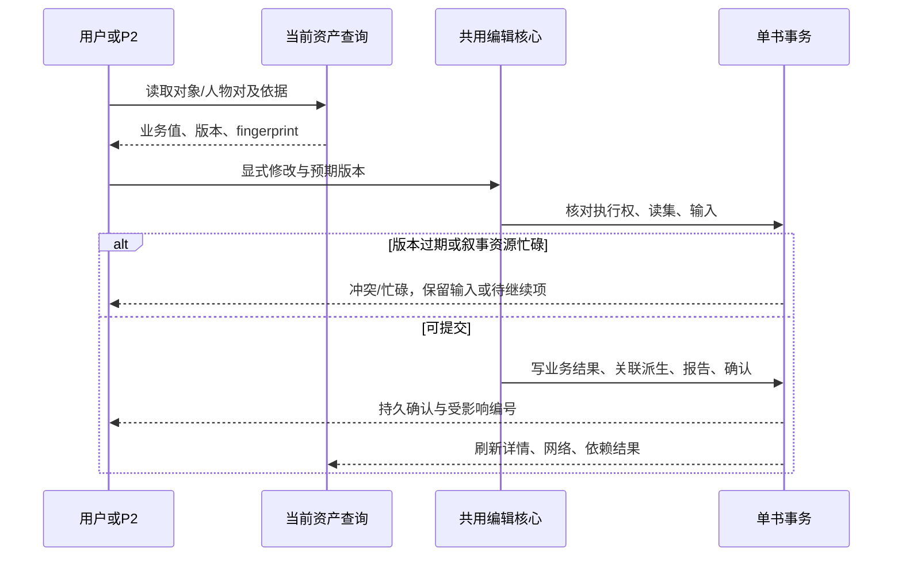

# 实施设计

本设计对应 REQ-011 至 REQ-014，授权与业务结论见[提案](proposal.md)。设计中的表名、工具名和参数为本次交接的具体方案；内部函数拆分由实施者决定。基础字段定义继续引用[03 数据契约](../../../docs/v2/03-Spec-数据与存储.md)，新增与变更如下。

## 模块协作与实施方法

| 位置 | 实施职责 |
|---|---|
| src/features/assets/types.ts、relations.ts | 人物对类型、当前结果投影、删除状态、标签及方向转换；现有原始事实保持可追溯 |
| src/features/assets/service.ts、mergeCore.ts、characterLinks.ts | 人工与 AI 共用写入验证及事务核心；人物改名/合并/删除后的端点与节点联动 |
| src/features/assets/AssetsPanel.tsx、AssetEditor.tsx、search.ts | 固定两栏、人物专用搜索、共用编辑会话、关系编辑弹窗及导航保护 |
| 新 src/features/character-network/ | 人物网络组件、Canvas 绘制、布局计算、命中测试及本机视图缓存；不混入事件网络的时间轴算法 |
| src/features/agents/contracts.ts、tools.ts、commands.ts、queries.ts | 六个对象专用写工具、人物对详情读工具、权限表、真实读集和确认；移除仅允许一个写工具名称的硬编码 |
| src/features/world/service.ts、queue.ts、types.ts | P2 全资产核对阶段与逐项恢复、修改报告，接入新工具；既有身份合并和按需整编继续复用 |
| src/features/story/coverage.ts 及相关恢复逻辑 | P2 修改节点/线后的实际依赖失效；不因无关字段修改清空全部覆盖 |
| src/lib/storage/workspace.ts、src/features/backup/ | 版本7表结构、备份升级、数据校验与本机布局删除清理 |
| docs/v2/resources/v2.2/ | 实施时同步工具参数/结果、存储 Schema、示例和 P2 提示词；同时更新文档与资源归属哈希 |

先完成当前关系投影与共用编辑核心，再接 UI、网络和 AI。人工入口取得既有资源检查，AI 入口使用绑定执行身份，二者调用可接受现有事务的核心；禁止核心再开启嵌套独立事务。

## 字段变化

### 人物对编辑结果

新增书库表 `characterRelationEdits`，主键 `pairKey`，索引 `aId,bId,state`。同一人物对只有一个当前编辑结果。`aId`、`bId` 按稳定字符串序排序，`pairKey = JSON.stringify([aId,bId])`，不可用容易碰撞的拼接分隔符。字典序只用于键，不用于用户显示排序。

| 对象与存储位置 | 增加/修改/删除 | 字段标识（含义） | 类型、必填、默认及校验 | 何时由谁赋值、谁读取 | 旧数据、接口及备份处理 |
|---|---|---|---|---|---|
| characterRelationEdits | 新增 | pairKey、bookId、aId、bId（人物对和归属） | 必填 string；两个不同的同书有效人物；系统生成键 | 共用保存核心赋值；详情、网络、工具和备份读取 | 版本6升级为空表；格式7完整导出 |
| 同表 | 新增 | state（当前状态） | `active` 或 `deleted`，必填；删除仍保存该行 | 人工或 AI 显式提交；读取时决定是否有连接 | deleted必须随备份保留，不能恢复为无记录 |
| 同表 | 新增 | aToBLabels、bToALabels（两向标签） | string[]，必填，去首尾空白、去重、保序；每项1–100字符，每向最多20项；active至少一向非空，deleted均为空 | UI/AI输入按端点方向换算；统一关系投影读取 | 旧事实聚合标签仍保留，不强行压成单字符串 |
| 同表 | 新增 | directionUnclear（方向未明确） | boolean必填；人工新建默认false；旧未明确资料编辑时默认保留true，可明确方向后改false | 编辑弹窗勾选及AI显式参数；UI/工具读取 | 不猜测旧“父子”等描述的反向身份 |
| 同表 | 新增 | evidence（本次依据） | `{chapterIndex:string,quote:string}[]`，人工默认[]；AI非空，逐字且已实际读取；章节属于本书 | 人工可补引文、AI必传；工具/来源区读取 | 原始事实的依据另保留，不将其误标为新标签的证明 |
| 同表 | 新增 | sourceRelationIds（关联原事实） | string[]必填，系统从被编辑对的基础投影取值，默认[] | 写入核心生成；来源详情及审计读取 | 原始事实不删除；导出保留 |
| 同表 | 新增 | revision、updatedAt、updatedBy、commitId | 正整数从1递增；ISO时间；`manual`或`agent`；非空持久确认号 | 系统提交时赋值，UI/读集/日志读取 | 新格式校验；不允许模型伪造 |
| 人物对查询结果（非表） | 新增 | pairKey、fromId、toId、forwardLabels、reverseLabels、state、editRevision、fingerprint、evidence、sourceRelationIds、directionUnclear | state含active/deleted/absent；无编辑行editRevision=0；fingerprint为当前有效结果及端点生命周期摘要 | 共用查询生成；UI与AI保存时使用 | 老relationEdges保留形状但改读有效投影；空标签方向不生成假边 |
| characterRelations原始事实 | 无字段变化 | originCharacterId、sourceId、targetIds及原标签/依据 | 继续按上一变更契约 | P1旧数据、合并和来源显示使用 | 不能为编辑某人物对而改掉其他目标的原始事实 |

当前结果算法：先按现有事实计算全部人物对，再叠加 `characterRelationEdits`。有active编辑行，完全采用该行双向标签；有deleted行则不输出连接；无编辑行则使用基础事实。新增人工关系只需编辑行。读取、改名导致的索引重算均不修改编辑结果。AI 恢复删除关系必须以新的显式保存命令把该行改为active。旧成功命令重放只返回旧确认，不能再次覆盖较新的人工/AI操作。

`relationEdges` 继续表示有向结果，但仅对非空标签方向生成边；编辑器与网络使用人物对结果，不从两条边推测连接数。原始事实以“原始提取依据”呈现，有效标签以“当前关系”呈现；人物详情的旧兼容 `relations` 字段也必须由有效投影生成，不能同时返回已删除关系作为当前事实。未解析记录单独返回，分页总数按人物对计。

### 资产编辑、记录与视图字段

| 对象与存储位置 | 增加/修改/删除 | 字段标识（含义） | 类型、必填、默认及校验 | 何时由谁赋值、谁读取 | 旧数据、接口及备份处理 |
|---|---|---|---|---|---|
| characters | 修改枚举 | roleWeightSource（层级赋值来源） | 增加`agent`；缺失沿用当前自动推导；人工值manual、AI显式值agent都不被频次刷新覆盖 | AI编辑层级时写agent；频次派生与合并读取 | 旧manual/frequency保持，格式7容纳agent |
| characters/locations | 明确赋值 | nameSource、manualKeep、verifiedAliases | AI显式改名写automatic；人工改名仍manual；manualKeep继续由合并流程维护；AI核实别名同步verifiedAliases | 编辑核心处理；合并与名称绑定读取 | 编辑可以更改人工主名，不能因nameSource=manual直接拒绝；合并保留目标的保护机制仍适用 |
| 四类资产 | 编辑入口增加，存储字段延用 | 本文工具字段表列出的业务字段 | 类型与校验见下；省略不改，显式清空按规则处理 | 人工/AI共同核心保存；全部资产查询读取 | 格式7保留既有字段；新增入口不重写createdBy |
| pipelineRuns已有命令与报告 | 新增记录内容 | assetEdits（修改报告） | 每项含commitId、tool、对象编号、fieldChanges的前后值、reason、evidence、timestamp、actor；系统生成 | 与业务数据同事务追加；P2报告查看并分页 | 旧运行缺省[]；格式7导出，敏感设置不写入 |
| P2任务 | 增加阶段/版本 | phase=`asset_review`、reviewVersion、workItemId、outcome | 由代码创建；对象kind+id构成稳定工作项；关系项由两端人物核对并按pairKey去重；outcome=no_change/changed/needs_review | P2队列创建和恢复读取 | 旧计划版本不当作新核对阶段已完成；不重跑P1或重放成功合并 |
| 本机localStorage | 新增 | `wwv3:character-network:v1:<bookId>` | `{version:1,positions:Record<id,{x:number,y:number}>,view:{x:number,y:number,zoom:number}}`；有限数值，zoom限定0.1–4 | 拖动/视角变化后防抖保存；打开网络读取 | 不进书库/备份；删除书清理；损坏丢弃并重布，存储失败当前页仍可用 |

人物的频次、来源章节汇总、生命周期、节点引文位置和事件线章节范围由代码派生。模型编辑业务事实，程序重算这些数据；既有字段字典权威位置不搬迁。

人工关系提交没有P2 run时，在pipelineRuns保存独立日志行：`id=asset-edit:<commitId>`、`recordType=asset_edit`、bookId、operationKey、payloadFingerprint、assetEdits和createdAt均必填，字段类型沿用上表；不得伪造成活跃任务或租约。人工提交由客户端生成操作键并在网络/反馈重试时复用；服务器式业务核心在同书事务内核对已成功键。AI报告则写入真实P2 run的report.assetEdits及既有命令账本。无变化提交记录结果，但不递增业务revision。格式7的pipelineRuns联合Schema须明确加入独立日志变体，恢复时保留且不作为待运行任务。

合并层级时将manual和agent都视为显式设置：优先保留目标的显式值；目标无显式值时按成员编号自然序选首个显式值；不同显式值记入合并冲突报告。自动频次只更新frequency来源或未设置者。

## 数据流转

### 人物对编辑与可追溯性

1. 打开人物详情：AssetService读取人物、生命周期、原关系表、编辑结果表 → 同书校验与有效投影 → 按对方主名拼音/编号排序的人物对列表，每页50组，同时返回总数和下一页。
2. 进入编辑弹窗：读取该对的完整当前结果、两端版本、fingerprint及依据。编辑器以当前人物为“我”，对方为“对方”；底层按a/b转换方向。
3. 保存：校验同书、人物存在、非自身、标签、资源、版本和fingerprint → 在单事务写编辑行、双方revision、修改记录 → 提交后通知LiveResult → 两个详情、网络、AI读取统一更新。失败保留弹窗输入。
4. 删除：确认文案列双方姓名/编号，明确删除双向整组 → 相同校验 → deleted行、双方revision和记录同事务提交。添加搜索由有效关系判断置灰；deleted对恢复可选。
5. AI：先读两端详情和人物对详情/原文 → 同一核心提交；关系不再受人工保护。成功的命令键、修改报告与业务更新同事务写入。

具体例子：A=`C1-P001`张三，B1=`C2-P002`张蕾，B2=`C5-P001`张蕾。基础事实R1使A→B1、A→B2都是父亲，反向女儿。人工只将A/B1改为“师父/徒弟”，新增该pairKey的active行，B2仍父亲/女儿；删除A/B1后该行revision变2、state=deleted，B2仍连接。刷新后A/B1仍无连接。P2重新读取该对后，以新operationKey及原文依据保存“父亲/女儿”，revision变3、active。B2与R1始终未被这次编辑改写。

### 合并、删除与改名

- 改名：编辑行绑定编号，不改端点；网络标签与搜索立即更新。基础事实仍按上一变更重建，编辑结果优先。
- 合并：共用mergeCore在合并前读取受影响人物对的**有效结果**，沿生命周期把端点映射到保留编号；相同目标对按方向合并有效非空标签、依据与来源编号。所有受影响目标对写成新的编辑结果，防止旧原事实重算引入已被屏蔽的标签。无有效连接但至少有删除编辑的目标对保留deleted；存在任一有效连接则active（被合并人物原本的有效关系继续保留）。两个端点合为同一人时不生成自连，历史依据留在合并报告。旧编辑键删除与新键、资产、映射、节点、报告同事务提交。
- 示例：A/B1被删除、A/B2仍父亲/女儿，将B1并入B2后A/B2仍父亲/女儿；若两对都删除，合并后仍无连接。这是身份合并后的关系汇总，不是刷新恢复。
- 删除人物：保留其关系编辑历史，但有效投影过滤不存在的端点，不能给新建同名人物继承；网络移除节点/线，选中者进入已删除提示。备份预检接受能由生命周期解释的已删除端点，拒绝未知/跨书端点。

### AI与并发



当前资产更新成功后才发刷新通知。姓名编辑可能改变名称命中的节点和关系，沿用现有同书绑定；事件成员、章节和引文编辑重算线范围、参与人物、引文位置及实际依赖覆盖。同一事务失败则旧数据完整，表单输入和模型命令意图保留供重试。不会因编辑保存自动启动P2/P3。

## AI工具参数与结果

### 注册与共有输入

在P2 `asset_editor` 注册 `edit_character`、`edit_location`、`edit_event_node`、`edit_event_line`、`set_character_relation`、`delete_character_relation`，并注册现有四类查询/详情与新增 `get_character_relation`。既有commit_asset_changes合并/别名工具继续存在。P3仍使用既有story_editor工具集，不通过此次新增P2工具获得其他权限。修改工具契约的完整请求、成功和失败Schema、示例及消费者一起更新。

新增写工具仅在P2的asset_review阶段暴露并允许执行；身份核实、按需整编和设置页探针保持各自既有工具许可。命令分派按“职责+阶段+工具”白名单检查，不能把新工具都路由到原applyAsset合并分支。

四个edit工具共有参数：

| 参数 | 类型与要求 | 语义 |
|---|---|---|
| operationKey | 非空string，必填 | 同run同工具同内容重试复用；跨工具复用同键拒绝；模型重新判断用新键 |
| id | 非空string，必填 | 当前有效对象编号；已合并旧编号要求重读后提交当前编号 |
| expectedRevision | integer≥1，必填 | 目标对象读取版本；不能仅依赖模型传值，须核对工具实际读集 |
| patch | 下表对象，必填且至少一个字段 | 严格拒绝未知字段；省略不改；数组为完整替换，不是自动追加 |
| reason | 去空白后非空string，必填 | 对此次修改的具体解释 |
| evidence | 数组，至少1项，必填 | 项为本书chapterIndex及逐字quote；新增/改写事实须原文支持，删除错误描述说明证据矛盾；读过原文才能提交 |

不接收bookId、runId、taskId、profile、数据库路径，它们由应用绑定。所有工具保留现有64KiB输入/输出限制；长资产详情继续分页，必须读完整将要修改字段，截断结果不能满足写入前置条件。程序验证引文存在和读取范围；事实语义忠实性由提示词和真实模型验收核对，不宣称程序可以证明推理正确。

### 逐对象patch字段

下表是可写字段白名单；S表示string，SA表示string[]。字符串默认不截断；名称/标题去空白后不能为空。清空可选文本用`""`、清空数组用`[]`；可选标量用null删除，必需字段不接受null。未列出的系统和派生字段不得从patch透传。

| 工具 | patch字段与类型 | 校验和存储转换 |
|---|---|---|
| edit_character | name:S；aliases:SA；identity:S；ageText:S；age:number或null；gender:S；appearance:S；personality:S；background:S；speechStyleSample:S；roleWeight:四层级枚举；chapterIndex:S或null；manualSourceNote:S | age为有限非负数；age/ageText/gender写入profile对应字段；roleWeight显式修改写agent；章节必须存在；无章节须有来源说明。人工主名/层级可显式改，未传则保留。别名规范化、同名允许；同步核实来源与名称绑定 |
| edit_location | name:S；aliases:SA；description:S；chapterIndex:S或null；manualSourceNote:S | 同书章节/来源说明；改名别名同步名称规范化；来源事实不被当成普通描述删除 |
| edit_event_node | name:S；summary:S；process:S；chapterIndex:S；quote:S；participantIds:SA；unlinkedParticipants:SA；actors:SA；targets:SA；actorIds:SA；targetCharacterIds:SA；time_text:S；time_hint:S；world_delta:SA；new_facts:SA；started_actions:SA；timeCoord:S；timePrecision:S | summary必需非空；chapterIndex必须为本书章节；明确编号必须存在；统一涉及人物(participantIds/unlinkedParticipants)与底层actor/target字段不得同次混传；复用setNodeParticipants保留既有归类。quote可清空，非空必须匹配所选章；更新时间坐标字段沿用现有类型约束。章节变更重算chapterName、offset、quoteStatus、order及相关线范围 |
| edit_event_line | title:S；nodeIds:SA；cause:S；process:S；result:S；lineStatus:open或closed | nodeIds完整有序替换，至少1个、同书有效且去重；新增成员必须读节点详情；重算chapters、timeRange和成员反向关联 |

AI原话片段及引文字段逐字核对，不能把概述当原话。人物与地点的来源字段只修改当前资产的人工来源入口，不重写P1原始章节事实。修改长描述必须保留仍有效事实；P2按需整编不得用旧优化结果覆盖新版本，相关事实指纹和已覆盖记录按实际修改失效。对尚无原文能支持的内容，模型记录未修改理由而不编造值。层级调整可引用出场事实并说明判断，不要求原文出现“主要人物”字样。

### 人物对工具

`get_character_relation({fromId,toId})`：必填本书不同人物编号，读取双方有效编号、编辑行和基础事实。返回 `data:{pairKey,fromId,toId,state,forwardLabels,reverseLabels,directionUnclear,editRevision,fingerprint,evidence,sourceRelationIds,endpointRevisions}`。没有连接也返回absent或deleted而非NOT_FOUND；人物不存在才报NOT_FOUND。原始证据过长使用已有详情分页机制另读，fingerprint包含完整当前结果，不能因展示截断遗漏依赖。

`set_character_relation`参数：operationKey、fromId、toId、expectedFingerprint、forwardLabels:SA、reverseLabels:SA、directionUnclear:boolean、reason:S、evidence，全部必填；标签规则同字段表。两个方向按调用方from/to解释，程序转换a/b。当前active可覆盖，absent可新增，deleted可恢复。至少一向有标签；清空某一向允许，双向都空要求用删除工具。

`delete_character_relation`参数：operationKey、fromId、toId、expectedFingerprint、reason、evidence，全部必填。读取当前对后删除双向整组。当前已deleted或absent时返回合法无变化确认，不增加关系或人物revision；不同operationKey的无变化确认仍记录意图结果。同键成功重放优先返回原确认。

共用写工具成功结果保留 `ok,commitId,operationKey,alreadyApplied,summary`，新增 `changed:boolean,affected:[{kind,id,revision}],pair?:{pairKey,state,editRevision,fingerprint}`。报告记录前后值、修改者、证据与工具。错误统一为既有领域错误：INVALID_ARGS、SCOPE/WRITE_SCOPE_DENIED、NOT_FOUND、CONFLICT、ASSET_DOMAIN_LOCKED、IDEMPOTENCY_CONFLICT、ABORTED；错误消息给出重读/稍后继续/修正字段的办法，不吞成成功。

示例（将被人工删除的关系恢复）：

```json
{
  "operationKey":"restore-pair-01",
  "fromId":"C1-P001","toId":"C2-P002",
  "expectedFingerprint":"从get_character_relation本次返回复制",
  "forwardLabels":["父亲"],"reverseLabels":["女儿"],
  "directionUnclear":false,
  "reason":"本章原文明确双方为父女，恢复这两个编号的连接",
  "evidence":[{"chapterIndex":"2","quote":"船夫张三是长女张蕾的父亲。"}]
}
```

### P2阶段与执行权

用户启动现有“AI整理”后，先按既有身份与别名核实处理，再进入 `asset_review`，随后执行现有按需整编。asset_review以四类资产当前编号构成可分页任务清单；一次最多50项，模型按任务读详情、关联关系及原文，返回逐项 no_change/changed/needs_review 和实际commitIds。没有合并候选也必须进入本阶段；不能仅注册工具而从未安排模型使用。允许从某个人物详情新增尚不存在的人物对，不要求关系列表已有项。

本阶段提示词写明五类可编辑对象、人工内容可修改但必须有据、单向不猜反向、同名按编号区分、原事实与当前结果区别、全文分页、无变化也给结论、资源忙碌不循环抢锁。标题“AI整理”可沿用，说明文字改为覆盖人物、地点和叙事资产的核对编辑。保留既有模型调用预算及费用记录，不偷偷增加独立自动任务。

P2继续持有world租约。写节点/事件线时，单书readwrite事务先核对world持有者，再检查narrative租约：若有其他活动持有者立即返回ASSET_DOMAIN_LOCKED；否则临时取得narrative资源，在同一事务完成全部写入并释放。模型请求期间不持有临时叙事资源，禁止等待锁。P3可以继续并行；P2能先完成不冲突的世界资产项，叙事项标deferred、界面提示“叙事任务运行中，部分资料待继续”。用户在P3结束后点击继续，重读并处理剩余项。不能将deferred标完成或自动打断P3。

人工叙事编辑也在同一事务核对资源和版本。事务和租约记录在同库序列化，使P3启动与P2叙事写入不能同时绕过检查。P2取消释放自己持有的资源，不释放P3资源；已提交结果保留。世界编辑导致的节点绑定联动沿用现有允许跨域更新及读集冲突规则，与直接编辑叙事正文区分。

## 界面与网络

### 人物列表与编辑会话

默认进入人物列表；列表左30%、右70%，网络左70%、右30%。右栏始终存在，无选择显示“请选择人物查看或编辑”。桌面双栏最小宽度：列表左280px，编辑器360px；不足时容器横向滚动，保持左右关系，不在选择后才切布局。两栏各自滚动，编辑器不因选择而自动滚动整页。工具栏依次保留新增人物、人物列表、人物网络；既有合并入口保留，进入合并通过统一切换保护并回列表。

人物搜索使用独立函数，NFKC规范化、去首尾空白、不区分英文大小写；只搜主名/别名，不搜编号、身份、背景或正文。相关度保留现有rank的tier、field、offset、excess四项比较，仅移除编号和正文候选：主名完全相同、别名完全相同、前缀、包含，再按原字段优先级、匹配位置与多余长度比较，其后主名拼音、来源章顺序、编号自然序。空查询按层级、`zh-CN-u-co-pinyin`主名排序、编号自然序；缺层级按NPC处理，不因此写数据库。数字/符号姓名采用同一collator；同拼音再比较完整名称及编号，保证稳定。

人物网络搜索与添加关系搜索共用这套姓名/别名匹配，结果显示姓名、编号、身份。网络搜索不移除其他节点，选中结果才定位与编辑。关系候选排除当前本人，已有有效连接的结果置灰并标“已建立关系”，不因分页漏读而可重复添加。搜索结果分页50条，选择与保存之间关系变化用fingerprint拒绝过期添加并提示转编辑。

父层维护编辑会话（基线、草稿、dirty、待导航目的地），完整AssetEditor跨视图保持挂载/同一身份；输入不因LiveResult刷新被覆盖。同一人物的新版本且无脏数据可自动更新；有脏数据提示冲突，提供保留输入、重新载入，保存失败不切换。

离开当前人物（选择、关闭、新增、切资产标签、切书、离开工作台）走统一保存/放弃/取消；浏览器刷新关闭用原生离开提示，不承诺刷新后恢复未保存草稿。列表与网络视图切换、搜索、缩放及重新布局不卸载草稿。关系弹窗有独立dirty与保存状态，关闭未保存弹窗需确认放弃。层级立即保存及关系独立保存只更新相关基线字段和版本，不覆盖其他未保存文本；新建人物先保存取得编号再允许建立关系。

### 关系分组展示

一组显示对方姓名（编号），可补身份；下方两向箭头与标签，一组共用编辑/删除。对称关系仍显示两方向；只有一方向则只显示该方向并在编辑框保留空白另一向。每向标签用可增删文本项输入，不把逗号强制当分隔符；多条来源聚合后也能逐项编辑。关系列表按对方拼音/编号稳定分页，不以UUID排序；分页中保持完整人物对。

未解析的原始关系放在“待关联的原始关系”区，显示原描述和原因（来源失效、目标未入库、合为自身）。方向未明确不等于未匹配，已匹配的旧关系照常展示并提示方向未明确。可在正常“添加关系”中选择已存在人物建立明确关系，原始未解析依据保留；此处不自动创建人物或猜方向。对用户报告的“关系不显示”，先以数据库事实、编辑结果和有效投影核对，不能直接归因为方向不明。

### 网络布局及交互

节点圆内姓名（过长截断，悬停显示完整姓名/编号/身份/层级）；四级半径依次32、26、20、16个世界坐标单位。黑底，基础线低透明度；选中节点及直接邻居高亮，其直接连线提高透明度，其余淡化。每人物对一条线；悬停显示按两个姓名和编号标注的非空方向标签及方向不明提示，不能将单向画成双向关系。无全局关系文字墙。

选择Canvas渲染，保留DOM搜索结果与可键盘操作的人物入口、状态提示和悬停卡。命中测试区分点击与拖动（移动超过5px为拖动），拖动结束不触发切换人物。滚轮围绕指针缩放、空白拖动画布、节点拖动、搜索定位、重新布局按钮齐全。拖拽使用pointer capture，取消拖拽保留最后合法位置。

力导向只在首次无缓存或点击重新布局时运行：吸引、排斥、碰撞和按层级变化的中心引力；孤立节点弱外围引力；不强制划社区。最大节点半径32加12间隙构成碰撞包络，任意两中心至少76单位，确保以后层级变大也不重叠。重要性是软优先，碰撞间距优先于中心位置。使用按编号确定的初始化种子和空间索引；布局放Web Worker并分批迭代，界面可取消。取消保留旧布局；首次取消保留当前合法临时布局。

选择、关系修改、编辑保存和节点大小变化不启动模拟。拖动节点只改变该节点，落点冲突则吸附最近空位，不推开全图。新增人物在已有邻居附近空位或外围空位插入；删除移除；合并保留目标节点坐标，若目标未显示用成员坐标确定空位。缓存中缺失人物丢弃，多出人物局部安放。数据更新不主动fit全图；首次布局和重新布局完成才适配视窗，搜索定位只改视角。

位置和视角以本书bookId缓存，交互后300ms防抖保存；选中状态不跨刷新持久化，刷新恢复布局时右侧可显示未选提示。恢复备份为新书时无旧布局，重新计算。存储失败给非阻断提示“本次布局未能保存在本机”；资产保存不受影响。所有有效人物与关系都进入网络数据，不用默认截断规避大图；允许视口裁剪绘制但搜索和邻接查询完整。

删除成功后清理该书本机缓存，并在当前页面拒绝旧视图延迟回调及卸载回调的晚到保存。其他书继续独立保存；新书和恢复副本使用新bookId。书卡隐藏只是删除流程的中间状态，验收缓存清理须等待删除成功反馈。

## 触发逻辑

| 触发动作或事件 | 前置条件 | 顺序及分支 | 状态与数据变化 | 模型或工具调用 | 反馈、重复、取消及恢复 | 下游触发 |
|---|---|---|---|---|---|---|
| 打开人物列表/网络 | 书已打开 | 读取有效资产→固定两栏→按视图渲染 | 无选择时空右栏；有缓存恢复视角 | 无模型 | 读取失败可重试；不展示跨书缓存 | 无任务 |
| 搜索/选择人物 | 姓名或别名匹配 | 相关度列表→导航保护→选中；网络仅定位高亮 | 草稿按用户选择保存/放弃/保留 | 保存时普通服务 | 保存失败停留原人物 | 不重布 |
| 新增/编辑关系 | 双方存在且资源可写 | 读取完整对→校验→事务保存 | active、双方版本与日志 | 人工无模型，AI用set工具 | 冲突保留输入并要求重读；重复请求复用确认 | 列表/双方详情/网络刷新 |
| 删除关系 | 用户确认或AI有据提交 | 读取→校验→写deleted | 两方向同时消失 | 人工无模型，AI用delete工具 | 双方无效报错；无变化不增版本 | 添加候选恢复可选 |
| AI全资产整理 | P1覆盖完成、用户启动P2 | 原身份核实→asset_review→按需整编 | 当前资产及报告逐项生效 | 已登记读写工具 | 世界项可继续；叙事忙碌项保留deferred；用户继续时重读 | 不启动P3 |
| 修改层级/姓名 | 版本有效 | 写字段→重算必要派生→发布结果 | 列表排序、网络大小/文字更新 | 人工或AI | 其他草稿保留 | 不重布 |
| 人物合并/删除 | 沿用原入口条件 | 有效关系映射→资产/节点/编辑结果事务更新 | 端点收敛或失效 | 原工具/人工入口 | 事务失败全部回滚 | 网络局部移除/更新 |
| 重新布局 | 网络可用 | Worker计算→碰撞检查→替换位置→fit→缓存 | 清除手拖位置，保留选中及表单 | 无模型 | 取消保留旧布局，旧Worker晚到结果丢弃 | 无资产修改 |
| 导出/恢复/升级 | 版本与预检有效 | 同库快照/原子升级/新书恢复 | 含编辑结果和删除状态 | 无模型 | 失败保留原库和原文件 | 恢复不自动跑任务 |

## 升级与兼容

数据库6→7只增加编辑表，旧原事实不变；5→6→7连续升级，任一步失败回滚。备份格式7增加新表与报告/层级来源枚举；格式6恢复时创建空编辑表，格式4/5沿既有迁移后进入7。旧低于版本5的原库仍遵循REQ-006，不顺便扩大升级范围。

预检新表的键、唯一性、同书端点、状态标签组合、修订号和证据章节；已删除端点须有生命周期解释。导出同一只读事务获取原始事实、编辑结果及全部资产，恢复重写bookId而保留人物编号和pairKey，不能重算后忽略deleted。恢复原始事实与编辑结果后比较有效关系投影。布局缓存排除；命令确认保留，活动临时租约排除。旧应用不支持格式7时明确报版本不支持。

工具契约版本变更后，旧P2任务保留成功命令/合并凭证；新asset_review清单从当前资产生成，不误判旧任务已覆盖新能力。中断恢复重新取得执行权，成功同键优先回放确认；未提交命令重读有效对象与证据。P3只失效被修改对象/查询实际依赖的覆盖，历史消息和业务确认继续保留。

## 验收与接手

### 验收修复实施方法

字段存储无变化：沿用人物revision、人物对fingerprint和assetReview逐项状态，不升级数据库或备份。模型总结沿用共用Schema的changed（已修改）、no_change（无需修改）、needs_review（待继续），提示词与消费端使用同一含义。

数据流转：模型提交partial及remainingWorkIds→核对队列仅把明确changed/no_change的项记为checked→剩余或needs_review项记为deferred→完成其他未尝试批次后暂停→用户继续时重读余项。例如人物已核对、地点L1尚未核对时，人物保持checked、L1保留deferred，运行不得显示completed。保留已提交确认，单次运行不循环重试暂缓项。

身份核实进度继续读取coverage，全资产核对进度与批次状态读取assetReview.items；核对阶段不能覆盖身份核实统计。功能浏览器用例等待保存确认后再刷新。大图帧率在功能回归完成后以单独浏览器测量，避免测试浏览器相互争用渲染资源。

人物表单按可编辑字段比较新版本；关系独立提交只改变关系投影和revision时更新基线，背景输入继续保留，真实业务字段变化仍提示冲突。关系弹窗独立跟踪草稿，关闭须确认放弃；导航沿用保存/放弃/取消，刷新显示原生保护。关系候选和网络共用姓名别名相关度搜索，每页50条可继续读取。

布局使用可扩展的世界坐标及空间索引，最终安放与拖动落点保证至少76单位中心距；重要性中心倾向保持软约束。Worker首次提供合法临时布局，重新布局期间保留旧图，只有完成后替换；取消终止Worker并使晚到消息失效。新增人物只安放空位，不推动旧节点。悬停逐条命中线段，显示双方姓名、编号和两向非空标签。失败或取消不改资产数据。

[任务](tasks.md)按1数据→2核心→3编辑器→4网络→5工具与阶段→6回归→7用户验收排列；4与5都依赖2，5不依赖网络实现。样本、运行命令、每项操作与数据结果、失败恢复见[验收清单](acceptance.md)。开发完成必须验证旧关系基础回归、六个工具真实写入、同名隔离、单向、删除不复活、AI恢复、未保存保护、布局不重算、P2/P3并发、格式4至7恢复和本机缓存隔离。

主规格及技术正文在用户验收后同步；运行时契约及哈希在代码实施时同步并跑业务测试。交付真实模型结果时逐条附样本原文与修改报告，不以单元测试替代小说效果验收。
