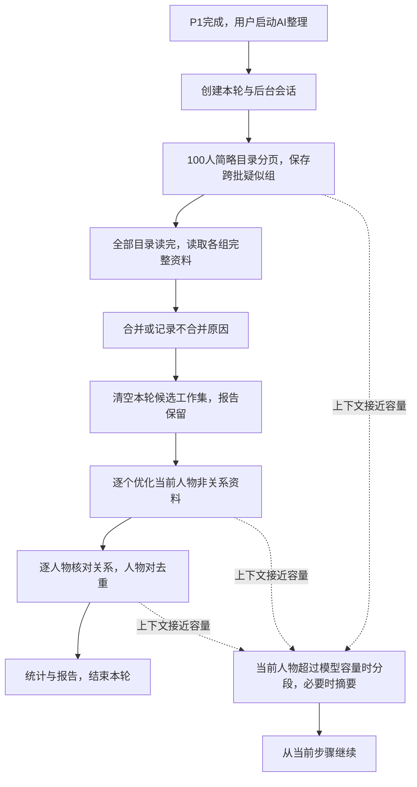

# 实施设计

> 2026-11-08 后续变更：P2 提示词与默认工具按工作项拆分见 [BUG-34](../step-specific-organization-prompts/proposal.md)。本文件中“提示词/工具集不随步骤变化”的旧条款由该变更替代；跨步骤查询、候选、合并、资料/关系纠错仍保留。


REQ-019；确认依据和修改范围见[提案](proposal.md)，验证见[验收](acceptance.md)。采用现有Pi运行器、资产服务和事务，在本书内完成统一后台整理。BUG-32改为分步骤、逐工作项输入；历史存档、工作上下文、进度分别维护，具体字段与执行规则见文末BUG-32设计。模型配置、P1启动门槛和代码整理入口保留。

## 流程与模块



world/service负责启动、续做、运行控制和收尾；新编排模块放在src/features/world/，不继续依次运行旧identity→全资产assetReview→optimizeAsset链。agents/runtime负责同会话多轮工具循环，sessions/context复用历史存储但按工作项投影，必要时使用按模型容量处理的compaction，profile支持asset_editor。assets服务负责实体/关系读写和合并，工具层不另造资产副本。

工作步骤为scan、resolve、profiles、relations、finalize、done；UI显示中文。profile及工具集不随步骤变化。工作完成条件可以校验目录是否读完、候选是否处理，但不能用“当前不是某阶段/不在分配项”拒绝合法资产工具调用。常规工作顺序由统一提示词和进度工具引导，所有步骤都能读取和修正其他资料。

主流程主动遍历人物；地点、节点、事件线可作为证据按需查改/合并，不增加一次强制全地点、全节点、全事件线扫描。模型可在优化或关系整理中发现遗漏的同人问题，使用同一候选/合并工具处理；新变化只重查受影响项，不重启整轮。

## 字段变化

沿用现有单书表，候选和进度嵌入pipelineRuns；会话复用storySessions/storySessionEntries，不重命名这些存储表。没有新增表/索引，数据库保持版本8；初版备份9已实现，BUG-32新增工作上下文与逐请求用量采用格式10。若其他Agent已占用格式10，实施前选择下一个未使用版本并同步本材料和测试。

| 业务对象/位置 | 变化与字段 | 类型、必填、默认及校验 | 赋值/读取与兼容 |
|---|---|---|---|
| P2运行pipelineRuns | 新增workflow、sessionId、organization | 新轮workflow固定character_organization_v1；sessionId为本书asset_editor会话ID；organization见下表，必填；phase固定character_organization | world创建、Agent工具推进、UI/备份读；旧运行缺workflow仍按旧结构识别 |
| organization | version、step、revision、scanIds、scanPages、candidateGroups、profileItems、relationItems、pairChecks、statisticsPending | version=1；step为六步骤枚举；revision正整数初始1；数组初始[]；statisticsPending布尔初始false；scanIds启动时当前人物ID按稳定编号排序去重 | 服务创建和工具事务更新；step不参与工具权限判断；失败保留 |
| scanPages元素 | pageId、ids、nextCursor、status | pageId服务生成，同一页稳定；ids实际返回的ID；nextCursor:string/null；status为issued/checked；未确认页不能计为已扫 | 查询登记issued，进度工具确认checked；断线重读未确认页，不越页跳过 |
| candidateGroups元素 | id、memberIds、reason、status、revision、createdAt、updatedAt | id服务生成；memberIds至少2个不同本书人物；reason非空概述；status=pending或resolved；revision初始1；时间为ISO | 保存/补充工具写；按排序后成员集合去重；报告另保存原始成员和判断，清空只删除本数组 |
| profileItems/relationItems元素 | id、status、outcome、reason、contentFingerprint、readRefs、commitIds | id为当前人物ID；status=pending/checked；outcome为changed/no_change/uncertain/unavailable或未处理时null；reason未处理可空，处理后必填；依赖指纹、实际读集和确认由服务记录 | 合并完成构建；对已合并ID按生命周期映射；已删人物由服务标unavailable，不能要求AI创建替身 |
| pairChecks元素 | pairKey、fingerprint、outcome、reason、basis、commitIds | pairKey为现有稳定人物对键；fingerprint当前业务结果指纹；outcome=changed/no_change/uncertain；其他字段与依据规则一致 | 关系查询/进度工具登记；双端遍历共用；数据实际变化时相应项失效 |
| report | 新增candidateDecisions、organizationSummary | candidateDecisions保存groupId、原成员ID/姓名、最终有效ID、outcome、reason、basis、commitIds、时间；outcome=merged/not_same/uncertain/partial；summary保存各步处理数、不确定数、修改数与统计是否完成 | 每次组结论同事务写入，清工作集不删报告；原groups/assetEdits/费用字段继续用 |
| storySessions | 扩展profile=asset_editor；新增workflow、runId | P2新会话必填workflow及runId；bookId一致；原story_editor会话字段和语义不变 | sessions创建；runtime/compaction按明确sessionId使用；按profile+runId区分，不选中P3 active会话 |
| 命令参数及记录 | 新增basis（概述性依据） | 非空数组；每项为summary与source，source按下文联合类型；保存时服务补充revision/fingerprint及实际读取范围 | P2新工作流写工具必填；旧quote/evidence原样保留为历史数据，不反向伪造逐字引用 |
| CharacterRelationEdit、AssetEditRecord及合并报告 | 新增basis；人物对结果新增basis | 可选以兼容旧行，缺省[]；新P2写入有basis；参与有效关系读取/报告和指纹 | 原evidence仍可为空/保留历史引文；basis有独立展示，不再把AI概述送入旧quote校验 |
| 人物层级 | 无新增字段；修改roleWeight、roleWeightSource | 沿现有四层级枚举；显式AI调整写roleWeightSource=agent | edit_character写；频次统计可更新frequency，不能覆盖manual/agent层级 |

系统编号、bookId、revision、生命周期、确认号、频次和反向索引由工具根据业务操作维护，不作为模型可任意覆盖的patch。它们有业务操作入口：改章节会重算节点归属，合并会重定向编号，改成员会同步反向引用。这不限制阶段或资产资料读取。

### 工作数据和报告约束

BUG-31新增检查规则标识reviewVersion=2。第二步开始保存reviewStartedAt；旧规则已过第一步的轮在用户启动时沿原run/session重建资料、关系余项，保留合并、清组结论和原修改；repairNotice说明重查。工作项name供报告定位，uncertainFields说明局部疑点；readRefs是BUG-31旧实现的读取记录；新P2第二、三步不再以完整读取或连续覆盖证明作为提交门槛，保留历史记录用于追溯。人物对outcome=null为待核，readFingerprint记录实际查询的业务结果。相关资料改变失效，派生统计不失效。完整字段、赋值时点、示例和恢复约定见[BUG-31提案](proposal.md#bug-31-资料与关系整理未落实及进度误报)。

- 每次有效写入连同对应确认在同一事务；BUG-32当前工作项提交将完成进度也纳入同一事务；无变化只写处理结论，不增加资产revision、updatedAt或虚构修改条数。
- sourceFingerprint基于真实内容和读依赖，不把frequency、更新时间、单纯修订号变化当作全书变化。提交时仍核对revision防止覆盖；自身提交更新本项基线，受影响邻接项才待重查。
- 未决语义项标uncertain并保存原因，视为本轮已处理；技术错误、网络失败、工具冲突不能伪装uncertain跳过。所有项已处理可completed，同时显示未确定数；有未完成技术项保留paused/failed/degraded及继续入口。
- 运行记录新增字段使用现有存储Schema扩展，不额外创建长期“影子资产库”。完整会话消息留在会话表，候选只存ID和简短原因，避免每页重复复制人物正文。

## 目录、疑似组与进度工具

所有工具由应用绑定bookId/runId/sessionId/owner，模型参数不允许重定向到另一本书或运行。写工具共同使用operationKey进行幂等确认；同键同payload返回原结果，同键不同payload拒绝。返回沿现有ok、commitId、alreadyApplied、changed等确认字段，补充各工具业务结果。

| 工具与用途 | 参数 | 返回/行为 |
|---|---|---|
| query_character_catalog，简略目录 | cursor:string/null默认null；limit整数默认100，1–100；可选search:string，仅姓名/别名；search模式用于查回，不推进全量扫描 | data:[{id,name,aliases,identity}]，pageId:string/null，nextCursor:string/null，total:number，fieldContinuations默认[]；正常字段类型为string/string[]/string，超长字段可为null并附下述续读引用；缺别名/身份返回[]/空串，其他介绍字段不返回 |
| get_organization_progress，工作状态 | 无业务参数 | step、步骤总数/完成数、scan下一未确认页、候选数量、未完成人物ID分页入口、statisticsPending；不塞完整资产正文 |
| save_candidate_group，保存/补充疑似组 | operationKey；groupId?:string；expectedRevision?:number（修改组必填）；memberIds:string[]；reason:string | 返回groupId、revision、是否复用已有同成员组；新增必须为已实际浏览目录或读过详情的本书人物；跨批ID可用 |
| query_candidate_groups，读候选 | cursor:string/null默认null；limit默认50、1–100；status可选pending/resolved | items、nextCursor、total、集合指纹；稳定按创建序/ID分页；每项带当前生命周期解析结果 |
| resolve_candidate_group，记录组结论 | operationKey；groupId；expectedRevision；outcome:merged/not_same/uncertain/partial；reason；basis；commitIds:string[]默认[] | merged/partial引用本组实际合并确认；未合并结论可无commitIds，但必须已读全组完整资料；报告与resolved状态同事务 |
| clear_candidate_groups，清工作集 | operationKey；expectedRevision（organization修订号） | 返回clearedCount及报告位置；只清本轮，必须每组已有报告结论；未处理组给具体编号，不悄悄清除；重复调用无变化 |
| record_organization_progress，目录进度及旧接口兼容 | 保留旧参数以兼容历史调用；新流程用于scan_page及第一步推进 | 第二、三步使用done提交，由代码推进，不要求另调本工具；不能沿旧profile/pair读取证明拦截新提交 |

工具参数为对象，未定义字段拒绝，字符串ID/理由必须有内容；查询分页均≤现有64KiB结果限制。目录长身份使100条超限时返回能容纳的完整条目和nextCursor，不截断identity冒充完整字段；单条超限时仅将超限字段置null，fieldContinuations返回{id,field,cursor}，field限定name/aliases/identity，cursor供既有详情分段工具续读该完整字段。null明确表示未返回，不等于缺值；确认本页前补齐。100是目标数量，不承诺固定token数。

scanIds是启动快照，不用可变offset查询当前人物表；cursor绑定本轮快照、位置和查询模式。返回issued页后，模型先处理候选，再确认该pageId；中断时重新提供未确认页。搜索查回上批姓名不算新的全量扫描页，也不能凭最后一页直接标全书完成。

疑似组允许重叠，不能把A疑似B、B疑似C自动做传递闭包后全部合并。合并前再读全组及保留目标；组中仅部分可合并时提交该子集，结论partial记录剩余成员原因。前组已合并导致后组成员映射到同一个ID时，服务记录已被前次合并解决，不重复合并/计费。成员映射、旧ID和原判断在报告中可追溯。

目录页处理完后释放该页工作输入，跨页通过目录搜索和候选存储查回，不依赖无限历史。目录读完才按常规流程核实合并；其他步骤发现漏组仍可保存、查阅和处理，工具始终可用。新组结束同样清理，整轮finish前不留下无报告的候选。清空失败重试不重复业务合并。

## 依据与写工具

### 概述性依据

新P2工具使用basis，单项结构：

```json
{
  "summary":"两份档案身份与经历一致，名称互为别名。",
  "source":{"kind":"asset","assetKind":"character","id":"C2-P002","fields":["identity","background","aliases"]}
}
```

source联合类型：

- asset：assetKind为character/location/node/eventLine，id必填，fields为可选非空字段名数组；合并须读取成员完整资料，目录信息不足以提交合并；第二、三步来源由预装资料或补查记录提供，不校验完整字段阅读证明。
- chapter：chapterIndex必填，offset/length可选且需同时存在、非负/正整数；必须在本会话实际读取范围内，省略则引用本次实际读到的该章范围，不视为读过全文。
- relation：fromId/toId为两个不同本书人物；预装当前人物关系即可作为来源，不要求再单独调用查询该对来取得证明。
- legacy_relation：id为实际读取过的本书历史关系记录，分段只读了一部分时不可声称读了完整原值。

summary为非空自然语言，不要求与原文、资产字段逐字一致，也不要求含人物姓名。应用从预装资料或补查记录补充来源ID、版本和实际章文范围，保存成Basis记录；第二、三步当前人物工具可不传basis，由代码结合理由补齐。来源越书、引用缺失或写版本过期仍返回具体错误；不以完整阅读、字符串包含或相似度门槛决定是否可提交，也不新增独立模型审批。合并仍按完整成员资料规则；语义是否支持结论由Agent判断和真实样本验收。

多个成员的合并basis至少覆盖所有成员完整详情，允许加原文；第二/三步每次更改提供与修改相关的依据和reason。资料矛盾且无法确定时保留当前值、报告uncertain，不以任意一条旧描述当真。已有身份事实可以支持角色层级判断，不要求原文出现“NPC”。

此变更放宽的是AI提交的依据表述。节点自身quote等原资料字段维持其业务含义：模型可用工具引用已读取的原文段，由服务填入精确文本/定位；不能把依据概述当作直接引语。原P1/P3证据规则由各自规格决定，不因新P2共享工具而自动放宽。

### 全程可用的读写能力

四类query/get_detail、read_original、历史关系、事实底稿、生命周期、当前人物对、当前整理历史和工作记忆在所有步骤可读。每次只按所需分页，不强制先把整本原文塞进上下文。新增工作存储工具也全程注册。

沿用edit_character/edit_location/edit_event_node/edit_event_line的业务patch字段，完整字段表见[前置工具设计](../character-workbench-and-agent-editing/design.md#逐对象patch字段)。新P2参数共同为operationKey、id、expectedRevision、patch、reason、basis；BUG-32当前人物提交由代码补充上下文来源和版本，模型参数按文末简化；未传字段不变，空串/[]清空可选内容，null移除可选标量；必需字段和引用继续校验。现有可读但不在patch的有效业务字段按相同语义补齐，系统/派生字段通过相应操作维护。

set_character_relation参数沿用operationKey、fromId、toId、expectedFingerprint、forwardLabels、reverseLabels、directionUnclear、reason，增加必填basis；新流程不要求旧专项reviewItemId或逐字evidence。delete_character_relation使用同一对、指纹、reason和basis；仅删两个人之间关系，不删人物。两方向至少一向非空，反向未知为空，标签是双方身份关系，不把事件互动/称呼混作身份标签，继承BUG-27结果。

新增统一merge_assets：operationKey、kind（四类之一）、memberIds（至少两个不同编号）、keepId（成员之一）、expectedRevisions（覆盖所有成员）、resultPatch（合并后业务字段）、reason、basis，可选candidateGroupId。成员必须同类、本书、已读完整资料；结果保留一个有效编号，其他编号进入merged生命周期并重定向。无需人工逐组确认。AI可显式调整原人工主名/层级等业务结果，默认保留原人工选择；改变时在resultPatch/keepId和理由中明确，不被旧phase或人工来源标签一概拒绝。

合并语义：

| 类别 | 保留与重定向 | 合并结果与依据 |
|---|---|---|
| 人物 | 复用mergeCore，关系两端、节点绑定、生命周期和候选/进度映射到keepId | 来源章、事实底稿保留并集；有效当前关系按既有碰撞规则合并；名称/别名可由AI整理，独有事实留在底稿/报告 |
| 地点 | 复用现有地点合并，不触碰人物关系端点 | 名称/别名、描述、来源事实按现有核心与resultPatch；报告记录全部成员 |
| 事件节点 | keepId保留，引用该节点的事件线nodeIds替换并去重，节点eventLineIds反向同步，生命周期为merged | resultPatch明确名称/摘要/过程/主章节；所有旧成员完整原值在合并报告保留。人物参与者和事实先并集，主章节/quote定位由保留结果重算，不能把多个不同事件仅因相似描述当作同一事件 |
| 事件线 | keepId保留，节点反向eventLineIds统一替换，旧线ID沿生命周期可查 | nodeIds默认合并去重后按章节order/节点order/编号排序；AI可在resultPatch给出覆盖全部成员的完整顺序；标题/起因/经过/结果由AI整理，chapters/timeRange派生重算 |

节点/事件线合并需扩展现有核心，不让模型调用removeAsset来模拟。事务保存成员原值、来源映射、反向引用和确认，失败全部回滚。合并不是丢弃资产内容的删除：不得提供“只删某ID”或以单成员合并绕过禁令。不注册create_asset/delete_asset/删书/清库能力；共享命令分派遇到直接删除或新建四类资产的请求也拒绝。关系新增、候选清空、为同类资产合并移除旧活行是允许的明确业务操作。

### 版本、租约与失败

新P2在技术批次接续、模型/工具和持久化边界核对world及asset_editor会话租约，定时器延迟时可为仍持有同bookId/owner/runId租约的执行者续期；其他执行者接管、租约移除或提取占用则拒绝旧执行者。写边界续约与业务变化在同一事务提交。收尾统计同样核对执行权；退出后释放本执行者的world和会话租约，便于用户立即继续原轮。报告统计状态仅在step=done且statisticsPending=false时为completed。

新P2仍按本书world执行权运行，P3并发时读取叙事资料可用；需要写/合并节点事件线则在事务内核对narrative执行权，冲突项记录待继续并继续可做的工作，不抢占P3。数据版本冲突重读相关对象后再判断；不能因无关资料变化使全书重新开始。

所有同轮写操作的operationKey按runId+tool+payload绑定，跨技术批次/压缩/重建实例重试仍能返回旧确认，不以新的taskId造成重复写。原有P3/探针规则保持；新工作流的跨任务幂等在命令入口单独测试。工具确认当前人物已处理完成后，代码直接推进，不再调用模型生成结束总结；报告由真实保存记录生成。

## 持续会话与压缩

runId与sessionId作为整轮进度和历史归档身份继续保留；模型输入使用独立contextId，三步不继承彼此全部消息，第二步每个人物、第三步每个人物的关系整理完成后切换工作上下文。同一Pi角色与全工具能力沿用，运行实例以contextId隔离，不能因sessionId相同把旧实例messages装回。P3使用既有会话投影，不受P2切项策略影响。

跨工作项需要的信息由候选、资料、关系结果、确认和简短状态提供。正常切换由程序组装下一人物，不调用摘要模型。当前人物资料超过模型真实容量时分段，必要时只压缩当前人物上下文，按BUG-32错误恢复执行。原消息留档可查，模型不默认重读。

用户关闭页面后本地计算停止；刷新不会自动调用模型。继续同轮时依据持久状态重建当前项小上下文，保留已提交修改、有效检查结果和用量，不能为了恢复再压缩整份旧历史。整轮完成后的新启动创建新run/session，从当前人物重新检查。


## 数据流转

启动：用户AI整理→验证P1完整、模型可用、无冲突world执行者→创建run/session及scanIds→目录工具读取当前人物的三字段→保存疑似组/扫描确认→全目录完成进入复核→详情与依据读集→merge_assets事务→报告结论→清工作集→建立合并后profileItems→字段编辑→建立relationItems和pairChecks→双方关系工具→统计和完成报告。

例如第一页出现C1-P001“张三”、别名“船夫”、身份“渡口船夫”，第三页出现C9-P002“张老三”、别名“张三”、身份“渡口船夫”。AI保存G1成员这两个ID。读取两份完整资料后basis概述“居处和亲属经历吻合”，不是复制原句；确认合并时保留C1-P001，来源映射C9-P002→C1-P001。报告记录G1、两份资料版本和确认号。清候选后G1不再是活动工作项，但报告保留；第二步只优化当前C1-P001，第三步查其完整当前关系。若身份经历冲突仍无法判断，G1记uncertain，两个原人物保持，后两步分别处理。

关系去重：遍历A读到A/B时记录pairKey及业务指纹；遍历B时如该指纹未变，复用已核对结果。修改A/B后只失效与其实际变化有关的条目；人物revision增加但无关字段未变不能导致所有邻接对反复重做。无关系人物仍完成一次关系缺漏检查，发现已有另一个资产编号可用set工具新增关系，找不到具体人物资产则报告原因，不新增人物。

## 触发逻辑

| 触发 | 前置 | 数据与顺序 | 模型/工具 | 反馈和恢复 | 下游 |
|---|---|---|---|---|---|
| AI整理首次/上轮已结束 | P1完成、模型和world执行权可用 | 新run/session及阶段工作上下文，全量当前scanIds，自动三步 | 同一角色/完整工具集 | 当前步骤、已处理/总数、模型费用和报告 | 不自动启动P3 |
| 继续AI整理 | 本轮paused/cancelled/failed/degraded且有技术余项 | 同run/session，重建当前工作上下文，核对有效依赖，只续余项 | 同工具集，按持久状态续做 | 已完成项不重写，已过期相关项重查 | 自动接续后续步骤 |
| 语义不确定 | 已读完整资料，必要时查原文仍不确定 | 保存编号/原因，当前资产不变，该项本轮已处理 | 记录结论工具 | 报告可查，继续后续项 | 不因单项不确定暂停 |
| 第一步结束 | 所有目录页/候选有结论 | clear候选→当前人物资料检查 | clear与进度工具 | 报告保留；clear失败续做不重合并 | 自动第二步 |
| 当前人物超出模型容量 | 近期工具对已完整持久化 | 分段/选择当前需要的资料；必要时压缩当前项 | 必要的摘要调用 | 具体失败原因和恢复状态，历史保留 | 只续当前项 |
| 修改资料/关系/合并 | 实际已读，版本与引用有效 | 资产、映射、确认、工作状态原子写 | 共用资产工具 | 详情/网络刷新；失败原值及余项保留 | 仅受影响项重核 |
| 全部工作完成 | 无技术余项、候选清理、统计完成 | done、completed和真实报告 | 无额外独立复核 | 不确定项单列，无变化不写业务资产 | 下次点击重新全量检查 |

统计重算频次与派生计数，保留manual/agent层级；若统计中断，statisticsPending=true，继续只收尾，不重跑模型三步。

## 兼容与旧入口

- BUG-32备份格式10沿用现有表清单，新增工作上下文和用量记录完整校验；读取格式4–9保留原迁移路径、BUG-21归档和原资产成果。无需仅因JSON新增字段修改IndexedDB表版本。
- 格式10恢复为新书：重写所有本书归属和结构化来源引用，保留资产/组/操作编号；重新基于恢复后内容计算指纹，沿现有rebase机制处理，不把所有有效已完成项置待办。保留消息原文历史但旧字符串书号不成为新工具作用域。运行暂停、租约排除；恢复新书后继续原轮余项，同轮已成功operationKey仍返回原确认。
- 当前运行无workflow的旧identity/assetReview/optimize及relations/sample记录保留历史报告与已提交资产。新的入口不再调度旧流程：若发现未结束旧轮，界面说明“旧版整理结果已保留，将使用新流程重新检查”，将旧轮停为paused且不再作为新版继续目标，创建新版全量轮。旧版没有全目录/持续会话状态，不能虚构已完成新版三步；此过渡不会重放旧写入。已有新版轮则严格续做原轮，不能借迁移重扫。
- 删除WorldPanel的范围选择、小批及continueRelations入口、新任务分派和提示语。旧reviewScope/reviewMode只用于读取旧报告/备份；不是新版权限开关。保留代码整理、机械队列和用户手动资产编辑/删除操作，限制的是本Agent的资产删除能力。

## 与既有材料的衔接

| 旧约定 | 本次处理 |
|---|---|
| WORLD-02、WORLD-ORGANIZATION-06/07的按需整编和独立模型复核 | 改为全量当前人物由同一Agent核对，直接通过工具提交；保留事实底稿与真实无变化记录 |
| AGENT-RUNTIME-ADAPTATION-02的P2临时实例、04的强制逐字证据 | 新P2使用持续会话及basis；P3/探针保持各自约定 |
| character-workbench-and-agent-editing的phase写权限和全资产扫描顺序 | 新P2不按步骤筛工具，不强制扫描全部非人物资产；复用全字段编辑与人物对事务核心 |
| repair-legacy-relation-books的关系专项、小批和关系只写权限 | 新入口移除，能力合入第三步；旧报告/备份可读，兼容修复和身份标签规则保留 |

实施时更新运行Schema、tool-contracts/results、pipeline-contract、active提示词及资源归属哈希；完成用户验收后按前置变更→本变更的顺序同步重叠条款，当前主规格不得提前宣称实现。

## 验收与接手

初版C01–C19记录保留；当前修复按任务10完成逐人物上下文、代码预装资料、done提交、错误恢复和用量记录，最后处理旧轮/备份。以[验收B32](acceptance.md#bug-32-修复验收计划)为v3检查依据；真实模型验证判断质量与实际消耗，不用文档校验或旧模拟结果代替。

## BUG-32 工作上下文与用量设计

**现行方案v3，2026-11-06用户明确纠正并授权改文档。** 第二步和第三步都按人物处理。代码准备默认资料、执行保存、推进和生成报告；Agent负责理解、归纳、判断是否需要查证，并可自主使用全部已开放工具。以下条款替代旧v2的逐人物对任务、字段读取证明和固定费用/请求额度。

### 默认资料与处理顺序

| 步骤 | 第一次请求前代码准备的资料 | Agent的工作 | 何时换上下文 |
|---|---|---|---|
| 第一步识别人 | 约100人的姓名、别名、身份和编号；扫描位置及候选入口 | 跨批保存疑似组，目录过完后读取候选完整资料并判断合并；不确定时查原文 | 目录页或候选组完成后；候选存数据库，跨页可查回 |
| 第二步优化资料 | 当前人物全部非关系业务字段、相关事实底稿和来源信息 | 直接归纳重复、修正明确问题；遇矛盾/缺漏再查原文或其他人物，提交改动 | 当前人物处理完后换下一人物；不带上一人的完整消息 |
| 第三步整理关系 | 当前人物必要介绍、当前完整关系列表（每个目标有稳定编号和必要介绍）、相关关系依据/未解析资料 | 整体整理此人的重复杂乱关系；有疑点再查对象完整资料或原文；可一次修改多条关系 | 当前人物的关系处理完后换下一人物；不按每两个角色拆任务 |

首次准备材料由程序直接查询数据库并加入模型输入，不产生一次“让模型调用查询工具”的额外请求。查询工具保留给后续补查或版本刷新。第二步不默认夹带relations/relationEdges/unresolvedRelations三套关系；第三步只给一套便于阅读的当前关系表示，不把同一数据换几种格式重复发送。

“人物对/pairKey”只标识两个具体编号之间的数据库关系，用于精确修改、两端同步和避免重复写。它不是第三步调度单位。处理李沁时可看见与张三的关系已被检查；若无新问题无需再改，有新依据仍可纠正。不能因为已从一端看过就从另一人的材料里删掉这条关系，妨碍整体理解。

全工具权限不随阶段改变，允许按需查询/编辑其他资产及合并；不能删除资产的约定保持。第一步合并的完整成员资料依据规则仍沿原约定。第二、三步不再要求模型提交完整详情、字段/事实覆盖或逐段阅读证明。

### 模型请求、保存与完成

一次模型请求中可以同时阅读输入、思考并输出保存工具调用；不需要把“思考”拆成另一请求。需要新工具结果才能继续判断时，再请求模型继续。普通短资料可以一次完成，但不把一次请求当硬性限制或质量指标。

提供两个供当前人物使用的提交工具，复用现有资产/关系写入服务：

- submit_profile_review：模型参数为{patch,done,reason?,basis?,uncertainFields?}。patch是人物非关系字段修改，默认{}；done必填布尔。reason在有实际修改或疑点时必填；basis为可选已有来源概述数组，缺省由代码用本次预装资料来源加reason记录，不要求模型重复构造整套来源证明。uncertainFields默认[]，保存尚不能判断的问题。
- submit_relation_review：模型参数为{changes,done,reason?,basis?,unresolved?}。changes默认[]，每项{targetId,action:set/delete,forwardLabels?,reverseLabels?,directionUnclear?,reason?}；set至少一向有标签，delete删除与当前人物的整组关系，不删除人物。关系方向统一相对当前人物，未知方向可空，稳定编号必填。同一提交重复targetId返回具体项错误，不猜覆盖顺序。unresolved默认[]，每项记录相关编号/旧关系记录与原因；没有问题时为空。

应用绑定当前bookId、runId、workId、characterId、读取版本和已有关系指纹，生成并持久化operationKey；模型不用重复填写这些内部字段。按需读到更新版本时应用更新绑定；保存仍在事务内比较数据库当前版本，不默默覆盖他人修改。basis只校验形状、引用有效和所属书；不以逐字匹配、完整阅读覆盖等拒绝第二、三步提交。完整查询/模型请求记录可追溯材料来自哪里。

done=true表示“提交这些修改，并结束当前人物”；代码在同一事务保存修改、报告、真实确认及此人的完成状态。工具成功后运行器直接切下一人物，不再要求模型调用record_organization_progress，也不再发结束总结请求。patch/changes为空可以表示无变化，代码依据真实保存结果统计，模型无需声称changed；不确定的内容保留原值和原因，其余确定修改仍可保存。

done=false表示先保存这部分，当前人物尚未处理完，可继续查证和修改。后续done=true、空patch/changes也可结束，代码关联之前本人物已有修改，不把它误计为无变化。原edit_character及单关系工具仍可用；若已用它们保存，完成提交只引用实际结果，不重写同一修改。

资料提交与所带关系批量提交分别为一个事务。关系changes中某项无效或版本冲突时，本次批量不写入，错误指明targetId及原因；以前已经成功保存的其他批次保持。相同提交重试返回原确认；反馈丢失时先查确认，不能再写一次。程序生成修改前后对比、三步统计和用户报告，不额外调用模型“总结刚才做了什么”。

### 必要校验和出错恢复

保留必要校验：字段格式和业务必填、目标编号存在且同书、关系方向/引用合法、版本及执行权有效、禁止直接删除资产、操作重复提交不重复生效。取消第二、三步的readRefs/readCoverage/snapshot送达证明通关，不把“模型是否完整看过所有字”做成保存前置条件。模型判断质量由实际内容验收，不由这些形式证明代替。

代码负责正确加载应提供的资料和注明缺失/分页。过长材料按模型真实容量分段，提示仍有哪些部分可续取；Agent继续阅读或将未处理内容留待处理，不隐瞒截断，也不伪造全文已提供。保留简单版本与请求来源记录供追溯，不再新增一套字段覆盖状态机。

| 错误 | 第一次如何处理 | 无法解决时如何继续 |
|---|---|---|
| 工具参数/目标错误 | 返回具体字段、目标编号、原因和正确用法，交回当前Agent纠正 | 相同工具、相同有效参数及同一数据版本再次得到同样错误且没有新资料/提交时，不再执行原样重复；将此人物留待处理并继续下一个 |
| 数据版本变化 | 返回冲突对象和最新版本/必要新值，Agent重新判断后提交 | 不覆盖新资料；无法确定的当前人物留待处理，其他人物继续 |
| 网络瞬时失败/限流 | 沿现有网络重试/退避，保存每次实际请求；服务提供retry-after时遵守 | 重试仍失败且服务不可用时暂停整轮，保留进度，用户可继续；不把断网当某人物内容有问题 |
| 密钥/存储/执行权问题 | 明确错误，停止当前写入和新请求 | 暂停整轮，不空转后续人物，保留已提交结果 |
| summary摘要校验失败 | 保存原响应与用量，给出具体原因，按下一节修正或重建 | 当前人物可重建则继续；否则留待处理，其他人物可继续，不能卡死界面 |

首次错误就交给Agent处理，不等累计到固定次数才反馈。成功读取了新资料、修正了参数或数据版本、发生真实保存才算有进展，改operationKey或输出一句解释不算。完全相同的失败调用可以由程序当场拦下，无需再次付出工具执行/模型往返去撞同一错误。这个恢复机制不限制正常有进展的调查次数。

尚未解决的技术错误不标为no_change或uncertain（语义未决）。当前人物记录pending/error及具体原因，本轮可继续后续人物；剩技术待办时最终显示“部分完成，可继续”，不能显示全部完成。继续只处理这些余项，已成功部分不重复。

### 上下文、summary与用量

不设置32,768 token输入上限、每人8次请求上限、整轮2,000,000 token停止额度，不开发扩额界面。新P2也不沿用20/200次互相矛盾的运行器/网关总调用上限。输入按实际需要提供；模型供应商真实上下文容量、输出能力、网络超时和取消机制保持。

减少消耗靠预装当前资料、不重复塞关系对象、不携带已完成人物的全文、不做结束总结。估算输入可用于发现重复装载和应对模型容量，不能变成额外任意阈值的拒绝条件。系统提示与工具定义保持稳定，动态进度只送当前必要信息。

换人物或换步骤由代码新建工作上下文，不调用压缩模型。只有当前人物多轮查证确实接近模型真实容量时，才裁减无关历史、分段资料或摘要；保留重要依据引用和未完成事项，不丢已保存结果。

summary压缩仍须修复：同一动态约束生成提示词、工具Schema和校验，去掉固定64000字与运行时8192字符的矛盾。沿模型配置和实际压缩需要选择摘要长度，不再额外规定P2固定4096字符。先记录返回与usage，再区分缺字段、非字符串、空白、超长（实际/允许长度）、错工具及输出截断；失败摘要不覆盖最后有效摘要，不允许空串冒充成功。

可修正时提供具体错误、失败摘要及当前必要状态，不重发整轮历史；修正仍无效则从资料、已保存修改和待办重建当前人物上下文。可靠重建时继续，无法重建时按前表留待处理，不删除历史或回滚已保存修改。正常完成提交不需要summary字段；不能把压缩协议错误当作每个人物保存失败。

每个物理请求记录普通工作/压缩/修正/网络重发的用途、工具、输入（缓存/未缓存/缓存写入）、输出、结果、费用及错误。usage缺失记unknown而非0；不设总额度预留或扣减。费用按当时配置价格及币种估算，缓存不漏算，不猜未知价格或汇率。历史累计和本轮明细分开，失败也记账。

### 字段变化

沿现有表存储，不新增数据库表。下表替代v2字段计划；内部历史可保留，不能再作为新工作流门槛。

| 位置/变化 | 类型、默认与校验 | 赋值、读取及兼容 |
|---|---|---|
| organization.executionVersion | 新策略整数4，旧缺省/3为旧策略 | world启动/恢复设置；按实际成果迁移，不重置全书完成标记 |
| organization.contexts | identity/profiles/relations三个上下文记录{id,status,pendingWorkId}，状态pending/active/completed | 程序负责三步切换，历史统一归档 |
| organization.activeWork | 可空{id,kind,characterId?,contextId,status,requestCount,draft,commitIds,lastError?}；kind=directory/candidate/profile/relations；后两者characterId必填；status=pending/running/completed/error | 程序装入当前人物，requestCount只统计；不创建pair工作项；draft可空，含当前未提交建议 |
| 当前工作输入记录 | 会话条目保存contextId、人物ID、版本、发送的资料/来源及续页位置 | 程序生成，查询和报告读取；不要求模型传snapshotId/readCoverage证明；旧snapshot/readRefs保留历史即可 |
| 当前错误 | {code,tool?,argsFingerprint?,dataVersion?,message,action}或空，action=retry/reload/defer/pause | 工具与运行器记录；用于阻止原样重复和恢复，错误有明确对象 |
| requestLedger | 每实际请求一个attemptId，stage、characterId/workId、contextId、purpose、时间、状态、原始usage及规范化token、cost/currency/costStatus、traceEntryId | 网关发送前记started，校验前保存原响应；reported/partial/missing区分，未知数值null；重回调按attemptId去重 |
| request_trace | 会话中的专用历史类型，存实际输入引用、已脱敏响应/片段、usage及校验错误 | 保存失败和压缩过程；不注入下一人物上下文；不保存凭据 |
| 提交记录及人物进度 | 沿既有commitIds/assetEdits/pairChecks；done状态由提交工具事务保存 | 无变化不增资产版本，部分成功真实计数；pairChecks只用于关系双端复用，不调度独立Agent任务 |
| v2 budget/budgetChanges/readCoverage | 不新增；如其他Agent已实现，停用新P2额度/覆盖门槛，历史字段仅兼容读取 | 取消额度暂停/扩额UI；旧计数可留作记录，不能阻止继续 |
| UI用量 | 当前/历史用量、逐人物请求、错误及恢复状态 | 报告由代码生成，显示实际修改和待处理；不增加模型总结调用 |

应用绑定的版本、执行权、幂等键和当前人物是服务参数，不塞给模型反复手填；工具描述说明done及空修改的语义。basis仍展示理由和来源，已预装来源由程序自动补齐，不要求AI原样输出来源正文。

### 数据流与触发

第二步例：代码直接读取贾政身份105字符及其非关系资料/相关事实，附版本r7送模型；模型一次响应提交patch中的63字符归纳身份和done=true。代码核对业务与版本，事务写r8、确认K1、此人完成，随后换下一人，不再请求“登记完成”或“总结”。若模型先查原文再修改则允许多轮；done=false只保存已确定部分。

第三步例：代码提供张三的必要资料及与C2-P002张蕾、C5-P001张蕾、李沁的全部当前关系。模型整体整理，并可一次提交多个targetId的修改；只对有疑点的C2-P002补查详情。修改只影响指定编号，另外同名对象不串改。done=true后换李沁，提供她自己的当前关系列表及已有处理标记，而不是逐个生成“张三/张蕾”独立会话。

| 触发 | 数据与模型操作 | 状态/反馈与恢复 |
|---|---|---|
| 首次启动/上轮完成再启动 | P1完成等既有门槛→新run→三步；程序先装当前资料 | 全工具可用，按人物处理，历史不重送 |
| 当前人物提交done=false | 合法patch/changes与真实确认同事务保存 | 当前人物保持进行中，可继续工具查证 |
| 当前人物提交done=true | 修改/报告/确认/完成同事务，代码选下一人 | 成功直接切上下文，不发模型结束总结 |
| 业务工具出错 | 具体错误和恢复动作返回Agent | 可纠正继续；原样无进展重复转此人待处理，其他人继续 |
| 当前人物超模型容量 | 分段资料/压缩当前必要内容 | 不加任意输入上限；摘要失败按具体原因恢复 |
| 取消/刷新/恢复 | 已提交成果和请求日志持久保存 | 不自动调用模型；继续只处理余项，不能重放原写入 |
| 所有人已处理 | 代码统计和生成报告 | 语义未决列原因；有技术余项则部分完成，不能虚报全完成 |

### 旧轮、备份与接手

沿已规划格式10容纳新上下文与请求日志，支持格式4–9；若其他Agent已实现格式10，先检查是否可向后兼容再定是否需要新格式，不能同版本异构。无新增表/索引时数据库仍为8。恢复重写结构化书籍归属，历史原文保持，排除凭据和活动租约。

保留BUG-32原轮5项修改、8个真实检查及第一步成果，未完成人物续做；不把旧全文送给模型，不无条件重建138人的资料待办。旧pair工作项若已被其他Agent实现，只保留真实关系修改和有效结果，再归回所属人物处理；不得把某一对完成等同整个人物完成。旧额度耗尽状态解除额度原因后可继续，实际调用用量保留，其他错误不能顺带清掉。

报告“请求与用量”按步骤→人物→请求展示，关系涉及哪些目标编号作为请求/修改详情。用户可查或导出普通、失败、压缩和修正过程；费用未知明确标识。无需开发聊天输入或额外模型总结。

任务10及[B32验收](acceptance.md#bug-32-修复验收计划)按本v3执行。先固定响应验证路径，再经用户授权用单人物和8人副本观察质量、每次实际输入与费用；不再用固定请求数或token额度代替真实质量验收。

## 运行稳定性修复（2026-11-10）

- **租约快照。** `pipelineRuns` 的租约行和 `storySessions` 的会话租约在快照比较中忽略 `expiresAt`/`leaseUntil`，owner/runId/lockKey 仍参与比较。业务写入事务增加租约守卫：真实过期、owner/runId 变化或会话所有权变化时拒绝提交，不关闭真实 revision/fingerprint 校验。
- **心跳职责。** P2 只保留 service 层 8 秒心跳，runtime 不再为人物整理启动第二套心跳；P3 保留 service 与 runtime 既有职责。心跳失败分类为暂时无法确认和真实丢失执行权：暂时失败最多重试三拍，仍失败则保留 `activeWork` 并暂停为可继续；真实丢失立即停止旧执行者。用户主动取消仍记为取消。
- **同书单任务。** 同一本书的 P1/P2/P3 启动入口在 service/租约事务内互相检查，不能只靠 UI 禁用；不同书籍使用不同数据库，可各自运行。P1 世界/叙事两条 lane 仍是同一 P1 任务内的并行执行，不作为跨阶段并行。
- **单人物恢复。** 可恢复快照冲突、暂时无法确认执行权或用户暂停时，保留当前人物、工作项、已完成提交和会话；继续复用原 run/workItem。`submit_profile_review`/`submit_relation_review` 的稳定 operationKey 不包含 taskId，丢失回执后命中原 `appliedCommands`，不重复写库；启动前缺少会话时补建组织会话。

检查入口：`tests/concurrency.test.ts`、`tests/organization.test.ts`、`tests/lease-heartbeat.test.ts`；运行类型、非 live 测试、构建、治理和 OpenSpec 校验。

## 关系方向、证据状态与存在性核实（2026-11-10）

- **方向。** `forwardLabels` 始终是当前人物相对目标人物的身份，`reverseLabels` 是目标相对当前人物；`pairFromPerspective` 在读取和保存时按当前人物切换视角。工具契约和提示词加入贾珩—贾珍示例（贾珍为族兄时，贾珩视角正向族弟、反向族兄）。
- **证据状态。** 实质标签变化没有逐字证据时，`unverified` 必须包含该人物对，`pairChecks` 为 `uncertain`；只移除“未知”或标签集合不变的规范化不强制证据。只对调正反标签且无证据时标记“方向与现有记录相反，需复核”。
- **存在性。** 已有连线不是关系成立的证据；`未知 ↔ 未知`、只有想起/同场/打量/一次性互动时，P1 不创建连线，P2 必须核实存在性，查不到支持时列入待核对，确认错误时带依据删除，不能默认写成 `no_change`。
