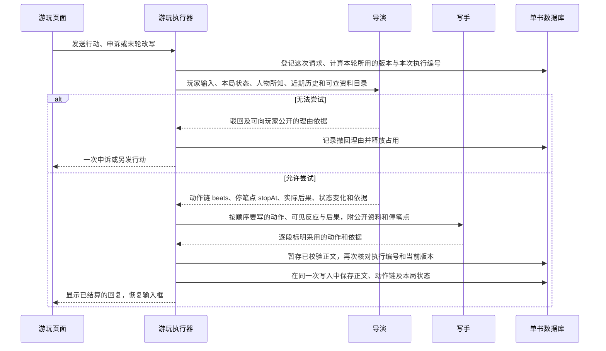

# 游玩 MVP 实施设计

[PRD 导航](proposal.md)　｜　[界面和玩家流程图](ui.md)　｜　[工具目录](proposal.md#tools)　｜　[数据表](storage.md)　｜　[验收](tasks.md)

关联 REQ-039、REQ-034、REQ-003。以下接口名和流程为本轮评审方案。玩家输入、版本和不同执行编号的含义见[提案术语说明](proposal.md#terms)。玩家侧操作见 [PRD](proposal.md)。[数据表与迁移](storage.md)、[资料装载器](context-loader.md)、[Agent 输入、输出与提示词](agent-contracts.md)分别是本设计的详细契约。

## 从现有代码接入

| 仓库当前行为 | 实施入口与职责 |
|---|---|
| 应用在启动时创建书库、模型和整理服务；游玩导航仅显示禁用的行动框。开发验收环境会替换 workspace 与 models。 | 在最终选定的服务依赖上创建 `createPlayService(workspace, models)`，注入 `App`；新建 `src/features/play/`，下设界面、执行器、状态提交、资料装载与任务提示词适配。正式环境和使用测试数据的环境都从同一个游玩服务入口进入。界面只发命令、订阅当前书和存档。[启动装配](../../../src/main.tsx) · [应用入口](../../../src/App.tsx) |
| 原文章节和当前资产按书可读。人物档案可能经过全书合并；原著事件检索针对节点和事件。 | 新档从所选包复制允许用于游玩的字段，得到建档时保存的书中资料；按节点顺序、实体编号、别名、合并映射和人物知情提供游戏资料。只有玩家在节点详情里打开阅读器时才读取原文章节；游玩服务只获得获准使用的结构化字段。缺少事件线或向量时仍可凭节点和关联资产准备场景。[装载与源码对照](context-loader.md) |
| 现有会话和压缩会写整理会话；工具注册器含资产编辑权。Pi 模型调用服务目前统一附加资料整理所需的输出说明。 | 沿用现有模型配置与 Pi（本项目用于调用模型及执行工具的运行库）。为每种游玩任务分别选择要发给模型的资料、允许调用的工具和交付结果的格式。原有整理任务继续使用整理规则。游玩历史、工具的接收结果及历史摘要只进游玩表。程序分别装载开局导演、行动导演、写手及独立历史摘要四份任务正文。每次请求实际声明的工具与参数见[模型契约](agent-contracts.md)。[网关](../../../src/features/models/gateway.ts) · [当前输出规则](../../../src/features/agents/output-discipline.ts) · [整理侧压缩](../../../src/features/agents/compaction.ts) |
| 正式书库由本机服务使用 SQLite 数据库，浏览器测试环境用 Dexie 访问浏览器数据库；整书备份按登记表导出并检查 JSON 数据结构校验规则（JSON Schema）。 | 新建四张按书逻辑表，使用现有短事务和两端相同的主键校验。将四表及引用纳入备份格式、预检、恢复、删除与重建副本处理。[工作区](../../../src/lib/storage/workspace.ts) · [事务实现](../../../src/lib/storage/transaction.ts) · [字段及兼容](storage.md) |

## 字段变化

| 新表 | 存什么、为什么需要 | 由谁写、谁读 |
|---|---|---|
| `playSaves` 游玩存档 | 选定资产包的身份、存档名、建档时保存的书中资料、主角、开局节点和介入时点、当前生效版本、当前占用。相同的书可有多个独立存档 | 开局和提交事务维护；存档列表和调度器读取 |
| `playAttempts` 回合尝试 | 玩家最初输入的全文、申诉说明或改写方向、计算本轮所用的版本、提交前应核对的当前版本、正在执行的页面及各角色待提交的结果。用于区分“模型已返回”和“本轮已生效” | 入口登记正在执行的请求，调度器暂存各角色结果；界面显示执行中、撤回和重试 |
| `playVersions` 已提交回合版本 | 父版本（从哪个版本继续）、回合序号、正文、该次结算时本局涉及对象的完整状态、人物所知、证据和笔记。一个生效版本对应一次完整提交 | 仅程序提交器创建；续玩、装载与改写从当前生效版本逐次查找其父版本 |
| `playRuns` 执行明细 | 任务及执行编号、实际请求、提示词及其内容校验值、模型、工具参数/返回、输出和异常；包含根据当前生效版本及其父版本生成、可再次用于检索的历史摘要 | 执行器和摘要任务写；回看执行过程、容量控制及开发验收读取 |

新建存档时，程序把允许使用的书中资料保存为一份只读副本（assetBaseline）。每次结算，程序更新本档当前生效版本的编号（headVersionId）。每轮保存本局已触及的状态，历轮游戏正文、获准资产字段与模型请求和返回结果按存档和版本回读。改写时只需读原回合之前的版本。随着人物和物品增加，每轮保存的完整状态也会变大。验证时记录存档字节、回合数和重开耗时，再根据测量结果决定是否改为只保存发生变化的字段。类型、可空字段、默认值、写入者、索引、旧书、导入和备份规则见[字段字典](storage.md)。

## 数据流转

### 代码调用顺序

[从玩家输入开始，按角色、工具和存档查看完整流程](ui.md#turn-flow)。下图说明玩家发送一句话后程序怎样处理。导演交给写手的**剧情动作链**写的是当轮的戏。写手从中读到主角做了什么、对方怎样反应、造成什么可见后果，以及下一步在哪里交回玩家。



### 服务接口

以下为拟新增的程序接口。模型只见[已登记的查询工具和任务提交工具](agent-contracts.md)。发送行动或改写回合时，页面带上自己上次读到的当前生效版本号。游玩服务从书库读出实际版本号，核对两者是否一致。接口以可移除的订阅监听进展，页面卸载不改变其他存档的执行权。

| 调用方与操作 | 请求与默认行为 | 返回、写入及失败恢复 |
|---|---|---|
| 准备页选择资产包 | `listPackages()` 读取已在本地书库登记的资产包，选择后的 `bookId` 作为包归属。尚未导入的 .wwv2 可从现有备份预检与恢复入口导入 | 只返回可选择的包、节点覆盖及存档列表入口。选包本身不创建存档，不读取章节内容，也不调用模型 |
| 游玩页列局与读取历史 | `listSaves(bookId)`、`loadSave(bookId,saveId)`，均为只读 | 依次返回存档选择项、有效正文与公开交流记录、当前占用和可用操作。找不到本书存档时回到本书列表；已有生效版本时直接打开聊天。还在选卡的草稿恢复原卡片；已选卡且尚未开场的草稿显示当前生成进度或手动重试入口。普通阅读只显示玩家可见的场景和消息 |
| 准备与确认开局 | `prepareOpening(bookId,saveId,attemptId)` 为选包创建未开场存档草稿，并在同一事务中复制允许保存的书中字段并计算内容校验值，失败时撤销此次建档写入；`confirmOpening(bookId,saveId,attemptId,candidateId)` 按[开局确认事务](storage.md#4-回合如何提交)保存选中的完整开局卡，并登记哪个页面负责生成开场。同一尝试只能保存一个选择。ID 由 UI/程序生成，在重送时复用 | 前者返回可核对的候选卡或缺失依据，后者成功保存选择后进入本档聊天并显示开场进度。重复确认同一张开局卡时直接读取执行进度或已提交的开场版本号，另一页面选择不同卡时，准备页显示已经生效的选择。选择期间可退出，回到存档草稿继续。开局最终成功返回第 0 版；缺材料可回资产页补齐，再新建使用修改后资料的存档 |
| 行动框 | `sendAction(bookId,saveId,attemptId,expectedHeadId,text)`，文本非空、原样保存 | 获准执行后返回本次请求与执行的标识及当前状态；重复命令按原 ID 查状态。其他运行占用返回当前进展；页面读到的版本与当前生效版本不一致时刷新后由玩家决定是否重发 |
| 申诉与改写 | `appeal(bookId,saveId,attemptId,reason)`；`rewriteLast(bookId,saveId,newAttemptId,targetVersionId,direction)` | 前者登记这条请求已申诉，保存申诉说明并换发执行编号。后者校验目标为末轮，复制玩家当时最初输入的全文，附方向；载入目标父版。被替换轮若原有有效申诉，复用原解释及采用动作作为意图材料，不继承旧结果 |
| 取消、重试、刷新 | `cancel(bookId,saveId,attemptId,runId)`、`retry(bookId,saveId,attemptId)`、`loadSave(...)` | 取消时仅在尝试编号和执行编号都匹配后释放占用。重试使用同一份建档资料和计算本轮所用的版本，沿用尝试编号，换发执行编号。已确认开局把所选卡的剧情动作链交给写手生成开场，未确认开局从推荐阶段恢复。刷新时先查已提交的版本号；若仍在运行，则检查该页面的执行期限；已中断时提供手动重试。如其他回合已生效，返回玩家最初输入的全文供另发 |
| 执行详情 | `loadRunDetails(bookId,saveId,attemptId)`，仅供明确进入的诊断视图 | 返回该次业务请求、工具记录、模型和提示词版本。可按角色核对隐藏信息的传递。正常小说页、拒绝提示与玩家历史仅取玩家可见的那部分信息；回放不产生业务写入 |

**行动、申诉和改写的伪代码。** 下列函数名说明拟接入位置，开发时以字段及模型附件为准。关键在于等待模型时不占数据库事务，所有异步返回的结果始终绑定发起时的书、存档、请求、执行编号和版本。

```ts
const execution = await claimAttempt(command)
const materials = await loadDirectorView(execution)
const resultFromDirector = await runDirector(execution, materials)
const ruling = await validateRuling(execution, resultFromDirector)
if (ruling.decision === 'reject') return withdraw(execution, ruling)
const writerView = await loadWriterView(execution, ruling)
const result = await writeScene(execution, writerView)
await stageWriterPreview(execution, validateParagraphs(writerView, result))
return commitIfCurrent(execution)
```

执行器校验导演通过本任务的 `submit_result` 交来的裁定。`decision="reject"` 时撤回消息并展示公开理由；允许尝试时把动作链交给写手。写手的每个段落标注所写的动作，程序核对顺序、覆盖和引用后暂存在本次尝试。此时界面可以显示待保存的正文，发送框仍锁定。保存失败或玩家先取消时，撤下正文，保留上个已结算版本。每次收下结果、取消或提交都核对尝试编号与执行编号；迟到的结果无法覆盖新一轮。提交后页面丢失通知时，按尝试编号找回已保存的版本。

### 用官厅一局核对程序和存储

| 时点 | 程序读写 | 玩家或开发可核对的结果 |
|---|---|---|
| 新建甲档 | 按 `bookId` 选定赖家线包，生成独立 `saveId=A`，将允许的资产字段固定保存在 A 档的建档资料中。从按数值章序、节点顺序排序的首个适用节点 `C15-N001`（revision 32）生成候选 | 推荐贾珩、长安节度使府官厅。位置来自节点的 locationNames，使用本档地点标识，保留节点来源。点击开始即切到聊天并生成开场 |
| 第 0 版 | 导演据 `C15-N001.summary` 确认贾珩问责、云光改称恩主。据 `process` 末段确认随后谈过翠华山匪情。`actorIds`、`locationNames` 与可公开的经过共同支持两位当事人及官厅。所选开局卡以匪情谈罢为停笔点，程序将这些已发生且可公开的事实连同依据交给写手，一起提交 `A0` | 玩家接手时贾珩已听到贼寇约四五百人、官兵进剿时对方会闻风逃走。先前改称恩主的事仍可追问。舆图尚未因此成为贾珩的持有物 |
| 留厅追问 | 甲档玩家留在官厅，问云光先前为什么改口。导演根据 A0 的现场及贾珩亲历的称谓变化，安排贾珩当面问起先前的称呼 → 云光欠身，只说方才失礼 → 云光住口抬眼，等贾珩接话。写手按此顺序成文，在停笔点收住 | `A1.parent=A0`，保存本轮回复及双方实际听到的内容。云光对原因的这句答复是本局新发生的事 |
| 改写或继续 | 甲档将 A1 改为“我告辞离厅”。以 A0 生成候选，检查当前生效版本仍为拟改写的 A1。导演按这次告辞裁定谁离开、谁留厅，以及他们各自看到的经过；写手据此重写本轮 | 成功后新版本 A1b 指向 A0；失败仍可读 A1。另一同包存档 B 始终读取 B 建档时保存的书中资料和当前生效版本。关闭再点“继续”直接读取该档当前生效版本和消息，模型请求数为零 |

**人工查看原文的调用边界。** 资产节点详情中的“查看原文”使用阅读组件及原有章节读取接口。进入节点详情先显示结构化字段，用户点按钮后才加载该节点对应的来源文字；关闭后返回该节点。聊天和节点卡不预取、展开、索引或记录此内容。UI 将阅读组件和游玩服务分别注入；阅读组件没有提交行动、写入知情或向模型追加消息的通道。调试回放只使用实际送入模型的该角色获准使用的字段。在游戏链路用会抛错的章节读取测试接口仍应跑通新建、续玩、查询、申诉、改写和压缩。[现有人工查看入口](../../../src/features/assets/AssetEditor.tsx) · [界面设计](ui.md)

## 触发逻辑

| 触发与前置 | 处理顺序、界面及恢复 |
|---|---|
| 新建存档，准备资料 | 先分配存档编号和开局请求编号 → 开局导演提出有证据的候选 → 程序校验，显示节点、主角、地点和已成立的场景 → 玩家点击开始，程序保存所选起点及依据，进入聊天 → 程序将开局卡的动作链和停笔点交给写手 → 写手出开场 → 回合 0 提交。点击一次不会分配两局。若缺模型连接则保留存档草稿，提示回设置后重试 |
| 玩家行动、申诉获准或改写 | 导演裁定能否尝试及当轮实际后果。可以尝试但未成功的行动仍有当轮结果。程序核对变更类别、前值、引用、人物所知和可揭示的事实，将校验后的动作链 `beats[]` 与停笔点 `stopAt` 交给写手。写手按动作顺序交出带步骤编号的段落。程序同时保存正文和局内变化，再开放下一次输入 |
| 资料或输出有误 | 缺证据时可在本次允许工具内查证。格式、非法引用、错误前值或写手漏写必写的剧情步骤时，将错误路径退回责任角色作有限修复；首版建议每任务至多一次输出修复。拒绝继续写入过期尝试。修复仍失败则结束整轮，并显示可操作的原因 |
| 取消、多窗口、服务中断 | 仍在执行时先核对并作废本次执行编号，停止后续请求，再中断网络。回合已经提交时返回已提交的版本号。其他标签只能观察正在执行的请求。服务异常或页面关闭在执行期限届满后可收回占用。恢复备份副本时清除原执行页面和执行期限。当前生效版本始终可重新读取 |
| 连续多轮到容量上限 | 从计算本轮所用版本开始，只取沿父版本可回溯的历史作为本轮背景资料。先缩减候选页、按需读取本角色可见的建档资料和已结算历史，再按需启动独立历史摘要。摘要记录覆盖范围与来源，改写后仅采用所覆盖版本仍属于当前游戏历史的摘要。模型一次请求仍放不下必要资料时，保留玩家最初输入的全文、当前有效进度及可重试原因 |

**动作链怎样落到正文。** 每一步保存 `id`（步骤编号）、`actorIds`（这一刻行动或说话的人）、`text`（具体动作、可见反应或后果）、`revealRefs`（允许写进正文的资料编号）。顺序由数组位置决定。`stopAt` 单列下一次该由玩家决定的时刻。比如“云光认了方才失礼”允许写手写他收声、等贾珩开口；单凭这句话不能让他招认通贼或让贾珩替玩家原谅他。动作链、写手请求、逐段答复使用同一场戏，可在[模型契约](agent-contracts.md)对照。

## 验收与接手

本期验收对应[任务与验收清单](tasks.md)中的存储与资料范围、导演与写手交接、开局与申诉、回合保存、改写及恢复。后续角色的研究资料见[单独存放的编剧设计](planner-deferred.md)。

实现时从[任务与验收清单](tasks.md)依序进入。用预设的模型答复验证各分支的调用顺序、权限与提交；再用指定包的真实模型请求核对官厅场景、未来节点隔离及玩家介入点。结构检查能抓住错引用、遗漏剧情步骤和错位置；“准备离厅”和“已经走出官厅”的区别要结合玩家输入、导演裁定、位置及生成正文逐句核对。整书迁移与跨浏览器恢复单独记录证据。
