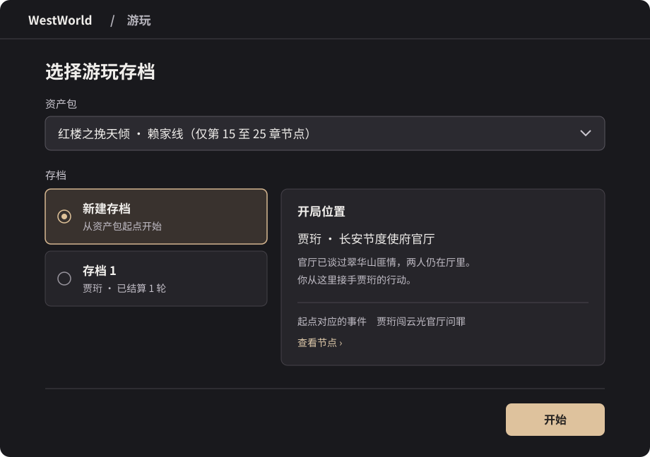
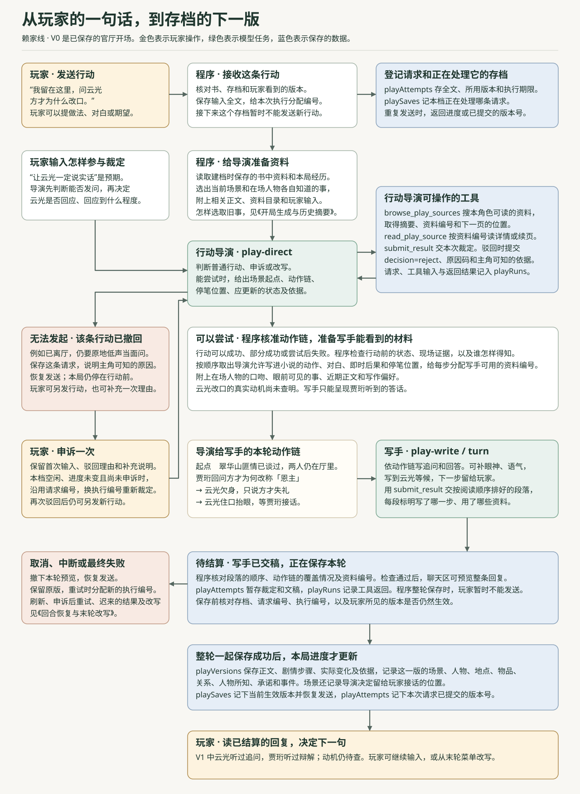

# 游玩 MVP · 导演与写手的产品需求

[游玩用语](#terms)　｜　[界面图](ui.md)　｜　[从玩家输入开始的完整流程图](ui.md#turn-flow)　｜　[工具目录](#tools)　｜　[提示词](#prompts)　｜　[资料装载](context-loader.md)　｜　[存档与表](storage.md)　｜　[代码运行](design.md)　｜　[验收](tasks.md)

REQ-039 · 大型需求 · 2026-11-26 第四稿，待确认。玩家选择资产包，新建或继续一份存档，在聊天里扮演原著主角。导演安排玩家这句话引出的下一场戏，写手把它写给玩家。本期只接入这两种创作职责。编剧暂缓，早期设想独立放在[编剧留档](planner-deferred.md)。以下使用[《红楼之挽天倾》赖家线资产包](../../../红楼之挽天倾-赖家线-仅第15至25章节点.wwv2)展示首个可连续游玩的版本。

## 工具目录

| 工具 | 谁用、用来做什么 | 直接看定义 |
|---|---|---|
| `browse_play_sources` 搜索资料目录 | 导演。在本档允许该角色查看的书中资料和已发生的回合中找相关人物、节点、旧事，返回带理由的候选，支持分页 | [参数、返回值与查询范围](context-loader.md#tool-browse) |
| `read_play_source` 读取资料详情 | 导演。用本次任务收到的资料编号读取人物、节点等字段或本局记录，可接着翻页 | [参数、返回值与越权处理](context-loader.md#tool-read) |
| `submit_result` 提交本任务结果 | 工具名复用，每次请求只发当前任务的参数定义。开局导演交开局卡，行动导演交裁定，写手交正文，历史摘要任务交带出处的摘要。程序检查通过后分别暂存或保存 | [各任务专用参数、返回及样例](agent-contracts.md#submit-result) |
| 「查看原文」 | **玩家**在节点详情中点击，才按该节点定位并显示原始章节。关闭后回到节点详情；不触发模型或推进回合 | [界面与返回路径](ui.md) · [人工阅读器及调用边界](context-loader.md#node-reader) |

**提示词全文**　[导演准备开局](agent-contracts.md#prompt-opening) · [导演裁定、申诉、改写](agent-contracts.md#prompt-direct) · [写手生成正文](agent-contracts.md#prompt-write) · [有效历史摘要](agent-contracts.md#prompt-compact)

**数据表**　[存档及建档时保存的书中资料](storage.md#table-saves) · [回合尝试](storage.md#table-attempts) · [已结算的版本](storage.md#table-versions) · [执行与工具记录](storage.md#table-runs)

**导演交给写手什么。** 导演先定这场戏从哪里接起，再逐步写明谁做了什么、在场的人如何回应、眼前局面因此怎样变化，最后点明哪里该停笔。写手可以安排对白、节奏和动作细节。玩家下一步要不要再问、对方为什么改口，仍可留在戏外。[官厅的剧情动作链与写手正文](agent-contracts.md#dramatic-chain) · [逐任务请求与提交样例](agent-contracts.md#sample-requests)

## 游玩界面与流程图

**选包与存档。** 先选资产包，再在该包下新建或继续一份存档。继续草稿时回到原来的候选卡或开场进度；已经玩过的档从最后一次结算处接着读。

**开始后的聊天。** 顶部标识当前存档和主角，中间按时间连续排列玩家行动和故事回复，下方固定行动输入框。玩家能看到这条行动正在裁定、正文是否还在生成，以及何时可以再说一句。

**从一句行动开始。** 主图展示玩家发送后会遇到的分支、导演和写手各自收到什么、工具交付及存档写入。恢复图展示取消、重试、申诉与末轮改写；开局图展示选卡、生成开场和长局续玩。[回合主图](figures/play-turn.svg) · [取消、恢复与末轮改写](figures/play-turn-recovery.svg) · [开局与历史摘要](figures/play-opening-memory.svg)

## 游玩用语

玩家在官厅输入「我留在这里，问云光方才为什么改口」。程序先记下这句话。导演判断贾珩可以当面问，云光只答「方才失礼」。写手把这段问答写成正文。等本轮需要的结果一起保存，下一轮的贾珩才记得自己听过这句话。下面用这一局说明各份文档中容易混淆的词。

### 玩家说了什么，游戏发生了什么

| 用语 | 在这一局中指什么 |
|---|---|
| 资产包、存档 | 资产包提供这本书已经整理好的人物、地点和情节。存档记录玩家从其中一个起点玩出的一局。同一本书可以同时保存“留在官厅”和“已经离厅”两局。 |
| 开局卡、开局位置 | 开局卡列出可以接手的主角、地点、原著中已经发生的事及其依据。玩家选中一张后，本局记住从哪个节点的哪个修订版、哪一刻起玩（`openingAnchor`）。 |
| 玩家最初输入的全文（原话） | 发送时逐字保存到 `playerInput`。如果玩家申诉「我的意思是先回厅再问」，补充说明单独存入 `appealText`。导演最终按哪个动作裁定，另记为 `effectiveInput`。三段文字能分别回看。 |
| 开局草稿（草档） | 程序已为这局分配存档编号、保存可用的书中资料，但还没有生成并保存开场。退出后可回来继续选卡或重试生成开场。 |
| 行动、回合尝试、已结算回合 | 行动是玩家想做的事。按下发送，程序分配本次尝试的编号（`attemptId`），把玩家输入及后续处理记在一起。申诉或重试沿用这个编号。获准尝试的行动可以成功、部分成功或失败。导演裁定的后果与正文一起保存后才算结算。 |
| 撤回、申诉、重试、改写 | **撤回**是导演判定当前条件下无法发起行动。**申诉**是玩家对这次判定补充一次理由。**重试**是处理取消或技术故障后再执行同一请求。**改写**是给最后一条已结算行动指定新方向，另建一次尝试，从原行动之前重算。 |
| 剧情动作链（剧情步骤、节拍，`beats`）、停笔位置（`stopAt`） | 动作链是导演按先后排给写手的一场戏，每一步有参与人、看得见或听得见的动作或回应，前一步给后一步一个理由。停笔位置指场面留给玩家的下一次选择，此例是云光说完，等贾珩接话。 |
| 本局状态、人物所知 | 本局状态包括时间、地点、人物位置、持有物、关系和已经发生的事等。人物所知还要记录具体是谁亲历、听说、相信或怀疑什么，以及依据。 |
| 可公开的内容 | 在本轮可以写给玩家看的言行和事实。例如贾珩听见云光说“失礼”，他可以记得这句话。云光改口的真实动机仍待查。 |
| 候选结果、待结算 | 导演和写手的有效交付先按本次尝试留存。正文如果比存档保存先显示，会标为“待结算”。版本保存成功后玩家才能发送下一句。 |

### 资料和游戏版本

| 用语 | 何时使用，怎样核对 |
|---|---|
| 建档时保存的书中资料（资产基线，`assetBaseline`） | 新建存档时复制游戏允许使用的书中字段，例如节点记载的官厅名称和当时在场的人物。以后即使在资产页改了节点，这一局仍用当时保存的内容。 |
| 当前生效版本（`headVersionId`）、父版本（`parentVersionId`） | 开场保存为 V0，留厅追问保存为 V1。此时打开存档看到 V1；沿它的父版本能找到 V0。这条路径上的回合组成这局当前有效的历史。 |
| 计算本轮所用的版本（`baseVersionId`）、提交前应核对的当前版本（`expectedHeadId`） | 从 V1 继续玩，两者都是 V1。把 V1 的追问改成告辞，要从行动前的 V0 计算，并在保存时确认当前仍为 V1。成功后新的 V1b 和旧 V1 有同一个父版本 V0。 |
| 本版状态（快照，`snapshot`）、本轮的具体改动（差量，`stateChanges`） | 快照回答“贾珩现在在哪里、知道什么”；具体改动记录哪个对象的哪个字段从什么值改成了什么值，以及依据。离厅时，贾珩的位置从官厅变成厅外。 |
| 角色可见资料（投影）、资料引用（`ref`）、证据引用（`evidenceRefs`） | 程序按任务选择可以交给该角色的字段。导演可凭本次资料编号继续读详情；写手接手时，程序只给它允许公开的内容和新编号。保存正式结果时，依据指回本局保存的资料字段或某一版的剧情步骤。 |
| 资产字段记录（`assetPins`）、内容校验值（指纹） | 正式版本记下本轮采用的资产、字段、修订号和内容校验值。程序用同样的算法重算后，可以检查恢复出的字段内容是否一致。 |
| 资料装载、资料目录、分页 | 装载是程序为这一次模型请求挑选并放入材料。目录先列出可查条目和编号；内容多时工具分几次返回，用上次返回的位置继续读取。 |
| 历史摘要、工作记忆 | 历史摘要用文字概括已发生的回合，附可回查的版本和依据。工作记忆还包括相关笔记、未兑现的承诺和近期正文。改写后，涉及被替换回合的摘要不能再供当前剧情使用。 |

### 哪个页面在处理，结果是否已经保存

| 用语 | 谁记录、玩家会看到什么 |
|---|---|
| 执行编号（旧稿称“运行令牌”或“世代”，`runId`）、执行页面（`ownerId`） | 同一条尝试可以先失败再重试。程序给每次执行分配新的编号，并记录哪个页面负责它。上一次执行迟到的回答不能覆盖新结果。 |
| 执行期限（租约，`leaseUntil`） | 程序记下负责页面可以处理这条尝试到什么时候，页面工作期间可以续期。另一页打开同一档时，可以查看进度；当前执行期限内仍由原页面负责。到期后程序再次核对当前执行，才可回收中断任务并显示“重试”。 |
| 工具已收到角色结果（工具回执） | 查询工具返回可读的资料或错误。角色调用 `submit_result` 后，`{ok:true,accepted:true}` 表示程序已收下**这个角色**的交付。例如写手可以收到确认，而新版本还未保存。 |
| 已提交的版本号（回合提交回执，`committedVersionId`） | 所需结果全部保存后，程序把新版本号记在本次尝试上。若页面漏收成功通知，再用同一个尝试编号查询，就能取回同一个版本。 |
| 接手执行（旧稿称“认领”） | 玩家发送行动时，程序同时核对存档是否空闲、当前版本是否与页面所见相同，并登记由哪个页面处理这次尝试。另一页同时发送时先显示正在处理的进度。 |
| 一次事务、解除占用 | 最后一次保存将新版本、存档指向的版本号和尝试的完成记录一起写入；其中一步失败就撤销这次写入。完成或终止时，程序释放该次执行占用的存档，界面才允许玩家继续操作。 |

**长局怎样接着写。** Pi 是本项目调用模型的组件。已有的整理任务会在一次工作中检查对话和工具消息是否需要压缩。游玩时，程序另从存档当前有效的回合中取材，必要时把较早经历整理成带出处的摘要。比如玩家把“留厅追问”改成“告辞离厅”，即使旧摘要记录了云光的答话，下次也只能取新版本有效的经历。[各任务的模型调用与记忆处理](agent-contracts.md) · [资料如何随存档取用](context-loader.md)

书籍、原文章节和事件节点沿用[项目统一术语](../../../docs/v2/00-阅读入口与术语.md#统一术语)。各表字段及允许值见[存储设计](storage.md)，每种模型任务的输入、工具与输出见[角色契约](agent-contracts.md)。

## Why

整理完成的资产包提供可游玩的小说世界。玩家想接过原著主角的身份，走出自己的后续剧情，再次打开时还能接上上一次的选择。当前应用的游玩页仍是占位入口；本需求接入聊天、回合和存档。[当前入口](../../../src/App.tsx) · [原三 Agent 构想](../../../docs/WestWorld-游戏三Agent-MVP与实现优先级.md)

## What Changes

### 用赖家线玩两局

1. 在「游玩」选中指定包。包里有 48 个节点，分布在包内序号 15 至 25，另有 131 个人物和 83 个地点。第一条可用节点为 `C15-N001`「贾珩闯云光官厅问罪」。其来源章名为《第一百三十三章 剿匪翠华山》。开局依据取自节点及相关资产字段。
2. 选「新建存档」，显示推荐开局卡。玩家扮演贾珩（`C1-P001`），地点为节点登记的「长安节度使府官厅」。本稿建议从该节点结束后接手：贾珩已经当面质问云光（`C13-P011`）。云光改称“恩主”后，厅里又谈了翠华山匪情。此时两人仍在官厅，轮到玩家开口。点击「开始」进入聊天，开场生成完成后可以说话。
3. 玩家输入「我暂不离开，请云光把刚才的答复再说明一下」。若导演裁定云光回避具体细节，写手可以写他如何斟酌措辞，停在贾珩能继续追问或告辞的位置。这是**本局推演**。资产里的后续节点 `C15-N002` 即便与此有关，也没有因此成为这个存档已经发生的事。
4. 同一包再建一档，贾珩可以直接告辞离厅。甲档仍在官厅，乙档已经离开。下次选甲档「继续」，打开原来的对话和位置。甲档后续若将末轮改写为告辞，先保留旧回复，待新的现场、知情和正文一起保存，才切换到新结果。

### 玩家操作和生效时点

| 操作 | 聊天里看到什么 | 存档怎么变 |
|---|---|---|
| 继续已有档 | 尚未选卡时回到原来的候选卡；已选卡、开场尚未保存时显示进度或手动重试；有已结算版本时显示该档的有效消息和可用操作 | 读取已存的候选卡、选择和执行状态，或恢复当前生效版本。打开页面本身不会再次调用模型 |
| 发送行动 | 行动进入消息流，先显示裁定中。玩家可以提出多步行动，也可以描述希望其他人物怎样回应，由导演决定实际结果 | 先保存玩家输入。若行动可以发起，不论是否达到目的，都按导演裁定的实际后果结算 |
| 输入无法尝试 | 原消息显示已撤回和主角能从当前处境判断的理由。可补充一次申诉或另发行动 | 存档停在原进度。申诉时分别保存玩家最初输入的全文、补充说明和导演最终采用的动作 |
| 等待生成 | 正文完成后、成功保存前可显示「待结算」。此时输入仍锁定，玩家可取消本次生成 | 成功时正文与状态一起生效。若取消先生效或保存失败，撤下预览，保留生效版本与原输入；保存已成功时返回该版本 |
| 末轮改写 | 最近一条已结算的玩家行动回复有消息菜单，玩家写明改写方向 | 从该行动之前的版本重算。新结果失败时仍可从原来的末轮继续 |
| 核对素材 | 打开节点详情后点「查看原文」，关闭阅读层返回节点 | 查看不生成聊天消息、知情记录或 Agent 输入。游戏装载、搜索、详情、摘要、重试、改写均只用结构化资产和本档历史 |

### MVP 范围

一套聊天支持原著主角开场、自由行动、一次申诉、连续回合、按档恢复与末轮改写。允许贾珩离开原著路线。无论留厅还是离厅，导演都按当前存档确定眼前的后果，写手据此续写。下一轮从实际保存的人物位置、见闻、言行与停笔处接上。幕后人物长期自行活动、自由建角和任意历史分支管理留待后续。

## Capabilities

### New Capabilities

`play-gameplay` 定义从资产包和存档进入聊天、回合协作、人物知情和改写。[游玩差异规格](specs/play-gameplay/spec.md)

### Modified Capabilities

`book-backup` 增加整书恢复时各存档、建档时保存的书中资料、回合版本及资料出处的完整校验。沿用 REQ-003 提出的按书会话与工具身份，再用存档号区分同一包的不同局。[备份差异规格](specs/book-backup/spec.md) · [会话接口](../play-session-foundation/design.md)

## Impact

| 需求 | 当前与目标 | 契约及影响模块 | 任务与验收 |
|---|---|---|---|
| REQ-039、REQ-003 | 从禁用输入框到选包、选档及聊天 | 游玩导航、启动装配、游玩服务；[界面](ui.md) | 任务 1.1、1.5，分别检查新建与继续 |
| REQ-034、REQ-039 | 从整书整理资料到按存档、节点和人物所知选取资料字段 | 查询程序、各任务可用的工具、资料来源；[装载器](context-loader.md) | 任务 1.2、1.3，游玩程序无法读取原文章节时仍可连续游玩 |
| REQ-039 | 从玩家行动生成导演的剧情动作链和写手正文，保存本局实际发生的后果 | 模型网关、提示词、运行调度；[程序设计](design.md) | 任务 1.3～1.5，验证留厅和离厅均可续玩 |
| REQ-039、REQ-034 | 同包多档与独立恢复 | 保存游戏版本、本机与浏览器两种存储、整书备份；[四张表](storage.md) | 任务 1.1、1.6、1.7，检查刷新、改写、迟到结果及跨浏览器恢复 |

## 确认依据

2026-11-26 首轮授权撰写可实施的 MVP PRD。本轮用户指定赖家线节点包、原始章节只从节点内的人工按钮查看、按包选新档或旧档、状态资产按存档保存、开始后进入传统聊天，并要求首屏可找到工具及各项材料。以上为本稿的产品要求。UI 线框、开局节点选择、表结构及运行方案供评审，尚未实施。

2026-11-26 用户明确先将编剧作为独立模块留待后续，在文档中切断一切编剧接入，保留并优化导演和写手。本次所说的“动作链”指导演安排演员接下来怎样演、写手接下来怎样写的剧情。用户指定参考 StoryWeaver 的两份提示词。此次授权覆盖方案和提示词拟稿；第四稿的实现、独立驳回工具选择和整书容量方案待确认。

## 讨论结论

本稿选用「第一个可用节点结束后接手」作为重头开始的默认规则，既能使用该节点已明确的结果，又能把下一次选择交给玩家。原始章节不参与判断。资料无法支持开局时显示具体缺项，返回资产整理。首版继续采用最终失败整轮作废、只改最后一个已结算行动的方案。每个存档在新建时保存一份游戏可读的书中资料，包后来编辑只影响之后新开的存档。

### 导演怎样驳回

本稿沿用行动导演提交 `decision:"reject"` 和公开理由的做法。程序收到有效驳回后，将玩家原消息标为“已撤回”，在原处显示主角当下可知的理由，并提供一次申诉。玩家能回看这个公开理由；完整的模型请求和导演内部理由只供开发核对。用户提出为导演单设 `reject_action` 工具，该拆分待确认。如采用，需同步替换行动导演原来的驳回分支、提示词、请求示例与校验。当前工具目录以页首为准。

### StoryWeaver 中的剧情动作链

参考版本 `d494781`（本机 `D:\mic\StoryWeaver`）。默认导演提示词把剧段拆成起点、按时间或因果推进的可见动作和落点。默认演员提示词把这三项放入演出单，允许补语气、动作与环境细节。正文见 `txtToWorldbook/core/constants.js` 的导演与演员模板，实际填充和发送见 `txtToWorldbook/services/directorService.js`。这里用本档已生效的现场作起点，用有参与人和公开依据的剧情步骤传递戏，再用停笔位置把发言权交回玩家。保留步骤顺序，步数随这场戏决定。[本项目的两份提示词及场景样例](agent-contracts.md#prompt-direct)

## 工程方案审查记录

2026-11-26 使用 gstack 工程方案审查复核第四稿。范围覆盖玩家输入、导演交戏、写手成文、各任务实际可见的字段、存档及整书恢复。对照 StoryWeaver 两份默认提示词和指定资产包的 `C15-N001` 修订 32，处理了以下问题。

| 发现 | 第四稿处理与核对入口 |
|---|---|
| 旧例把接手时刻写成云光刚刚换了称呼。节点的概述提到改称“恩主”，经过还记有之后谈论匪情 | 从匪情谈罢起笔，让贾珩回问先前的称呼。把导演定下的动作、写手正文和停笔位置放在一起核对。[官厅动作链](agent-contracts.md#dramatic-chain) · [聊天页](figures/play-chat.svg) |
| 早期稿仍要求等编剧交出计划才能开局或保存离厅行动，部分表和工具还带有计划字段 | 本期只调开局导演、行动导演、写手及按需历史摘要。验收分别检查任务注册、模型可见参数、版本和备份，覆盖编剧完全缺席的情况。[任务 B、I、J](tasks.md) |
| “继续”笼统地进入聊天，无法解释未选卡的草稿；看到正文后取消与保存同时发生也需要可判定的结果 | 草稿恢复原卡组或开场进度。取消先成功就撤下预览；保存先成功就返回同一版本。[游玩规格 GAME-01、05](specs/play-gameplay/spec.md) · [整书恢复](specs/book-backup/spec.md) |
| 改写后沿用旧摘要、未经筛选的检索结果或错误详情，都可能把角色尚不知道的事带给玩家 | 补入旧摘要失效、目录及驳回理由的可见性用例。玩家只见公开理由；摘要须能追溯到本档当前有效的回合。[游玩规格 GAME-02、07](specs/play-gameplay/spec.md) |

本次在本机核对工程与剧情样例，由独立审阅分别复查交接和恢复。外部 Claude Code CLI 在本机不可用。真实模型写作品质与运行时事务留待实施后按[验收清单](tasks.md)验证。

整书导出拟沿用现有容量上限。恰好达到上限时可以交付，超过上限时显示实测容量并停止导出。该取舍待确认。

## 接手说明

从本页页首选主题。开发顺序和运行入口见[实施设计](design.md)与[任务、环境、验收](tasks.md)，玩家实际体验见[准备页、聊天页和流程图](ui.md)。本次已核查指定包的结构化资产，工作状态为第四稿待确认。代码实现、真实模型效果和玩家验收分别记录。[需求池](../../需求池.md) · [技术总入口](../../../docs/v2/项目技术说明.md#三-agent-游玩-mvp)
