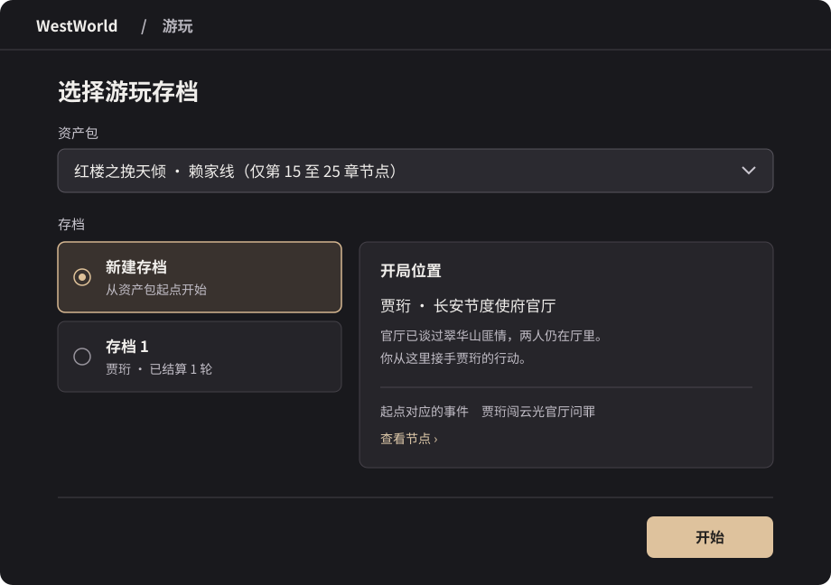
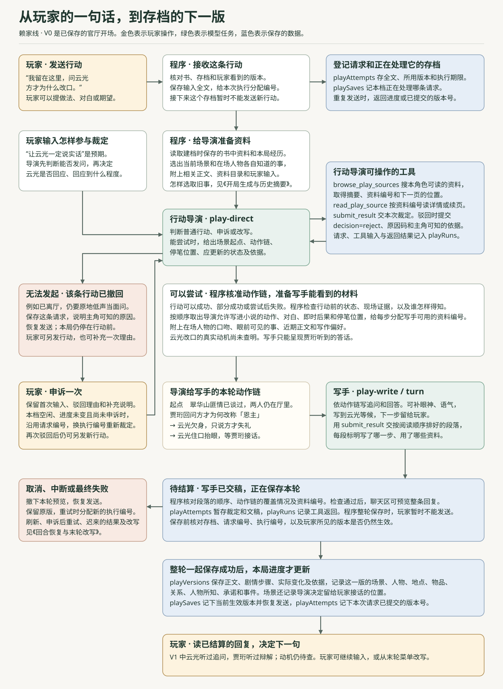
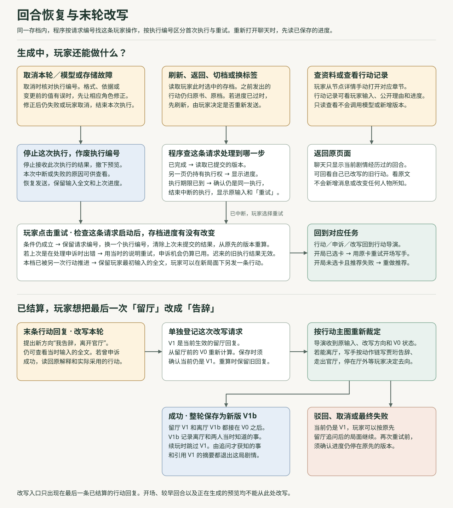
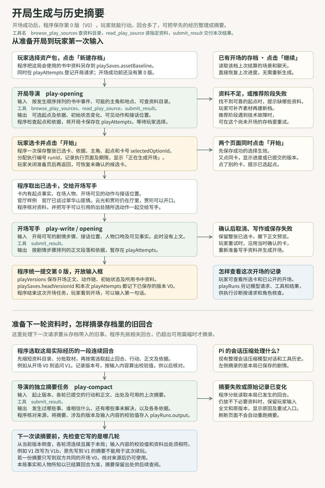
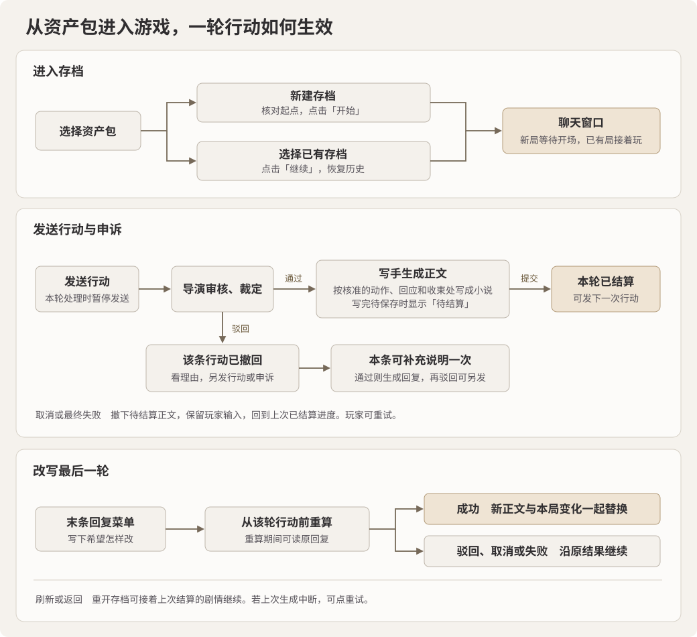

# 游玩界面与操作

[产品需求与导航](proposal.md)　｜　[游玩用词说明](proposal.md#terms)　｜　[工具目录](proposal.md#tools)　｜　[提示词目录](proposal.md#prompts)　｜　[存档与表](storage.md)　｜　[代码运行](design.md)　｜　[验收](tasks.md)

REQ-039 的准备页和聊天页示意图采用同一份[赖家线资产包](../../../红楼之挽天倾-赖家线-仅第15至25章节点.wwv2)演示。书中这个节点先写贾珩在官厅问罪、云光改称「恩主」，随后写官厅已经谈过翠华山匪情。本局在整段经过结束后交给玩家。玩家的追问、云光接下来的答话以及图中的存档进度，都是本局游玩中的示例。

## 选书中的资料，进入存档

玩家从「游玩」进入准备页。先选已导入的资产包，也就是一本书整理好的人物、地点和事件等资料；下面随即列出用这份资料开的各局。每个存档只保存自己这局的进度。窄屏按资产包、存档选择、所选项详情、主按钮的顺序纵向排列。

| 玩家操作 | 界面结果 |
|---|---|
| 选择资产包 | 列出「新建存档」和这个包下的已有存档。首次游玩只有新建选项。切换包时同时更新存档列表、详情和主按钮。 |
| 选择「新建存档」 | 显示「开局卡」，供玩家核对从哪件事结束后接手。示例取书内第 15 章的事件节点（书中一段有编号的经过）`C15-N001`「贾珩闯云光官厅问罪」。主角是贾珩，地点是长安节度使府官厅，云光早些时候改称贾珩为「恩主」。官厅已经谈过翠华山匪情，两人仍在厅里，玩家从这里接手贾珩。来源章名为《第一百三十三章 剿匪翠华山》。 |
| 准备开局卡 | 程序还在准备可选起点时显示「正在准备开局」，暂时禁用「开始」。有多个起点可选时，玩家看过各卡所列的依据再选一个。书中资料不足时，列出还缺什么，并提供「返回资产」。选好起点后启用「开始」。 |
| 在起点上点「查看节点」 | 打开这件事的详情，展示名称、经过、相关人物与地点。游玩页只选取允许展示的资料，并沿用资产编辑器里供玩家手动阅读的按钮。只有玩家点击节点内的「查看原文」（现有按钮名「查看所选章节原文」）才打开章节阅读层。关闭后回到节点，再返回原聊天或准备页。 [节点详情按钮](../../../src/features/assets/AssetEditor.tsx) |
| 点击「开始」 | 进入这个新档的聊天页，显示「正在生成开场」并锁定发送。写手从玩家确认的起点起笔。程序将开场正文和人物所处的初始状态一起保存，随后开放输入。这次保存就是开场「已结算」。若开场最终失败，该档保留已选卡，点重试仍从所选起点生成开场。两个页面同时确认不同卡时，较晚确认的页面显示“此存档已选择〈已选卡名称〉”，可进入该档查看进度。 |
| 选择一份已有存档，点击「继续」 | 已经开场的档进入聊天，显示该档主角、位置和有效消息。草稿尚未选卡时显示原卡组；已选卡但开场未保存时显示原进度或手动重试入口。 |

## 单列聊天

进入后沿用传统 SillyTavern 聊天的阅读顺序。顶部保留返回存档、包名、存档名和扮演的主角。中间是一列按时间排列的消息，玩家行显示主角头像和名字，故事行使用统一的叙事头像。输入框和发送按钮固定在底部。长回复在消息区连续阅读，窄屏继续使用同一列。玩家在一个输入框行动。导演决定这场戏如何往下走，写手把获准的动作和回应写成玩家读到的那条故事消息。[SillyTavern 聊天说明](https://docs.sillytavern.app/usage/chatting/)

**这张图停在第一轮结算后。** 官厅已经谈过翠华山匪情，玩家留在厅里，回问云光方才为何改称「恩主」。云光欠身说方才失礼，随即住口，抬眼等贾珩接话。玩家可以接着说话，也可从末条叙事消息的「⋯」进入「改写本轮」。图中输入为空，输入行动后「发送」亮起。

| 当前状态 | 消息与控件 | 玩家操作后的结果 |
|---|---|---|
| 可以行动 | 上次已结算正文可读，行动框可输入 | 发送一次，在该条玩家消息下显示「正在裁定」，锁定发送。重复点击沿用同一次行动。 |
| 裁定通过，正在生成 | 同一位置显示「正在生成回复」与「取消」。写手交稿且正文通过检查后，如果程序还在保存本轮，预览标「待结算」。 | 可读预览。正文和本轮变化一起保存成功后转为「已结算」，解锁发送并开放该轮改写。 |
| 行动已撤回 | 导演判断这件事目前无法发起，保留玩家最初输入的全文，显示「已撤回」及主角能够知道的理由。当前存档仍停在这条行动之前时，显示「申诉一次」，行动框也能接受新行动。 | 点击申诉后补充理由或重述行动。通过后可分别查看玩家最初输入的全文、申诉说明，以及导演最终按什么动作继续。再次驳回后关闭该条申诉入口。直接另发并推进存档后，旧条目保留为记录。 |
| 取消或最终失败 | 撤下本次待结算正文，保留原输入和原因，显示「重试」。已结算历史继续可读。 | 重试同一行动或发送新的行动。如果这条行动已经申诉过，重试也沿用那次申诉。 |
| 改写最后一轮 | 开场和较早的消息无改写入口。点末条已结算行动回复的「改写本轮」，展示当时的行动和改写方向输入框，可提交或关闭。 | 例如填「改为告辞离厅」。重写期间仍可阅读上次已保存的正文；新回复显示「改写中」或「待结算」。成功后，新正文与本轮发生的变化一起保存。离厅后的地点随之生效，原回复里那番辩解也退出本局经历。驳回、取消或最终失败后可直接从原来的官厅追问继续。 |
| 刷新、切档或返回 | 「返回存档」回到选包与存档列表。再次进入时恢复该档目前采用的最近一次结算结果。另一页面还在执行时显示「正在其他页面处理」，发送保持锁定。 | 已提交的回合直接显示。若生成中断且尚未结算，显示当时的输入和重试入口，由玩家决定是否重试。切换到其他存档时，迟到的回复仍按原档处理。 |

## 从玩家输入到下一轮

第一图从开场保存为第 0 版（V0）后开始。第二图画出生成中和结算后的操作。第三图说明第 0 版如何生成，以及程序怎样为下一轮请求选取存档中的旧事。

### 玩家发送「我留在这里，问云光方才为什么改口」

导演给写手的**动作链**说明这一回合的小说要写到哪里。官厅已经谈过翠华山匪情，两人仍在厅里 → 贾珩回问方才为何改称「恩主」 → 云光欠身，只答「是下官方才失礼」 → 他住口抬眼，等贾珩接话。第一步取自已结算的开场，随后三步是导演为本轮安排的动作。写手可以斟酌对白的措辞和停顿，贾珩接下来是否追问由玩家决定。玩家读到的是这段小说，结算后存档记下两人分别听到了什么。

[打开回合主图](figures/play-turn.svg) · [对照各角色收到的资料与交付的结果](agent-contracts.md#sample-requests) · [查看四张表各自保存什么](storage.md#4-回合如何提交)

### 取消、刷新、重试，或把最后一次留厅改为离厅

[打开回合恢复与改写图](figures/play-turn-recovery.svg) · [服务接口](design.md#服务接口)

### 初次开局与长局的历史摘要

新开局先生成候选卡供玩家选定，再由写手从卡上的接手位置写开场。游玩多轮后，程序从这个存档挑出下轮需要的已结算经历。若分页取材后仍装不进一次请求，就把所选连续回合整理成带出处的摘要。Pi 是项目调用模型的运行组件。现有资料整理任务的会话压缩处理该次工作的对话和工具历史；游玩还需要在玩家改写和切档后找到正确的一段存档经历。[资料装载与历史预算](context-loader.md)

[打开开局与历史摘要图](figures/play-opening-memory.svg) · [查看各角色能读取哪些资料](context-loader.md#role-views)

## 从选包到聊天的操作总览

用相同的开局做一次对照。甲档追问云光后退出，再继续甲档，应看见这次追问和回复。乙档从同一节点起步直接告辞，应从离厅后的局面继续。回到甲档改写为告辞，令本次改写故障，甲档仍应显示原来的追问。重试改写成功后，甲档才采用离厅结果。回到两份存档时，分别核对聊天、人物知道什么、人在什么地方。[回合与存档契约](storage.md) · [游玩验收场景](specs/play-gameplay/spec.md)
