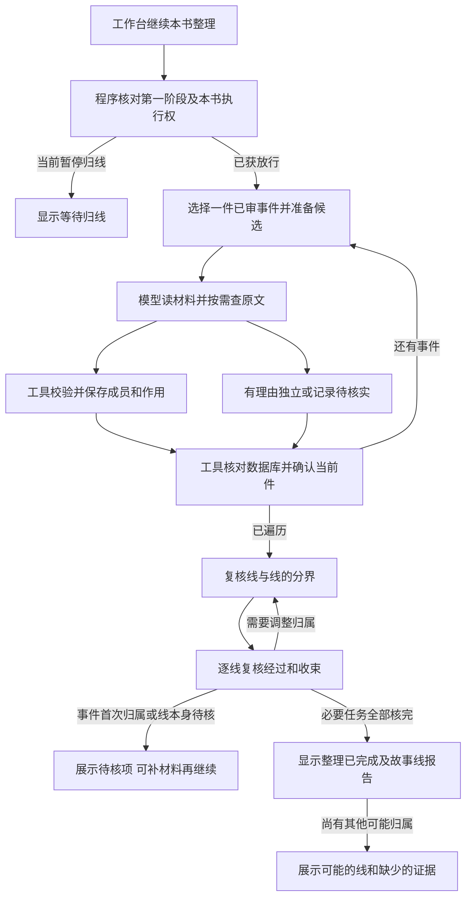

# 三种故事线任务怎样调用工具（拟定契约）

适用于第二阶段新版任务。表中对象均以本书真实编号引用。应用给模型发一份业务提示词全文、一份当前任务资料和该任务允许使用的工具定义。内部的书号、运行号、任务号、读取版本及写入执行权由程序绑定。工具保存内容，程序确认实际结果后推进。样本里用的编号见[三轮请求和输出](requests.json)。

## 各任务的输入、权限与交接

| 任务 | 何时收到什么 | 可用工具与输出 | 接收方 |
|---|---|---|---|
| 逐事件归线 link_event | 阶段一交接后，按当前事件首个成员位置、事件编号排序。当前事件包括名称、概况、最新进展、待解决问题、线索、状态、起止位置、成员节点及当前归属。后文只给编号、名称、概况和位置。候选给故事线字段、相关成员及各自作用、总数、是否列全。疑点只给相关事项 | get_detail、search_prior_events、search_storylines、edit_storylines、confirm。输出已归线、独立或待核实；已归线从库中查得各线及作用 | 运行服务登记这一件，新的独立事件可以作为以后补查的对象 |
| 故事线分界 review_line_boundaries | 遇到待核对的重叠成员、零共享但线索或内容相接的线、待重查的独立事件、单事件线，或收到逐线转回。输入为线卡、成员事件及节点、各自作用、待核事件编号、转回问题 | get_detail、search_events、search_storylines、edit_storylines、confirm。输出本组结论或待核实 | 程序按最新版本重排受影响的线组，再派发逐线任务 |
| 逐线进展 review_line_progress | 线组核对完成后，每条存续线获得一轮。输入为一条线卡、完整成员及作用、按证据位置排列的时间表、疑点、上次分界意见 | get_detail、search_events、search_storylines、edit_storylines、confirm。输出本线完成、待核实或转回分界 | 运行服务记录版本、展示待核原因或重新派发。全部逐线确认且无阻塞疑点时完成 |

候选和预览只存在于任务材料。首轮最多三件后文、十条排序候选，加上实际已有的归属，去重。旧线文本可缺，材料以缺项呈现。程序按线索、贯穿问题和最新进展查找候选，语义服务超时后改用本地匹配，保存原因。模型只能把当前或已处理的事件挂线；前序独立事件改挂后将原结论标为已被新归属替代。在当前事件跨越很长篇幅时，整件既有事实可用于解释归属，模型只依据已归成员中的事实按剧情发生顺序判断最新进展；章节位置用于定位证据。预览事件本身不提供可写依据。

## 读取工具

编号和字段名均为字符串。参数表中列为可省的字段有默认值，其余必填，除明确列出外均不接受 null。工具只在本书及当前任务可见范围内读取。本节提到的 items 为本页记录，total 为总条数，next 为下一页位置。搜索的结果可供补查，正式归属须单独编辑。

| 工具及输入 | 默认、返回及错误 |
|---|---|
| get_detail（查字段）传 requests 数组，至少一项。每项有 kind（node 节点、event 事件、line 故事线）、id、fields 字符串数组，可省 offset 非负整数，默认 0 | 每项返回 id、values（字段和值）、unavailable（缺少的字段）、可选 message。长文本每次 2000 字符，长列表每次 20 项，返回 value、total、next，next 为下一偏移或 null。新增线字段及 memberEvidence（逐成员依据）按成员顺序以记录列表返回，支持同样分页。找不到编号逐项返回原因。沿用[按编号读字段](../../../src/features/story/narrativeTools.ts) |
| search_storylines（搜本书故事线）、search_prior_events（初串搜较早事件）、search_events（复核搜本书事件）均传 groups 二维字符串数组，至少一组，每组至少一词。同组的词都需出现，命中任一组即可。可省 offset 非负整数，默认 0 | 线搜索名称、贯穿问题、概况、遗留、线索，事件搜索名称、概况、进展、遗留、线索。前序范围根据当前任务在书中的次序判断。返回 items（每项 id、title、summary）、total 和 next；按书中顺序每页 20 项。空结果 items 为空、total 为 0、next 为 null。参数错误返回对应字段 |

## 编辑工具

edit_storylines（编辑线及其成员）接收 operations 数组，至少一项。每项必填 op 和非空 reason，说明改动事实。一次调用在同一事务顺序执行。新线由程序分配编号，可在 create_line 使用可选 ref（本次调用内唯一的名字，如 new），后续操作的 lineId 写 $new。其它 ID 必须已存在。程序校验任务权限、读取版本及引用后才保存。

| op 与参数 | 权限和效果 |
|---|---|
| create_line 必填 fields（下表全套内容）。本批另用 attach_event 加入首个成员；此时 ref 供挂入操作引用 | 初串、分界可用。独立事件只有在原文已提出可以跨事件持续追踪的问题时才可开线。事务结束时至少有一件带依据的成员 |
| update_line 必填 lineId、fields，至少一个变化字段 | 初串只更新这次归属直接影响的线，分界更新本组或已读取的关联线，逐线只更新当前线 |
| attach_event 必填 lineId、eventId、contribution 非空文本、evidence_node_ids 非空字符串数组。节点均须属于该事件并有可定位的原文位置 | 新增或更新此成员的作用和依据。逐线只允许补改当前线已有成员的依据。相同事件挂两线分别提交，第二次补写作用不会增加成员数量 |
| detach_event 必填 lineId、eventId | 只在分界复核使用。移出该线的成员及依据；迁移需同批挂入目标线。若成为独立事件，操作中必填 independent_reason（独立理由）并同步运行结论 |
| delete_line 必填 lineId | 只在分界复核使用。先在同批处理成员去向，删除时验证该线已空。撤销的线不再参与下一轮；其他线共享的成员仍有效 |

fields 的键与线卡同名。title（名称）、summary（已知概况）、throughline（贯穿问题）、latestProgress（最新进展）为非空字符串；unresolved（遗留）为可空字符串；clues（线索）为字符串数组，可为空；lineStatus（状态）为 open 或 closed。新建都必填，更新省略即沿用。修改进展或状态时，reason 说明是哪件事的哪条已存依据支持新值。补挂早期事件和后来章节的回忆只补足来由，进展按剧情实际发生顺序判断。程序核对成员和节点引用，逐线复核核查文字结论。

成功返回 ok、created（临时引用到正式编号）、changes（每项 op、lineId，可含 eventId、contribution、evidence_node_ids）、当前任务涉及事件的 assigned_line_ids（逐件时有）。失败返回 ok=false、code、reason，可附 operationNumber 和 objectIds。编号越界、证据不属于成员、版本过期、参数错误或无写入权，均整批撤回。旧版本读取后才发现变化时，重新读相关对象及节点再提交。

## 确认工具

confirm（确认当前任务）接收 result 字符串。逐件允许 assigned、independent、pending_review，分界允许 completed、pending_review，逐线允许 completed、pending_review、return_to_boundaries。independent 必填 reason；分界 completed 须给 reason 说明本组结论。pending_review 必填 issue、checked_scope、missing 三个非空字符串，分别说明疑点、已查范围及缺少的事实。return_to_boundaries 必填 line_ids、event_ids、evidence_node_ids 三个非空编号数组和 reason。已归线时还可附下方约定的其他可能归属。

程序读取已保存的数据核实归属、成员依据和版本。assigned 至少有一条有效归属，independent 的当前事件应无归属。completed 逐线须有完整线卡与可查的成员作用。成功返回 confirmed=true、result、taskId；确认失败返回 ok=false、code、reason 及适用的 objectIds。同一个调用编号重复提交相同参数，返回原保存结果；参数不同则拒绝。同一个已关闭任务不能另起一次写入。

逐件确认 assigned 时可附 possible_links（仍待核对的其他线），默认空数组。每项必填 line_id、issue、checked_scope、missing 四个非空字符串；line_id 必须是本书存在且尚未建立本件归属的线。事件编号由当前任务绑定。按事件号、可能的线号保存一项疑点到该次运行的报告，同批检查和保存，不写入那条线的 eventIds。一次确认结果同时返回已保存的 possible_links。恢复报告时读取该运行已有记录。后续形成正式归属时标为已解决；相关线已撤销时标明去向。仅存这类疑点可以显示“全书已完成”，详情仍可展开证据缺口。首次归属仍不清楚或线本身无法复核时，按 pending_review 办理。

## 数据经过哪些表

| 谁在何时读写 | 已有表、关联与生效时点 |
|---|---|
| 工作台启动与继续 | compileProgress（本书 P3 整理进度）指向 pipelineRuns（运行、任务、写入结果）中的 runId。程序核对第一阶段的复核结果及有无同书任务持有执行权，在同一笔写入中建立本轮任务并冻结输入版本 |
| 准备输入 | 从 storyEvents（事件表）按 id 取事件及 nodeIds；从 nodes（节点表）按编号取名称、经过、引文和章节顺序，从 chapters（章节表）取原文章节顺序。从 eventLines（故事线表）取内容、eventIds 和逐成员依据，从 storyEditorNotes（整理疑点）取本次会话相关项。eventRetrievalVectors（排序用的向量缓存）按书、用途、模型、原文复用，可重算 |
| 发送和恢复 | storySessions（会话）绑定书和运行，storySessionEntries（往来记录）按 sessionId、taskId、ordinal（消息次序）保存消息及工具返回；pipelineRuns 的任务快照保存本轮输入、读过的版本和待确认状态。恢复时用当时的提示词版本解释已发送记录 |
| 保存与确认 | eventLines 保存内容、成员及依据；新增线同步 assetLifecycle（资产编号沿革）。沿已有大纲同步逻辑生成该线的节点、章节和时间范围，节点上的 eventLineIds 只用来显示反向归属。pipelineRuns 以任务编号及工具调用编号存参数与结果，确认后更新运行进度。疑点结论用已有运行记录保存，历史 storyEditorNotes 仍可读取。事务失败时上述本批写入均不生效 |
| 内容变更与备份 | 成员或依据被移出时使受影响线的确认失效，引用已失效节点的成员作用和由此写出的进展等待逐线核实。备份记录上述业务字段及任务版本，旧单值线索完整作为数组一项，已有成员缺作用时标为待核。普通导入保留已有线和原书数据。核对新旧流程时用同一份已审事件生成两份测试数据，保留事件及节点编号。现有“P3 重建副本”会清空事件，不能直接用来开展这个对照 |

## 完整调用链与恢复

候选检索的两路取数可并行，整理模型在材料组装完成后才运行。成员和依据保存成功后才可确认，同一书仅允许一个写任务。检索单次超时按已有 30 秒设置切换本地排序；整理模型超时按现有调用预算暂停，保留已写的业务结果。继续时先查本次调用是否已保存，再重建缺失的工具回复。若材料对应的线、事件或节点已经变化，重读后另派受影响版本。用户取消时结束本次派发，已成功的归属在详情可见。进展复核退回同一个问题时，显示此前分界意见；同一版本、同一问题再次提出且没有新证据时，交给待核实列表，留出可继续的位置。
