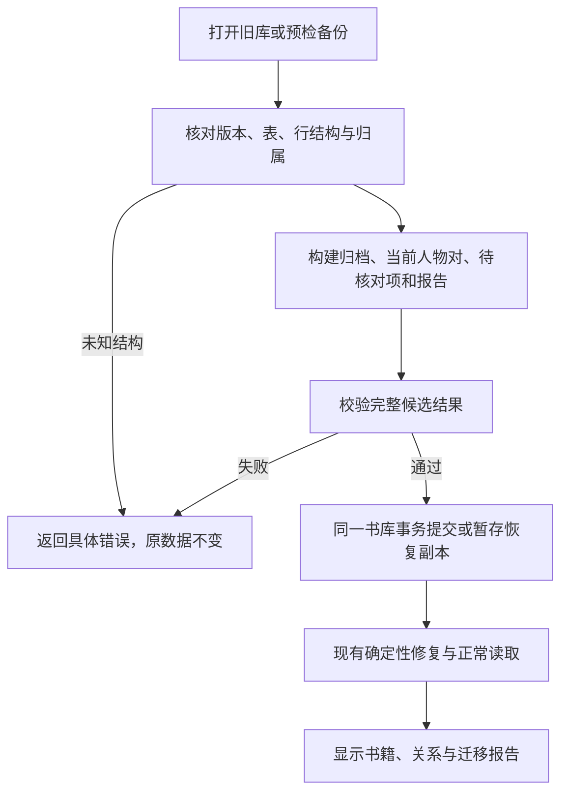

# 实施设计

需求、授权和依赖见 [提案](proposal.md)。A 为 BUG-21 / REQ-010，B 为 REQ-015；按 A→B 实施，A 可先交付。本文件定义拟议变化，当前行为以 diagnosis 和源码为准。

## 模块协作与实施方法

- assets：新增纯转换函数，输入历史/当前关系、人物和生命周期，输出当前人物对、历史原始记录、诊断与统计。书库升级和备份预检共用；不要在多个入口各写一套转换。
- storage/workspace：新增数据库版本8，完整声明当前表/索引并增加历史原始记录表。转换完成后才执行现有 ready 修复。版本6、7的旧声明不能删除或原地改写成“已经升级”。
- backup：先验证包/清单与原始结构，再转换，再按当前结构完整校验；新增格式8。历史格式7没有编辑表是合法历史结构分支，不能全局放松当前格式7缺表校验。
- assets/RelationEditor、agents/queries：展示和分页读取历史依据及待核对项；当前关系仍由 characterRelations + characterRelationEdits 计算。网络复用该当前结果。
- world：关系专项复用 assetReview、P2 world 租约、运行记录、取消/继续和费用汇总；跳过身份合并、人物整编和其他资产写入。全资产模式保持既有流程。
- agents：现有 get_character_relation、set_character_relation、delete_character_relation 继续使用同一人物对写核心。专项注册和命令层同时限制写工具，并补充历史依据读取、确切工作项和原文读集校验。

选择保存历史行并投影为具体人物对，原因是旧行包含角色、人工选择、排除原因和多条证据，不等价于新模型的一条“来源人物→目标称呼”事实。强塞进新事实再按姓名扩展会改变旧人工对象。给 trim 加默认值、清空关系重建、重跑P1均不能满足保留成果的要求。

## 字段变化

以下是相对当前代码的新增/修改；原有字段完整定义继续引用 [存储结构](../../../docs/v2/resources/v2.2/storage.schema.json) 与 [人物对设计](../character-workbench-and-agent-editing/design.md#人物对编辑结果)，实施时同步类型、运行Schema、备份与工具结果。

| 对象与存储位置 | 增加/修改/删除 | 字段标识（含义） | 类型、必填、默认及校验 | 赋值与读取者 | 兼容处理 |
|---|---|---|---|---|---|
| 单书数据库 | 新增版本 | version=8 | 大于历史和当前7；旧数据自动升级 | workspace；所有服务在成功打开后读 | 完整建立 characterRelationEdits 及当前关系索引，测试真实缺表的旧7库 |
| 备份清单 | 修改版本 | formatVersion=8 | 导出必填；读取4–8，6/7按结构分支 | codec | 格式8必含新表（可空）；格式4/5沿现有路径，6/7兼容两种已知关系结构 |
| legacyRelationRecords（旧关系原始记录，新单书表） | 新增 | id、bookId、schema、original、disposition、pairKeys、issues、migrationVersion、migratedAt | id为原关系ID，bookId本书；schema固定 legacy-left-right-v1；original为完整原始JSON对象；disposition枚举 converted/unresolved/excluded；pairKeys为唯一字符串数组，默认[]；issues为非空原因代码数组或[]；migrationVersion=1；migratedAt为ISO时间；全部必填，主键id、索引disposition | 转换函数写，详情/核对/备份读；业务编辑不修改original | 逐条归档原行，不截断labelVariants、qualifier、evidence、原始ID和扩展字段；恢复副本按现有bookId规则变更归属 |
| characterRelationEdits | 扩展 | updatedBy增加 migration；legacyRecordIds | legacyRecordIds可选，字符串数组去重，缺省[]，每项引用本书legacyRelationRecords；migration仅由迁移赋值，人工/模型不能自行传此来源 | 迁移/人物对核心写，详情、报告和网络读 | 其他字段沿现有含义；旧manual/agent值不变；编辑/删除时继续保留legacyRecordIds |
| CharacterPairResult、关系工具结果 | 新增 | legacyRecordIds | 字符串数组，默认[]；纳入当前结果指纹 | effectivePairs与查询产生 | sourceRelationIds仍只引用新格式事实表，不能塞入不同结构的旧记录ID；工具和UI可分页查旧依据 |
| 迁移记录：pipelineRuns | 新增记录类型内容，复用容器 | recordType=asset_edit、stage=asset_edit；result.kind=legacy_relation_migration、version=1、sourceSchemas、counts、recordMappings、affectedIds | 复用现有运行记录基础必填字段；counts包含输入/归档/已投影/未解析/排除/冲突数量；recordMappings为每个旧ID→归档ID/人物对键/处置原因；无记录被悄悄丢弃 | 同一迁移事务写一次；报告和备份读 | 不冒充AI调用/用户操作，不产生模型费用；原值在归档表，无需再次复制整本书 |
| P2运行：pipelineRuns | 新增 | reviewScope、reviewMode、relationReviewVersion | reviewScope:all_assets/relations，旧运行缺省all_assets；reviewMode:sample/full，专项必填，初次sample；relationReviewVersion=1；用户开始时固定，恢复不得切成其他范围 | world服务写，运行器/命令层/界面读 | 可随格式8备份恢复，恢复为暂停，不能自动请求模型 |
| P2 assetReview.items | 扩展 | kind、id、workItemId、sourceFingerprint、evidenceReads、commitIds、resolvedPairs | 复用既有状态pending/checked/deferred/skipped；专项kind为relation、legacy_relation、character_relation_scan；id分别为pairKey、旧ID、人物ID；workItemId确定性由范围+kind+id生成；sourceFingerprint为当前事实/编辑/归档/原文依赖指纹；evidenceReads为已实际读取的章及范围，默认[]；commitIds为实际提交ID数组，默认[]；resolvedPairs为本项实际核对的{pairKey,fingerprint}数组，默认[] | 队列与工具执行记录，模型不能伪造读集或确认；报告读 | 既有全资产item无新必填；专项记录plan范围和余项，不把全资产检查完成状态当成专项完成 |

未变字段：人物/地点业务字段、事件节点/事件线正文、P1凭证和原文均无结构变化；人物对提交引起的两端revision/updatedAt和相关派生、覆盖失效沿既有机制。不得把迁移误当新的P1结果，或清空P1完成状态。

## 旧结构识别与逐项转换

### 识别顺序

1. 先检查 bookId、行ID、数组/字符串/null 类型、生命周期、记录归属，后调用任何 trim/当前关系方法。版本号只决定升级入口，实际行结构决定转换分支。
2. 历史行：left/right为对象，含characterId（string/null）、nameHint、binding，含kind、leftRole/rightRole、status、evidence等历史字段。按 [diagnosis](diagnosis.md) 及历史types校验；允许保留未知扩展字段，不能把缺关键结构的任意对象误认成历史行。
3. 当前行：符合当前CharacterRelation完整Schema。混合表允许逐行分类；未知/双重冲突结构返回SCHEMA错误及表/行ID/字段路径，不删除、不伪造空字符串。
4. 空表无法提供行特征，数据库按实际表/索引补齐；备份按已知完整清单识别。历史6/7清单是格式5表加characterRelations；当前7另有characterRelationEdits。当前形状非空且缺编辑表的格式7拒绝；历史行/空表与历史清单一致才允许缺表。混合行要求存在编辑表，避免吞掉可能丢失的人工结果。

### 迁移投影

历史left/right行全部进入legacyRelationRecords，不再留在当前characterRelations。当前形状行逐字段保持原值，之后仅执行已存在且有独立验收的确定性修复。以下规则仅处理历史行：

| 旧数据 | 目标处理 |
|---|---|
| left/right.characterId可沿character生命周期解析为两个有效不同编号 | 按两个编号生成稳定pairKey；不因nameHint与同名候选产生其他连接 |
| 旧明确编号已合并 | 只沿生命周期解析；保留原ID和路径；合并成自连则归档unresolved、issues含self_after_merge，不生成自连 |
| 任一端缺失、binding为unresolved/deleted、或生命周期为deleted | 归档unresolved，保留候选称呼与依据；不自动同名补人，不伪造来源；显示待核对 |
| status=excluded | 归档excluded，不产生有效标签；若同一人物对没有其他未排除旧记录且没有当前事实/编辑结果，生成deleted人物对结果；若另有有效记录，只排除此记录，不删除别人支持的连接 |
| 两端角色已明确且类型/角色合法 | 按各端自己的角色生成该端→另一端的标签。例如left=抱琴/servant、right=元春/lord，抱琴→元春为“仆从”，反向“主人”。使用历史角色字典的显式对照，不按label文字顺序推断 |
| 仅一个角色明确 | 只填该方向，另一方向空；不自动从父亲猜儿子/女儿。旧标签、类别和说明保留在原始依据中 |
| 两端角色都缺失 | 用旧label，缺失时依次取首个非空labelVariants、历史kind的中文名称作为原关系标签，双端显示同一原标签并directionUnclear=true；UI必须显示“方向待核对”，不画成已确认的双向称谓 |
| 角色不在可识别历史字典，或旧issues含roleUnclear/labelConflict/typeUnclear/claimUnconfirmed等语义问题 | 保留所有原值；按不确定标签显示，归档issues保留对应原因；不把旧status=active等同原文已验证 |
| 多条旧记录属于同一人物对 | 先看未排除且verification为manual/ai的显式旧结论，有则用这些结论作为当前标签，未确认legacy行只保留依据，不用旧猜测盖过人工结果；没有显式结论时聚合未排除legacy行。选中的记录按原ID稳定排序、合并同向标签/依据并去重，所有旧行ID仍归档。选中结论内部不明确/冲突时directionUnclear=true，不擅自取最新/第一条；manual与ai均为显式结论，不凭来源名决定谁覆盖谁 |
| 人物对已有当前characterRelationEdits（包括deleted） | 原行完整保留，不改已有标签/state/revision/updatedBy；仅合并归档关联ID，并相应更新读指纹；以既有编辑结果为当前权威 |
| 人物对已有当前事实，但无编辑行 | 合并当前事实对和历史对的已知标签生成migration编辑行，来源事实ID照常保留；不丢当前事实，语义冲突标不确定 |

迁移新建编辑行：revision=1、updatedBy=migration、commitId关联迁移记录，aId/bId按pairKey排序；已有编辑行的附加归档关联是结构元数据，保留业务revision，读指纹必须变化。继承旧manual/ai的事实来源在original中完整记录，界面写“由旧资料迁移，原确认来源：人工/AI/旧提取”，不把迁移时间显示成用户刚编辑的时间。

标签每向最多20项、每项100字仍按当前规则。超过限制的历史对不能截断后声称完整迁移：保留原行，归档unresolved并报告label_limit；该对现有当前结果保留，无当前结果则不生成不完整连接。空标签且kind也无法表达、角色冲突无法投影等同样保留待核对。

证据：只有chapterIndex实际存在且quote逐字属于该章的旧证据，进入当前人物对evidence；chapterHints只用作检索提示，不能伪造引用。缺失/错误引文原值保存在original，附issue；不会阻止其他可确定的连接迁移，也不会在迁移时调用模型补证据。

所有已知旧行满足：输入数=归档数；每行可追溯到处置结果。输出人物对数不要求等于旧行数，一对多条旧记录聚合是正常行为。旧行ID不丢，人物、节点等资产ID不变。历史节点尚无actorBindings/targetBindings时，在完整当前校验前复用现有migrateNodeBindings补齐来源；保留原有明确编号，新增自动称呼绑定按已确认节点规则执行，计入迁移报告及依赖失效。其他资产正文保持原值，不能为通过校验删字段或造成功凭证。

### 原始资料展示与生命周期

人物编辑器的“旧关系依据/待核对”区域复用现有来源展示，列出旧ID、两端姓名/编号、原标签、原确认来源、未处理原因和章节提示。单页最多50项，能看到所有页。全书迁移报告能查看无有效归属人物的行；不能只让它们藏在数据库里。

当前关系中directionUnclear=true显示“方向待核对”；网络仍可显示该对连接但不暗示已确定的箭头方向。已明确的单向只画实际方向，空反向不生成“未知”假标签。

合并/删除人物时，归档original保持迁移时原值，查询通过当前生命周期解释归属；pairKeys是迁移时索引，不当作永久有效当前端点。编辑关联legacyRecordIds随现有人物对合并规则做集合并集；已排除/删除不因刷新重建。原始记录不参与新的全同名自动绑定。备份恢复重写归属bookId，保留历史ID和关系值，恢复后详情、核对和指纹都可解析。

## 数据流转

### A：打开与恢复

书库升级在单一versionchange事务内完成表/索引、归档、关系投影、迁移记录及相关覆盖失效；任何失败回滚版本与全部行，保留原库可重试。升级事务中只做本地计算，不发模型/网络请求。新数据库建表不需要空迁移报告；没有历史行的当前库正常升级表结构，不额外改关系revision。

打开前检查其他连接和活动world/narrative租约；活任务存在时暂缓升级/业务读取，提示先暂停任务并重试，不替用户释放别人的租约。处理Dexie blocked/versionchange与跨标签退出，不能永久等待且无反馈。旧schema下的只读预检不得先走会触发新版ready的getBookSummary。

备份：校验压缩限制、路径、checksum、清单→原结构校验→内存转换→当前完整校验→供恢复预览。旧数据归档加入格式8清单/checksum，备份体积限制仍生效；超过限额明确失败，不能省掉归档。恢复只在独立新书暂存成功后发布书架，失败清理沿既有导入生命周期；原书不变。用户浏览器原库无法打开时，实施者先用只读导出/克隆获取最新原始快照；不能用11月1日备份直接覆盖11月4日原库。

读档错误应明确“旧人物关系迁移失败”、表/记录编号和可重试原因；未知结构、缺失必需表、跨书资料均不能变成成功空书。重试先重新读取原数据，不沿用半成品。

### 具体前后示例

旧行R-1prf5f8：left=C20-P014抱琴/servant，right=C7-P016元春/lord，verification=manual。迁移后归档R-1prf5f8保留全部原值；人物对键为JSON序列化后的两个有序ID；抱琴视角forwardLabels=[仆从]、reverseLabels=[主人]、directionUnclear=false、legacyRecordIds=[R-1prf5f8]。另一个叫元春的编号不新增连线。

旧行R-1013q41：齐王C4-P023与许绍真C46-P016，label=府中典客、双方role=null。迁移后两端展示原标签“府中典客（方向待核对）”，不猜“上级/下级”；原始章节提示和两条evidence保留。若AI后来读到真实原文明确一方为上级，才用工具提交该对的新标签和逐字引用。

### B：按原文核对

入口为现有AI整理区域的范围选择“全部资产 / 人物关系”；默认保持“全部资产”，用户选“人物关系”后显示“先核对10项”。直接启动关系asset_review，不运行身份合并、机械队列、人物整编或P1。

计划包含三类工作项：

1. relation：当前有效人物对，包括方向不明、历史迁移对、已有人工/AI结果；一对仅一次，不从两个人各核一次。
2. legacy_relation：未解析、排除或存在独立待核对问题的旧记录。已经由relation工作项覆盖的旧ID不重复排任务；无可核对象或缺原文可deferred，不伪造完成。
3. character_relation_scan：每个当前人物一次，只读该人物资料、来源章和相关原文，检查是否遗漏关系。新增只限已存在的具体人物资产；需要创建/合并人物时报告待人工处理，专项不扩大权限。

排序：不确定/冲突的关系→未解析旧记录→其他关系→人物漏项检查；组内以稳定ID排序。sample取前10个未完成项；即使第1项修改完成也不能提前把10项或全书标完成。没有10项就处理全部实际项。

每项读取：人物详情与生命周期→当前人物对（若有）→相关旧依据→旧证据章、人物来源章/关联节点中的原文。read_original按nextCursor续页，不把截断文本或章节标题当证据。旧引用、nameHint和角色字段是线索，不是新的原文证明。无法确定具体同名对象、只见称呼未证实身份、缺正文或冲突未解时保留当前结果并needs_review；单个章没有出现关系不能证明应该删除。

从人物扫描发现新的对时，将pairKey加入同一计划并去重；本次写入即记录该新对工作项与确认。sample内新增项计入余项，不扩大本次10项预算；之后full明确按当前动态计划显示总数。对已经核对且依赖未变化的对不重复提交。自身提交更新该对和两端依赖基线；仅revision增加但业务字段和关系内容不变不使所有相邻对无限重跑。外部实际内容变化使相关工作项待重读。

每次提交保存具体fromId/toId、前后标签、reason、逐字原文evidence、commitId及读集。成功提交后应用模型最后总结不是必要的落库条件；断线保留已提交结果，继续用相同operationKey重放返回原确认。任务总结必须对应同一工作项/人物对的实际读取和提交，不能仅检查“调用过某个get_character_relation”。

旧记录被有据解决后，在对应工作项的resolvedPairs记录当前对及指纹，归档original/disposition仍描述迁移时原貌。详情将该行显示为“已核对”并链接当前关系；迁移报告保留原始处置统计。当前对/证据后来变化则核对状态失效、重新待核对。对于仍找不到有效对象的旧行不得生成假的resolvedPairs；报告保留needs_review。不要靠删除归档项来清除待办。

sample结束显示已核对/修改/无需修改/待核对/剩余数量、实际费用与逐项前后值；停在现有暂停状态，提示“小批核对结束，等待继续”。用户确认效果后点击“继续全书核对”才把reviewMode改为full并处理余项；运行中支持取消，刷新不自动继续，不重跑已经确认且依赖未变的项。

## AI工具参数与权限

沿用 [既有参数与结果](../character-workbench-and-agent-editing/design.md#人物对工具)，增加以下约束/只读能力：

- 专项运行Scope增加reviewScope=relations（由真实持久运行读取）；可写工具仅set_character_relation、delete_character_relation。工具注册隐藏其他写工具，commands再次拒绝edit_character/edit_location/edit_event_node/edit_event_line/commit_asset_changes等绕过，返回WRITE_SCOPE_DENIED、零写入。保留必要查询和submit_result；不得只靠模型自律。
- set_character_relation/delete_character_relation沿用现有字段，增加reviewItemId:string：在relations专项中必填，在原all_assets调用中可省略。其值必须来自本task持久workItems。relation项要求from/to排序后精确等于该项pairKey；character_relation_scan项要求至少一端为被扫描人物；legacy_relation项须已读取该旧ID原值，已有明确且存活端点不得换成其他同名编号，缺失端点的选择须由本次已读原文支持。提交、读集和确认关联到此项，禁止使用其他任务的ID。专项每个set/delete必须有至少一条实际读取且逐字匹配的本书原文evidence；缺原文返回SOURCE_MISSING，证据空或未读返回INVALID_ARGS。允许修改人工结果、恢复deleted、新增absent，但必须重读本对fingerprint；冲突重读再决策，不覆盖用户新值。将reviewItemId纳入命令payload指纹；同键更换关联项也是幂等冲突。
- 新增只读工具 `get_legacy_relation_records({ids,cursor,limit})`：ids必填、1–50个不同本书旧ID；cursor为string/null、默认null，limit整数、默认20、1–50；ID不存在返回NOT_FOUND，跨书拒绝。返回必填字段 `data,nextCursor,fingerprint`，nextCursor为string/null。data每项必含 `id,disposition,pairKeys,issues,original,fragment`；普通记录original为完整JSON对象、fragment=null。单记录过大时original=null、fragment为 `{offset:number,text:string,totalLength:number}`：text是按稳定键序序列化original后的连续JSON文本片段，offset/totalLength以UTF-16代码单元计，不拆代理对；从offset=0顺序拼接至totalLength再JSON.parse可无损还原。每个分段重复归档元信息，limit限制本页记录/分段数；同时按UTF-8实际字节限制整个响应≤64KiB，必要时提前续页，不能返回空页但游标不前进。cursor是包含有序ids指纹、内容指纹、记录位置和分段offset的不透明字符串，绑定该请求，非法/过期游标返回INVALID_ARGS/CONFLICT。fingerprint覆盖完整选中记录而非当前页；不可静默省略证据。
- get_character_detail/get_character_relation返回legacyRecordIds及可分页关联入口；无当前端点的旧记录通过专项任务或迁移报告给出ID，不能只依赖已连接人物查询。
- 归档读取纳入查询指纹；原文与当前对纳入实际read set。submit_result的no_change也必须有该项的实际依据读取；找不到依据返回needs_review，不能伪称核对完成。对于人物扫描，必须遍历计划列出的来源章/关联依据，无法读完的保留余项；不宣称扫描了全书所有潜在关系。
- 所有工具沿既有Pi运行、作用域、租约、工具结果Schema、64KiB限制、幂等确认和取消路径。全资产模式现有权限不收窄，专项的限制根据持久范围核对，禁止模型通过参数更改范围。

## 触发逻辑

| 触发 | 前置条件 | 顺序及状态 | 模型/工具 | 反馈、失败与重复 | 下游 |
|---|---|---|---|---|---|
| 打开版本5–7书库 | 预检通过，无活任务/阻塞连接 | 先迁移到8→ready修复→正常读取 | 无模型 | 报告迁移数量和待核对项；失败事务回滚；重开不重复迁移 | 不启动P1/P2/P3 |
| 恢复格式4–8 | 包完整、结构已识别 | 内存转换→校验→独立新库→书架发布 | 无模型 | 原书/原文件保留，失败可重试，不发布半书 | 不自动整理 |
| 重新打开已迁移书 | 当前结构合法 | 当前规则读取，归档只读 | 无模型 | 删除结果和人工编辑不复活，不新增迁移记录 | 无 |
| 人物关系/先核对10项 | P1按原门槛完成、模型配置可用、world执行权可取得 | 创建relations/sample计划→最多10项→暂停等待 | 关系读写+原文工具 | 展示实际提交与余项；失败/取消保留已提交；没依据待核对 | 等用户继续 |
| 继续全书核对 | 小批报告可查、同书无其他world持有者 | 持久reviewMode=full，重核依赖→处理未完成项 | 同上 | 不重做有效完成项；租约冲突不抢占；费用持续累计 | 不自动P3 |
| 模型请求新增/恢复/删除关系 | 两个当前编号，实际读集/证据/fingerprint有效 | 共用事务写编辑行、两端revision、报告和覆盖 | set/delete | 两端与网络同步；失败全回滚，刷新不改变结果 | 无额外任务 |

## 验收与接手

详细场景和命令在 [acceptance.md](acceptance.md)，实施顺序在 [tasks.md](tasks.md)。优先最小历史7缺表样本+真实备份副本，验证开书、迁移无丢失、重复打开、保存删除、导出恢复，再进入专项核对。首次真实AI仅运行副本小批，用户核对原文后再继续全书。

主要风险及验证：历史角色方向与当前箭头语义通过明确主仆/父女双视角样本固定；未知旧结构不以兜底空值掩盖；current/legacy混合避免覆盖新编辑；升级失败保留旧库；旧格式7缺表与损坏当前7包分开测试；原始归档体积和工具分页须验证；任务自身写入不得使计划无穷重跑。
